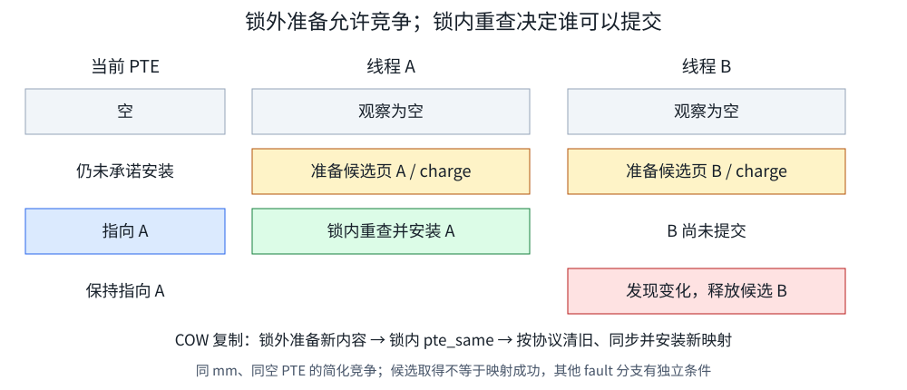

# arm64 缺页与 COW：规则检查、候选准备和页表提交

本篇基于 arm64 Linux 6.1.158，承接 [地址空间篇](../../03-address-space.md)。只选普通用户地址、基本页私有匿名映射作为主干，再说明文件、大页和 userfaultfd 的分派边界。

要理解的不是一串缺页函数，而是：**什么允许这次访问？谁准备内容？谁保证安装时观察仍然有效？**

## 1. 从 arm64 异常到公共 mm

`arch/arm64/mm/fault.c` 的 `do_page_fault` 使用 FAR 对应地址和 ESR 异常信息，形成读、写或取指的处理条件，取得并验证适用 VMA，才调用 `handle_mm_fault`。

| 层次 | 核对内容 |
| --- | --- |
| arm64 入口 | 异常类型、地址、用户 / 内核情境、是否允许处理缺页 |
| 地址空间规则 | 地址是否有适用 VMA，操作是否满足本树权限规则 |
| 公共 mm | 当前页表状态、后备内容类型、页大小与回调 |
| 安装协议 | 页表锁、原状态重查、引用 / rmap / LRU / 记账和架构同步 |

读权限判断在本树还包含 WRITE、EXEC 与 EPAN 的条件，不能替换成所有访问统一检查一个 `VM_READ` 位。内核 uaccess 异常还有异常表等约束，不是任意内核指针都能按用户缺页修复。

## 2. VMA 许可与当前 PTE 是不同层的状态

可写私有 VMA 可以对应尚未 present 的 PTE，也可以对应因 COW 被写保护的 PTE。因此一条“写入允许”的规则不能直接确定缺页的执行分支。

| 观察到的状态 | 普通路径中的下一步 |
| --- | --- |
| 无适用 VMA或访问不满足权限 | 不进入普通分配安装路径 |
| PTE 空、私有匿名映射 | `do_anonymous_page` |
| PTE 空、文件映射 | 文件 fault 回调及相应 `do_fault` 分支 |
| 非 present 但有编码条目 | 分辨 swap、迁移等，不当成全部未分配 |
| present、写保护、适用私有写入 | `do_wp_page` 决定复用或复制 |
| PMD 大页等 | 先走对应大页路径，不无条件访问下一级 PTE |

主要分派在 `mm/memory.c` 的 `handle_pte_fault` 和 `__handle_mm_fault`。

## 3. 首次匿名读和首次匿名写为什么不同？

`do_anonymous_page` 对适用只读缺页可安装共享零页；写入需要私有内容，不会把共享零页直接变成可写进程存储。

普通写缺页的过程是：

```text
准备匿名关系与页表位置
  -> 取得清零私有页
  -> 适用 memcg charge
  -> 准备 uptodate 状态与待安装 PTE
  -> 取得 PTE 锁，重查当前条目仍为空
  -> 检查地址空间稳定性及 userfaultfd
  -> 更新映射关系和统计，安装条目
```

这里“取得页”与“安装映射”不能合并成一个原子事件。分配和 charge 可能等待，其他线程可能在这段时间完成同一地址的缺页。



## 4. 两个线程同时首次写同一地址，会不会安装两张页？

按同一 `mm` 中两个线程、同一个空 PTE 的简化情形推演：

| 时刻 | 线程 A | 线程 B | 当前页表 |
| --- | --- | --- | --- |
| 初始观察 | 发现空条目 | 发现空条目 | 空 |
| 候选准备 | 取得页 A | 取得页 B | 仍可能为空 |
| 提交 | 在 PTE 锁内重查、安装 A | 尚未提交 | 指向 A |
| B 重查 | 已结束安装 | 发现不再为空，释放候选 B | 仍指向 A |

本树对应判断是 `do_anonymous_page` 中锁内的 `pte_none` 检查。不能拿早先无锁或锁外观察作为最终提交依据。

候选页 B 不等于“曾映射成功又被替换的页”，它根本没有获得本次映射身份。释放候选与清理已安装映射是不同路径。

## 5. Fork 的 COW 为什么先共享而后写保护？

对需要复制页表的普通私有匿名映射，`copy_page_range/copy_present_pte` 将父子映射连接到原内容，并执行适用写保护和引用 / rmap 更新。

```text
fork 前：父 PTE 可写 -> 内容 P
fork 后：父 PTE 写保护 -> P <- 子 PTE 写保护
子写入：决定能否复用；不能复用时准备新内容 Q
提交后：父 -> P，子可写 -> Q
```

这不是所有 VMA 都逐页复制的通用说明，文件映射与未驻留区间可能走不同优化。也不是直接把可写 PTE 复制给子进程而只靠“之后再提醒”的方式保护私有写语义。

## 6. 写保护缺页不一定复制

`do_wp_page` 先处理 userfaultfd 写保护及普通页识别，再分辨匿名内容、共享映射和其他类型。

对于匿名页，本树有 `PageAnonExclusive` 和相应 folio 锁、引用、KSM、swapcache 检查。满足复用条件时可恢复适用写许可；否则进入复制路径。

| 情况 | 不应得出的结论 |
| --- | --- |
| 页表写保护 | 不等于每次都分配新页 |
| 一个映射已解除 | 不等于所有额外引用或 pin 都结束 |
| mapcount 看起来较小 | 不能代替全部独占与引用协议 |
| 共享可写文件映射 | 不套用私有匿名 COW 的复制模型 |

因此不要只写一个“引用计数等于 1 就复用”的算法，把本树独占标记与其他分支删掉。

## 7. 真正复制时，为什么先清旧条目并失效再装新条目？

`wp_page_copy` 在锁外准备新页、复制内容及 charge，随后取得 PTE 锁，以 `pte_same(*vmf->pte, vmf->orig_pte)` 验证原观察。

若仍相同，才进入提交；若不同，必须按当前状态清理候选，不能覆盖另一个线程的新结果。

当前普通复制路径的关键顺序是：

1. 取得适用 MMU notifier 范围保护。
2. 在 PTE 锁内验证原条目。
3. 执行适用 cache 操作，清除旧 PTE 并完成相应翻译失效。
4. 建立新匿名关系，安装新条目。
5. 按源码顺序结束旧页映射关系及引用，并结束 notifier。

这些是协议主干，不代表所有架构分支都执行同一组机器指令。arm64 的实际条目与失效实现继续读 `arch/arm64/include/asm/pgtable.h`、`tlbflush.h`。

特别不能在还存在旧 PTE 的窗口提前减少旧映射关系，否则其他路径可能把旧页判断为可复用，而线程仍能通过旧翻译访问它。

## 8. 哪些锁各自管什么？

| 保护 | 作用 |
| --- | --- |
| mmap 锁 | VMA 查询及规则存活，不独自串行化所有 PTE 安装 |
| PTE / PMD 锁 | 当前条目观察和提交 |
| folio 锁及引用 | 页对象状态与准备期间存活 |
| anon_vma / rmap 协议 | 匿名映射关系及候选查找 |
| MMU notifier 与 TLB helper | 与其他翻译使用者协调、失效旧翻译 |

适用 fault 回调可释放 mmap 锁并返回 RETRY；arm64 入口需要重新取得 VMA，不能继续使用睡眠前的旧规则指针。

## 9. 阅读与边界

| 要推演 | 源码入口 |
| --- | --- |
| arm64 操作如何变成 fault flags？ | `arch/arm64/mm/fault.c`：`do_page_fault`、`__do_page_fault` |
| 如何区分页表状态？ | `mm/memory.c`：`handle_pte_fault` |
| 匿名首次安装与竞争撤销 | `do_anonymous_page` |
| fork 共享与写保护 | `copy_page_range`、`copy_present_pte` |
| COW 复用与真正复制 | `do_wp_page`、`wp_page_copy` |

本篇的教学时序未在目标机运行。文件缺页和锁释放重试继续读 [页缓存专题](../page-cache/01-cache-writeback.md)，反向关系继续读 [rmap](../reclaim/02-rmap.md)，PMD 大页继续读 [大页专题](../page-size/01-hugepages-cma.md)。
