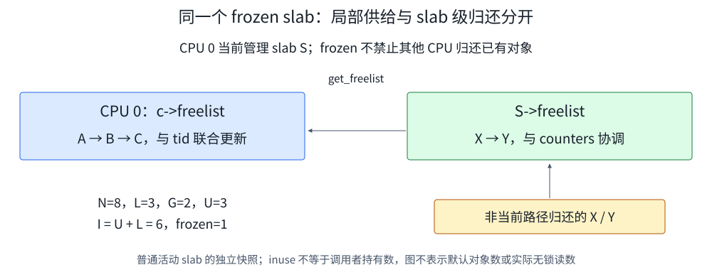

# SLUB：对象供给、冻结 slab 与跨 CPU 释放

本篇基于 arm64 Linux 6.1.158 的 **CONFIG_SLUB 实现**，未假定目标机器已经选用该配置。已知 [页分配器](../page-allocation/01-buddy.md) 提供底层页块后，进一步看 SLUB 如何把它们组织成可反复取得的对象槽位。

核心问题不是“slab 每页能装多少对象”，而是：**哪些槽位由当前 CPU 直接取得，其他 CPU 归还的对象如何汇入，何时底层 slab 才能归还？**

## 1. 三层对象，各自保存不同状态

| 对象 | 本树关键内容 | 谁在改变 |
| --- | --- | --- |
| `kmem_cache` | 类型规格、大小、标志、每 CPU 和每 node 管理对象 | cache 初始化及分配管理 |
| `kmem_cache_cpu` | `slab`、`freelist`、`tid`、适用 `partial`、local lock | 当前 CPU 分配释放及 slab 切换 |
| `struct slab` | 底层存储、`freelist`、`inuse/objects/frozen`、cache 归属 | slab 取得、远程释放和停用 |
| `kmem_cache_node` | partial 列表、数量及列表锁 | 节点级 slab 交接 |

`struct slab` 在 `mm/slab.h` 中复用页描述存储；CPU 字段在 `include/linux/slub_def.h`。不要按旧版 `struct page` 的 slab 字段布局阅读本树。



## 2. 同一个活动 slab 为什么有两条 freelist？

当前 CPU 的 `c->freelist` 提供本地直接分配的槽位。活动 slab 的 `slab->freelist` 可接受通过另一条释放路径归还的对象；两者不是重复保存同一条完整空闲链。

`frozen` 表示 slab 处于相应 CPU 管理协议中，阻止它被当作普通 node partial slab 任意取得。它不表示内容不可写，也不表示其他 CPU 不能释放已经持有的对象。

因此，`slab->inuse` 在 frozen 状态下不能简单读成“应用实际持有对象数”。源码把交给 CPU 本地 freelist 管理的槽位纳入这层计数，随后在本地链回收 / 停用时协调它们。

## 3. 一次本地分配：为什么 freelist 要和 tid 一起更新？

`slab_alloc_node` 先执行适用 pre-allocation hook，再尝试局部供给。支持相应无锁快路径且 slab、node 等条件满足时：

```text
读取当前 CPU 管理对象和 tid
读取 object = freelist 及其下一节点
用 this_cpu_cmpxchg_double：
    确认 freelist 与 tid 仍是所观察的一组
    一起替换为 next_object 与 next_tid
若验证失败，重新读取并重试
```

例子只跟踪局部对象链：

| 操作 | CPU freelist | 本次交给调用者 |
| --- | --- | --- |
| 初始 | A → B → C | 无 |
| 取得 A | B → C | A |
| 本地归还 A | A → B → C | 无 |

`tid` 不只是统计分配次数：它参与验证 CPU 和局部操作序列，避免使用失效的一组观察值。单独比较 freelist 指针不能代替该协议。

这里的原子操作并不提供对所有其他 CPU 的对象内容锁。`USE_LOCKLESS_FAST_PATH`、RT 和调试配置会改变路径，不能把这一段推广为“SLUB 永远不需要锁”。

## 4. 局部链为空，为什么不立即申请新页？

`___slab_alloc` 按状态尝试恢复供给：

1. 重新验证当前 slab 及 node / pfmemalloc 条件。
2. 在 local lock 内再次检查 CPU freelist。
3. 通过 `get_freelist` 接收当前 frozen slab 的另一条空闲链。
4. 没有适用供给时，转向 CPU / node partial 或准备新 slab。

部分步骤受配置与状态影响，不是每次都完整经过的固定调用链。

`get_freelist` 的关键交接是：原子取得 `slab->freelist`，清空它，调整 slab counters，把对象链交给 CPU 本地管理。没有可取对象时还可能解除 frozen 状态，让调用路径换 slab。

新 slab 是最末级供给之一，涉及页分配、槽位布局和元数据准备。一次对象分配慢路径并不必然意味着一次新的物理页分配。

## 5. 远程归还为何不直接写拥有者 CPU 的 freelist？

`do_slab_free` 比较被归还对象的 slab 与当前 CPU 的 `c->slab`：

- 相同且满足快路径条件：更新当前 CPU freelist 和 tid。
- 不同：进入 `__slab_free`，处理 slab 级 freelist / counters 及必要列表状态。

设 CPU 0 持有 frozen slab S，CPU 1 归还 S 中的对象 X。X 可以加入 `S->freelist`，而不是跨 CPU 直接改 CPU 0 的本地链。CPU 0 日后通过 `get_freelist` 接收这些对象。

`__slab_free` 联合更新 freelist 与 counters。若 slab 已 frozen，通常不需要这次改 node partial 列表；若由 full 变 partial、由 partial 变 empty，则需要按 CPU partial 和节点列表政策处理。

“远程释放慢路径”也不等于“每次都取得 node 列表锁”。应看状态转换是否真的改变列表成员资格。

普通 full 状态也不保证存在一个 full 链表节点。本树的 `kmem_cache_node.full` 属于调试配置，`add_full/remove_full` 还检查 `SLAB_STORE_USER`；不能把调试跟踪布局画成所有 SLUB 配置的固定集合。

## 6. 停用 slab：把两条供给重新协调起来

`deactivate_slab` 在切换活动 slab 时处理尚在 CPU freelist 中的空闲对象，把它们与 slab 级状态协调，解除相应独占管理，决定归入 partial、full 或销毁路径。

不能先丢掉 CPU 本地 freelist 再把 slab 标成 full，否则会丢失可用槽位；也不能让 node 列表中的 slab 仍被另一个 CPU 当作独占活动 slab。

对象全部空闲也不保证立即释放底层页。`min_partial`、partial 库存政策和相应 RCU 等规则可影响保留；只有满足实际销毁路径才执行底层 slab 归还。

## 7. 四种保护不能混为一谈

| 保护 | 主要解决什么 |
| --- | --- |
| local lock / CPU 事务验证 | CPU 管理字段和局部对象链的一致性 |
| slab freelist 与 counters 联合更新 | slab 级释放、冻结和计数状态 |
| node `list_lock` | partial 及相应调试跟踪集合的成员资格 |
| 调用者自己的引用、锁或 RCU 协议 | 对象发布后的内容访问和存活 |

`SLAB_TYPESAFE_BY_RCU` 不让同一地址永远代表同一对象。释放后对象槽位可能重新用于另一个实例；不能因为缓存自身的 RCU 规则就忽略身份重查和调用者引用。

## 8. 定向阅读与下一层

| 问题 | `mm/slub.c` 中的入口 |
| --- | --- |
| 局部对象怎样取得和验证？ | `slab_alloc_node` |
| 供给用完后如何交接？ | `___slab_alloc`、`get_freelist`、`acquire_slab` |
| slab 如何退出 CPU 管理？ | `deactivate_slab` |
| 本地 / 非当前 slab 的释放如何分派？ | `do_slab_free` |
| full、partial、empty 如何改变？ | `__slab_free` |

本篇解释普通供给协议，完整调试、freelist hardening、KASAN、节点回退和 cache 合并规则仍有独立条件。观察 `/proc/slabinfo` 或相关 cache 统计时，先区分对象使用、库存和底层页保留，本文没有采集运行统计。

具体创建与配对用法见 [对象缓存 API](../../api-reference.md#cache)，不是把上述内部函数当作可直接调用的通用接口。
