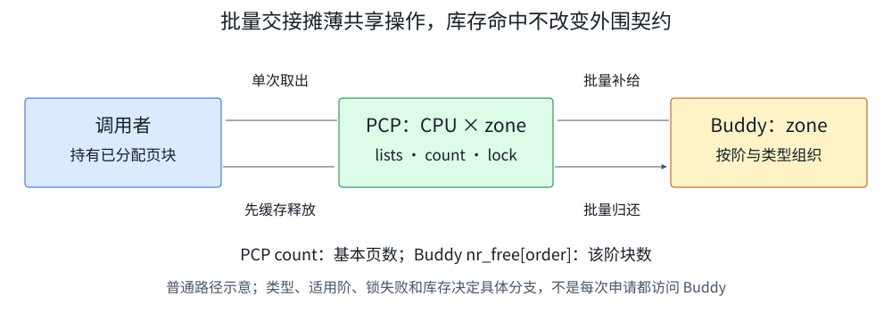

# PCP：页块缓存、批量补给与归还

[Buddy](01-buddy.md) 解释了 zone 内空闲块的组织。PCP 在它前面增加 CPU 局部供给，减少每次小规模分配都修改同一组 Buddy 状态的成本。本文基于 arm64 Linux 6.1.158，重点是**块在调用者、PCP 与 Buddy 之间如何交接**，不是重新介绍 per-CPU 的一般概念。

## 1. PCP 缓存的是什么？

每个 zone 的 `per_cpu_pageset` 指向各 CPU 的 `struct per_cpu_pages`。它缓存尚未交给调用者的页块，不是 CPU 独占的物理地址区间。

| 字段 / 对象 | 当前含义 |
| --- | --- |
| `pcp->lists` | 按适用阶和 PCP 迁移类型分组的链表 |
| `pcp->count` | 各列表覆盖的基本页总数，不是链表节点总数 |
| `pcp->batch` | 批量交接的规模参考，具体路径会按阶等因素换算 |
| `pcp->high` | 库存高水位参考，不是保证可分配的上限 |
| `pcp->free_factor` | 连续释放时影响批量归还规模的状态 |
| `pcp->lock` | 保护对应 PCP 列表及交接状态 |
| `page->pcp_list` | 缓存块首个页的链表节点 |

声明在 `include/linux/mmzone.h`，索引换算在 `mm/page_alloc.c` 的 `order_to_pindex/pindex_to_order`。PCP 页不能同时保留一个覆盖它的 Buddy 空闲块节点。



## 2. 本树不是“PCP 只缓存 order 0”

`pcp_allowed_order` 的当前规则是：

```c
/* mm/page_alloc.c：完整 helper；具体功能是否启用依配置。 */
static inline bool pcp_allowed_order(unsigned int order)
{
    if (order <= PAGE_ALLOC_COSTLY_ORDER)
        return true;
#ifdef CONFIG_TRANSPARENT_HUGEPAGE
    if (order == pageblock_order)
        return true;
#endif
    return false;
}
```

本树 `PAGE_ALLOC_COSTLY_ORDER` 为 3。不能把旧文章的单页缓存布局直接套用，也不能认为允许某阶就一定通过 PCP 成功：类型、CMA 许可、锁获取以及库存仍影响选择。

PCP 跟踪普通的 UNMOVABLE、MOVABLE、RECLAIMABLE 类型。归还时 CMA / HIGHATOMIC 等类型有相应转换和恢复规则；ISOLATE 不能当作普通 PCP 供给。列表分类与原 pageblock 属性不是同一个状态。

## 3. 一次分配的两个分支

### 3.1 列表有块：不必修改 Buddy 空闲链表

`rmqueue_pcplist` 获取当前 zone 的 PCP 保护，定位相应列表，进入 `__rmqueue_pcplist`：

```text
取得受保护的 PCP
  -> 找到 order / migratetype 对应列表
  -> 从表头摘下一个块
  -> count 减去 2^order
  -> 检查块；若不符合要求则继续
  -> 把候选块交给分配外围
```

命中路径省去了这一次 Buddy 选块和拆分，但没有省去外围的水位判断、页初始化和适用记账。PCP 命中也不改变调用者所传 GFP 的合法上下文。

### 3.2 列表空：一次持 zone 锁取得多个块

`__rmqueue_pcplist` 调用 `rmqueue_bulk`。后者在一次 zone 锁保护内重复执行 `__rmqueue`，把取得的块接到 PCP 列表，再由本次请求取走一个。

用 **order 0、实际补入四块、其他列表为空** 的教学情形推演：

| 时刻 | PCP count | Buddy 的变化 | 调用者获得 |
| --- | --- | --- | --- |
| 补给前 | 0 | 未变化 | 无 |
| 四块交入 PCP | 4 | 四页退出 Buddy，可能涉及拆分 | 无 |
| 本次取走一个 | 3 | 不再取新块 | 一个候选页 |

四不是内核默认批量保证。源码对高阶请求会换算 `batch`，也可能只补入部分数量；页检查失败还会使“从 Buddy 移出量”与“实际加入 PCP 量”不同。

这正是 `rmqueue_bulk` 分别保留循环次数与 `allocated` 的原因：不能用成功加入列表的数量替代所有资源状态变更的记账。

## 4. 一次释放：先缓存，不代表已经可以合并

在页引用和释放准备满足条件后，适用阶进入 `free_unref_page`。取得 PCP 保护后，`free_unref_page_commit` 将块加入列表，并增加 `2^order` 个基本页的库存。

因此，一个物理上紧邻 Buddy 空闲块的页，如果仍在 PCP 中，不会仅因为邻居空闲就被 Buddy 的伙伴查询合并。

到达本次有效高水位或触发相应 drain 时，`free_pcppages_bulk` 才进行交接：

```text
在 PCP 保护下取得 zone 锁
  -> 从 PCP 列表移出块，减少基本页 count
  -> 检查 / 恢复适用迁移类型
  -> __free_one_page：按 Buddy 协议合并、入队
  -> 释放 zone 锁
```

假设本次从八页库存归还四个单页块，PCP count 变为四；Buddy 可能得到四个单页块，也可能与伙伴合并成较大块。归还页数相同，不保证 `nr_free[0]` 增加四。

`nr_pcp_high/nr_pcp_free` 还考虑回收状态、高阶释放与连续释放趋势。High 和 batch 不是独立于工作负载的固定延迟承诺。

## 5. per-CPU 不等于无需同步

本树用 `pcp_spin_trylock` 等 helper 处理 CPU 定位和列表保护。分配路径尝试锁失败可以退到直接 Buddy；释放路径也有直接归还分支。

CPU 迁移、中断重入和其他 CPU 发起 drain 都必须纳入协议。`free_pcppages_bulk` 的 zone 锁只保护 Buddy 侧，不取代 PCP 锁；不能只关本地中断就声称所有配置下都保护了整个交接。

RT 和非 RT 的辅助操作存在条件分支，本轮未指定 `.config`，不推定实际抢占行为。应按 `mm/page_alloc.c` 顶部的 `pcpu_*` helper 阅读，不从 per-CPU 字样猜测锁语义。

## 6. 阅读与定位

| 问题 | 源码入口 |
| --- | --- |
| 哪些阶可用？ | `pcp_allowed_order`、`order_to_pindex` |
| 命中和补给分别改变什么？ | `rmqueue_pcplist`、`__rmqueue_pcplist`、`rmqueue_bulk` |
| 谁决定这次归还多少？ | `nr_pcp_high`、`nr_pcp_free`、`free_unref_page_commit` |
| 如何回到 Buddy？ | `free_pcppages_bulk`、`__free_one_page` |
| 如何集中归还其他 CPU 库存？ | `drain_pages_zone`、`drain_all_pages` |

这些符号都在 `mm/page_alloc.c`。可结合 `mm_page_pcpu_drain` 和 Buddy 选块事件观察交接，但事件的阶、库存量和块数不能混用，本文未采集运行数据。

读完应能解释：一次单页申请为什么可能从 Buddy 取得多个页；一次释放为什么没有立即出现在 Buddy 合并结果中；库存命中为什么仍不能保证整次分配成功。后续连接 [分配慢路径](03-slowpath.md)，接口用法保持在 [API 样章](../../api-reference.md#pages)。
