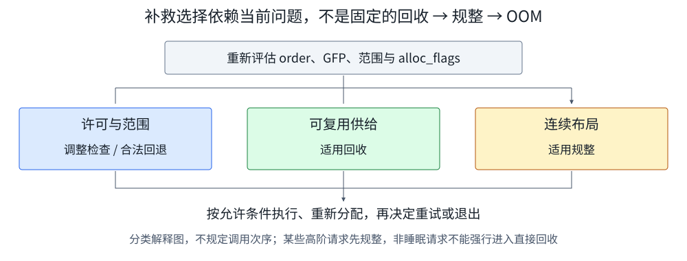

# 页分配慢路径：许可、供给与布局的补救

已有 [Buddy](01-buddy.md) 和 [PCP](02-pcp.md) 解释怎样取得现有供给。本篇基于 arm64 Linux 6.1.158，追踪**现有供给没有满足请求以后，分配器怎样决定下一步**。

慢路径不是“回收、规整、OOM”三个函数必定依次调用。它是受 GFP、阶、资源范围和进展状态约束的决策过程。

## 1. 输入不只是大小

`__alloc_pages` 准备 `struct alloc_context`，第一次 `get_page_from_freelist` 失败后才进入 `__alloc_pages_slowpath`。需要同时追踪：

| 状态 | 决定什么 |
| --- | --- |
| `order` | 请求形态、是否属于 costly allocation、规整目标 |
| `gfp_mask` | 是否允许直接回收、I/O、文件系统工作及重试政策 |
| `ac->zonelist/nodemask/highest_zoneidx` | 允许和优选的资源范围 |
| `alloc_flags` | 本次水位、保留供给及回退等内部许可 |
| 回收进展 | 是否释放了可讨论的供给，不等于已经满足连续性 |
| 规整结果 | 是跳过、推迟、失败还是可能形成目标块 |
| cpuset / zonelist 状态 | 睡眠前后是否需要重新建立范围 |

GFP 是调用者契约；`alloc_flags` 是实现中的派生状态，不能把内部标志当作公开 API 参数。



## 2. 先重新评估许可，再重试现有供给

慢路径开始重新计算 `gfp_to_alloc_flags`，重建优选 zone，按允许条件唤醒后台回收，然后再调用 `get_page_from_freelist`。

这次可能成功，因为第一次使用了更保守的标志；也可能因为其他线程已归还资源。进入慢路径，不意味着必须先制造更多空闲页。

`wake_all_kswapds` 是通知，不是等待后台完成。当前申请仍可能在后续检查中失败。

## 3. 某些高阶申请会先尝试规整

本树的关键条件同时涉及：

```text
允许直接回收
且允许规整
且（costly 阶，或某些非 MOVABLE 的高阶申请）
且不属于相应可动用 pfmemalloc 供给的情境
```

满足时会先进入 `__alloc_pages_direct_compact`。原因在于：基本页可能足够，只是排列不合适；先大量回收不一定解决布局问题。

规整的核心是迁移内容、重新组织空闲位置，不是将本来存在的 RAM 扩容。它需要合适的迁移目标、可移动内容和保护协议；固定或不可迁移的页可能阻止目标范围形成。

源码位置：`mm/page_alloc.c` 的 `__alloc_pages_slowpath` 前半段、`__alloc_pages_direct_compact`；具体隔离和扫描在 `mm/compaction.c`，内容迁移在 `mm/migrate.c`。

## 4. 直接回收与规整之间为什么反复重新分配？

一条常见可睡眠路径可以按下面的**删节决策**阅读：

```text
调整本次允许范围与供给标志
尝试分配，成功则结束

若不允许直接回收，或处于不允许递归回收的上下文：
    按退出规则处理

直接回收，并尝试分配
仍失败则尝试规整，并尝试分配

根据重试策略、回收进展、规整结果决定重试或退出
必要时重建发生变化的 cpuset / zonelist
仅在适用条件下进入 OOM 决策
```

不是所有重试都按这个简化模型走；早期规整、保留供给和 NOFAIL 有独立条件。

回收和规整返回后再分配非常必要：补救过程可能睡眠，释放出的资源可能被别人使用；“这轮扫描回收了四页”不是给当前申请预留了一个四页块。

## 5. 三种失败，用不同方式理解

| 情形 | 补救重点 | 为什么仍可能失败 |
| --- | --- | --- |
| 允许范围内供给太少 | 回收可再取得的内容 | 脏页、写回、引用、固定、资源组保护等阻碍回收 |
| 空闲基本页足够，但没有目标高阶块 | 规整改变布局 | 无迁移目标、内容不可迁移、范围或扫描政策限制 |
| 其他 node / zone 有块，本次不能使用 | 核对范围与许可 | 用户策略、cpuset、设备约束或保留供给不能随意绕过 |

`should_reclaim_retry` 与 `should_compact_retry` 用不同证据决定继续。不能用“总空闲量增加”替代对规整结果的判断，也不能用规整失败证明全机容量已耗尽。

## 6. 重试政策不是添加越多越可靠

`__GFP_NORETRY` 会限制继续尝试，但此前允许的步骤仍可能睡眠；`__GFP_RETRY_MAYFAIL` 允许更积极尝试，仍需处理失败。

本树 costly 请求的重试还依赖规整是否可用等条件。`__GFP_NOFAIL` 不能用来修复任意高阶需求，`rmqueue` 对阶大于 1 的此类请求明确警告。

不能把业务数据结构在高阶分配中无限等待当作可靠设计。可选方向是降低连续性需求、预先准备适用资源、延后工作，或明确失败回滚。

## 7. OOM 为什么不等于分配 NULL？

`__alloc_pages_may_oom` 有自己的锁、重查和限制。进入 helper 也不等于一定选中并杀死进程；某些高阶或特定上下文可以直接退出相关决策。

即使释放了进程内存，也不保证解除固定、生成目标高阶块或扩大一个明确不允许跨越的资源范围。OOM 讨论的是取得进展，不是替每一种连续性或设备需求兜底。

## 8. 如何读源码和观察问题？

| 需要解释 | 对应实现 |
| --- | --- |
| 第一次失败后有哪些状态重建？ | `__alloc_pages_slowpath` |
| 回收后怎样再试？ | `__alloc_pages_direct_reclaim`、`get_page_from_freelist` |
| 为什么这次规整被跳过或继续？ | `__alloc_pages_direct_compact`、`should_compact_retry` |
| 何时停止回收重试？ | `should_reclaim_retry` |
| 何时进入适用 OOM 决策？ | `__alloc_pages_may_oom` |

以上位于 `mm/page_alloc.c`。回收实现另读 [回收专题](../reclaim/01-reclaim.md)；连续区域的迁移与隔离另读 [大页和 CMA](../page-size/01-hugepages-cma.md)。

观察时先记录请求阶、GFP、允许范围和具体失败点，再对应回收 / 规整事件和 PSI；只列一个空闲字节数会丢失关键信息。本篇未启用追踪或执行压力实验，不提供未经测量的延迟保证。
