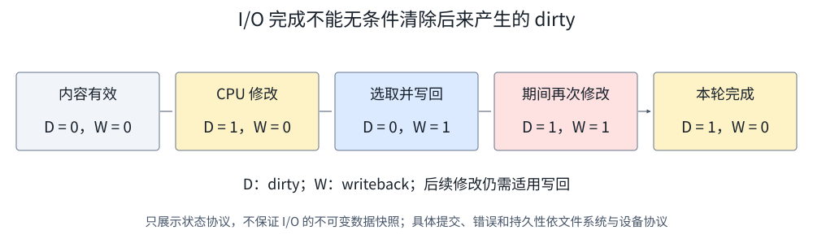

# 页缓存与写回：索引、内容有效性和再次脏化

本篇基于 arm64 Linux 6.1.158，选普通文件页缓存为主线；具体文件系统仍通过 `address_space_operations` 实现数据读入、脏化和写回。DAX、直接 I/O 和 swap 后端不套用同一完整路径。

## 1. 同一文件数据由哪两个索引联系？

`address_space.i_pages` 用文件页索引定位缓存 folio；`address_space.i_mmap` 组织可能映射该文件范围的 VMA。前者找数据，后者服务反向关系，不是一棵树同时完成两种查找。

| 对象 / 状态 | 责任 |
| --- | --- |
| `address_space` | 缓存索引、文件回调、映射区间与相关保护 |
| `folio` | 内容、锁、引用及 uptodate / dirty / writeback |
| `i_pages` 的 marks | 标记需要写回等索引状态，避免每次全量扫描 |
| `inode` 与 `bdi_writeback` | 文件级待写集合、写回管理和统计 |
| 文件系统回调 | 内容读入、具体块映射、脏化和 I/O 提交 |

声明见 `include/linux/fs.h`。Buffered read、buffered write 和普通文件 mmap 可使用同一缓存对象，而不是为每个进程各复制一套文件缓存。

## 2. 进入索引，不等于内容已经有效

`filemap_add_folio` 将新对象加入 `i_pages`。对象可先进入索引，再通过相应读入和完成协议变成 uptodate；其他查找者需要等待或验证，不能仅因“找到 folio”就读未完成内容。

这正是引用、folio 锁与 uptodate 各自不同的原因：

- 引用保持对象存活。
- 锁协调读入、截断和关键状态改变。
- Uptodate 表示本路径需要的内容已经有效；不是一种资源所有权。

本篇以普通 filemap fault 为例；某些文件系统的 buffered read 还处理部分有效范围，不用它们覆盖所有 folio 的统一规则。

## 3. 文件缺页：查到缓存后还要检查哪些状态？

`mm/filemap.c` 的 `filemap_fault` 主干可按三个阶段阅读：

```text
检查文件大小和所需页索引
  -> 查找或创建缓存 folio，处理适用预读
  -> 获取 folio 锁；等待可能需要释放 mmap 锁
  -> 重查 folio 仍属于原 mapping，内容 uptodate
  -> 重查文件大小与索引
  -> 返回锁定数据页给公共 fault 安装路径
```

它返回 `VM_FAULT_LOCKED` 时，表示上层仍需按协议完成安装和解锁，而不是 helper 已完成全部用户 PTE 更新。

若等待中丢掉 mmap 锁，则返回 RETRY 使上层重新取得 VMA；不能把“文件对象仍存活”替代“VMA 没有变化”。

## 4. 截断竞争：一个有引用的 folio 为什么仍不能安装？

考虑 fault 已取得缓存对象引用，另一线程截断文件：

| 时刻 | 缺页线程 | 截断线程 |
| --- | --- | --- |
| 查找 | 取得 index 对应 folio 引用 | 尚未完成截断 |
| 等待 folio 锁 | 引用保证对象还在 | 可改变文件大小及缓存成员资格 |
| 重新取得锁 | 检查 mapping 和 i_size | 已退出相应临界区 |
| 继续或重试 | 原成员资格 / 大小失效则不按旧观察安装 | 不靠调用者旧引用恢复旧文件大小 |

对象存在、仍属于索引、仍在有效文件范围，是三个不同问题。`filemap_fault` 对 `folio->mapping` 和 `i_size` 的重查体现了这一点。

## 5. 脏化不是只给 folio 写一个位

`folio_mark_dirty` 在适用 mapping 下调用 `mapping->a_ops->dirty_folio`。具体文件系统可能需要设置缓存索引标记、更新 inode 待写状态、块或缓冲元数据与统计。

调用者不能手动设置一个 dirty 位就认为这些副作用全部完成。反过来，索引中有 dirty mark 也不是这次 I/O 已完成的证明。

共享文件 mmap 的写入与 PTE 脏状态还要通过 `folio_mkclean` 等路径协调到文件缓存。私有文件映射的 COW 新页则属于匿名内容，不把它当作原文件自动写回。

## 6. Dirty 与 writeback 为什么必须分开？



只跟踪一个缓存 folio 的主状态，省略具体文件系统的提交步骤：

| 时刻 | Dirty | Writeback | 含义 |
| --- | --- | --- | --- |
| 内容有效且未修改 | 0 | 0 | 可讨论为干净缓存 |
| CPU 修改内容 | 1 | 0 | 需要适用写回 |
| 本轮选取并开始写回 | 0 | 1 | 本轮在进行，不代表内容不会再被修改 |
| 写回期间再次修改 | 1 | 1 | 同时存在进行中的写回与新的脏状态 |
| 本轮完成 | 1 | 0 | 新脏状态不能被本轮完成无条件抹掉 |

这是状态协议示意，不规定文件系统一定对内存内容制作不可变快照。具体数据版本、锁、块 I/O 和一致性仍由文件系统保证。

`folio_clear_dirty_for_io`、`__folio_start_writeback` 和 `folio_end_writeback` 的作用不能互换。清除 dirty 的准备过程与开始 writeback 需要正确协调，I/O 完成则结束本轮 writeback 并唤醒相应等待者。

## 7. 为什么清脏之前还要看 PTE？

本树 `folio_clear_dirty_for_io` 要求 folio 锁。在适用可写回 mapping 下，它调用 `folio_mkclean` 处理用户映射中的脏状态，配合重新脏化副作用，再协调清脏和统计。

这是为了避免 PTE、folio、索引和文件系统各自清状态时遗漏修改。单独读一次 dirty 位，再释放锁并直接提交，不能代表该同步协议。

`__folio_start_writeback/__folio_end_writeback` 还维护 `i_pages` 的 WRITEBACK 标记与对应计数。它们不是普通字段赋值包装。

## 8. 谁挑选要写的文件，谁提交实际 I/O？

`fs/fs-writeback.c` 管理 inode / writeback 工作；`__writeback_single_inode` 协调本轮文件写回。`mm/page-writeback.c` 提供通用扫描、标记和节流基础；具体 `writepages` 等回调执行文件系统相关工作。

因此“文件缓存是 mm 的一部分”不等于文件系统块分配、日志或持久性都由 mm 统一完成。

写回完成也不等于完整 `fsync` 持久性要求已满足。还可能涉及元数据、日志、错误报告和设备完成协议，不能只检查一个 writeback 位就宣称数据已经可靠落盘。

## 9. 写入者为什么也会被节流？

如果脏化速度长期高于后端处理能力，继续积累缓存会挤压可回收供给。`balance_dirty_pages_ratelimited` 以通用写回状态为基础，在适用路径约束写入速度。

这不是每次 write 都同步刷整张页，也不是只看全机空闲内存做决定。写回域、后端能力和相关阈值共同影响策略，本文不提供未经测量的通用调参值。

## 10. 阅读和衔接

| 问题 | 当前实现 |
| --- | --- |
| 索引插入与查找 | `mm/filemap.c`：`filemap_add_folio`、`filemap_get_pages` |
| 文件缺页与截断重查 | `filemap_fault` |
| 脏化副作用和清脏 | `mm/page-writeback.c`：`folio_mark_dirty`、`folio_clear_dirty_for_io` |
| 写回起止与再次脏化 | `__folio_start_writeback`、`__folio_end_writeback`；`mm/filemap.c`：`folio_end_writeback` |
| inode 工作与实际回调 | `fs/fs-writeback.c`：`__writeback_single_inode` |
| 写入者节流 | `balance_dirty_pages_ratelimited` |

观察 dirty / writeback、写回事件与 I/O 时，先对应状态和计量单位；本篇没有采集数据。缓存如何被安全移出继续读 [回收](../reclaim/01-reclaim.md)，候选用户映射如何定位继续读 [rmap](../reclaim/02-rmap.md)。
