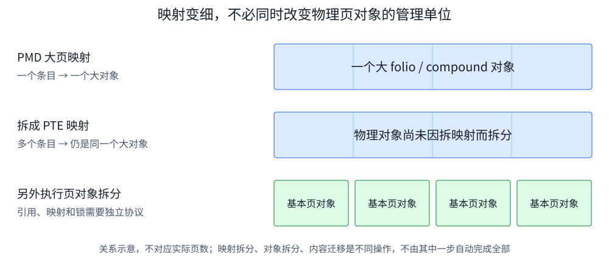
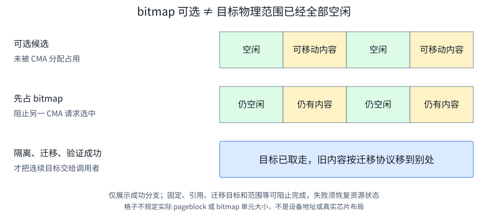

# 大页与连续区域：THP、HugeTLB 和 CMA 的不同协议

本篇基于 arm64 Linux 6.1.158，承接 [页粒度与约束概览](../../05-placement-and-limits.md)。三者可能需要连续物理资源，但解决的问题和生命周期不同：**THP 改善适用映射，HugeTLB 提供显式大页资源模型，CMA 为指定连续区域整理供给。**

## 1. 先分开对象粒度、映射粒度和区域政策

| 维度 | 要回答什么 |
| --- | --- |
| 物理页对象 | 是一个 compound / 大 folio，还是独立基本页？ |
| 页表映射 | 是 PMD 大页条目，还是多个 PTE？ |
| 资源政策 | 普通动态供给、HugeTLB 池，还是 CMA 连续区域？ |

一个大物理对象可以由多个 PTE 映射。把 PMD 映射拆成 PTE，不必同时拆分这个物理对象；物理对象拆分另有引用和映射协议。



图用少量格表示关系，不是实际 PMD 下的基本页数。arm64 的页大小影响 `HPAGE_PMD_SIZE/HPAGE_PMD_ORDER`，本篇不把所有配置的大页固定成 2 MiB。

## 2. THP 首次缺页怎样尝试大页？

在适用 PMD 匿名缺页中，`do_huge_pmd_anonymous_page` 先检查 VMA 和范围是否适合，再按当前策略准备大页或适用巨大零页。

普通写入情形的主干：

```text
检查目标 PMD 范围及 VMA 适用性
  -> 选择 THP 的 GFP 策略
  -> 准备 HPAGE_PMD_ORDER 的 folio 与适用 charge
  -> 在 PMD 锁内重新核对当前映射状态
  -> 按协议安装大页映射
```

本树在不适合或某些供给失败时返回 `VM_FAULT_FALLBACK`，使上层尝试普通页路径。页表资源或特定关系准备失败也可能是 OOM 等结果，不能把所有失败都压成同一种回退。

THP 不是预先为所有可用 VMA 分配一套大页。`madvise` 等策略也不等于成功形成大页的承诺。

## 3. Khugepaged 合并为什么必须重新检查 VMA？

`collapse_huge_page` 处理已有基本页映射，准备大页所需工作可能耗时，因此会释放 mmap 读锁。回来后必须重查 VMA，取得写锁后还要核对 PMD 和相关页。

```text
观察适用的小页范围
  -> 放开部分保护，分配 / charge 大页候选
  -> 重新取得地址空间保护，验证 VMA 和 PMD
  -> 协调 anon_vma、页锁、页表锁和 MMU notifier
  -> 复制 / 汇入内容，替换成大页映射
  -> 按协议结束旧资源
```

若 VMA 已被解除或属性已变，先前扫描结果不能用来强行合并。Khugepaged 不是在系统后台无锁地把任意相邻页拼起来。

实现见 `mm/khugepaged.c` 的 `collapse_huge_page` 及其检查 helper。

## 4. 分开两种拆分，才不会误读引用

`__split_huge_pmd` 处理大页映射到 PTE 关系；`split_huge_page_to_list` 处理页对象拆分。两者都可能涉及同步，但改变的管理事实不同。

| 变化 | 仍需保持 |
| --- | --- |
| 一个 PMD 大页变成多个 PTE | 相应内容与页对象存活、映射引用和翻译失效 |
| 大物理页对象分为基本页对象 | 引用重新组织、映射关系和适用锁协议 |
| 内容迁移到另一物理位置 | 内容身份、使用关系和后备保证 |

大页不适合当前操作时，不一定立刻复制所有内容；有的操作只需改变映射形态。被固定或有额外引用时，对象拆分和迁移可能受限制。

## 5. HugeTLB：池中的空闲量与预留量不是同一计数

`hstate` 组织适用页大小的池与计数，例如总量、空闲大页、预留大页和 surplus 相关状态。Reservation 为相应后续实例化记录资源要求，不表示用户 PTE 已经安装。

只作账本示意：某池有四张空闲大页，其中三张已计入适用预留。它不是“有四张都能被不持预留的新请求自由消费”；也不是已经有三个进程各自映射了一张页。

实际分配还受节点、subpool、HugeTLB cgroup 和预留类型约束，不能仅用一个全局空闲数判断成功。

`hugetlb_fault` 用文件 mapping / 大页索引对应的哈希 mutex 协调实例化竞争，还取得 HugeTLB VMA 保护与相应页表锁。它不是普通匿名 `do_anonymous_page` 换一个更大 order。

从池中取得、消耗预留、处理 COW 和归还池都有专用路径，不使用普通 THP 回退策略代替。实现位于 `mm/hugetlb.c`，对象见 `include/linux/hugetlb.h`。

## 6. CMA：bitmap 空位为什么不证明目标范围已经空闲？

CMA 的 bitmap 表示相应范围是否已经被 CMA 分配占用，不是每一张基本页在 Buddy 中的实时空闲位图。

激活后的适用 CMA 区域允许某些普通可移动内容借用。Bitmap 中找到候选只表明可以尝试该范围；范围内仍可能有需要迁移的内容。



`cma_alloc` 的主干是：

1. 在 CMA 锁内找到满足数量和对齐的 bitmap 候选，并先占位。
2. 放开 bitmap 锁，进入 `alloc_contig_range` 等可能等待的工作。
3. 成功则交出目标连续页；失败则撤销 bitmap 占位。
4. 对适用 EBUSY 结果尝试其他候选，不保证任意候选最终成功。

先占位防止另一 CMA 请求同时选中同一区域，不意味着页已经可交给设备；不能拿着 spinlock 等待整个迁移过程。

失败回滚恢复的是占位、隔离和资源管理状态，不保证已经迁移的内容全部搬回原 PFN；逻辑内容存活与物理布局回到旧样子不是同一要求。

## 7. Alloc_contig_range 怎样取得“指定位置”的连续页？

与普通 Buddy“找任意适用块”不同，它需要完成指定目标范围：

```text
按协议隔离相关 pageblock，防止新的普通分配进入
  -> drain 适用 PCP 库存
  -> 迁移目标范围内可移动内容
  -> 验证范围确实已隔离且可取得
  -> 从空闲组织中取走目标页
  -> 归还扩大处理范围中的非目标部分，恢复区域类型
```

这是生命周期解释，不省略真实错误退出中的恢复要求。范围不在同一适用 zone、遇到固定或不可迁移内容、迁移目标不足，都可能阻止完成。

迁移成功通常改变内容所在 PFN，不改变该内容在逻辑对象中的身份。它需要 rmap、迁移条目、引用和文件系统等协议，不是复制字节后立即释放旧页。

## 8. 为什么 CMA 不替代 DMA API？

连续 CPU 物理范围只是资源形态之一。设备地址、IOMMU、缓存一致性和完成仍由 DMA 协议处理；不能直接把 `page_address` 或 PFN 作为设备地址。

具体驱动通常沿适用 DMA 分配接口使用平台提供的后备，不自行把任意 CMA API 当作所有设备的通用分配器。使用契约见 [DMA 参考](../../api-reference.md#dma)。

## 9. 当前阅读边界

| 想解释 | 源码 |
| --- | --- |
| THP fault、回退和映射拆分 | `mm/huge_memory.c` |
| 已有小页如何合并 | `mm/khugepaged.c` |
| 池、预留和专用 fault | `mm/hugetlb.c` |
| bitmap 占位和失败恢复 | `mm/cma.c`：`cma_alloc`、`cma_release` |
| 指定范围隔离与取得 | `mm/page_alloc.c`：`alloc_contig_range` |
| 内容迁移 | `mm/migrate.c`：`migrate_pages` |

本篇有完整主干与竞争 / 回滚边界，但没有穷举大页 COW、所有迁移模式和 CMA 隔离算法。功能启用依目标配置；没有执行策略修改、连续分配或大页实验。资源范围与 charge 继续读 [资源约束专题](../resource-control/01-numa-memcg.md)。
