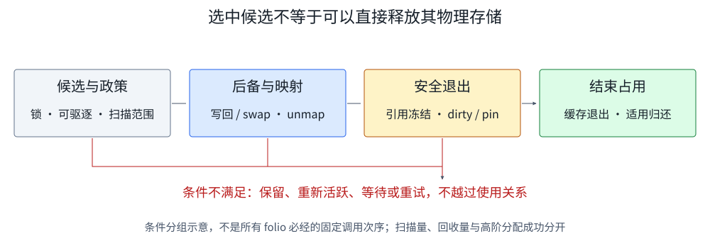

# 回收：候选排序、解除使用关系与安全复用

本篇基于 arm64 Linux 6.1.158。已有 [回收概览](../../04-reclaim-rmap.md) 解释职责，现在继续追踪：**一个被选中扫描的 folio，要跨过哪些条件才真正结束资源占用？**

## 1. 排序与销毁是两类问题

传统 LRU 和配置相关的 MGLRU 决定优先扫描哪些候选。`shrink_folio_list` 等执行路径则判断这些对象是否能安全退出。

| 层次 | 主要状态 |
| --- | --- |
| 候选组织 | node / memcg 的 lruvec、匿名 / 文件分类、活跃度或 generation |
| 本次回收政策 | `scan_control` 的目标、范围、可否 unmap / swap、优先级等 |
| 对象安全性 | folio 锁、dirty / writeback、映射、引用、pin、文件系统私有状态 |
| 完成处理 | 结束缓存成员资格及记账，最终归还底层存储 |

被选入扫描列表，不表示引用已经结束；离开用户页表，也不表示已经退出文件缓存。



## 2. 传统 LRU 与 MGLRU 分别保存什么？

传统模型在 lruvec 中区分匿名 / 文件、active / inactive 及不可驱逐对象，并通过访问证据调整候选。Active 不是进程正在运行，inactive 也不是保证可以立即丢弃。

MGLRU 用 generation 序列表示候选年龄，`max_seq` 与匿名 / 文件相关的 `min_seq` 表达窗口。数组槽位循环复用，序列不是简单等同于墙钟秒数。

它们有不同的扫描和访问收集路径，本轮不推定 `.config` 或运行时启用状态。讲清候选年龄并不能替代下面的引用、脏状态和翻译安全检查。

## 3. 进入执行列表后，先取得什么？

`shrink_folio_list` 逐个处理已隔离的候选，尝试 folio 锁，按 `folio_nr_pages` 更新基本页扫描量，检查对象是否 evictable 和本次是否允许解除映射。

锁没取得时可以保留对象；不可驱逐或受到相应保护时不进入普通销毁。不把“扫描了一个 folio”与“扫描了一个基本页”当成同一计量。

引用证据和回收目标仍可能使对象重新活跃或留待后续。它不是清空一个链表就把全部内容交给 Buddy。

## 4. 文件与匿名内容需要不同的后备保证

| 候选 | 安全复用前需要解决 |
| --- | --- |
| 干净文件缓存 | 当前文件后备可再取得，退出真实映射、缓存和其他引用 |
| 脏文件缓存 | 协调文件系统写回及状态，不直接丢弃修改 |
| 普通匿名内容 | 在适用 swap 模型下建立后备，或采用合法的其他处理 |
| writeback 中的对象 | 按执行上下文等待、标记或跳过，不能重复或提前释放 |
| 被 pin / 其他引用保持的对象 | 先结束适用使用者，不靠 unmap 消除它们 |

无 swap 时不把任意有用匿名内容“当作文件页”直接回收；lazyfree、shmem 等有自身条件，不能从上述普通匿名模型推出全称结论。

大 folio 的 swap 或回收还可能涉及拆分与回退，不把一次基本页示例直接放大成全部大页行为。

## 5. Unmap 之后为什么还继续检查？

本树执行 `try_to_unmap` 后重新检查 `folio_mapped`。仍被映射时会按实际路径保留或重新活跃，不能假定 helper 一次遍历一定成功。

即使用户映射已经消失，还要看 `folio_maybe_dma_pinned`、dirty、文件系统私有状态、缓存成员资格和引用。CPU 映射是使用关系之一，不是所有使用者的总开关。

匿名 swap 路径会协调页表中的后备编码，真实恢复流程在 `do_swap_page`。迁移条目与 swap 条目也不是同一含义。

## 6. 安全移出缓存：为什么先冻结引用，再检查 dirty？

`__remove_mapping` 在 folio 锁和相应缓存索引保护下处理最后的成员资格。当前普通检查使用预期引用数量 `1 + folio_nr_pages(folio)` 尝试冻结引用，再核对 dirty。

该数字只解释此条缓存退出路径，不能当作所有页来源的通用“可释放引用数”。

假如把次序倒过来，会出现源码注释指出的竞争：

```text
回收者先看到 dirty = 0
另一个合法引用者修改内容，设置 dirty，结束自己的引用
回收者随后看到引用满足退出条件
如果不再次协调 dirty，就可能丢弃刚产生的修改
```

本树以引用冻结与随后的 dirty 检查避免把这两次观察拼成一个并不存在的安全状态。冻结失败或仍脏时按协议恢复并退出，不能手动把 refcount 置零。

## 7. 退出索引后为何还可能保留 shadow？

适用工作集路径可在缓存索引中保留 shadow entry，记录此前驱逐的信息，以便后续 refault 判断重新加载代价和候选政策。

Shadow 不继续占用原内容页，也不意味着下一次返回同一个 PFN。它追踪缓存对象 / 索引历史；引用和对象状态由新加载的 folio 重新建立。

传统路径和 MGLRU 的工作集处理有条件差异，不把一个固定 refault 算法当成所有运行配置的相同行为。

## 8. 扫描、回收、腾出目标块是三个结果

| 指标或结果 | 能说明 | 不能说明 |
| --- | --- | --- |
| 扫描量 | 检查了多少基本页对应的候选 | 全部成功回收 |
| 回收量 | 本路径报告了多少释放 / 适用回收进展 | 为本次申请独占保留同量供给 |
| 目标阶分配成功 | 当前满足相应资源与布局条件 | 以后同阶都能成功 |

有的路径还涉及 demotion 等处理，不能仅据一个进展计数认定内容已从整个系统物理内存消失。对统计必须核对执行路径和作用域。

## 9. 源码路线与观测

| 需要解释 | 源码 |
| --- | --- |
| 候选排序和执行列表 | `mm/vmscan.c`：传统 LRU 与 MGLRU 分支 |
| 活跃证据与保留决策 | `folio_check_references`、`shrink_folio_list` |
| 解除用户映射 | `mm/rmap.c`：`try_to_unmap` |
| 缓存退出与引用冻结 | `mm/vmscan.c`：`__remove_mapping` |
| 驱逐和重访历史 | `mm/workingset.c`：`workingset_eviction`、`workingset_refault` |

观察扫描 / 回收比、dirty / writeback、refault 和 PSI 时应保持相同 node / memcg / 时间范围，不能把压力值解释成占用率。本篇未运行观测或压力测试。

详细解除映射继续读 [rmap](02-rmap.md)；分配者如何利用回收进展继续读 [慢路径](../page-allocation/03-slowpath.md)。完整 MGLRU aging / eviction、swap 后端和文件系统回收细节仍可继续下钻。
