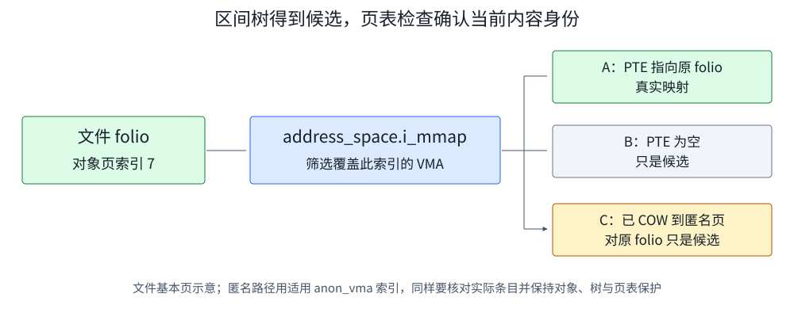

# Rmap：对象索引、候选 VMA 与真实页表映射

本篇基于 arm64 Linux 6.1.158，承接 [回收篇](../../04-reclaim-rmap.md)。重点是**从已知 folio 找到它的实际用户映射，并在同步协议中检查或修改这些关系**。

## 1. Rmap 不是每页保存一个“所有 PTE 指针数组”

本树采用对象式索引，先根据内容归属缩小可能的 VMA 集合，再走页表验证：

| 内容类型 | 候选索引 | 最后要确认 |
| --- | --- | --- |
| 文件 folio | `address_space.i_mmap` 的 VMA 区间树 | 此 VMA 的目标条目是否仍映射当前页 |
| 普通匿名 folio | 适用 `anon_vma` 的 `anon_vma_chain` 区间树 | 此地址是否仍有当前页的映射 |

区间索引记录“可能覆盖这个对象位置”，不是已经确认当前 PFN 的映射清单。Folio 的归属、位置与引用提供查询前提，不允许对任意页强行当作匿名 rmap 对象。



## 2. 文件页例子：三个候选，可能只有一个真实映射

假设某文件基本页索引为 7，三个普通线性 VMA 的文件区间都覆盖该索引：

| VMA | 当前实际情况 | rmap 验证结果 |
| --- | --- | --- |
| A | 已缺页，PTE 指向该文件 folio | 真实映射 |
| B | 尚未访问该位置，PTE 为空 | 只是候选 |
| C | 私有写后 PTE 指向新的匿名页 | 对原文件 folio 不是真实映射 |

文件区间关系可以仍然存在，而 COW 后内容身份已经改变。不能遍历 `i_mmap` 后不查 PTE，就把 A、B、C 都算成原页的映射。

对普通基本页线性范围，可用下面的关系理解候选地址：

```text
用户地址 = VMA 起点 + (对象页索引 - vm_pgoff) × PAGE_SIZE
```

只适用于已验证落在范围内的简化模型；真实源码使用 `vma_address` 等 helper，并处理 folio 范围与不同映射类型，不自行用公式绕过检查。

## 3. 匿名索引为什么需要 anon_vma_chain？

Fork 后多个 VMA 可能共享匿名内容，同时后续 COW 会生成仅属于其中一个分支的内容。`anon_vma_chain` 连接 VMA 与相关匿名对象索引，允许在保持关系表达的同时缩小搜索范围。

它不是一个 `mm` 对应一个固定 anon_vma，再把所有匿名页都接到同一个全局链表。`anon_vma_clone/anon_vma_fork` 还包含复用条件，不能画成每次 fork 无条件新建完全相同的一套节点。

图只展示候选与验证的逻辑，不规定某一次 fork 实际新增的全部对象数。对应实现见 `include/linux/rmap.h`、`mm/rmap.c`。

## 4. 一次 walk 怎样把索引变成操作？

`rmap_walk` 根据 folio 类型进入 `rmap_walk_anon` 或 `rmap_walk_file`。它计算 folio 覆盖的对象位置区间，在相应树中筛选候选 VMA，再调用 `rmap_walk_control.rmap_one`。

```text
持有适用 folio / 对象保护
  -> 获取匿名或文件区间索引保护
  -> 按对象位置筛选候选 VMA
  -> 计算该候选中可能的用户地址
  -> 回调在实际页表中检查 / 操作
  -> 达到 done 条件或按回调结果结束
```

不同用户可用这套框架检查访问、解除映射或迁移关系。索引遍历本身不是固定执行“释放物理页”的命令。

## 5. page_vma_mapped_walk 负责验证什么？

`mm/page_vma_mapped.c` 的 `page_vma_mapped_walk` 在相应页表锁下定位条目，验证目标 PFN / folio 范围及适用条目类型。

它还区分 PMD 映射与 PTE 映射的大 folio、迁移等状态；不能在看到一个 PMD 非空后就认为它是普通下级表。

调用者若提前结束遍历，需要按 helper 契约结束持有的页表映射 / 锁。保留一个 PTE 指针到锁外后长期使用，不是 rmap 提供的能力。

## 6. Try_to_unmap 如何使用这些关系？

本树 `try_to_unmap` 建立控制对象：

```c
/* mm/rmap.c：控制对象主干摘录。 */
struct rmap_walk_control rwc = {
    .rmap_one = try_to_unmap_one,
    .arg = (void *)flags,
    .done = page_not_mapped,
    .anon_lock = folio_lock_anon_vma_read,
};
```

回调检查并修改真实映射，协调 dirty 信息、适用 swap 编码、引用和翻译失效。操作可能被 mlock、竞争或其他条件阻止，因此调用者仍检查 `folio_mapped` 等结果。

`try_to_unmap` 是内部执行接口，调用者需要适用 folio 锁 / 引用和 flags 协议，不能把它当作驱动取得任意用户页后可调用的通用清理函数。

## 7. 三层保护的对象不同

| 保护 | 主要责任 |
| --- | --- |
| folio 锁与引用 | 归属关系及处理期间的对象存活 |
| anon_vma / `i_mmap_rwsem` 等 | 候选集合及其关系结构 |
| PTE / PMD 锁 | 实际条目验证与修改 |

`rmap_walk_file` 明确依赖 folio 锁稳定 mapping，以便取得 `i_mmap` 保护；匿名路径有自己的对象取得与读锁协议。不能只读一个 mapping 指针，就在对象可能已退出时拿其锁。

读锁保护候选集合，也不自动使整个 mm 的所有页表成为静止快照。不同层的保护解决不同竞争，不能彼此替代。

## 8. Unmap、TLB 和最终归还如何连接？

撤掉软件 PTE 后，旧翻译的使用还需要架构失效协议。部分回收路径采用批量 flush，不能因未立即看到单独失效动作就省掉最后完成步骤。

另一方面，即使全部用户映射已撤销，也可能仍有文件缓存引用、临时访问引用或 pin。Rmap 和 mapcount 不是所有引用的总清单；最后回收继续看 [回收专题](01-reclaim.md) 的安全退出条件。

## 9. 读完应能解释

| 问题 | 实现入口 |
| --- | --- |
| 如何从归属找到候选？ | `mm/rmap.c`：`rmap_walk_anon`、`rmap_walk_file` |
| fork 为什么不按固定对象数新增？ | `anon_vma_clone`、`anon_vma_fork` |
| 如何确认实际页表关系？ | `mm/page_vma_mapped.c`：`page_vma_mapped_walk` |
| 如何执行 unmap 与检查结果？ | `mm/rmap.c`：`try_to_unmap`、`try_to_unmap_one` |

图和三候选例子是静态推演，未执行 fork、COW 或追踪实验。完整 KSM、HugeTLB rmap 和所有批量失效分支不是本篇覆盖的全部实现。
