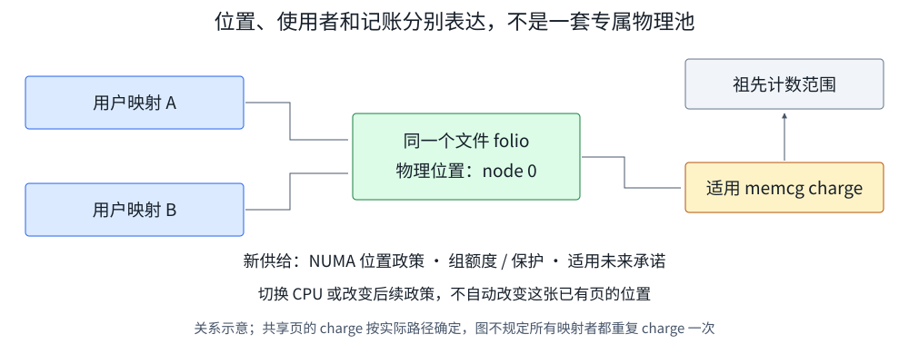

# 资源约束：NUMA 放置、memcg 记账与内存承诺

本篇基于 arm64 Linux 6.1.158，承接 [资源约束概览](../../05-placement-and-limits.md)。它不把 NUMA 与 memcg 当作同一个分配器，而是沿一次缺页说明三个独立问题：**页可以放在哪，使用算给谁，未来需求是否获准承诺。**

## 1. 一张页可以有三种不同的归属信息

| 信息 | 表示 | 不能推出 |
| --- | --- | --- |
| node / zone | 物理存储的位置和资源范围 | 哪个进程独占所有内容 |
| memcg charge | 本次资源使用计入哪个组及祖先范围 | 已为该组预分配一个物理页池 |
| 用户映射 | 哪些地址空间通过页表使用内容 | 各使用者各拥有一份独立物理副本 |

共享文件缓存尤其能体现区别：多个进程可以使用同一内容，物理页只有自己的位置，记账并不是为每一个映射者自动复制一张相同页。



## 2. NUMA 策略怎样进入分配？

在适用用户页路径中，`get_vma_policy` 先查文件 / VMA 的策略，再回退到任务或默认策略。策略转成优选 node、适用 nodemask，并与 cpuset、GFP zone 约束一起进入页分配。

主要对象是 `struct mempolicy` 的 mode、nodes、flags 等。它描述政策，不装后备页列表。

| 模式思想 | 主要取舍 |
| --- | --- |
| Preferred / local | 优先适用位置，但不是所有情形下绝不回退 |
| Bind | 对适用分配施加节点集合要求，仍需按 zone 等条件理解 |
| Interleave | 在节点间分布供给，VMA 路径可按地址位置选择，不简单等于每个系统调用轮一次 |

本树还存在 PREFERRED_MANY 等变体。`policy_nodemask/policy_node` 共同工作，不能只看一个优选 node 就抹掉集合约束；某些低 zone 请求对策略应用另有条件。

源码在 `mm/mempolicy.c`，不是所有内核缓冲区都自动使用用户 VMA 的策略。

## 3. 改了策略，为什么旧页仍在原 node？

缺页时才需要取得新内容的范围，按当时的适用政策放置。已安装页不会因为修改策略而自动重新经历分配。

| 变化 | 对已有页的默认理解 |
| --- | --- |
| 线程改在另一 CPU 上运行 | 原物理页不因这一步自动移动 |
| VMA 改了后续分配策略 | 对新供给有影响，已有内容需另有迁移机制 |
| 显式迁移或适用 NUMA balancing | 按自己的扫描、权限、引用和迁移结果决定 |
| 页受到固定或不可迁移约束 | 移动内容可能失败或不允许 |

“访问变远”与“内存已经移动”不是同一观察。迁移需要保持逻辑内容和映射身份，不是将旧 PTE 指向一个未经准备的新 PFN。

## 4. Memcg charge 发生在什么完成点？

普通匿名缺页准备候选页后，在正式安装 PTE 前执行适用 charge。COW 新页和 swapin 等路径也有各自记账协议。

这说明物理分配成功还不是最终可交付状态：

```text
按适用策略取得物理候选
  -> 找到本路径的记账组
  -> 核对组及祖先计数，必要时回收 / 等待 / 失败
  -> 建立内容与映射身份
```

Charge 失败时，调用路径需要归还候选并退出，而不是给使用者留一张“不计账但照常使用”的页。

`__mem_cgroup_charge`、`charge_memcg`、`try_charge_memcg` 位于 `mm/memcontrol.c`。不使用它们作为驱动对任意页手动收费的通用示例。

## 5. 为什么先消耗 stock，再调整层级计数？

`try_charge_memcg` 尝试 `consume_stock`。适用 per-CPU stock 保存已经记入相应组的批量额度，减少每个基本页都更新共享层级计数的频率。

它不是 PCP：PCP 存物理页块；charge stock 存记账额度，不预先携带一组可直接映射的页。

批量 charge 失败时可缩到实际页数重试；回收前后还可能 drain stock。只看一个计数变化，不能直接推断刚刚进行了同量物理页分配。

## 6. Max、high 与保护分别在哪一侧起作用？

| 设置 | 政策方向 | 不是 |
| --- | --- | --- |
| `memory.max` | 适用硬限制及超限后的回收 / 失败 / OOM 决策 | 预留固定物理池 |
| `memory.high` | 过量使用后的回收与节流压力 | 每次超过就立即 OOM |
| `memory.low` | 尽力保护适用用量免于回收 | 保证无限新分配成功 |
| `memory.min` | 更强的适用回收保护 | 从 RAM 中永久划走指定大小 |

保护还受实际使用量、父层有效量和层级分配影响。`mem_cgroup_calculate_protection` 不只是读取子组写入的数字，不能把所有兄弟组的配置量当作同时完整兑现。

`mem_cgroup_handle_over_high` 与 charge / reclaim 分别有执行点；high 不需要被硬塞进每一次页表安装的一个固定内联检查。

## 7. 一个有物理内存但仍失败的例子

简化情形：允许节点仍有普通页，目标组的适用 charge 已到限制，组内候选大多被固定或暂时无法回收。

1. 物理候选可能取得成功。
2. Charge 检查发现组或某个祖先限制不满足。
3. 按本次允许政策尝试组范围内回收和重试。
4. 若不能取得所需额度，走适用失败 / OOM 路径，归还候选。

这不是全机 RAM 耗尽，也不一定由改变 NUMA 优选节点修复。若真正失败的是严格节点范围，单独提高组上限同样不直接解决。

祖先限制和对象保护必须纳入排查，不只看当前叶组的 `memory.current`。

## 8. Overcommit 为什么是在另一张账上？

承诺记账管理某些地址空间操作对未来内存的需求，不等于当前驻留页数，也不是 memcg charge。

`__vm_enough_memory` 先按相应需求加入承诺，依据模式检查；失败时撤销承诺。模式 1 可放宽承诺，模式 0 与模式 2 有不同检查方式；不能把任一模式写成“保证未来所有缺页成功”。

本树模式 0 的代码检查包括单次需求与总 RAM / swap 的关系，不把旧文章的“当前空闲内存减缓存”公式直接当作唯一实现。模式 2 对比适用承诺上限及保留规则。

代码在 `mm/util.c`，调用者包括适用 mmap、保护变化和 fork 等路径。用量计量、失败回滚和特殊映射条件需按真实调用者理解。

## 9. 一次需求受到多层约束，怎样分辨？

| 现象 | 优先核对 |
| --- | --- |
| 更换 CPU 后访问成本变化 | 现有物理位置、任务运行位置与实际迁移 |
| 叶组未到上限但 charge 受限 | 祖先计数、stock、适用记账范围 |
| 区间建立成功但缺页失败 | 物理供给、charge、映射资源与实际 fault 结果 |
| 组内回收困难 | 保护、dirty / writeback、引用、pin 与候选构成 |
| 合适总容量但没有连续区间 | 页分配的阶、布局与迁移条件 |

运行核对可用适用 `numa_maps`、cgroup 控制文件、内存事件与 PSI，但需明确作用域和配置。本篇没有采集输出或修改策略。

具体接口见 [原查询页的策略入口](../../api.md#policy-queries)；缺页提交继续读 [缺页与 COW](../address-space/01-fault-cow.md)，回收继续读 [回收专题](../reclaim/01-reclaim.md)。完整 NUMA balancing、计数层级并发和全部 pin / 热插拔生命周期仍有独立深入空间。
