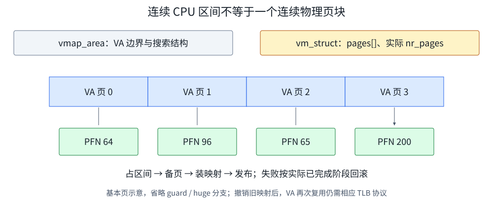

# Vmalloc：地址区间、后备页与映射的分阶段生命周期

本篇基于 arm64 Linux 6.1.158，承接 [分配概览](../../02-allocation.md)。重点是一个连续 CPU 虚拟工作区如何建立、失败回滚和销毁；它不是用户进程的 `mmap` 地址空间管理。

## 1. 成功返回一个指针，需要三类资源同时就绪

| 资源 | 管理对象 | 失败可能 |
| --- | --- | --- |
| 足够长且符合对齐的内核虚拟区间 | `vmap_area`、空闲 / busy 结构 | 无合适区间或管理元数据失败 |
| 存放内容的后备页 | `vm_struct.pages/nr_pages` | 只取得部分页、页数组或供给失败 |
| 从区间到后备页的翻译 | 内核页表与相关同步 | 页表分配或映射步骤失败 |

`vmap_area` 保存区间边界及搜索结构；`vm_struct` 描述用途、页数组、页数和调用来源。声明在 `include/linux/vmalloc.h`。



连续的是返回地址的可访问区间，不是页数组里存放的各 PFN。后备页可能部分相邻，但使用者不能依赖整体物理连续。

## 2. 地址管理为什么需要 free 与 busy 两种组织？

`alloc_vmap_area` 从空闲区间结构中寻找满足长度、对齐和地址范围的候选，取走相应部分，进入 busy 管理。树中的 `subtree_max_size` 用来辅助查找能容纳请求的空闲区间。

它避免每次只从地址空间起点线性寻找所有空洞，但对齐、碎片与可用区间仍影响结果。虚拟空间“总空闲长度足够”也不保证有一段适用的连续区间。

普通分配还通常包含 guard 范围。`vm_struct.size` 与调用者请求的有效容量不能无条件视为同一数值，应通过对应 helper 和实际标志理解。

## 3. 正常建立：先占区间，再准备页与映射

`__vmalloc_node_range` 协调过程，`__vmalloc_area_node` 执行页数组、后备页及映射准备：

```text
申请并登记虚拟区间
  -> 准备后备页指针数组
  -> 取得足够后备页，记录实际 nr_pages
  -> vmap_pages_range 建立映射
  -> 完成适用初始化 / 调试状态
  -> 清除 VM_UNINITIALIZED，返回地址
```

这是生命周期主干，huge vmalloc、KASAN 和 GFP 限制有条件分支。不能把“区间已登记”当作“可以向调用者发布指针”。

本树支持相应较大映射粒度。即使为了映射取得了较高阶后备页，内部也会按自身协议拆分以便页数组归还，不把它推广为调用者可以拆开普通 `alloc_pages` 块逐页释放。

## 4. 失败必须按已完成的阶段撤销

| 失败点 | 已持有资源 | 清理重点 |
| --- | --- | --- |
| 页数组分配前 | 虚拟区间、管理对象 | 撤销区间及管理对象 |
| 只取得部分后备页 | 区间、数组、部分页 | 按实际 `nr_pages` 归还，不按请求总数访问数组 |
| 页表安装途中 | 上述资源、部分软件映射 | 撤销映射，归还实际取得的页和元数据 |
| 最终初始化完成前 | 可能已建立映射 | 仍不能把半成品返回给调用者 |

`__vmalloc_area_node` 在取得页数不足或映射失败时汇入 `__vfree`，并依实际状态清理。它不是“失败只释放最后一次分配”的路径。

页表分配未必直接继承表层所有 GFP 位。本树在适用 NOFS / NOIO 情形下使用作用域 helper 约束内部页表工作；仅替换表层标志不能解释整个上下文协议。

## 5. Vfree 和 Vunmap 的分界在哪里？

`__vunmap(addr, deallocate_pages)` 共用撤销基础，但由入口及用途决定后备资源是否归还：

- 普通 `vmalloc`：存储和映射一起管理，`vfree` 结束二者。
- 普通 `vmap`：调用者提供并保留页的所有权，`vunmap` 只结束该虚拟映射，页另按原协议归还。
- `VM_MAP_PUT_PAGES`：有明确成功转移契约，用规定入口结束数组和页引用。

类型不能由“地址处于 vmalloc 区间”单独判断。把普通 vmap 地址传到错误销毁入口，可能丢失或重复结束后备资源。

接口签名和转移失败语义只在 [虚拟工作区 API](../../api-reference.md#virtual) 与 [Vmap API](../../api-reference.md#vmap) 维护。

## 6. 撤销软件映射与再次复用虚拟地址不是同一完成点

本树包含延迟回收 vmap 区间的机制：撤下软件映射的区间进入相应 lazy 管理，批量 TLB 处理后才进入可重新分配的空闲区间组织。

因此不能写成“`vfree` 每次立即执行全局 TLB 刷新”，也不能认为“后备页归还了，所以旧虚拟地址可以立刻挂上另一组页”。区间重用必须遵守翻译失效协议。

调用者在释放之后已经没有合法访问权，延迟处理不延长旧指针的存活。CPU 对旧地址的非法访问仍然是 use-after-free，不是缓存带来的免费宽限。

实现入口：`free_unmap_vmap_area`、`free_vmap_area_noflush`、`purge_vmap_area_lazy`，以及 `vm_remove_mappings/__vunmap`。

## 7. Kvmalloc 回退改变了什么？

`mm/util.c` 的 `kvmalloc_node` 先尝试 kmalloc，适用较大请求失败后才回退 vmalloc。因此它允许两种后备形式，调用者必须从一开始就接受“不保证整体物理连续”。

回退并不消除所有资源需求：虚拟区间、数组、后备页与页表仍可能失败。本树还检查请求大小和是否允许阻塞；不是任意 GFP 都能获得 vmalloc 回退。

返回后统一配 `kvfree`。不能根据本次碰巧得到的连续存储，把使用协议固定为 `dma_map_single` 或直接 `virt_to_phys`。

## 8. 阅读时追踪哪些状态？

| 要追踪 | 源码 |
| --- | --- |
| 区间怎样被占用和返回？ | `mm/vmalloc.c`：`alloc_vmap_area`、lazy purge |
| 页数组和部分页如何管理？ | `__vmalloc_area_node`、`vm_area_alloc_pages` |
| 映射何时可发布？ | `__vmalloc_node_range`、`clear_vm_uninitialized_flag` |
| 释放入口怎样区分所有权？ | `__vunmap`、`vmap`、`vunmap` |
| 回退条件是什么？ | `mm/util.c`：`kvmalloc_node` |

可对照 `/proc/vmallocinfo` 理解区间、页数和来源，但它不是所有分配资源的统一内存统计，本文未采集输出。arm64 映射和 TLB 原理另见 [地址空间篇](../../03-address-space.md#tlb-cache)，用户映射后备区的存活另查 [共享缓冲区 API](../../api-reference.md#user-map)。
