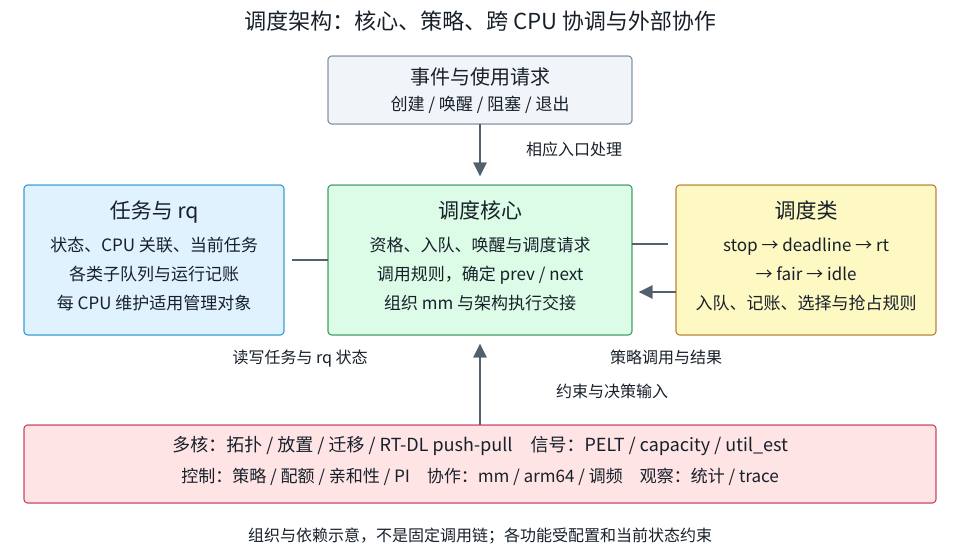
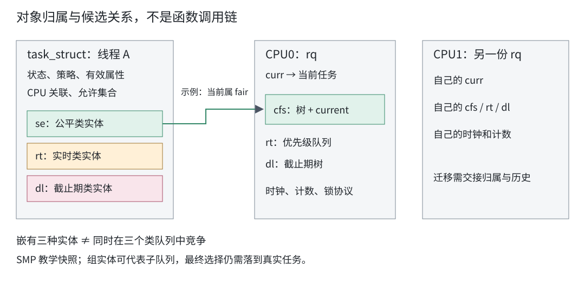
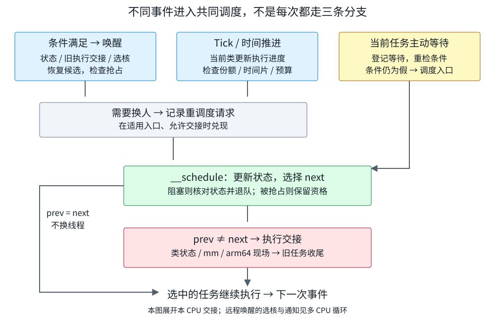
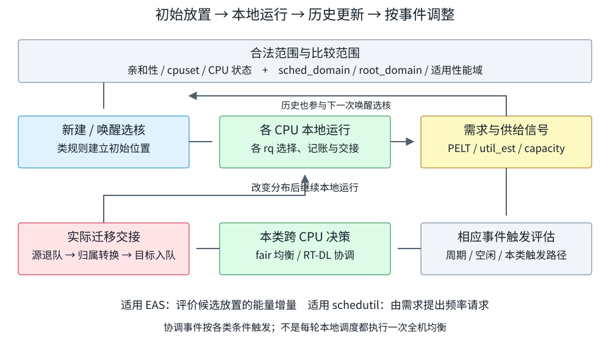

# 内核调度总览：组成、决策与运行过程

理解调度器，需要把两张图放在一起看：**架构图说明有哪些参与者，运行图说明它们何时协作。** CFS、实时策略、唤醒和上下文切换各自只是其中一部分。本篇先建立全局关系，再沿单 CPU 和多 CPU 的运行过程把它们连接起来。

分析基线为本地 **Linux 6.1.158-rt58、arm64、`PREEMPT_RT=y`**。读者已熟悉任务、系统调用、内核同步和基本内存管理。本篇直接从调度器的组成与设计进入；多核算例额外假定 SMP，组调度、带宽控制、lazy 抢占和 EAS 等按各自条件讨论。

<a id="reading"></a>

| 阅读需求 | 入口 |
| --- | --- |
| 建立全局视野 | [架构](#architecture) → [设计思路](#design) → [对象](#tasks) |
| 连接唤醒、选择和切换 | [单 CPU 运行过程](#dispatch) |
| 连接选核、信号和迁移 | [多 CPU 运行过程](#placement) |
| 理解 RT、锁和资源控制的影响 | [约束怎样作用于运行过程](#constraints) |
| 开始读某个实现专题 | **[专题目录](sub/index.md#route)** |
| 开发时查询接口 | [API 选型](api.md) · [详细契约与示例](api-reference.md#quick) |
| 查术语和资料 | [术语](#terms) · [依据与核对范围](99-evidence.md) |

<a id="architecture"></a>

## 1. 整体架构：一个调度核心，几组相互协作的机制

调度器对外提供四类能力：管理任务的运行资格，在 CPU 上选择任务，在多 CPU 间安排需求，以及把选择落实为执行交接。运行时间记账贯穿这些过程，既支持后续决策，也给观察和资源控制提供依据。



这张图是**组成关系**，没有规定每次调度的固定调用顺序。先看中央：调度核心通过每 CPU 的 rq 管理当前状态，向调度类询问如何组织候选、更新执行进度和选择 next。再看两侧：运行需求从创建、唤醒等入口进入，等待与退出使需求离开；拓扑、历史信号、锁依赖和资源控制影响不同决策。

### 1.1 调度核心与调度类

调度核心负责共同协议：状态转换、入退队包装、调度请求、时钟更新、执行交接。调度类负责不同服务规则：怎样排列候选、怎样记账、什么事件值得重新选择。

目标树按以下优先关系组织调度类：

| 类 | 对应需求 | 核心规则 | 主要实现 |
| --- | --- | --- | --- |
| stop | CPU 停止、迁移等内核特殊工作 | 特殊最高优先级工作 | `kernel/sched/stop_task.c` |
| deadline | 预算与截止期预约 | EDF 选择、CBS 预算管理 | `kernel/sched/deadline.c` |
| rt | 用户 FIFO/RR、适用实时内核任务 | 固定优先级，同级按 FIFO/RR 规则 | `kernel/sched/rt.c` |
| fair | 普通、batch、用户 idle 策略 | CFS 带权服务进度 | `kernel/sched/fair.c` |
| idle | CPU 无其他可选任务 | 每 CPU 的兜底空闲任务 | `kernel/sched/idle.c` |

这里先介绍所有类，再讨论 CFS。这样才能理解：公平类的“下一任务”只是公平类内部的答案，还要放回跨类选择中。

类的排列由链接段和遍历规则建立，入口在 `include/asm-generic/vmlinux.lds.h` 的 `SCHED_DATA` 和 `kernel/sched/sched.h`，不是一条 `sched_class.next` 指针链。用户 `SCHED_IDLE` **属于 fair**，与内核 idle 类是两件事。

### 1.2 多核机制与需求信号

每 CPU 有自己的候选和当前任务。因此，单 CPU 选择之外还有两种工作：

- 唤醒、新建或策略相关路径为任务寻找初始 CPU。
- 平衡路径检查已有分布，决定是否移动某些任务。

这些决策使用允许 CPU 集合、调度拓扑、负载和容量信号。PELT 提供带衰减的历史需求，util_est 补充近期激活的估计，capacity 描述归一化供给。RT/DL 又有自己的跨 CPU 优先级和截止期辅助状态，不把所有任务交给 CFS 的负载均衡。

### 1.3 控制、同步与观察

任务策略、nice、亲和性和 cgroup 是输入；它们分别改变服务规则、相对权重、合法位置或资源额度。PI 锁协议可以临时改变任务的有效优先级，帮助锁拥有者推进。调度统计和事件则记录执行、等待、唤醒和迁移等事实。

这些部分与架构主体的关系可概括为：

| 部分 | 提供什么 | 消费方 |
| --- | --- | --- |
| 任务状态、rq 和类队列 | 当前候选及执行事实 | 唤醒、选择、迁移、切换 |
| PELT、util_est、capacity | 需求与供给估计 | 放置、均衡、适用调频 |
| 拓扑、亲和性、cpuset | 合法范围与比较范围 | 选核、迁移、准入 |
| 策略、权重、配额、PI | 服务规则、上限和依赖需求 | 类选择、记账、资格维护 |
| 统计、trace、PSI | 已发生的行为及压力 | 开发者和运维分析 |

进程管理创建/释放任务，同步模块管理业务条件，mm 管理地址空间，arm64 代码保存/恢复线程现场。调度器与它们协作，而不是独自拥有这些对象的全部生命周期。

<a id="design"></a>

## 2. 设计思路：为什么分成这些部分？

### 2.1 局部运行，全局协调

把常见选择留在本 CPU，可以减少全机共享队列的锁竞争并保持局部性。代价是队列可能不均衡，所以需要另外的放置和迁移机制。**本地公平与全机合理分布是不同层面的目标**，一个满足不代表另一个自动满足。

### 2.2 共同机制与服务策略分离

睡眠任务恢复资格、当前任务切出、next 恢复上下文，都需要一致的状态协议。普通任务与实时任务则有不同的服务目标。调度类接口把策略接入共同机制，使 core 不必在每个入口重新实现五种完整算法。

阅读 `enqueue_task`、`pick_next_task`、`task_tick` 等回调时，应同时问：core 已保证了什么？当前类又维护了什么？一个回调通常只是某次事务中的一段。

### 2.3 资格、决策、请求和执行是四层

“条件满足”通过同步协议进入唤醒；唤醒恢复任务资格；类规则可能判断应该换人；调度请求再在适用入口兑现。最后才是线程现场交接。

这种分层允许任务在其他 CPU 上被唤醒，允许短临界区完成后再切换，也解释了“唤醒成功但还没有运行”的常见现象。

### 2.4 不同时间尺度解决不同问题

当前执行增量用来记账；CFS 虚拟进度用来比较带权服务；PELT 历史用来估计需求；DL 截止期和配额周期用来约束时间窗口。它们都叫“时间”或“负载”，但时钟、单位和用途各不相同。后续专题会先给口径，再给计算。

<a id="tasks"></a>

## 3. 对象关系：任务、实体、rq 与两种“组”



`task_struct` 是线程对象，包含策略、有效优先级、等待状态、CPU 关联和各类实体。`sched_class` 指向当前采用的类，`se`、`rt`、`dl` 保存对应竞争规则需要的状态。

`rq` 是每 CPU 的管理对象，含 `curr`、类子队列、时钟、计数和原始锁。它不是一条统一链表：fair 维护实体树，RT 维护优先级数组与链表，DL 维护截止期相关树。

### 3.1 用不同关系表达运行状态

| 关系 | 回答的问题 | 一个典型细节 |
| --- | --- | --- |
| `p->__state` | 是否等待某类事件？ | `TASK_RUNNING=0` 同时包含等待 CPU 和正在执行 |
| `p->on_rq` | 当前由哪种 rq 候选协议管理？ | queued 与 migrating 是不同状态 |
| 类成员，如 `se.on_rq`、RB 节点 | 在本类中怎样组织？ | CFS current 在树外，但仍可运行 |
| `p->on_cpu` | 旧执行使用关系是否已交接？ | SMP 切换中可短暂出现两个任务均为 1 |
| `rq->curr` | 本 CPU 当前选择谁？ | 有切换窗口，读取还需相应保护 |

因此，“R 状态”“在队列中”“在树中”“正在执行”不能互相替代。完整快照和生命周期见 [任务/rq](sub/core/01-task-rq.md#states)。

### 3.2 任务组与调度域是两张独立关系图

启用公平组调度时，`task_group` 的每 CPU 子队列可以由组实体参加父级竞争。它回答**资源怎样按层级分享和限制**。

`sched_domain`、`sched_group` 描述 CPU 平衡范围和拓扑分组，`root_domain` 保存适用 CPU 集合及 RT/DL 等共享管理状态。它们回答**在哪些 CPU 间比较和协调**。

一个任务可以同时属于某个资源组，并在某个拓扑范围内放置。cgroup 的层级不会自动变成 CPU 拓扑，调度域也不另外拥有一套全体任务队列。

<a id="dispatch"></a>

## 4. 单 CPU 运行过程：从事件到下一任务



这张图是**运行关系**。三条入口各自有触发条件，汇入共同选择；没有规定每次切换都先经过一次唤醒和一次 tick。

### 4.1 唤醒分支：恢复需求，再考虑抢占

以消费者 A 等待数据、生产者发布数据为例：

1. 等待接口把 A 登记到相应等待对象，设置状态并重新检查条件；条件仍不满足才睡眠。
2. 生产者按业务对象的同步协议发布数据，再通知等待者。
3. `try_to_wake_up` 检查匹配状态，协调旧 rq 和 `on_cpu` 交接，选择合法 CPU。
4. 入队恢复运行资格，类的抢占检查决定是否请求该 CPU 重新选择。

本地 RT 分支默认 `TTWU_QUEUE=false`，通常由唤醒者在目标 rq 原始锁下入队。远程 IPI 可用于请求重调度；它与另行启用的异步 wake-list 不是同一个机制。

唤醒成功表示协议取得进展，不表示 A 已开始处理数据。A 恢复后还要重检条件，因为别的消费者可能先取走了数据。详情见 [等待/唤醒协议](sub/core/02-wait-wakeup.md#protocol)。

### 4.2 Tick 分支：更新进度，再判断当前是否仍合适

Tick 为正在运行的类提供一次更新机会。类对执行量记账，并检查服务进度、RR 时间片或 DL 预算等条件。结果可能是继续运行，也可能是记录重调度请求。

<a id="time"></a>

公平类的例子最能说明“规则如何接入循环”：权重 A:B=1:2 时，实际执行增量转换为

```text
Δvruntime ≈ Δexec × 基准权重 / 实体权重
```

B 执行 2 ms，才与 A 执行 1 ms 得到相同虚拟进度。CFS 比较这类进度，同时用运行粒度控制过于频繁的交接。RT 则首先比较固定优先级；DL 比较动态截止期并扣预算。三者共用 tick 入口，但维护不同状态。

详细运行循环见 [CFS](sub/fair/01-cfs.md#selection)、[FIFO/RR](sub/realtime/01-fifo-rr.md#rr)、[Deadline](sub/realtime/02-deadline.md#edf)。

### 4.3 主动阻塞分支：结束候选关系

当前任务发现需要等待，把相应状态交给调度入口。`__schedule` 在 rq 保护下重新核对状态：若并发唤醒已经恢复 RUNNING，就保持资格；若确实仍等待，则按阻塞路径退队并选择别人。

被抢占的任务通常仍可运行，所以与主动阻塞的退队不同。这是“暂时没用 CPU”和“当前没有运行需求”的关键区别。

### 4.4 汇合处：选择、交接与收尾

`__schedule` 更新 rq 状态并选 next；`prev==next` 时可以结束本轮而不发生线程切换。确需交接时：

1. 类状态完成旧实体与新实体的关系更新。
2. `context_switch` 与 mm 协作处理地址空间和 `active_mm`。
3. arm64 `__switch_to` 处理适用架构状态，`cpu_switch_to` 保存/恢复 x19～x29、SP、返回位置等线程现场。
4. 切入者完成旧任务执行资格释放和适用引用收尾。

Next 继续自己的栈和返回位置；不是每次从线程函数开头启动。共享 mm 的线程不必每次换一套全新用户页表。A 将来恢复时，旧调用栈上的收尾对象还可能是刚切出的 C，详见 [完整交接](sub/core/03-schedule-switch.md#finish)。

源包缺少 `arch/arm64/include/asm/switch_to.h`，本系列只以实际存在的调用点、`process.c` 和 `entry.S` 实现为依据，不补造包装宏。

<a id="placement"></a>

## 5. 多 CPU 运行过程：放置、观察、调整



单 CPU 循环负责“这颗 CPU 运行谁”。多核循环负责“需求分布是否合适”。一次唤醒可能完成初始放置，随后多次本地执行更新历史，再由平衡事件调整分布。

### 5.1 先确定可放范围，再评价位置

任务允许掩码、cpuset、CPU 状态以及类相关条件限定合法目标。拓扑再决定从局部共享资源、更大范围或适用性能域中寻找候选。

公平类 `select_task_rq_fair` 会按路径综合唤醒关联、空闲 CPU、容量和域搜索等信息。它不是遍历全机找“人数最少的 CPU”，也不保证初始选择永远最佳。

### 5.2 执行历史形成下一轮决策输入

| 输入 | 含义 | 典型消费者 |
| --- | --- | --- |
| load | 带权需求的历史 | 适用负载比较、组需求 |
| runnable | 可运行需求，包括等待 CPU | 竞争/需求判断 |
| util | 已执行所反映的归一化利用率 | 能力匹配、调频、能效评估 |
| util_est | 近期激活的需求估计 | 适用唤醒放置和调频 |
| capacity | CPU 的归一化能力及适用可用供给 | misfit、放置和均衡 |

PELT 使用自己的归一化时钟；runnable、util 的输入也不同。两个持续竞争的任务可各有 runnable≈1024、util≈512，而 CPU 总 util≈1024。把这几个信号都读成“CPU 百分比”，会丢掉竞争与获得服务的区别。

### 5.3 不均衡判断与真正移动分开

平衡先比较域中的组，再寻找源 rq 和可移动任务。load、util、task、misfit 等迁移类型各自有不同的目标量与单位。

真正移动还要在源 rq 退队、标记迁移、改变 CPU 关联，在目标 rq 入队并恢复稳定状态。正在运行、亲和性受限或局部性不适合的任务，可能需要跳过或转入其他迁移路径。因此“决定需要减轻负载”与“成功搬走一个任务”不是同一步。

RT 通过优先级辅助状态及 push/pull，DL 通过截止期辅助状态等协调多核需求。它们服务本类目标，不是公平负载均衡的一个权重选项。

### 5.4 能效与调频是协作，不是替代选择

具备相关配置、拓扑和能量模型时，EAS 比较候选放置带来的能量增量，同时考虑能力和约束。arm64 不必是异构大小核，异构系统也不必满足 EAS 条件。

Schedutil 接收适用利用率信号，向 cpufreq 提出频率请求。需求估计、频率请求和硬件达到工作点各有时间与成本。`uclamp` 约束利用率相关输入，既不是执行时间配额，也不是直接指定固定频率。

按“时钟与信号 → 决策输入 → 选核 → 迁移”继续读 [PELT](sub/placement/01-pelt.md) 和 [放置/均衡/EAS](sub/placement/02-placement.md)。

<a id="constraints"></a>

## 6. RT 与资源约束怎样作用于前面的过程？

把约束放回对应阶段，比把它们全部当作最后的例外更容易理解。

| 作用阶段 | 机制 | 对前面过程的实际影响 |
| --- | --- | --- |
| 等待与唤醒 | RT 锁、PI、saved_state | 锁等待有独立协议；业务通知与取得锁资格分别维护 |
| 候选资格 | CFS/RT 带宽、DL 预算 | 任务仍有业务工作，类或祖先实体却可能暂不能竞争 |
| 选择规则 | FIFO/RR、DL、PI 有效属性 | 使用固定优先级或截止期，PI 可临时改变拥有者的有效需求 |
| 请求兑现 | PREEMPT_RT、raw 锁、关中断、独立 lazy 条件 | 已请求重调度，何时可以真正交接仍受上下文约束 |
| 多核位置 | 亲和性、cpuset、容量、域、准入 | 可选范围和可承诺供给受到限制 |

### 6.1 PREEMPT_RT 已经是本系列的工作环境

普通 `spinlock_t` 按 RT 实现由 rt-mutex 机制支撑；竞争时可发生锁等待，持锁任务仍可被抢占。其 `irqsave` 变体不能按非 RT 语义理解为关闭硬中断。rq 锁和任务 `pi_lock` 则仍是原始锁，真实关中断/禁止抢占区间仍限制交接。

普通等待队列头的 `spinlock_t` 与 completion 的 raw swait 又有不同上下文契约，开发时要查 [详细参考](api-reference.md#waitqueue)。RT 不会把所有线程变成 FIFO，也不会自动启用 lazy 抢占、EAS 或组带宽。

### 6.2 策略保证建立在模型和可用供给上

FIFO/RR 的高优先级让适用可运行任务先获得服务；它无法让仍等待设备或锁的任务凭空推进。DL 的 Q/D/P 预约把运行预算、相对截止期、周期联系起来，通过准入和 CBS 管理供给；业务执行时间、外部等待和硬件条件仍需独立分析。

目标树中 DL 的执行还在相关条件下进入根 RT 带宽记账，体现跨类共享供给的联系；它与 DL 自身预算是两份账，具体见 [DL 的时间与记账](sub/realtime/02-deadline.md#edf)。

CFS `cpu.weight` 调整同层相对份额，`cpu.max` 限制组的累计运行额度。两 CPU 并行消费同一额度，可以比一个 CPU 更早用尽；祖先限流也会阻止仍有本地余量的子组。

### 6.3 一个场景串起这些影响

<a id="examples"></a>

A 被数据通知唤醒，选入 CPU1，但没有立刻执行。可以沿同一架构逐层定位：

1. 同步层：数据确实发布了吗？A 是业务等待还是 RT 锁等待？
2. 资格层：A 已稳定入队吗？所属组或 DL 预算是否被限流？
3. 策略层：CPU1 上是否有更高类或更应优先的候选？
4. 执行层：CPU1 是否尚在原始锁或真实关中断区间？
5. 位置层：允许范围是否使 A 只能等待 CPU1？

这不是要求每次故障检查全部层，而是让证据指向相应机制。观察方法见 [调度排障](sub/observation/01-observe.md)。

<a id="next"></a>

## 7. 阅读与使用地图

### 7.1 按问题进入深入专题

| 架构部分 | 建议入口 | 阅读后应能解释 |
| --- | --- | --- |
| 核心对象 | [任务/rq](sub/core/01-task-rq.md) | 状态、成员资格、当前执行和生命周期 |
| 核心协议 | [等待/唤醒](sub/core/02-wait-wakeup.md) → [切换](sub/core/03-schedule-switch.md) | 条件发布、竞态、旧执行交接和恢复现场 |
| 服务策略 | [CFS](sub/fair/01-cfs.md) · [FIFO/RR](sub/realtime/01-fifo-rr.md) · [DL](sub/realtime/02-deadline.md) | 每类的对象、记账、选择、退出和恢复循环 |
| 多核输入与决策 | [PELT](sub/placement/01-pelt.md) → [放置](sub/placement/02-placement.md) | 信号口径、候选范围、不均衡目标与迁移 |
| 资源与依赖 | [组带宽](sub/fair/02-bandwidth.md) · [PI](sub/synchronization/01-pi-preempt.md) | 额度怎样改变资格，锁依赖怎样改变有效需求 |
| 使用与观察 | [API](api.md) · [排障](sub/observation/01-observe.md) | 选择接口、处理错误/存活、解释统计与事件 |

**[专题首页](sub/index.md)** 同时提供推荐顺序和按现象查询。专题不是源码文件的机械拆分：一个协议可能穿过多个文件，一个大文件也包含多种机制。

<a id="interfaces"></a>

### 7.2 开发时从 API 查询入口走

用户线程的权重、策略、CPU 范围分别查询 nice/priority、scheduler/attr、affinity 接口。内核同步先区分条件等待和完成事件，再查询 waitqueue 或 completion；专用线程查询 kthread 的创建与停止协议。

[API 选型](api.md) 回答“用哪一类”；[详细参考](api-reference.md#quick) 回答“参数、单位、上下文、返回值和清理怎样处理”。内部 `try_to_wake_up`、`__schedule`、类回调在机制篇用于阅读，不作为普通模块的直接调用建议。

<a id="terms"></a>

### 7.3 按概念分组的术语速查

| 组别 | 名称 | 含义 |
| --- | --- | --- |
| 对象 | rq / sched_entity | runqueue 管理对象 / 调度实体，实体可代表任务或组 |
| 对象 | task_group / sched_group / root_domain | 资源任务组 / 拓扑 CPU 分组 / 适用根管理范围 |
| 状态 | TTWU / activation | Try To Wake Up / 恢复运行需求至再次阻塞的一轮激活 |
| 状态 | `TASK_IDLE` / `SCHED_IDLE` / idle 类 | 不计相应系统负载的等待状态 / fair 策略 / CPU 空闲兜底类 |
| 公平 | CFS / vruntime | Completely Fair Scheduler / 带权虚拟运行进度 |
| 实时 | RT / PREEMPT_RT | Real-Time / 本系列的实时抢占内核模型 |
| 实时 | FIFO / RR | First-In First-Out / Round-Robin，同级规则 |
| 实时 | EDF / CBS / GRUB | 最早截止期选择 / 恒定带宽服务器 / 未使用带宽回收 |
| 实时 | WCET / 0-lag | 最坏执行时间 / 阻塞任务的带宽可退出 active 集合的适用时刻 |
| 多核 | SMP / IPI | 多 CPU 并行体系 / CPU 间中断通知 |
| 信号 | PELT / EWMA / util_est | 每实体负载跟踪 / 指数加权移动平均 / 近期激活利用率估计 |
| 能力 | capacity / misfit / pinning | 归一化供给 / 能力不匹配 / 放置范围限制 |
| 能效 | EAS / perf domain | 能效调度 / 性能与能量评估域 |
| 能效 | DVFS / OPP / AMU | 动态电压频率调整 / 性能工作点 / arm64 活动计数单元 |
| 控制 | uclamp / quota | 利用率约束 / 可消费执行额度，含义不同 |
| 同步 | PI / RCU | 优先级继承 / Read-Copy Update 并发读及存活协议 |
| 切换 | TLB / ASID | 地址翻译缓存 / 地址空间标识 |
| 时间 | rq clock / clock_task | 调度时间 / 任务执行记账时间 |
| 观察 | PSI / load average | 压力停顿统计 / 系统平均负载，后者不同于 PELT util |

资料、版本差异和关键源码核对统一见 [依据附录](99-evidence.md)。总览提供坐标；深入篇负责把某个模型推到完整状态变化；API 页负责可查询的调用契约。
