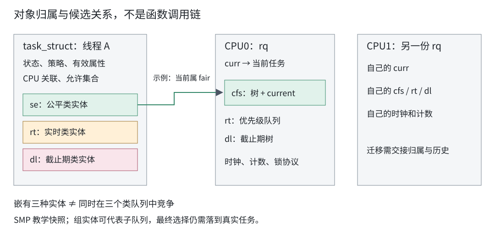
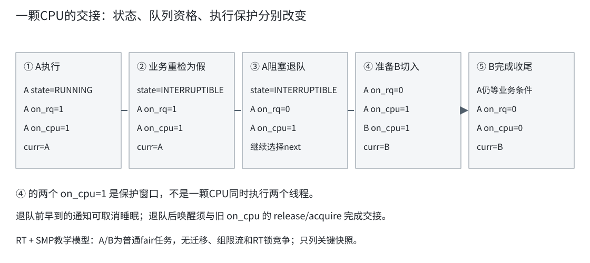

# 任务与 rq：运行资格由哪些对象共同表达？

调度器把同一线程放进几组关系：它是一个任务对象，在某个类中是竞争实体，归某颗 CPU 的 rq 管理，又可能正与旧 CPU 交接执行。本篇先把这些关系画清，再看状态变化和保护。

本篇位于[整体架构](../../00-overview.md#tasks)的对象层，建立后续 [睡眠唤醒](02-wait-wakeup.md)、[调度切换](03-schedule-switch.md) 和 [多核迁移](../placement/02-placement.md) 共用的模型。输入是任务创建、资格或属性变化，输出是相互吻合的任务状态、类成员和 CPU 归属。基线为本地 Linux 6.1.158、arm64、RT补丁与`PREEMPT_RT=y`；双CPU图额外采用SMP。

阅读顺序是**组织 → 字段与时钟 → 成员变化 → 生命周期与同步**。读完应能解释一个快照，并知道修改它需要哪些保护；不把快照当作无锁检查公式。

<a id="objects"></a>

## 1. 组织关系：任务与各类实体

先区分“对象归属”和“运行成员”。`se/rt/dl` 嵌在 `task_struct` 内，是对象归属；当前类、CPU 关联和类队列是随运行而变化的成员关系。线程被抢占，任务和实体仍存在；线程迁移，改变的是成员归属；线程退出后，仍可能有引用保持任务对象存活。

`task_struct` 是线程的任务对象。其调度部分同时回答三个问题：

- **它是谁、处于什么状态？** `__state`、`policy`、优先级、CPU 关联和允许掩码。
- **它怎样参加策略竞争？** `sched_class` 以及 `se`、`rt`、`dl` 等类相关实体。
- **它现在怎样交接执行？** `on_rq`、`on_cpu`，以及 rq 中的 `curr` 关系。

`se`、`rt`、`dl` 嵌在任务对象内，不是在每次改变策略时重新申请一套任务。改变策略需要由调度接口在保护下退队、更新属性和重新入队，而不是让调用者替换结构体指针。

公平组调度又增加一种实体：组的 `sched_entity` 不是线程本身，而是代表子队列在父级竞争。组赢得机会后，继续进入子队列选择，最终才得到真正的任务。这种层级关系见 [CFS 的组调度](../fair/01-cfs.md#groups)。



图画的是对象归属和候选关系，箭头不代表函数调用，也不表示一个任务同时在三个类队列中竞争。

定义入口：`include/linux/sched.h` 的 `task_struct`、`sched_entity`、`sched_rt_entity`、`sched_dl_entity`。

<a id="runqueue"></a>

## 2. 状态字段：每 CPU 的 rq 与类队列

`kernel/sched/sched.h` 的 `struct rq` 汇集当前 CPU 所需的状态：

| 状态 | 回答什么 | 使用时的重点 |
| --- | --- | --- |
| `curr` | 当前选择的任务是谁？ | 与真实切换有交接窗口，不用于任意无锁访问任务 |
| `cfs`、`rt`、`dl` | 各类候选怎样组织？ | 树、优先级数组和类计数有各自语义 |
| `nr_running` | 当前 rq 的适用可运行任务计数 | 不是 CFS 树节点数，也不是所有等待队列长度 |
| `clock`、`clock_task` | 哪种时间推进了？ | 任务记账时间与包含其他开销的时钟口径不同 |
| `__lock` 及 rq 锁辅助接口 | 谁可改变本地调度状态？ | 读实现用 `rq_lock` 等协议，不自行猜锁地址 |
| SMP 的 CPU/均衡状态 | 本地队列与其他 CPU 怎样联系？ | 拓扑和迁移不归一条全局任务链管理 |

实际原始锁字段是 `__lock`。源码注释常写 `rq->lock` 表达逻辑锁，但适用配置可能通过辅助接口选择实际锁；不能从注释照抄字段名编写外部代码。

`cfs_rq->nr_running` 统计本级实体，`h_nr_running` 表达适用层级中的任务数。一组有五个线程，可以只在父级表现为一个组实体。限流时，叶级仍保存任务，祖先的可见运行量却需要调整。计数永远要同时说明对象、层级和当前状态。

### 2.1 调度核心与调度类怎样共同改变队列？

入队不是“给某棵树加节点”这么窄。`core.c`的公共包装要更新适用时钟、调度信息、PSI和uclamp等状态，然后才调用`p->sched_class->enqueue_task`。类回调维护自己的组织：公平类的实体/树/层级，RT类的优先级队列，DL类的截止期树。

先区分两组名字：

| 操作 | 公共职责 | 与`p->on_rq`的关系 |
| --- | --- | --- |
| `enqueue_task` / `dequeue_task` | 组织公共记账和类回调 | 不代表调用者一定改变任务的整体运行资格，例如属性变更可暂时移出再移入 |
| `activate_task` | 需要恢复一个任务的候选关系 | 先完成入队，再发布`TASK_ON_RQ_QUEUED` |
| `deactivate_task` | 结束当前候选关系或准备迁移 | 先标记睡眠0或迁移2，再由类完成退队 |

本地`kernel/sched/core.c:2122`的关键顺序可写成：

```text
activate:
    如果原状态是 migrating，补入迁移标志
    公共入队包装 -> 当前类的 enqueue 回调
    p.on_rq = QUEUED

deactivate:
    p.on_rq = DEQUEUE_SLEEP ? 0 : MIGRATING
    公共退队包装 -> 当前类的 dequeue 回调
```

这是在rq保护下的实现关系，不是外部可直接调用的流程。先标记迁移再改CPU，是为了让同时查询任务所属rq的人识别到交接窗口；入队完成后再发布queued，则避免把未建立好的候选当成稳定成员。

### 2.2 调度时钟为什么不只有一个？

任务执行记账需要知道“CPU给任务用了多少时间”，预算期限又需要知道“时间过去了多久”。中断等非任务执行使这两个量不同。

`update_rq_clock`推进`rq->clock`；`update_rq_clock_task`在相应配置下扣除IRQ时间和虚拟化steal时间，才推进`clock_task`，随后又更新PELT时钟。三者用途如下：

| 时钟 | 典型使用 | 关键区别 |
| --- | --- | --- |
| `rq->clock` | 截止期、限流区间等时间关系 | 不等于某个任务拿到的执行量 |
| `rq->clock_task` | `update_curr*`计算执行增量 | 按配置排除适用非任务时间 |
| PELT clock | 容量/频率归一化的负载信号 | 还存在缩放、idle和组限流处理，见[PELT](../placement/01-pelt.md) |

限定启用IRQ时间记账、无steal的算例：两次更新相隔5 ms，其中真实IRQ占1 ms，则`clock`推进5 ms，`clock_task`推进4 ms。若这4 ms里有0.5 ms由线程化IRQ任务执行，它属于任务执行，不能再把它当真实hardirq重复减掉。

源码还限制`irq_delta <= delta`，防止IRQ统计在退出时更新、与rq更新边界不同而使任务时钟倒退。越界部分留待后续记账，不是用负执行量补偿。`ENQUEUE_NOCLOCK/DEQUEUE_NOCLOCK`等标志表示调用者已按协议更新时钟，不是取消全部记账。

<a id="states"></a>

## 3. 成员变化：运行资格与执行交接

先限定普通任务、SMP、无组限流和迁移的稳态：

| 快照 | `__state` | `on_rq` | `on_cpu` | 与 `rq->curr` 的关系 |
| --- | --- | --- | --- | --- |
| A 等待 CPU | `TASK_RUNNING` | queued | 0 | 不是 current |
| A 正在执行 | `TASK_RUNNING` | queued | 1 | 是 current |
| A 已完成阻塞交接 | 某种等待状态 | 0 | 0 | 不是 current |

`TASK_RUNNING` 值为 0，同时包含“可以运行”和“正在执行”。`on_rq` 也不是只取 0/1 的任意布尔量：本地树定义了 `TASK_ON_RQ_QUEUED` 与 `TASK_ON_RQ_MIGRATING`。

再看三个不能直接套表的窗口：

1. **准备睡眠。** 当前线程先设置等待状态，然后检查条件；此时仍可能执行、仍在 rq。若事件已经到来，它可以取消睡眠，不发生退队。
2. **切出交接。** 已从候选中移除，并不意味着 `on_cpu` 已释放。唤醒者必须与旧执行者完成交接，才能安排新的执行。
3. **迁移或组限流。** CPU 关联、队列成员和上层可见性正被改变，普通稳态表不再表达完整情况。

公平类还要区分 `p->on_rq`、`p->se.on_rq` 与 RB 树成员。当前实体可以保持 `se.on_rq=1`，却由 `cfs_rq->curr` 保存而不在树内；`on_rq` 不等于“存在一个树节点”。完整关系见 [current 与树](../fair/01-cfs.md#objects)。

RT锁竞争还会使用`TASK_RTLOCK_WAIT`和`saved_state`保存业务等待状态。上面的表只表达普通业务等待稳态，不覆盖该锁等待窗口；详见 [RT保存状态](../synchronization/01-pi-preempt.md#saved)。

### 3.1 沿一次阻塞，看到哪些中间状态？

固定A正在CPU0执行，B在同一rq等待，两者都是普通fair任务；暂不加入组限流、迁移及RT锁竞争。只看A的字段：

| 阶段 | A的`__state` | A的`on_rq` | A的`on_cpu` | CPU0的`curr` |
| --- | --- | --- | --- | --- |
| A正常执行 | RUNNING | QUEUED | 1 | A |
| A登记业务等待，重检仍为假 | INTERRUPTIBLE | QUEUED | 1 | A |
| `__schedule`完成A的阻塞退队 | INTERRUPTIBLE | 0 | 1 | 尚在选择/交接 |
| 已选B并准备低层切换 | INTERRUPTIBLE | 0 | 1 | B |
| B完成切入及旧任务收尾 | INTERRUPTIBLE | 0 | 0 | B |



准备B切入时，B的`on_cpu`已经置1，而A的旧`on_cpu`还未清0。**同一CPU短暂出现两个任务的`on_cpu=1`，不是两个线程同时在一颗CPU执行。** 这个字段表达交接保护窗口，物理并行不能从它的总数推断。

第二行若业务唤醒先把A恢复RUNNING，`__schedule`就不能照原先的等待意图把它退队。第三行之后，唤醒侧又要等旧`on_cpu`释放。这两个分支分别封住“退队前”和“执行交接后”的竞争，详见[等待唤醒](02-wait-wakeup.md)。

### 3.2 需要维持的不变量是什么？

常规稳定候选只归一个CPU的rq管理；类组织、CPU关联和公共资格必须相互吻合。改变归属时可以暂时不在稳定队列中，但必须用迁移状态和同步协议让其他操作者等待/重试。

当前任务只是这个CPU的当前选择，不保证它始终在类排序结构中。CFS current在树外，RT current则可以留在本级优先级队列里；类的组织策略不同，公共`on_rq`关系不能简单翻译成“某个节点存在”。

状态锁、队列锁和引用又分别维持不同不变量：状态转换不丢通知，队列修改不破坏候选组织，引用保证对象还活着。一个保护成立，不代表另外两个自动成立。

| 要维护的事实 | 常用保护 | 保护结束后还要做什么？ |
| --- | --- | --- |
| 等待状态与 PI 来源一致 | 任务原始 `pi_lock` 及状态协议 | 遵守与 rq/执行交接的内存顺序 |
| 类组织、计数、current 一致 | rq 原始锁及类内部协议 | 迁移时重建目标关系 |
| task 指针可访问 | 正确获取/持有任务引用 | 配对释放引用；引用本身不冻结属性 |
| CPU 关联与队列吻合 | `task_rq_lock` 等重检协议 | 发现迁移窗口则重试，不能继续用旧 rq |

<a id="lifetime"></a>

## 4. 生命周期：创建、运行、退出与同步保护

新线程由进程创建路径分配任务及相应资源；调度初始化建立优先级、实体和类状态。`sched_fork` 并不让孩子立即执行，随后 `wake_up_new_task` 在适用 CPU 上建立可运行关系。

运行期间，睡眠会暂时退出候选，唤醒恢复候选，迁移改变 CPU 归属。这些动作通常不重新分配 `task_struct`。任务退出才进入生命周期终结，但最终释放仍需要等待相应引用和销毁协议结束。

因此有两种独立保护：

- **引用/生命周期保护**保证对象仍存在，例如在正确查找协议下取得 `get_task_struct` 引用，最终配对 `put_task_struct`。
- **调度状态保护**保证读写状态相互一致，例如 `p->pi_lock`、rq 锁及内存顺序。

持有 task 引用不等于可以直接改其 CPU 或优先级。持有某个 rq 锁也不等于一个跨线程保存的裸 task 指针永不失效。外部使用应选 [调度辅助 API](../../api-reference.md#kernel-policy)，而不是操作内部字段。

### 4.1 为什么查询任务rq也可能需要重试？

`task_rq_lock`先获取任务`pi_lock`，根据当前CPU关联找到rq并取得其原始锁，然后重新确认两件事：这个rq仍是任务所属rq，任务不处于`TASK_ON_RQ_MIGRATING`。

```text
获取 pi_lock
读取 task_cpu，获取对应 rq 锁
    归属仍相同且非 migrating -> 可以操作
    否则 -> 释放两把锁，等待/重试
```

只读一次`task_cpu`就去锁那个rq会有漏洞：迁移者可能已经把任务移到另一rq，旧锁不再保护目标任务。检查与重试让操作者拿到一份稳定的“任务—CPU—队列”关系。

本地`core.c:439`给出的主要嵌套约定是`pi_lock -> rq锁`；需要同时获取两个rq时又有相应排序。不是把所有路径都改成先锁全部任务。被动均衡利用迁移状态分阶段交接，RT/DL部分迁移使用双rq协议，分别见[多核](../placement/02-placement.md)与[RT](../realtime/01-fifo-rr.md)。

<a id="source"></a>

## 5. 有方向地进入源码

| 要核对的关系 | 源码入口 | 阅读时追问 |
| --- | --- | --- |
| 类实体嵌在任务里 | `include/linux/sched.h` | 哪些字段属于当前策略，哪些受配置影响？ |
| rq、子队列和计数 | `kernel/sched/sched.h:954`，`struct rq` | 本级实体数与层级任务数是否混用？ |
| 任务初始化 | `kernel/sched/core.c`，`__sched_fork`、`sched_fork` | 初始化完成与成为 runnable 是否分开？ |
| 新任务开始竞争 | `kernel/sched/core.c:4833`，`wake_up_new_task` | 选核、入队和抢占判断由谁组织？ |
| 状态互斥约定 | `kernel/sched/core.c` 开头的锁协议注释 | 任务锁与 rq 锁分别保护哪些路径？ |
| 旧执行资格释放 | `kernel/sched/core.c`，`finish_task` | release 与唤醒侧 acquire 怎样配对？ |

读完本篇，应能解释一个任务“状态允许、候选存在、实际执行”为什么是三个问题。下一步沿 [等待与唤醒](02-wait-wakeup.md) 看它们怎样变化，而不是把稳态表当作无锁读取公式。
