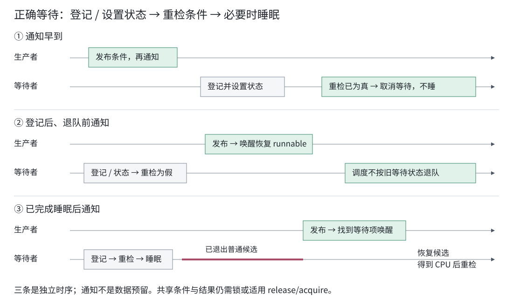
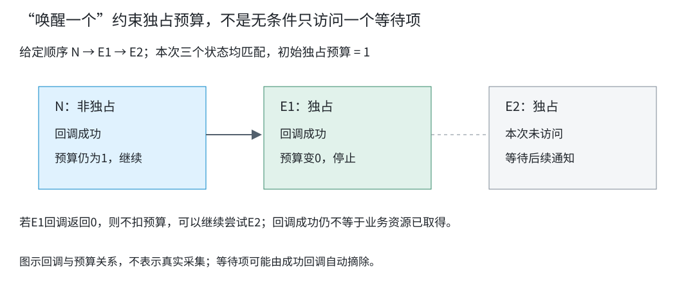

# 等待与唤醒：怎样避免通知到来后仍然睡下去？

等待/唤醒是[单 CPU 运行过程](../../00-overview.md#dispatch)的需求入口：业务条件决定是否有工作，调度状态决定任务怎样离开和重新进入候选。两份状态通过等待接口连接，业务数据仍按对象自己的协议同步。

先理解 [任务与 rq](01-task-rq.md#states)。本篇按Linux 6.1.158、arm64、RT补丁与`PREEMPT_RT=y`解释条件检查、等待登记、唤醒与旧执行交接；实际用法直达 [等待队列 API](../../api-reference.md#waitqueue) 和 [completion API](../../api-reference.md#completion)。

本文先走**登记/发布/通知/恢复**的正常事务，再看下层 TTWU 与退队的交接，最后用错误时序检查协议为什么成立。Completion 放在最后作对照，因为它把“完成状态”保存在对象内，适合另一类需求。

<a id="protocol"></a>

## 1. 正常事务：登记、重检、睡眠和恢复

以“生产者把元素放入队列，消费者 A 取出元素”为主线。队列内容由业务锁保护，等待队列只登记通知对象：

| 阶段 | 消费者 A | 生产者 | 形成的结果 |
| --- | --- | --- | --- |
| 准备等待 | 登记等待项、设等待状态，再检查队列 | 尚无新元素 | 等待者已经可被通知 |
| 真正睡眠 | 条件为假，进入调度并退队 | 可在之后发布 | A 不再参加普通 CPU 竞争 |
| 发布工作 | 保持等待登记 | 先完成数据同步，再 `wake_up*` | 条件成立，通知有可找到的对象 |
| 恢复资格 | TTWU 使 A 重新成为候选 | 通知返回，继续自己的执行 | A 可等待 CPU，不必立即执行 |
| 消费与结束 | 恢复后重检条件，取得元素并清理登记 | 可继续生产 | 业务资源由业务同步保证 |

实际宏可能在第一次快速检查就发现条件成立，此时无需建立完整睡眠事务。下面展开的是需要等待的分支。

`wait_event*` 的关键循环可理解成以下教学伪代码，真实接口还处理信号、超时、独占标志和清理：

```text
循环：
    登记等待项，并设定当前等待状态
    重新检查受正确同步保护的条件
    条件满足 -> 离开循环
    信号或其他终止条件 -> 离开循环
    schedule()
取消等待登记，将当前状态恢复为 TASK_RUNNING
```



这套顺序封住三个窗口：

| 通知发生时刻 | 为什么不会遗漏？ |
| --- | --- |
| 登记之前 | 重新检查能看到已发布条件，不需要睡眠 |
| 登记之后、真正退队之前 | 唤醒把等待状态恢复为 runnable；调度时不会按原等待状态退队 |
| 已完成睡眠之后 | 等待项仍可被找到，调度唤醒恢复候选资格 |

被唤醒仍要重新检查条件，因为别的消费者可能先取走资源，也可能有不对应本次条件的通知。等待队列不是自动为消费者保留数据的邮箱。

源码 `include/linux/wait.h` 的 `___wait_event`、`kernel/sched/wait.c:305` 的 `prepare_to_wait_event`、`finish_wait` 负责该层协议。队列锁保护等待项和唤醒遍历，**不自动保护业务数据的多字段一致性**。

普通等待队列的锁是`spinlock_t`，在本RT基线下获取它可能进入可调度的锁等待。相应`wake_up*`也会获取这把锁，不能直接套用“通知方可在任意硬中断/持raw锁现场调用”的假定；线程化中断与真实hardirq必须区分，具体用法见API参考。

### 1.1 登记与条件重检在源码里怎样连接？

`___wait_event`为当前调用建立一个栈上的`wait_queue_entry`：`private=current`，默认使用可自动摘除的唤醒回调。每轮先调用`prepare_to_wait_event`，再检查condition，最后才执行`schedule`或`schedule_timeout`。

`prepare_to_wait_event`在队列锁下做的不是单次无条件插入：

1. 检查当前等待状态对应的信号终止条件。
2. 正常情况下，只有等待项尚未在队列中才插入；独占项通常放尾部，非独占项按相应头部规则登记。
3. 设置本轮任务等待状态，然后释放队列锁。
4. 宏在锁外重新求值业务条件；满足条件就退出，不进入睡眠。

信号分支会摘除等待项并返回`-ERESTARTSYS`。宏仍先重检condition，再判断该错误，因此事件与信号同时到来时，已经成立的条件可以优先结束等待。这不是接口保证业务消费一定成功：条件背后的资源仍需调用者同步。

正常结束由`finish_wait`恢复RUNNING并安全摘除仍在队列的等待项。唤醒回调可能已经自动摘掉它，所以清理不能假设“每次都有一项需要再删除”。栈对象的结束点与等待项清理相连，而不是函数返回后还让队列保存失效地址。

### 1.2 被唤醒后为什么又会睡？

设两个消费者都等“队列非空”，生产者只放一个元素。两者都恢复候选后，C1先获得对象锁并取走元素；C2运行时重新检查得到空。C2重新登记状态并睡眠是正确行为。

因此有三种不同结果：通知回调执行、任务状态恢复、业务资源取得。等待队列负责前两层的交接，第三层由业务队列锁/引用协议保证。将唤醒次数当成元素数，会把“通知合并”和“竞争后重睡”误判成调度器丢事件。

<a id="publish"></a>

## 2. 数据发布：业务同步与通知范围

有两种常见模式：

- **锁保护队列/状态。** 消费者在对象锁下判断是否有数据并尝试取走；生产者也在同一锁下插入。睡眠时必须释放不能跨睡眠持有的锁，返回后再获取。
- **单向发布标志。** 生产者先写完整数据，再对标志做 release 发布；消费者用 acquire 检查标志，看到标志后才读数据。适合已经明确生命周期、只有一次发布或另有复用协议的场景。

`READ_ONCE` / `WRITE_ONCE` 主要防止相应访问被不合适地合并或拆分，不能单独充当任意多字段发布协议。`wake_up` 也不能补救调用者遗漏的所有数据同步；尤其没有实际唤醒等待者时，不能依赖它为任意访问提供所想象的屏障。

无锁使用 `waitqueue_active()` 以跳过唤醒，还有专门的内存序要求。一般驱动先使用无条件 `wake_up*`，不要为省一次锁而引入未经证明的检查/通知窗口。

### 2.1 独占等待的“唤醒一个”到底约束谁？

本地`__wake_up_common`遍历等待项并调用它们的回调。回调返回负值可停止遍历；返回0表示这项没有成功完成本次唤醒；返回正值且该项带`WQ_FLAG_EXCLUSIVE`，才扣减独占唤醒预算。

固定队列顺序`N -> E1 -> E2`，N为非独占，E1/E2为独占，三项状态都匹配；本次独占预算为1：

| 经过谁 | 回调结果 | 剩余独占预算 | 之后做什么？ |
| --- | --- | --- | --- |
| N | 成功，可能自动摘除 | 1 | 非独占不消耗该预算，继续 |
| E1 | 成功，可能自动摘除 | 0 | 达到预算，停止遍历 |
| E2 | 尚未调用 | 0 | 留待后续通知 |



若E1状态不匹配、回调返回0，预算不会消耗，可以继续尝试E2。这说明`wake_up`的“一”不是无条件只访问一个项，也不是只恢复一个线程。长队列还可能用bookmark分段遍历，释放再获取队列锁，避免一次连续保护过长。

独占等待减少部分惊群，但仍不替E1保留业务资源。独占项的信号退出与通知选择相遇时，需要在队列保护下摘除并重新检查条件；不是简单取消一份已经静态分配的资源。

<a id="ttwu"></a>

## 3. TTWU：将通知转换为运行资格

上层等待项的回调只把“哪个 task、哪些状态可匹配”交给 TTWU。下层必须先确定该任务是否已经在 rq、旧执行是否结束；这就是从业务通知过渡到调度候选的交接点。

`try_to_wake_up` 接收 task、可匹配的状态掩码和唤醒标志。它要与正在睡眠、切换或迁移的任务保持一致，主要分支如下：

| 情况 | 主要动作 | 避免什么错误？ |
| --- | --- | --- |
| 目标就是 current | 在适用前提下走特殊状态恢复路径 | 不必为了当前任务重复走远程交接 |
| 普通状态不匹配，但RT保存状态匹配 | 记录`saved_state=TASK_RUNNING`，仍等锁唤醒 | 业务通知被锁等待吞掉，或误将锁未获得当作已获得 |
| 普通状态和保存状态都不匹配 | 不执行这次普通唤醒 | 错误唤醒无关状态 |
| 任务仍由 rq 管理 | `ttwu_runnable` 在 rq 保护下恢复/检查 | 同一个任务重复入队 |
| 已退队但旧 CPU 仍在切出 | 设置`TASK_WAKING`，默认等待`on_cpu`释放；另行启用TTWU_QUEUE时才考虑wake-list | 旧 CPU 尚在使用任务时安排新的执行 |
| 需要重新建立候选 | 选 CPU，必要时改变关联，`ttwu_queue` 交接 | 无视亲和性和类选择、非法跨 CPU 状态修改 |

源码入口：`kernel/sched/core.c:4191`。目标非 current 时，`p->pi_lock` 使相应任务状态变化串行化，rq 锁保护队列；读取 `__state`、`on_rq`、`on_cpu` 又有明确顺序。锁和屏障各有分工，不是一个任务锁就替代全部协议。

需要等待旧执行释放时，唤醒侧 `smp_cond_load_acquire(&p->on_cpu, !VAL)` 与 `finish_task` 的 `smp_store_release(&prev->on_cpu, 0)` 配对。它保证旧执行关系结束后才进入新的交接，而不只是忙等一个布尔值。

`kernel/sched/features.h`在RT分支默认关闭`TTWU_QUEUE`。按该默认主线，处理完旧`on_cpu`交接并选核后，`ttwu_queue`直接取得目标rq原始锁完成入队和唤醒处理。只有另行启用该特性且满足条件时，远程wake-list才将这部分工作交给目标CPU；不能把它当成本系列默认路径。

### 3.1 为什么必须按state、on_rq、on_cpu的顺序观察？

唤醒者首先确认任务确实处于本次可匹配状态。再观察`on_rq`，可区分“还在原rq候选协议中”与“已经需要重新入队”。如果先读到过时的`on_rq=0`，却实际任务尚未完成相应睡眠转换，后面可能走错交接路径。

看到已退队之后，再检查`on_cpu`，是因为退队者仍可能在旧CPU执行切出代码。这个阶段不是靠另一次入队把问题覆盖掉，而是先完成旧CPU的release/acquire交接，再建立新CPU的关系。

`try_to_wake_up`因此在任务原始`pi_lock`下匹配状态，并用读屏障、控制依赖后的acquire及对`on_cpu`的acquire等待维护顺序。锁提供串行化，屏障保证跨CPU看到的事实顺序；两者不可互相替代。

默认RT路径中的一个完整状态推演：

```text
已阻塞：state=INTERRUPTIBLE, on_rq=0, on_cpu可能尚为1
    state匹配 -> 本次唤醒可以处理
    on_rq=0 -> 需要恢复候选，state置WAKING
    等旧on_cpu释放 -> 不在旧执行关系上建立新执行
    选允许CPU，必要时更新归属
    目标rq保护下activate与唤醒处理
稳定结果：state=RUNNING, on_rq=QUEUED；仍可能等待CPU
```

这条推演不覆盖already-runnable与RT保存状态分支，不能把它拿来解释每次返回1。尤其`saved_state`匹配可以记录成功而不执行新入队，见[PI状态表](../synchronization/01-pi-preempt.md#saved)。

<a id="sleep"></a>

## 4. 交接竞态：阻塞退队与并发唤醒

`__schedule` 在 rq 保护下读取一次 `prev->__state`。非抢占方式进入且确实处于等待状态时，它检查信号，或以 `DEQUEUE_SLEEP` 退队。若唤醒已经把状态恢复成 `TASK_RUNNING`，本次不能再按旧等待条件让它消失。

这里最重要的两个结果：

1. **唤醒早到时可以根本不睡。** 调用过等待接口、甚至准备调用 `schedule`，不保证一定发生线程切换。
2. **退队之后仍有执行交接。** Rq 候选移除和 `on_cpu=0` 分别完成不同动作，因此还需要上一节的 release/acquire。

本系列已经采用RT保存状态协议。普通业务等待沿上述主线；竞争睡眠型spin/rwlock时还需`SM_RTLOCK_WAIT`、`saved_state`配合，详见 [PI与抢占模型](../synchronization/01-pi-preempt.md#saved)。业务等待与锁等待不能合成一个状态。

<a id="lost"></a>

## 5. 用丢失唤醒反例检查协议

设消费者等 `ready=true`，生产者只发布一次：

```text
消费者                              生产者
检查 ready，得到 false
                                    发布 ready=true
                                    尝试唤醒，但消费者还不是等待状态
设置等待状态
schedule()
```

数据已经准备好，消费者却睡了。如果没有下一次事件，它可能一直等待。问题不在于调度器没有选最优任务，而在于条件检查与睡眠之间存在未闭合的竞争窗口。

仅仅把状态赋值提早，也不能代替完整协议：等待队列是否已登记、条件数据是否正确发布、设置状态与重新检查是否有必要内存序，都要成立。

<a id="completion"></a>

## 6. 对照 Completion：把完成状态保存在对象中

等待队列条件由调用者维护，completion 则把“完成次数”收敛到对象的 `done`。`complete()` 先增加完成状态，再唤醒适用等待者；通知先于等待，也能由后来等待消费。

本地 `struct completion` 使用 `swait_queue_head`，不是某些历史文档示例中的普通 `wait_queue_head_t`。`complete_all()` 将状态置成适用的全完成值，后来等待者也可通过，直到由调用者在安全时重新初始化。

Completion 解决的是“结果已完成，可以继续”，不是每次返回都为你锁住结果对象。超时返回也不等于生产者取消：它仍可能随后 `complete()`，对象和结果必须继续存活，直到取消/排空协议真正结束。

具体计数、返回值与完整骨架见 [API 参考](../../api-reference.md#completion)。

### 6.1 从完成状态到等待者消费

`complete`在原始swait锁下增加`done`并通知一个适用等待者。等待侧在同一原始锁保护下检查：`done=0`才登记并释放锁睡眠；重新取得锁后继续检查；正常完成状态大于0时扣减一次。

独立模型：先连续`complete`两次，再有三个等待调用。前两次可以各消费一份状态而不睡，第三次发现0而等待。模型不涉及`UINT_MAX`全完成值或取消，不把完成状态当作可永久借出的对象引用。

`complete_all`保留全完成状态，让所有相应等待者及后来等待通过。复用前不但要重置`done`，还要确保旧完成者、旧等待者和回调收尾都已经结束；只看到done非零，不能据此释放异步对象。

<a id="source"></a>

## 7. 从哪条路径继续读？

| 要理解的交接 | 阅读位置 |
| --- | --- |
| 条件循环及信号/超时退出 | `include/linux/wait.h`，`___wait_event`、`wait_event_interruptible_timeout` |
| 登记、恢复状态及摘除 | `kernel/sched/wait.c`，`prepare_to_wait_event`、`finish_wait` |
| 唤醒遍历和独占计数 | 同文件，`__wake_up_common` |
| 任务唤醒和远程交接 | `kernel/sched/core.c`，`try_to_wake_up`、`ttwu_queue`、`sched_ttwu_pending` |
| 阻塞退队和旧执行释放 | 同文件，`__schedule`、`finish_task` |
| 完成计数与消费 | `kernel/sched/completion.c`，`complete`、`do_wait_for_common` |

回到主线，协议结束时要同时成立：等待项没有遗留，条件按业务同步重检，任务状态按正确分支恢复。若尚未取得业务资源，重新等待仍是合法结果。任务已经 runnable 后如何真的获得 CPU，继续看 [调度核心与 arm64 切换](03-schedule-switch.md)。
