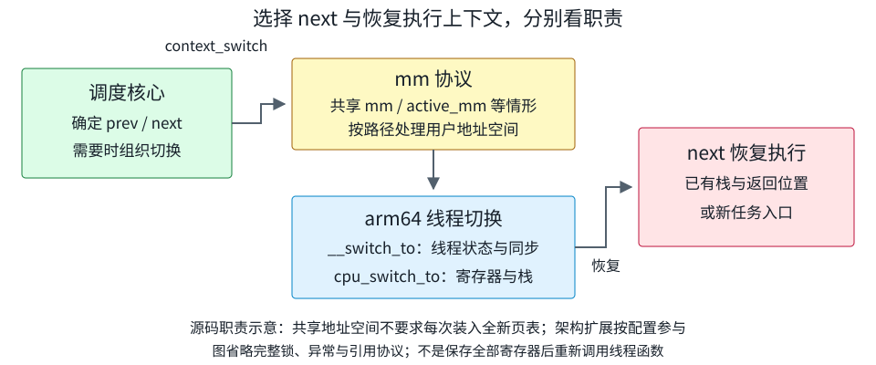
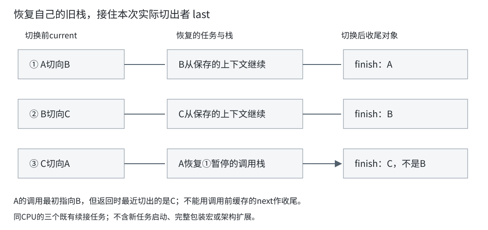

# 调度核心与 arm64 切换：从请求到恢复执行

CFS 或实时类可以判断“现在应该换人”，但不能自己在任意现场切换线程。调度核心统一组织当前状态、类选择、地址空间和架构上下文的交接。

本篇基于Linux 6.1.158、arm64、RT补丁与`PREEMPT_RT=y`，从 [任务与 rq](01-task-rq.md) 和 [唤醒](02-wait-wakeup.md#ttwu) 继续。它展开[单 CPU 循环的交接部分](../../00-overview.md#dispatch)：输入是当前任务、候选及调度原因，输出是下一任务继续执行，以及旧执行关系完成收尾。

先走一次普通 **A→B**，按调度核心、mm、arm64 现场和收尾展开；最后再回看请求来源、RT 锁等待和选择重试。这样能先看清事务，再理解入口和变体。

<a id="core"></a>

## 1. 核心事务：处理 prev，选择 next

固定同一 CPU：A 当前执行，B 已经 queued；A 等待数据，且在核心核对时仍为 `TASK_INTERRUPTIBLE`，B 最终被选中。正常过程是：

| 步骤 | 改变什么 | 由谁完成？ |
| --- | --- | --- |
| A 进入调度 | 保存 prev=A，稳定本 CPU 的 rq，更新时钟 | 调度核心 |
| 处理阻塞 | A 退出普通候选；执行使用关系尚未全部释放 | 核心退队包装和类回调 |
| 选择 B | 类选择得到 next=B，发布当前任务关系 | 核心和调度类 |
| 交接地址空间 | 根据两者的 mm/active_mm 关系处理 | `context_switch` 与 mm |
| 交接线程现场 | 保存 A 的栈/返回现场，恢复 B 的现场 | arm64 切换实现 |
| B 完成收尾 | 释放 A 的旧 `on_cpu`，处理适用引用 | `finish_task_switch` 等 |

这张表是本文各节的导航。A 若在状态核对前已被唤醒，阻塞退队会被取消；若选择仍是 A，则没有 A→B 的低层切换。这些分支与正常事务共享状态协议。

先固定普通阻塞或抢占主线，省略 tracing、调试及特殊调度模式的教学骨架：

```text
找到当前 CPU 的 rq 和 prev
在中断/锁协议下更新 rq 时钟
读取 prev 的等待状态
    若是阻塞方式且应睡眠：检查信号或退队
根据类和候选选择 next
清除本轮已经处理的重调度请求
    prev == next：结束本轮保护，不换线程
    prev != next：发布 current、记录切换，进入 context_switch
```

选择过程中可能有类快速路径、重新尝试和适用平衡动作，不是一条无条件的“五类逐个完整运行”链。类返回的是符合本轮条件的任务，策略细节由各类实现。

`kernel/sched/core.c:6557` 的实现区分 `SM_NONE`、抢占模式及 RT 锁等待等。主动阻塞会调整 `nvcsw`，适用非自愿切换调整 `nivcsw`；这类计数不是等待原因和硬件成本的完整分类。

本RT基线下`SM_MASK_PREEMPT=SM_PREEMPT`，因此`SM_RTLOCK_WAIT`不会被误判成普通抢占。rq锁及`p->pi_lock`仍是原始锁，调度核心的关键保护没有变成普通可睡眠的`spinlock_t`。
Rq 锁保证选择与本地候选变更一致。`p->pi_lock` 及跨 CPU 协议仍在唤醒、属性变化和迁移中发挥作用，不在每次切换中无条件获取所有任务锁。

### 1.1 阻塞与被抢占为何要不同处理？

普通抢占意味着任务仍想运行，不能因为它暂时失去CPU就`DEQUEUE_SLEEP`。主动等待则要结束普通候选资格，否则等待条件未成立的线程还会继续竞争。

`__schedule`读取一次prev状态并按`sched_mode`判断。可中断等待若有相应信号，先把prev恢复RUNNING；否则退队，再选择next。这里的单次读取与退队控制依赖也参与唤醒同步，不能随意反复读状态拼出两个时刻的判断。

`prev==next`分支完成保护收尾但不经过线程架构切换；只有`prev!=next`才更新切换次数、发布`rq->curr`并进入交接。因此统计schedule调用数、task切换数与异常返回次数，是三个不同对象。

<a id="mm"></a>

## 2. 地址空间交接：mm 与 active_mm

一个执行上下文包含用户地址空间关联，也包含线程自己的内核栈和架构状态。两者是不同资源：

- 普通用户任务有 `mm`。两个线程可以共享同一 mm，不因此共享同一执行栈。
- 内核线程通常没有用户 mm，但切换过程要管理 `active_mm` 和相应借用/引用。

`context_switch` 根据 next 是否有 mm，选择 lazy TLB 与 `active_mm` 交接，或 `switch_mm_irqs_off` 等路径。从内核线程返回用户任务，还可能把待释放引用放在 `rq->prev_mm`，由完成切换的路径收尾。

**每次调度不必更换用户页表根，更不等于复制整个地址空间。** 同 mm、不同 mm、用户与内核线程互切有不同操作。Arm64 的 ASID、TLB 与页表切换按 MM 协议处理，不用一个“清空 TLB”框概括全部情况。

源码：`kernel/sched/core.c:5308`，`context_switch`；arm64 地址空间依赖按 `arch/arm64/mm/context.c` 与实际可用头文件继续定位。

### 2.1 四种mm交接分别改变什么？

| prev -> next | 地址空间处理主线 | 延后收尾 |
| --- | --- | --- |
| 用户 -> 用户 | 按`prev->active_mm`与`next->mm`切换；共享mm有相应优化 | 不复制地址空间；架构TLB/ASID处理仍按条件 |
| 用户 -> 内核线程 | next借用prev的active_mm，取得相应引用 | 内核线程没有因此得到一个新的用户mm |
| 内核线程 -> 内核线程 | 转交active_mm关系，清掉prev的相应借用字段 | 不是每次重复增加一份永久引用 |
| 内核线程 -> 用户 | 切到next的mm，旧借用引用放入`rq->prev_mm` | 在新执行上下文中的`finish_task_switch`收尾 |

`mm`与`active_mm`不是两个任意可互换的字段。前者代表任务拥有的用户地址空间，后者表达CPU当前执行所需的地址空间关系。引用转交、页表处理和线程栈切换需要正确排序，但由不同部分负责。

<a id="arch-switch"></a>

## 3. Arm64 线程现场：寄存器、栈与返回位置



`arch/arm64/kernel/process.c:522` 的 `__switch_to` 先处理适用线程状态：FPSIMD、TLS、调试寄存器、上下文 ID、扩展状态等有自己的条件，还包含 `dsb(ish)` 等同步。不能无条件删去这些处理，再声称一次切换只有十几个寄存器搬运。

`arch/arm64/kernel/entry.S:829` 的 `cpu_switch_to` 保存/恢复以 x19～x29、SP、返回位置为主的内核执行上下文，并有适用架构辅助处理。这对应函数调用约定下的调度现场，不是把所有用户寄存器在这里统一复制一遍。异常入口保存的现场与调度所保存的续接状态要分开。

保存 prev 的 SP 和返回位置后，加载 next 保存的值。返回时 CPU 已使用 next 的栈和续接点：

```text
A 的栈：进入 schedule -> 暂停
B 的栈：从以前暂停的切换点继续 -> 返回原调用者
以后再选 A：
A 的栈：从自己暂停的切换点继续 -> 返回原调用者
```

新建线程尚未经过普通暂停点，创建路径预先布置启动上下文，最终进入新任务相应入口。之后的切换仍是继续执行，不从线程函数开头重来。

本地源码包缺少 `arch/arm64/include/asm/switch_to.h`。本文据实际存在的通用调用点、`__switch_to` 和汇编入口说明交接；不声称已核对缺失的包装宏定义。

### 3.1 从汇编里看，恢复的到底是哪一组状态？

`cpu_switch_to`把prev的x19～x29、当前内核SP和LR存进其`thread.cpu_context`，从next的同类存储恢复，再更新SP及适用架构关系。x19～x29属于调用约定要求保持的寄存器；异常入口保存的用户寄存器现场属于另一层。

SP决定后续局部变量和返回地址在哪个栈上。LR决定低层`ret`续接到哪次调用后面。因此最关键的改变不是“换了一个task名字”，而是**同一段C代码的续执行已经归属于另一个任务此前保存的栈帧**。

本地还保存/加载SCS、安装适用的内核指针认证状态，并通过arm64的同步与扩展状态处理完成交接。源码路径少量摘录能说明主干，却不能据此把其余条件当作可删的无关宏。

<a id="finish"></a>

## 4. 切入后的收尾：结束旧执行关系

低层切换完成后，当前执行的是新任务，但它要协助结束旧任务在该 CPU 上的关系。`finish_task_switch(prev)` 处理旧任务状态、锁交接、相关引用和适用退出清理。

其中 `finish_task` 以 release 清除 prev 的 `on_cpu`，让相应唤醒者的 acquire 等待完成。这个顺序不能提前到旧栈/旧任务仍被使用时。

Rq 保护跨低层切换交接，最终通过相应辅助路径释放。它不是允许业务代码在持有任意 spinlock 的情况下调用 `schedule`；调度器自己的锁交接是受控内部协议。

退出的任务也不是执行到这里就由旧任务自己继续释放所有东西。`finish_task_switch` 中的旧状态和引用收尾，保证不能在仍使用的执行现场上提前销毁资源。

### 4.1 A以后恢复时，收尾对象为什么可能是C？

假设A/B/C都已经有保存过的普通续执行现场，在同一CPU发生：

| 本次交接 | 哪个任务开始续执行？ | 它应收尾谁的旧CPU关系？ |
| --- | --- | --- |
| A -> B | B | A |
| B -> C | C | B |
| C -> A | A | C |



A最初进入的是“A切向B”的调用，但它真正返回时，最近切出的是C，不能按调用前缓存的A收尾。低层返回值把实际切出任务带给恢复后的C语言路径，通用`context_switch`随后以正确prev进入`finish_task_switch`。

这里的教学形式可写成`last = architecture_switch(prev, next)`，`finish_task_switch(last)`；它表达契约，不冒充本地缺失包装宏的展开。现有arm64汇编恢复next的栈/返回位置时，返回值寄存器保留本次切出者，`__switch_to`也返回相应last。

这解释了为什么切换前后的“同一行C代码”不能按一个任务的直线调用栈理解。清除旧`on_cpu`、退出引用和mm借用收尾都依赖正确的切出对象；使用调用前缓存的任务会破坏这些协议。

<a id="request"></a>

## 5. 入口与变体：请求、抢占和选择重试

Tick、唤醒抢占、任务属性变化、预算消耗等可能使类算法要求重调度。`resched_curr` 设置适用请求，远程情况按条件通知 CPU。当前树还有 `resched_curr_lazy`，其作用必须与 lazy 配置和实际抢占入口一起理解。

请求不直接说明下一个任务是谁，也不保证当前现场马上可切换。实际入口常见有：

| 原因 | 当前任务是否还想执行？ | 与调度入口的关系 |
| --- | --- | --- |
| 主动等待 | 暂时不想竞争 | 等待接口设置状态，进入 `schedule` 等路径 |
| RT睡眠型锁竞争 | 等待获得锁 | `TASK_RTLOCK_WAIT`及`schedule_rtlock`，保留原业务等待状态 |
| 内核抢占 | 通常仍可运行 | 满足对应模型和上下文条件后进入抢占路径 |
| 返回用户态前检查 | 通常仍可运行 | 异常/系统调用返回工作在适用条件下处理请求 |
| 主动让出 | 仍可运行 | 类相关 yield 规则改变机会，再调度 |

Tick 只是其中一种判断时机；“没有每次 tick 切换”不表示调度失效。“调用了 schedule”也不表示必然换线程：选择仍可能是自己。

抢占条件不能简单写成“有标志就行”：关中断、抢占计数、原始锁临界区，以及 RT/lazy 分支影响可执行入口。详见 [抢占模型](../synchronization/01-pi-preempt.md#preempt)。

### 5.1 本地请求、远程通知和轮询分别做什么？

`resched_curr`要求rq保护已成立。若current已经有普通need-resched标志，本次可以直接结束；它不是每次请求都发送一次中断。

目标就是当前CPU时，设置任务标志和对应抢占请求即可。目标是另一CPU时，需发布目标current的请求，再判断该CPU是否正在适用idle polling；轮询CPU能够看到标志时可省掉IPI，否则发送reschedule IPI。

因此远程通知有两份契约：请求必须可见，目标CPU必须有机会处理。IPI只是提供后者的一种手段，不在发送者栈上替目标CPU选择任务。`resched_curr_lazy`又有独立标志与条件，未启用lazy特性时转普通请求，不把函数名直接翻译成固定延迟。

### 5.2 为什么选择路径还会重启？

本地`__pick_next_task`有一个fair快速路径：prev不来自更高类，且`rq->nr_running == rq->cfs.h_nr_running`时，可以直接进入公平选择，不必完整遍历所有类。若没有fair候选，则按协议转idle。

但公平选择为寻找任务或newidle balance等工作，可能释放/重取保护，状态随之变化。返回`RETRY_TASK`要求核心重启选择；它不是一个可执行任务指针。重启路径先处理prev与适用平衡，再按类顺序找候选。

```text
满足fair快速路径条件？
    是 -> pick_next_task_fair
        真实任务 -> 用它
        无fair任务 -> 处理prev后用idle
        RETRY_TASK -> 转完整重启
    否 -> 完整路径
完整路径：处理prev/适用平衡 -> 按类优先顺序取候选
```

如果prev来自RT类，不能仅因眼前只有fair候选就跳过更高类的相关交接/拉取机会。快速路径的条件表达的是“可以省哪一部分工作”，不是永久关闭其他类。

配置启用core scheduling时还有额外选择协议。本篇沿常规每CPU选择主线讲解，不把该扩展混成`__schedule`的必经步骤。

<a id="reading"></a>

## 6. 调试一个“已唤醒但很晚运行”的问题

把等待区间拆开，才知道需要看哪一层：

1. 事件何时发布，等待协议有没有真正结束？
2. 唤醒何时恢复候选，在哪颗 CPU 上？
3. 当前有什么更高类、组限流或 CPU 约束？
4. 请求到实际入口之间是否有不可交接区间？
5. 进入调度后是否真的 `prev != next`，切换何时完成？

这里不运行 tracing。事件含义和可设计的观测方案见 [观察与排障](../observation/01-observe.md)。更高优先级只能改变部分选择规则，不能消除锁依赖、硬件停顿或错误的等待协议。

返回 [专题首页](../index.md)，或沿 [多核信号](../placement/01-pelt.md) 继续解释 next 为什么出现在这颗 CPU。
