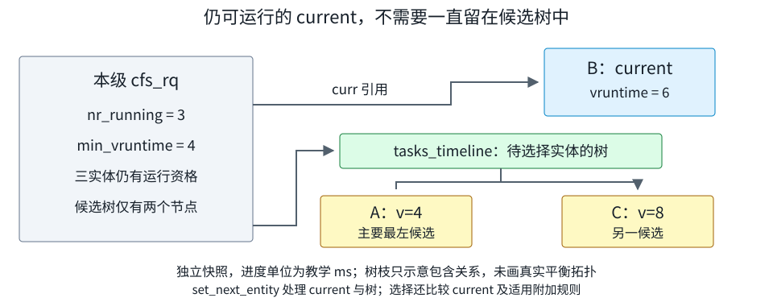
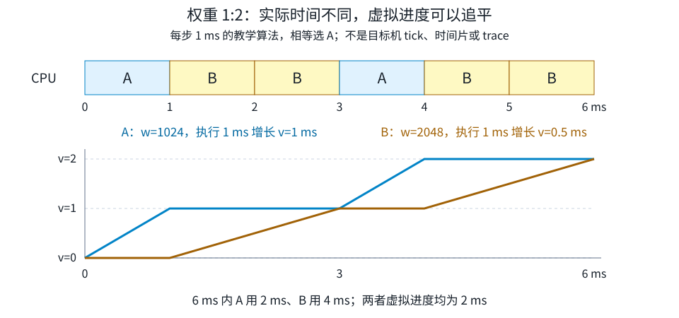
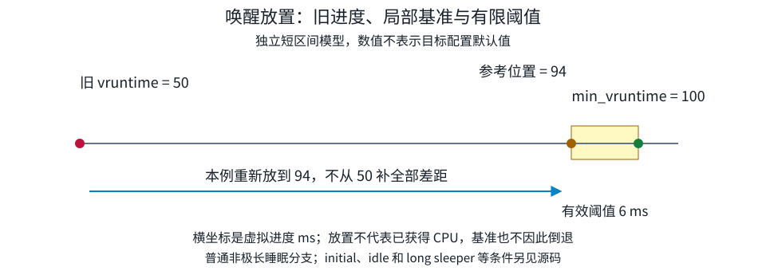
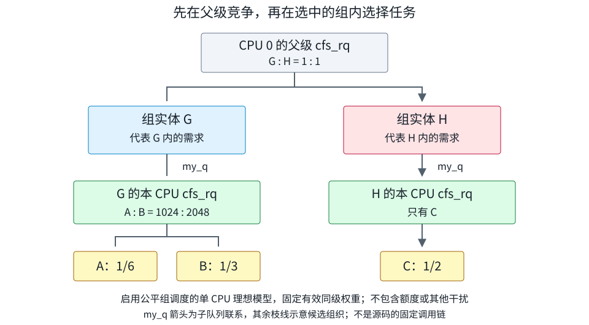

# CFS：时间份额、虚拟运行时间与任务选择

[总览](../../00-overview.md#time) 已经区分运行资格、时间分配和真正切换。本篇固定一个 CPU 的公平竞争，解释：**不同权重为什么能变成不同执行份额，内核怎样记录这些份额，又怎样从当前状态选择下一实体？**

基线为本地 **Linux 6.1.158、arm64、RT补丁与`PREEMPT_RT=y`**。先讨论普通公平任务、持续竞争、无组限流的模型，再加入睡眠、粒度和组层级。PREEMPT_RT不取消CFS公平竞争；其他配置另行说明，图表是算法推演，不是目标机调度记录。

本篇展开[调度架构中的 fair 策略](../../00-overview.md#architecture)。输入是本级可运行实体、权重及已获得服务，输出是公平类候选和必要的重调度请求。顺序为**共享模型 → 状态对象 → 记账 → 完整运行循环 → 睡眠/迁移/组层级**；跨类选择和 arm64 交接由 core 承接。

<a id="reading"></a>

## 阅读路线

| 要解决的问题 | 本文入口 |
| --- | --- |
| 公平份额为何不等于每次轮流一样久？ | [理想共享与权重](#shares) |
| 当前实体为什么不一直在树中？ | [队列、当前实体与基准](#objects) |
| 权重怎样进入实际运行记账？ | [Vruntime 与执行增量](#vruntime) |
| 何时需要考虑别人？ | [选择与运行粒度](#selection) |
| 睡很久的任务为什么不补回全部时间？ | [睡眠与重新放置](#wakeup) |
| 为什么跨 CPU 不能直接比较裸 vruntime？ | [局部基准与迁移](#migration) |
| 同样 nice 的三个线程为何不必各占三分之一？ | [任务组层级](#groups) |
| 怎样对应源码并继续研究？ | [源码路线与理解检验](#source) |

<a id="shares"></a>

## 1. 公平模型：同层需求按权重分享

### 1.1 一个理想的同时共享模型

先想象一个理想 CPU，可以让多个实体同时按比例推进。权重为 `w_i` 时，第 i 个实体的目标份额是：

```text
share_i = w_i / 所有同层竞争实体权重之和
```

等权实体得到相同份额；两实体权重 1:2，则目标分别为三分之一、三分之二。真实 CPU 只能先后执行，所以调度器需要把先后执行转换成足够接近的共享结果。

这里的比较对象是**同一个竞争层级中的可运行需求**。任务阻塞、出现更高调度类，或组被限流，都改变模型的参与条件。

### 1.2 为什么不能只数已经运行了多少毫秒？

假设 A、B 都执行了 2 ms：

- 等权时，两者获得的服务相当。
- B 权重是 A 两倍时，这不代表公平；B 的目标本来就更大。

若仍让“实际运行更少”作为唯一选择依据，就会把不同权重又变回平均分配。需要一个**已经按权重修正、可以比较进度**的量，这就是虚拟运行时间。

### 1.3 Nice 只是建立权重的一种入口

本树 `sched_prio_to_weight` 中，普通 nice=0 的逻辑权重为 1024，nice=-5 为 3121。仅看同层、持续竞争的这两个普通实体：

```text
nice=-5 的目标份额 = 3121 / (3121+1024) ≈ 75.30%
nice=0  的目标份额 = 1024 / (3121+1024) ≈ 24.70%
```

这是给定竞争条件下的比例，不是任意时间窗口里的硬保证。Nice 权重不是实时优先级，也不是组配额；`SCHED_IDLE` 公平策略另有特殊权重处理，不能无条件套用普通 nice 表。

源码入口：`kernel/sched/core.c` 的 `set_load_weight`、`sched_prio_to_weight`。下面的 1:2 推演使用给定逻辑权重，不声称它正好对应某两个 nice 值。

<a id="objects"></a>

## 2. 状态对象：实体、current、树与基准

### 2.1 从实体到本级 cfs_rq

| 对象/字段 | 主要职责 |
| --- | --- |
| `sched_entity.load` | 当前实体的权重等表示 |
| `run_node` | 实体进入相关树时使用的节点 |
| `exec_start`、`sum_exec_runtime` | 执行起点与累计执行量 |
| `vruntime` | 参与公平比较的执行进度 |
| `cfs_rq.tasks_timeline` | 本级待选择实体的红黑树与最左节点缓存 |
| `cfs_rq.curr` | 本级当前执行实体 |
| `cfs_rq.load`、`nr_running` | 本级运行需求权重及实体数量 |
| `cfs_rq.min_vruntime` | 单调推进的局部参考基准 |

字段定义见 `include/linux/sched.h` 和 `kernel/sched/sched.h`。这里不是完整字段字典，先抓住权重、进度、树和当前实体的关系。

### 2.2 可运行、入树和正在执行分别管理

下面是独立于六步模型的一个快照：同级三个普通实体 A、B、C，虚拟进度分别为 4、6、8，B 当前执行。



A、C 在树中等待选择，B 由 `curr` 指向。本例三者仍有运行资格，`nr_running` 可以为 3，但树中只有两个节点。**从树中取出当前实体不等于将它阻塞或减少全部运行资格。**

本树 `set_next_entity` 在相应条件下执行 `__dequeue_entity`，然后记录 `cfs_rq->curr`；`put_prev_entity` 则在实体仍 `on_rq` 时重新入树。实体的 `on_rq` 与树节点存在不是同一件事，也不要与 `task_struct.on_rq` 的迁移状态混用。

### 2.3 Min_vruntime 是基准，不是当前最小节点的别名

`update_min_vruntime` 结合当前实体和最左候选，并保持基准不倒退。它为新实体放置和迁移等操作提供局部参照。

```text
先看适用 curr 与树中最左实体的进度
得到本次候选基准
min_vruntime 保留旧值和候选中较新的值
```

这是正常短区间的关系说明；源码用相应有符号差值和 helper 处理比较，而不是任意整数都可直接代入普通 `min/max`。

唤醒实体可以被放到基准之前的有界位置，因此 `min_vruntime` 不总等于每个时刻树里的最小值。不要把它理解成任务数、全机时钟或“所有 CPU 共享的公平进度”。

<a id="vruntime"></a>

## 3. 执行记账：从实际时间到虚拟进度

### 3.1 执行相同时间，虚拟进度可以不同

用普通逻辑基准 1024 表达模型：

```text
Δv_i ≈ Δexec_i × 1024 / w_i
```

给定 A 权重 1024，B 权重 2048：

| 实体 | 实际执行增量 | 虚拟进度增量 |
| --- | --- | --- |
| A | 1 ms | 1 ms |
| B | 1 ms | 0.5 ms |
| B | 2 ms | 1 ms |

B 跑得更久才能增加同样多的虚拟进度。优先给虚拟进度较落后的实体机会，就会让 B 得到更多实际时间，而不是让它的虚拟进度永远落后。

本地 arm64 的内核权重还使用 `scale_load` 等表示方式；源码的 `NICE_0_LOAD` 和 `se->load.weight` 必须在同一表示下使用。表中的 1024 是逻辑权重说明，不是让读者直接把未缩放的值写进结构体。

### 3.2 六步推演：A 少运行，进度却能追平

限定一个教学算法：每步实际执行 1 ms，每步结束重新比较虚拟进度；相等时选择 A。暂时不模拟 Linux 的粒度、buddy、组调度或抢占入口。

| 步骤 | 执行谁 | A 的累计实际时间 | B 的累计实际时间 | A 的 vruntime | B 的 vruntime |
| --- | --- | --- | --- | --- | --- |
| 初始 | 无 | 0 | 0 | 0 | 0 |
| 1 | A | 1 | 0 | 1 | 0 |
| 2 | B | 1 | 1 | 1 | 0.5 |
| 3 | B | 1 | 2 | 1 | 1 |
| 4 | A | 2 | 2 | 2 | 1 |
| 5 | B | 2 | 3 | 2 | 1.5 |
| 6 | B | 2 | 4 | 2 | 2 |

表中单位均为 ms，是为阅读换算的数值。源码使用相应纳秒记账；这个固定 1 ms 步长**不是 CFS 的真实时间片，也不是实际机器 trace**。



图的上半部看实际 CPU 归谁使用，下半部看虚拟进度怎样增长。两条线追平时，B 已获得 A 两倍的实际时间。这解释了“按虚拟进度选择”为什么可以实现权重份额。

### 3.3 当前源码怎样记账？

`update_curr` 先定位当前实体，用 `rq_clock_task` 与 `exec_start` 计算执行增量，再更新累计执行时间和 vruntime。下面只摘录核心动作，省略统计、带宽及其他处理：

```c
/* kernel/sched/fair.c: update_curr, teaching excerpt. */
delta_exec = now - curr->exec_start;
curr->exec_start = now;
curr->sum_exec_runtime += delta_exec;
curr->vruntime += calc_delta_fair(delta_exec, curr);
update_min_vruntime(cfs_rq);
```

`calc_delta_fair` 的本树形式是：

```c
/* kernel/sched/fair.c:694. */
static inline u64 calc_delta_fair(u64 delta, struct sched_entity *se)
{
    if (unlikely(se->load.weight != NICE_0_LOAD))
        delta = __calc_delta(delta, NICE_0_LOAD, &se->load);

    return delta;
}
```

基准权重可直接沿用增量，其他权重通过对应整数计算换算。它不是每次调用浮点除法；时钟读取、增量有效性检查和相关统计也不能从上面的短片段删掉后当成完整可调用实现。

`sum_exec_runtime` 回答实际执行累计了多少，`vruntime`回答在当前公平模型中推进了多少。二者用途不同。

<a id="selection"></a>

## 4. 运行循环：入队、选择、记账和交出 CPU

先把前面的权重、实体和 vruntime 放进一个完整循环。固定单层 A/B、逻辑权重 1024/2048，没有更高类和组限制：

| 阶段 | 关键状态变化 | 本地实现中的对应操作 |
| --- | --- | --- |
| 恢复候选 | 更新当前进度，把新实体纳入本级权重/资格，放入候选树 | `enqueue_entity`，睡眠唤醒另有放置处理 |
| 选择 | 比较 current 与树中候选，确定本级 next | `pick_next_entity` |
| 开始执行 | next 从树转到 `curr`，仍保留运行资格，建立执行起点 | `set_next_entity` |
| 执行记账 | 实际增量按权重转换为虚拟进度，推进局部基准 | `update_curr` |
| 检查换人 | tick 看本轮执行与差距；唤醒看可比较实体与粒度 | `check_preempt_tick`、`check_preempt_wakeup` |
| 交出 CPU | 仍 runnable 的旧实体回候选树，阻塞者结束本级资格 | `put_prev_entity` 或退队协议 |

例如 B 执行 2 ms 后虚拟进度只增加 1 ms，这个差异已进入下一次选择。算法没有另外存一个“欠 B 一毫秒”的业务账单。唤醒、tick 和阻塞从不同阶段进入循环，完整调用路径也有组调度快路径，不能把本表当成一条逐函数必经链。

下面依次展开**选择谁、何时请求、怎样改变成员**。Slice 的多层计算放到[任务组](#groups)之后，先把单层循环走通。

### 4.1 先比较进度，再处理适用的附加选择

树按 vruntime 组织，最左节点是一个重要候选。但当前实体在树外，`pick_next_entity` 会把当前实体也纳入比较。

在此基础上，本树还处理 `next/last/skip` 等 buddy 选择。它们在适用的公平差距条件下偏好或暂避某个实体，以兼顾局部性等因素；不能凭偏好永远跳过公平约束。

例如图中 current B 的进度 6，树最左 A 为 4，可以先把 A 作为主要候选；若 current 本来更落后，则不能因为它不在树里就忽略它。附加规则还会影响最终返回，不把这两个例子当成所有配置的完整决策表。

把本地`pick_next_entity`的主要决策展开，可得到以下教学伪代码：

```text
left = 树最左实体
若curr存在且比left更早，或树为空：
    left = curr
candidate = left

若candidate正是skip：
    从树后继/树最左和curr中找第二候选
    第二候选不比left落后太多 -> 暂用第二候选
若next buddy存在且不比left落后太多：
    candidate = next buddy
否则若last buddy存在且不比left落后太多：
    candidate = last buddy
返回candidate
```

这里“落后太多”的比较由`wakeup_preempt_entity`给出，不是另造一套优先级。固定left虚拟进度10 ms，并设针对left的有效虚拟粒度2 ms：buddy进度11，差1，可以满足相应偏好条件；buddy进度13，差3，应因太不公平而被拒绝。这个独立模型不表示next/last必定已设置，也不涉及idle特殊分支。

`skip`先找替代，再接受next/last偏好，顺序会影响结果。`clear_buddies`与入队/退队等路径又负责取消过时偏好，不能把曾经被唤醒的对象永久留为优先候选。

### 4.2 Tick 与唤醒分别提供判断机会

| 情形 | 本树的主要检查 | 产生什么结果 |
| --- | --- | --- |
| 当前实体持续执行 | `entity_tick`、`check_preempt_tick` | 更新执行量，结合理想份额、粒度和差距考虑重调度 |
| 新任务被唤醒 | `check_preempt_wakeup`、`wakeup_preempt_entity` | 更新相关状态，比较当前与唤醒实体的进度及虚拟粒度 |
| 当前任务主动阻塞 | 公平退队与调度核心 | 结束相应资格，重新选择可运行任务 |

本地 tick 路径使用 `resched_curr_lazy`。未采用相应 lazy 分支时还有回到普通请求的包装行为，不能从函数名断言目标机一定延迟抢占。

唤醒比较也不只是 `waker.vruntime < curr.vruntime`：适用 helper 会把唤醒粒度换算到相应虚拟进度，再判断差距是否足够。层级、限流和配置还可能先阻止此判断。

这些结果首先是请求或选择信息。真正在哪个时刻进入 `__schedule`，还取决于执行上下文与抢占入口，见 [总览的执行交接](../../00-overview.md#dispatch)。

`check_preempt_tick`不是单个“slice到期”判断。先比较current自本轮选择以来的实际执行量与理想slice；超过则请求重调度并清除其buddy偏好。未超过时，如果实际执行还小于最小粒度，先避免过早打断；达到该粒度后，再比较current与树最左实体的进度差。

固定current为普通基准权重实体，ideal_runtime=4 ms、最小粒度=1 ms：

| current本轮执行 | current比left领先的虚拟进度 | 相应分支 |
| --- | --- | --- |
| 5 ms | 任意 | 超过理想slice，请求重调度 |
| 0.8 ms | 5 ms | 本轮执行未达最小粒度，在该分支先返回 |
| 2 ms | 5 ms | 已达最小粒度，差距又超过理想runtime，请求重调度 |
| 2 ms | -1 ms | current仍更落后，不因这项差距请求抢占 |

图表限定进入常规tick检查的条件；hrtick、组限流或更高类可另行改变结果。比较的实际时间与虚拟时间必须放回当前算法和权重场景理解，不能跨CPU套数。

唤醒检查又先处理自唤醒、限流、已有请求和idle策略等情况，再通过`find_matching_se`把来自不同组的任务提升到可比较的同层实体。若直接拿两个叶任务vruntime比较，就可能把它们各自组内的进度当作同一竞争层级。

### 4.3 一次当前实体交接改变哪些关系？

在普通、本级有实际交接的模型中，可以追踪：

1. 核算旧 current 的执行进度。
2. 仍可运行的旧实体回到适用候选组织；已经阻塞的实体不再按同样方式入树。
3. 选定下一实体并从树中取出，在本级成为 current。
4. 重新建立这次执行的起点和有关统计。

这是关系变化，不是所有 `pick_next_task_fair` 快路径都按同一组函数名机械调用。启用组调度时，选择还可能逐级进入子队列。

<a id="wakeup"></a>

## 5. 睡眠与唤醒：有界放置和抢占检查

### 5.1 睡眠不是持续的运行需求

A 一直运行，B 睡眠很久。若 B 醒来后保留极旧进度，并要求追平 A 的全部推进，B 就可能长时间独占 CPU，损害本来持续参与竞争的 A。

但若完全不照顾唤醒需求，短周期交互工作又可能迟迟得不到 CPU。CFS 需要在这两点之间提供有限的放置调整，而不是把睡眠时间全部换成运行欠账。

### 5.2 Place_entity 提供有界的参考位置

本树普通、非极长睡眠的唤醒分支先根据本级 `min_vruntime` 和适用阈值得到参考值，再与实体旧 vruntime 比较：

```text
reference = min_vruntime - 有效唤醒阈值
new_vruntime = max_vruntime(old_vruntime, reference)
```

阈值受普通/idle 公平策略和 `GENTLE_FAIR_SLEEPERS` 等条件影响。下面固定有效阈值 6 ms，仅作短区间推演：

| 输入 | 数值 |
| --- | --- |
| 当前本级基准 | 100 ms |
| B 的旧 vruntime | 50 ms |
| 本例有效阈值 | 6 ms |
| 参考位置 | 94 ms |
| B 重新放置后的进度 | 94 ms |



B 不从 50 ms 开始追全部差距，也不简单等于 100 ms。基准本身保持单调，而唤醒实体可以暂时在它之前，两者用途不同。

6 ms 不是目标配置默认值。极长睡眠还通过 `entity_is_long_sleeper` 等处理比较回绕问题，初次创建又有 `START_DEBIT` 相关分支，不能把上述规则扩大为所有实体的初始化。

### 5.3 放置与请求抢占还是两个阶段

`enqueue_entity` 在维护本级权重、状态和适用负载信号后处理唤醒放置。之后的抢占判断，还要考虑当前实体、差距、层级及其他条件。

放得较靠前只是帮助参与竞争，不证明当场运行。另一个调度类、组限流或当前不可交接的执行区间，都可能影响结果。

### 5.4 入队为何先更新时间，再改位置与成员？

`enqueue_entity`要同步几类状态，顺序有意义：

1. 按是否需要renormalize、是否current，安排局部基准转换的时机。
2. 更新旧current，让本级基准推进到相应当前时刻。
3. 同步PELT、组需求和有效权重，再把新实体权重加入本级竞争。
4. 普通唤醒按`place_entity`调整位置，迁移标志还触发相应处理。
5. 非current实体入树，发布`se->on_rq=1`，按首个实体等条件处理带宽和叶队列关系。

Current先转换基准再记账，是为了避免用错误坐标累计它的新执行；非current在旧current记账后转换，是为了不把它放到过时的本地基准。树排序、PELT贡献、运行资格和带宽在同一操作里协作，但不是同一种成员关系。

<a id="migration"></a>

## 6. 迁移扩展：把进度转换到新的局部基准

每个 cfs_rq 有自己的推进基准。CPU 0 的基准为 100，CPU 1 为 500，不能仅因为某实体 vruntime=110，就认为它在另一 CPU 上比进度 510 的实体“欠得更多”。

迁移需要在适用路径中处理原基准与目标基准的关系。本树 `migrate_task_rq_fair` 对 `TASK_WAKING` 等情形减去原参考，后续 `enqueue_entity` 在相应条件下加上目标参考，并维护有关负载联系。

```text
位置 = 局部基准 + 相对进度
换到另一局部基准时，需按路径重新表达位置
```

这不是任意外部调用者可以自行加减字段的迁移算法。可运行、睡眠、迁移中的实体有不同处理，引用、队列、CPU 定位和时钟也要同步。

因此，一个 `vruntime` 数值只有放回其所属队列、状态和比较协议，才有实际意义。

固定一个需要renormalize的迁移模型：源基准100 ms，实体位置110 ms，相对进度为+10 ms；目标基准500 ms，则目标表达可为510 ms。若直接带110入目标树，可能把它误当成比所有目标任务落后很远，得到不应有的优势。

但是普通未迁移的唤醒，不需要统一执行这组加减。本地`enqueue_entity`按`!ENQUEUE_WAKEUP || ENQUEUE_MIGRATED`决定renorm；`migrate_task_rq_fair`又按TASK_WAKING等状态安排源端转换。数值模型用于解释坐标关系，实际路径必须先确认状态与flags。

<a id="groups"></a>

## 7. 层级扩展：任务组与逐层份额

### 7.1 上层竞争者可以是任务组

启用 `CONFIG_FAIR_GROUP_SCHED` 时，任务组可以由组实体参加父级 cfs_rq 的竞争；该实体的 `my_q` 联系它代表的子队列，任务实体则在适用组内参与竞争。



沿用前面的 A/B 权重 1024:2048。现在固定一个 CPU、两组 G/H 的有效同级权重相等，没有配额限制；A/B 放入 G，H 内只有 C：

```text
G : H = 1 : 1
A : B 在 G 内 = 1 : 2

理想全局份额：
A = 1/2 × 1/3 = 1/6
B = 1/2 × 2/3 = 1/3
C = 1/2
```

A/B 在 G 内仍按 1:2 分享，但 G 本身只拿父级的一半。C 独自使用 H 的份额，不需要与 G 内两个叶任务直接比较权重。即使改为三个叶任务同权，分组仍会得到 1/4、1/4、1/2，而非各 1/3。

模型固定的是本 CPU 上的有效实体权重。实际组权重还与份额分配和本地需求等有关，不能直接把一个 `cpu.weight` 文件的数值当作所有 CPU 上的裸 `se->load.weight`。

### 7.2 选择、记账和 slice 要理解层级

`pick_next_task_fair` 沿适用实体/子队列找到真正任务，相关记账也要维护经过的层级。`sched_slice` 的权重分配循环体现的是各层竞争，不是永远用全机所有线程权重之和。

这里的任务组不是多核平衡中的 `sched_group`。前者组织资源竞争，后者描述调度域中的 CPU 分组，名称相近但对象和作用不同。

### 7.3 时间份额计算不等于硬预约

`__sched_period` 在运行需求较少时使用目标周期，较多时扩大周期，避免每个实体可分时间过短。`sched_slice` 再按相关层级权重分配基础份额。

给定一个基础周期 12 ms，同级权重 1024:2048，单层份额计算可以得到 4 ms、8 ms。但真实 slice 还受层级、`ALT_PERIOD`、`BASE_SLICE` 和特殊策略等条件影响。

本树 `BASE_SLICE` 分支还会对计算结果施加适用的最小粒度。因此不能从 4:8 推断下次一定先连续运行 4 ms，再严格运行 8 ms。

这种计算帮助判断本次执行是否已经足够、何时考虑别人，并非承诺任务每个窗口都得到一段不受干扰的专属时间。

本地`__sched_period`与`sched_slice`分两层计算：

```text
period = 运行实体数量超过阈值 ? 数量 * min_granularity : latency
slice = period
沿当前实体及其父实体：
    slice *= 本实体权重 / 本级总权重
按BASE_SLICE及idle条件应用相应下限
```

若实体尚未入队，计算时还要临时把它的权重计入该级总量，不能用尚未包含新任务的分母给它计算份额。开启ALT_PERIOD又可能用根部层级任务数决定周期。

对上图同一个两级模型，给定基础 period=12 ms，所有实体均已入队且无下限修正：

| 层级 | A计算后的slice | 为什么？ |
| --- | --- | --- |
| 初始 | 12 ms | 从给定基础周期起步 |
| G内 | 4 ms | A占本级1/3 |
| 父级 | 2 ms | G再占父级1/2 |

这就是“逐级乘比例”的实际含义。将A只与全机线程权重比较，会跳过组层级；仅将12 ms除以线程数，又会丢掉权重。

B 同理得到 `12 × 2/3 × 1/2 = 4 ms`，C 得到 `12 × 1 × 1/2 = 6 ms`。三者为 2/4/6 ms，与上图的 1/6、1/3、1/2 相符。实际粒度、周期来源或其他竞争改变时，重新计算，不能把这组数字当作运行预约。

### 7.4 权重与额度不能互相替代

权重决定适用竞争中的相对份额；CFS 带宽控制则为任务组管理可消费运行额度，耗尽后可能限流，祖先额度也会影响子组。

一个组仍有业务任务，不代表它的组实体此刻一定有资格继续竞争。也不能通过将某叶任务放到树最左边界来绕开组限流。

额度的领取、限流竞态、补充和祖先关系由 [CFS 组带宽](02-bandwidth.md) 承接；使用选型与单位见 [API 指南](../../api.md)。

<a id="source"></a>

## 8. 怎样从机制回到源码？

| 要验证的机制 | 当前源码入口 | 阅读时追踪什么 |
| --- | --- | --- |
| nice 如何形成权重 | `kernel/sched/core.c`：`set_load_weight`、`sched_prio_to_weight` | 普通策略/idle 特例、逻辑与缩放权重 |
| 当前实体如何推进 | `kernel/sched/fair.c`：`update_curr`、`calc_delta_fair` | 时钟、执行增量、实际累计量与 vruntime |
| 树和 current 如何交接 | `__enqueue_entity`、`__dequeue_entity`、`set_next_entity`、`put_prev_entity` | 树成员、on_rq 和 current 分开 |
| 基准怎样推进 | `update_min_vruntime` | 当前与最左候选、单调比较 |
| 选择谁及何时考虑别人 | `pick_next_entity`、`sched_slice`、`check_preempt_tick`、`check_preempt_wakeup` | 当前候选、粒度、buddy、配置及请求 |
| 睡眠/迁移怎样改变位置 | `place_entity`、`migrate_task_rq_fair`、`enqueue_entity` | 旧值、参考基准、唤醒/迁移标志 |
| 组层级如何得到任务 | `pick_next_task_fair`、`for_each_sched_entity` 等适用路径 | 当前层实体、子队列和最终任务 |

具体定义还见 `include/linux/sched.h`、`kernel/sched/sched.h`。这些内部入口按 rq 等保护协议调用，不是普通模块可随意调用的分配或排序 API。

树的最左候选有缓存，给定树上的插入/删除通常需要平衡树操作；整个选择和切换还包含层级、记账、同步及可能的均衡工作，不能用一个复杂度标签承诺固定调度时延。

## 9. 用条件变化检验理解

| 改变什么 | 应能解释什么 |
| --- | --- |
| 权重 1:2 改为 1:1 | 相同执行增量的虚拟增长相同，理想份额不再偏向 B |
| B 从持续竞争改为经常阻塞 | 它不始终参与，不能对全窗口强求同一份额 |
| Current 比树最左还落后 | 选择必须纳入 current，不能只因它不在树里就忽略 |
| 一个唤醒实体很久未执行 | 需要按放置规则限制旧进度差距，而非补全部睡眠时间 |
| 实体换到不同 cfs_rq | 裸进度不能直接当成跨队列公平次序 |
| 三任务放到两个组层级 | 先有组之间的竞争，再有组内竞争 |
| 组额度耗尽 | 时间份额排序不能独立恢复该组资格 |

本篇已经连接公平模型与目标树的关键对象、记账、选择、放置和层级。继续读 [负载信号](../placement/01-pelt.md)、[跨 CPU 放置](../placement/02-placement.md) 和 [组带宽](02-bandwidth.md)；所有 feature 组合及目标抢占时延不由这些机制算例保证。

返回 [调度总览](../../00-overview.md)，选择 [其他深入问题](../index.md)，或查 [术语](../../00-overview.md#terms) 和 [源码依据](../../99-evidence.md#cfs)。本文未运行调度实验或修改任何目标参数。
