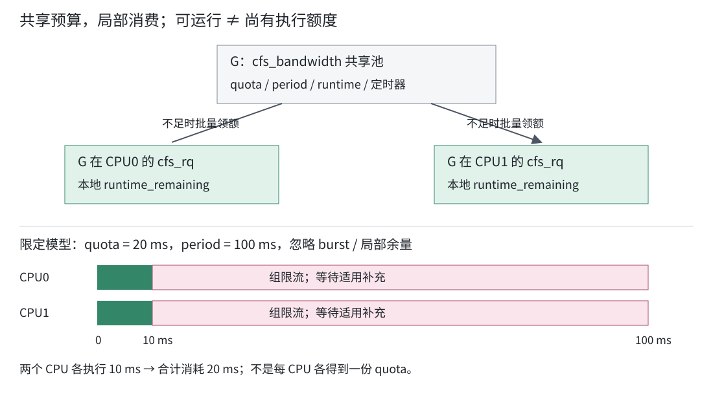
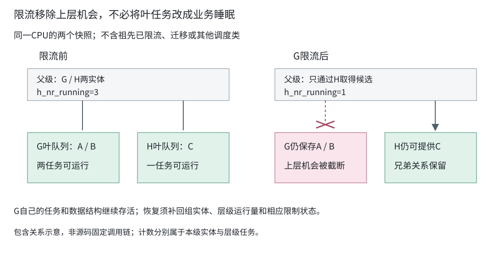

# CFS 组带宽：可运行任务为什么会被限流？

`cpu.weight` 决定竞争时如何分享；`cpu.max` 则限制适用周期内该组能消耗多少 CPU 时间。提高权重不能让没有额度的组继续执行。

本篇承接 [CFS 组实体层级](01-cfs.md#groups)，解释共享预算、每 CPU 额度和限流恢复。采用Linux 6.1.158、arm64、RT补丁及`PREEMPT_RT=y`；公平组与带宽配置是另一个条件，本专题在它们启用的前提下解释实现。

它位于[架构的资源控制层](../../00-overview.md#constraints)：输入是组上限和实际执行量，输出是本地可消费额度，以及组实体是否能继续提供候选。按**额度含义 → 共享/本地对象 → 消费与领额 → 限流/补充 → 层级及优化 → 统计**阅读。

<a id="model"></a>

## 1. 资源模型：聚合执行额度与周期

独立模型：组 G 的 quota=20 ms、period=100 ms，两个线程分别在两颗 CPU 上同时持续执行。若没有其他干扰和超额修正：

```text
经过 10 ms 墙上时间
CPU0 消耗 10 ms + CPU1 消耗 10 ms = 20 ms 组额度
```

额度因此可以较早用完，再等后续补充。这不是“每颗 CPU 都能跑 20 ms”，也不是“在任意滚动 100 ms 窗口都精确为 20%”。周期边界、局部余量和 burst 等还影响短窗口。



图的上下两部分分别展示额度组织和限定消耗时间线；为简洁省略局部 slice 的取领细节，不当成真实 trace。

<a id="pool"></a>

## 2. 状态与消费循环：共享池和每 CPU 额度

`struct cfs_bandwidth` 属于 task group，保存 quota、period、全局可分配 runtime、定时器和被限流队列等。每 CPU 上该组的 `cfs_rq` 保存 `runtime_remaining`、`runtime_enabled`、`throttled` 等本地状态。

执行先扣本地额度；不足时，按 slice 从组池申请。这样普通记账不需要每次都修改共享池，大系统上的锁争用更少。

一次完整循环可先概括为：

```text
组周期补充共享池
    本地需要执行 → 从池中领额
    执行 → update_curr 记账 → 本地余量减少
    余量不足 → 再领
        领到正余量 → 继续
        仍不足 → 请求调度并重检 → throttle
    后续补充/返还分发 → 本地变正 → unthrottle → 再参加竞争
```

周期补充与本地执行可能在不同 CPU 上并发进行。下面的限流重检与锁序正是为了让这个循环在并发下仍成立，而不是额外独立的算法。

`fair.c:5182` 的 `__assign_cfs_rq_runtime` 计算需要量：

```text
需要量 = 目标本地余量 - 当前余量
实际取得 = min(共享池可用量, 需要量)
共享池减去取得量；本地加上取得量
本地余量 > 0 才算本次可继续
```

本地余量可能为负，因为记账增量先扣除才检查。假设本地=-1 ms，目标=5 ms，共享池只剩3 ms：需要6 ms，但只能取3 ms，最终本地2 ms，仍可继续。这比“取一次一定有完整5 ms”准确。

时间在源码内部主要用纳秒；cgroup v2 `cpu.max` 的文本 quota/period 用微秒。看模型、用户接口和内部字段时要显式换单位。

### 2.1 额度在各处怎样守恒？

先忽略burst、局部保留和记账超额。某周期可将quota拆成“已执行消费、各CPU已领未用、共享池未分配”三部分。领额只在后两者之间转移，不是再生成一份quota；执行才把本地额度变为消费。

固定quota=20 ms，示例领额目标为5 ms：

| 事件 | 共享池 | CPU0本地 | CPU1本地 | 已消费 |
| --- | --- | --- | --- | --- |
| 本周期初始 | 20 | 0 | 0 | 0 |
| CPU0领5 | 15 | 5 | 0 | 0 |
| CPU1领5 | 10 | 5 | 5 | 0 |
| 两CPU各执行3 | 10 | 2 | 2 | 6 |
| CPU0再执行2 | 10 | 0 | 2 | 8 |
| CPU0再领5 | 5 | 5 | 2 | 8 |

单位均为ms，数字是固定模型，不是读取默认slice。共享池变为0也不表示所有CPU立即停：它们可能还有本地已领余量。相反，本地已负值也不代表一定限流，还要尝试补足并重新检查。

<a id="throttle"></a>

## 3. 限流事务：重检额度并改变祖先可见性

`account_cfs_rq_runtime` 记账后，本地额度不足且无法补足时请求重新调度。本地树该处使用 `resched_curr_lazy`；是否延迟兑现须结合实际配置，不能声称扣到零的瞬间已经完成所有退队。

进入 `throttle_cfs_rq` 后，组队列登记到 throttled 列表，并沿公平层级移除/更新相应组实体和可见任务量。叶级可以仍有任务和自己的内部队列，但不能经由已被限制的祖先得到正常选择。

这与业务阻塞不同：线程可能仍为 `TASK_RUNNING`，只是不再能通过当前公平层级取得执行。把 `ps` 的 R 状态当成“可以无条件被 CPU 选择”，会看错限流。

`throttle_cfs_rq` 在真正限流前，还在带宽锁下尝试取得足以使本地余量为正的极小额度。原因是补充可能与限流检查竞态；如果已经有额度却错误退队，可能错过本次恢复而等到另一周期。这个重检保证状态转换不依据过时的一次失败。

### 3.1 限流后哪些对象还在，哪些关系消失？

固定CPU0父级同时有G和H，G内A/B可运行，H内C可运行；进入限流前共三个叶任务。G额度耗尽并限流后：

| 关系 | 限流前 | G限流后 |
| --- | --- | --- |
| G叶队列的A/B | 保留为可运行实体 | 仍保留，不通过业务睡眠逐个撤销 |
| G在父级的组实体 | 参与父级候选 | 相应退队，不能再向下选择A/B |
| 父级可见层级任务量 | 3 | 减去G的2，剩H的1 |
| CPU普通运行量 | 能看到A/B/C | 只通过未受限路径看到C |
| A/B业务状态 | RUNNING | 可以仍为RUNNING |



`throttle_cfs_rq`沿实体链退队/减计数，遇到仍有其他子需求的祖先时，保留该祖先实体，并继续更新相应层级运行量。它不是把整条祖先链及兄弟H一起无条件删除。

组层级的throttle_count与限流时钟又保存传播状态，PELT可冻结受限区间的相应时钟，避免把“不能取得组额度”简单解释成任务天然idle。恢复时要解除层级限制并补回候选关系，不只是清一个叶任务flag。

<a id="replenish"></a>

## 4. 恢复事务：周期补充、分发与返还

带宽定时器更新共享额度，并向限流的本地队列分配。获得可用额度后，`unthrottle_cfs_rq` 解除相应限制，恢复层级实体和运行量；如果当前 idle 等条件要求，会请求重新选择。

解除限流不等于立即运行：恢复后还要与其他实体、类和祖先约束竞争。

局部队列变空时，可以按协议返还多余 runtime，保留少量本地余量减少反复领额度的开销。还有 slack timer 分发等适用路径；局部余量并非全都在每个周期边界清空。因此短时间测量可以与最简单的 quota 时间线有差异。

源码入口：`do_sched_cfs_period_timer`、`distribute_cfs_runtime`、`return_cfs_rq_runtime`、`unthrottle_cfs_rq`。本篇给主线与关键竞态，不将所有计时器回调串成同一个同步调用。

### 4.1 为什么分发要释放带宽锁再逐个取rq锁？

记账领额已有“rq保护 -> 组带宽锁”的方向。周期回调如果持组带宽锁，再等所有rq，会与另一CPU持rq等待组锁形成反向嵌套。

本地周期路径在需要分发时释放带宽锁，`distribute_cfs_runtime`沿RCU保护的限流队列逐个取得相应rq锁，再短暂取带宽锁转移runtime。拿到rq后还要检查该队列是否仍throttled，不能相信遍历开始时的一份旧列表状态。

```text
周期刷新共享池
发现有throttled队列 -> 放开组锁
对每个仍受限的本地队列：
    取该rq锁，重检throttled
    取组锁，把可用额度转来
    本地余量恢复正值 -> unthrottle
    释放相关保护，继续下一队列
```

分发优先补到“足以变为正值”，不是保证每个队列立即得到完整slice。若原余量=-2 ms、池只剩1 ms，补完仍为-1，必须继续受限；不能发一次通知就放它执行。遍历期间别的CPU也可能领额、返还或退出限流，重检和计时器后续机会共同维持一致性。

### 4.2 空队列为什么不立即返还所有余量？

`return_cfs_rq_runtime`只对相应已空、启用runtime的队列处理。返还量是`runtime_remaining - min_cfs_rq_runtime`，小于等于0则不返还；本地保留小额，减少睡眠/唤醒频繁时反复获取共享锁。

本地常量保留量为1 ms。若本地5 ms全部未用，变空时可返还4 ms、保留1 ms。余量属于这个CPU的局部缓存，不是可随意跨CPU转用的额外预约。

返还时可能发现别的本地队列受限，但当前还持有rq保护，不能立即倒转锁序去解除它们的限制，因此用slack计时器安排后续分发。这是延后工作的原因，不是固定等满下个period。

<a id="hierarchy"></a>

## 5. 层级限制：同时遵守祖先上限

若父组 P 限制整体，子组 G/H 也各有限制，则每次执行同时受祖先路径约束。模型：

| 对象 | quota/period | 当前情况 |
| --- | --- | --- |
| 父 P | 30/100 ms | G 已用20 ms，H 已用10 ms，父预算耗尽 |
| 子 G | 20/100 ms | 自己耗尽 |
| 子 H | 20/100 ms | 自己还有10 ms，但父已限制 |

H 的剩余不能绕过 P。子配额之和可以大于父配额，以便不活跃的兄弟少用时另一组多用；这不是同时向每个子组保证全部上限。

同样，单 CPU 得到的有效组权重还受组负载分布影响，不能把 `cpu.weight=100` 当成每个 CPU 上固定同样的实体原始权重，见 [CFS 层级](01-cfs.md#groups)。

<a id="burst"></a>

## 6. 扩展控制：burst 与 uclamp 的不同作用

目标树有 `cpu.max.burst`。在适用配置和控制路径下，允许以限定的积累余量承接短时突发；它不是每周期无条件再多给一份 burst，也不是 Deadline 的严格业务截止期保证。

`cpu.uclamp.min/max` 是利用率约束，服务放置及调频等决策。它不让被限流的组继续跑，不保留 CPU 时间，也不直接等于硬件频率上限。

### 6.1 Burst在周期补充中怎样形成？

本地`__refill_cfs_bandwidth_runtime`先给共享runtime加quota，再限制到`quota + burst`。固定quota=20 ms、burst=10 ms，上一轮池里还留8 ms：

```text
补充前8 + 本次quota20 = 28 ms
上限quota20 + burst10 = 30 ms
本次池可保留28 ms，而非每次固定领30 ms
```

如果上一轮已用尽共享余量，则单看这一步只能从0补到20 ms，不会凭空生成10 ms积累。局部额度保留、归还及计时器时序还会影响瞬时状态，这个例子只演示共享池补充规则。

Burst改善突发需求的短时可用量，但会改变同CPU其他任务受到的干扰；它不让CFS成为具有业务截止期准入保证的DL服务器。

<a id="use"></a>

## 7. 使用时先查哪些数据？

`cpu.max`、`cpu.weight`、`cpu.max.burst` 与 `cpu.stat` 的当前值和增量，应连同祖先、cpuset、实际线程并行度一起看。V2 CPU 时间统计按微秒，不把 v1 文档的 `throttled_time` 纳秒字段原样套到 v2。

本地 `do_sched_cfs_period_timer` 在发现被限流队列时，按经过的带宽周期累计 `nr_throttled`。它不是每次叶线程暂停或每次本地 `throttle_cfs_rq` 调用的计数。

`throttled_usec` 来自该组各 CPU 上已结束的本地限流区间累计：`unthrottle_cfs_rq` 才把该区间加进组统计。因此它可以超过单个墙上区间，也可能尚未包含正在进行的限流。父组限流对孩子的影响不保证作为同样一份计数反映到子组自身文件里，应同时查询祖先，不能只看子组0增量就排除限流。

接口单位与选择见 [资源控制参考](../../api-reference.md#cgroup)，排障的增量和事件组合见 [观察篇](../observation/01-observe.md#limits)。

读源码先看 `kernel/sched/sched.h` 的 `cfs_bandwidth/cfs_rq`，再看 `fair.c` 的领额、记账、限流、补充四组入口；cgroup v2 ABI 以 `Documentation/admin-guide/cgroup-v2.rst` 为准。
