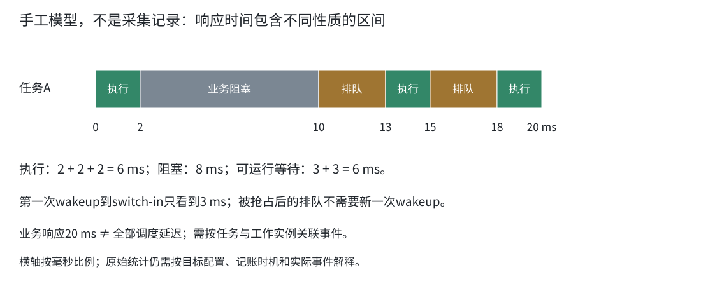
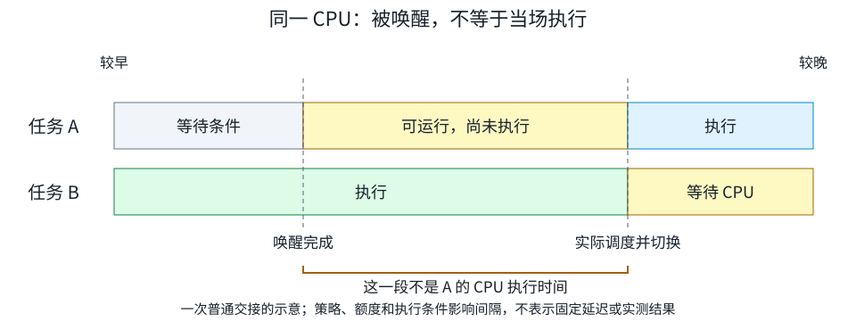

# 观察调度：从延迟问题反推状态、队列与约束

“线程运行晚了”可能指没有收到事件、还在等 CPU、组额度耗尽、锁依赖，或者频率/容量不够。先确定等待发生在哪层，再选择观察方法。

本篇按Linux 6.1.158、arm64、RT补丁与`PREEMPT_RT=y`给查询与观测思路，**没有实际执行tracing、绑定CPU、调参或压力实验**。命令是目标Linux环境中的只读查询示意，不在当前Windows主机运行。

它是[运行过程](../../00-overview.md#examples)的反向阅读：输入是业务停顿或性能异常，输出是可以继续验证的机制假设。先分执行/阻塞/可运行等待，再固定任务与配置，最后关联事件和资源统计。判断某个原因需要一组相互支持的证据，而非一个指标超过阈值。

<a id="intervals"></a>

## 1. 将一次恢复执行分成不同区间

先区分三个时间：任务实际执行，等待业务条件，以及已经可运行但没有 CPU。以下 20 ms 模型把三者分开；后面的 trace 和累计统计都回到这三种口径解释。

### 1.1 用一条手工时间线分清三种时间

以下是人为给定的教学模型，不是采集输出。固定观察A在0～20 ms中的状态：

| 区间 | A的状态 | 累计到哪里？ |
| --- | --- | --- |
| 0～2 | 执行 | CPU执行2 ms |
| 2～10 | 等业务事件 | 阻塞8 ms，不是runqueue等待 |
| 10～13 | 已唤醒但未被选择 | 运行队列等待3 ms |
| 13～15 | 执行 | CPU执行再2 ms |
| 15～18 | 被抢占但仍可运行 | 运行队列等待再3 ms |
| 18～20 | 恢复执行 | CPU执行再2 ms |



完整模型中：执行6 ms、业务阻塞8 ms、可运行等待6 ms，合计20 ms。仅看“业务响应20 ms”不能把20 ms都当成调度延迟；只测第一次wakeup到switch-in又只看到3 ms，漏掉后面仍可运行时的抢占等待。

每次业务完成应按工作实例关联开始/结束记录，再用任务事件解释中间阶段。调度器提供CPU机会，设备结果、锁依赖及用户业务完成属于其他边界。

### 1.2 将区间映射到事件记录点



若要测唤醒后延迟，应明确起点：

| 事件 | 表示什么 | 不能直接说明什么 |
| --- | --- | --- |
| 业务事件记录 | 数据/工作何时产生 | 调度器已经知道此事件 |
| `sched_waking` | 普通路径开始相应唤醒处理 | 已在目标 CPU 完成入队 |
| `sched_wakeup` | 相应唤醒完成的记录点 | 目标线程已经执行 |
| `sched_switch` 的 `next_pid=TID` | 调度切换选中目标 | 该业务已经完成 |
| `sched_migrate_task` | CPU 关联迁移相关事件 | 每次迁移都改善性能 |
| `sched_pi_setprio` | PI 有效属性变化记录 | 每个锁等待都实现 PI |

普通场景可以关联 wakeup 到随后 switch-in，但要保留 CPU、TID 和时序，处理重复通知、迁移及 trace 丢失。若任务原本 runnable，不一定每次重新执行前都有新的 wakeup 事件；当前任务特殊路径也可能产生不经历通常退队的记录。

记录线程可能退出，TID 后来可复用。长时间采集要结合 fork/exit 事件，不能仅按数字拼接多个生命周期。

<a id="facts"></a>

## 2. 先保存会改变解释的条件

本系列已经固定RT抢占基线；实际采样时仍记录其构建、其他配置和调度特性，以便复现结果。至少保存任务TID、策略、允许CPU、cgroup与祖先限制和CPU拓扑。若只是一个线程有问题，不用整个进程平均值替代它。

只读查询示意，路径中的 `TID` 和组路径要换成实际值：

```bash
cat /proc/TID/status
cat /proc/TID/schedstat
cat /sys/fs/cgroup/GROUP/cpu.max
cat /sys/fs/cgroup/GROUP/cpu.stat
cat /sys/fs/cgroup/GROUP/cpu.pressure
```

`status` 可帮助确定线程和允许范围；`schedstat` 的提供及更新受配置/开关影响，缺文件或值为零不自动表示没有等待。`/proc/TID/sched` 也依赖相关调试配置，字段口径以实际目标树为准。

### 2.1 `/proc/TID/schedstat`三个数字怎样读？

本地`fs/proc/base.c:510`在相应SCHED_INFO路径输出：

| 顺序 | 源码字段 | 意义与单位 |
| --- | --- | --- |
| 1 | `se.sum_exec_runtime` | 已记账的任务执行时间，ns |
| 2 | `sched_info.run_delay` | 累计适用运行队列等待时间，ns |
| 3 | `sched_info.pcount` | sched_info记录的到达CPU次数 |

它不是“执行、睡眠、总生存时间”三项，也不能将第三项直接等同于`nvcsw+nivcsw`。没有启用对应记账时，这条实现可以输出`0 0 0`。

`run_delay`在任务到达CPU或相应退队交接时累计；`sum_exec_runtime`也依赖记账更新。读一份快照不能要求正在执行/等待的全部区间都已按当前墙上时间结算。

同一任务生命周期内两次取样，可得到执行与等待增量。`Δrun_delay/Δpcount`可帮助描述这批已完成记账的到达，但可能包含采样开始前已经排队的时间；它不是严格将所有等待截断到本采样窗的均值，更不是P99。长期分布需要逐次事件记录。

<a id="trace"></a>

## 3. 怎样设计一份有用的 trace？

先在目标 tracefs 的 `available_events` 确认可用事件，检查 `events/sched/.../format` 的实际字段。根据问题选择少量 sched 事件，以及必要的业务、IRQ、锁或频率事件，而非打开所有 tracepoint。

如果过滤到一个 TID，要注意：

- `sched_switch` 需看 prev 和 next；只用采集线程的 current PID 过滤可能漏掉切入事件。
- 只保留目标任务会丢失它为什么没被选中的竞争者信息。
- 跨 CPU 比较要确认 trace clock 和时间口径；环形缓冲溢出会破坏区间推导。
- tracing 本身引入开销，不能把观测时延无条件当作无观测时延。

适用工具可对 sched 事件做时间线分析，但工具是否支持、采集权限、内核配置以及字段版本要单独确认。这里不提供伪造的 `perf`/ftrace 输出，也不把一次设置开关当成已经完成排障。

事件定义入口：`include/trace/events/sched.h`；发射位置回 `core.c`、`fair.c` 等实际路径核对。

### 3.1 如何关联一段可运行等待？

从目标TID的wakeup事件开始，记录允许/目标CPU和当时策略，寻找随后`next_pid=TID`的switch。中间若有migration，跟随任务而不是继续只盯旧CPU；找不到switch时先检查退出、丢事件、采样结束和有效过滤。

目标曾作为prev切出且仍RUNNING，也会开始新的可运行等待，不需要另一次业务wakeup。`prev_state`的输出包含实际状态编码和适用抢占标记，应按目标事件format解析，不用一个固定字符判断所有锁等待或迁移。

将RT锁等待混进普通queue delay也会误判。锁通知、`sched_pi_setprio`和业务通知不必一一对应；只有看到PI变化不能证明等待者已经拿到锁，只有看到业务wakeup也不能证明锁依赖已经解除。

### 3.2 延迟在哪层，就补哪层的记录

| 已定位的区间 | 需要补的记录 | 要排除的误判 |
| --- | --- | --- |
| 业务事件到waking之前 | 设备/业务发布点、线程化IRQ工作 | 把尚未发起调度通知的时间都归给CFS |
| waking到wakeup | 唤醒执行现场、原始锁/旧on_cpu交接 | 默认RT路径不是必经wake-list |
| wakeup到switch-in | 竞争者、目标CPU、组额度、请求兑现现场 | 简单以nice或单次CPU使用率解释所有等待 |
| 已切入到业务完成 | 实际执行、再次阻塞、设备或锁关系 | 误认为获得CPU即等于工作已完成 |

只记录目标自身可以说明“等了多久”，却常不足以说明“被谁、哪项条件限制”。补竞争者和相关控制状态比盲目增加所有tracepoint更有方向。

<a id="limits"></a>

## 4. Cgroup 应读增量，而不是只看累计数

固定同一 cgroup，间隔采样两次 `cpu.stat`：

```text
执行使用增量 = usage_usec_2 - usage_usec_1
被记为限流的带宽周期增量 = nr_throttled_2 - nr_throttled_1
限流累计增量 = throttled_usec_2 - throttled_usec_1
等效单 CPU 使用比例 = 执行使用增量 / 采样墙上时间增量（均为微秒）
```

例如100000微秒的墙上采样区间，组使用增量为160000微秒，则比例为1.6，即160%的等效单CPU使用；这可以由多个CPU并行产生。必须用两次读数的差值，不能把自创建以来的累计 `usage_usec` 除以本次短区间。

`nr_throttled` 按本地带宽周期处理累计，不表示每个线程被暂停多少次。`throttled_usec` 累计该组多个CPU的已结束本地限流区间，不能除以采样时长就宣称唯一线程“停止了120%墙上时间”；正在进行的限流还可能未计入。

同时读祖先限制和 `cpu.max.burst`。子组自身还有额度，不排除父组已经限流。`cpu.max`限制公平类带宽，不把RT/DL任务的使用量直接当成CFS配额消耗。`cpu.pressure` 描述适用 CPU 资源停顿，不等同于 utilization 或某个调用的等待时间。

两次采样应对应同一组实例；组被删除重建、计数回退或采样期间成员大幅变化时，先处理作用域变化，不继续套用原区间。多个文件的读取也不是一个原子快照。

### 4.1 零限流增量为什么仍不能立即排除配额？

本地限流时间在`unthrottle_cfs_rq`结束区间时累计。若两次采样都落在同一个仍持续的限流区间，时间增量可以还没反映完整停顿。另一方面，父组额度耗尽也可能限制孩子，而孩子自身统计没有同样变化。

因此应结合控制层级、当前候选状态及更完整的时间窗。`nr_throttled`增长说明相应带宽周期被记为受限，不提供每个线程的等待分布；`throttled_usec`多个CPU累计也不能直接作为每个业务实例的响应时间。

机制见 [组带宽](../fair/02-bandwidth.md)，接口单位见 [API 参考](../../api-reference.md#cgroup)。

<a id="questions"></a>

## 5. 按现象选择下一条证据

| 现象 | 先问什么 | 再查哪里 |
| --- | --- | --- |
| 数据到了，线程仍睡眠 | 条件发布、等待登记和对象存活是否正确？ | [等待竞态](../core/02-wait-wakeup.md#protocol) |
| 已 wakeup，却晚 switch-in | 候选 CPU、有无更高类、额度或不可交接区？ | switch 时间线、[核心切换](../core/03-schedule-switch.md) |
| 同级 RT 线程长期不运行 | 队头是否 FIFO 且不阻塞？ | [FIFO/RR 队列](../realtime/01-fifo-rr.md#fifo) |
| 可运行但整组周期性停顿 | quota、祖先、并行消耗和 burst 是否符合预期？ | cpu.stat 增量、[带宽](../fair/02-bandwidth.md) |
| 高优先级任务卡在锁上 | 谁拥有资源，依赖链是否继续推进？ | PI/锁事件、[同步篇](../synchronization/01-pi-preempt.md) |
| 某 CPU 空闲但线程排队 | 掩码、pinning、域和迁移收益是否允许？ | [放置与迁移](../placement/02-placement.md) |
| CPU 时间足够但业务变慢 | capacity、频率、热压力或内存/设备瓶颈？ | [信号与调频](../placement/01-pelt.md)、相邻子系统 |
| Deadline 设置失败/周期限流 | 参数单位、root domain、准入和预算是否正确？ | [DL 机制](../realtime/02-deadline.md)、[属性 API](../../api-reference.md#attr) |

每次只改变有证据支持的假设。观察方案不是运行验证；设备上真正获得 trace 后，还需要用实际配置、事件丢失和同步条件重新解释。
