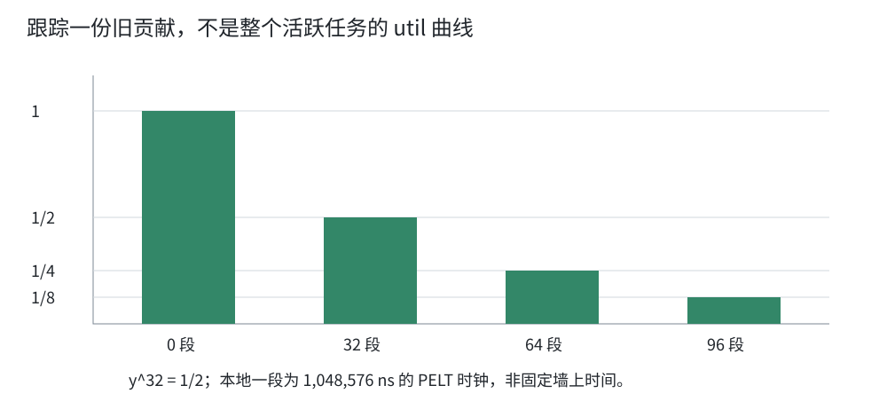
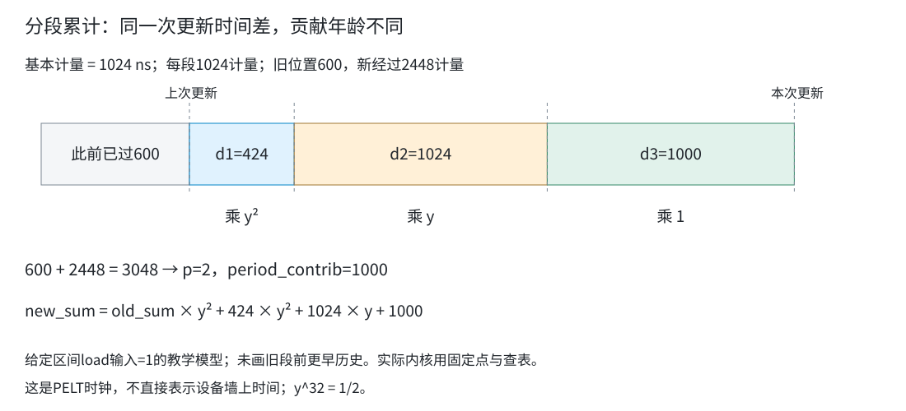

# PELT、util_est 与调频：调度器怎样估计运行需求？

放置线程时，调度器不知道它下一次会做多少工作。只看当前 rq 有几个人也不够：一个每秒运行一次的线程和持续计算线程，带来的需求不同。

本篇解释历史怎样形成信号，以及信号怎样进入 [多核放置](02-placement.md) 和调频。基线为Linux 6.1.158、arm64、RT补丁与`PREEMPT_RT=y`；硬件容量、频率归一化和其他配置按目标机确定。

它位于[架构的信号层](../../00-overview.md#placement)，把任务/队列的可运行与执行区间转换为历史估计，不直接决定 next。阅读顺序是**输入含义 → 时钟与单位 → 衰减计算 → 归属与聚合 → util_est → 消费者**。先看口径，再算数值，最后判断这些值能够回答什么问题。

<a id="signals"></a>

## 1. 输入含义：load、runnable 与 util

设 A、B 等权，在一个满归一化能力的 CPU 上持续竞争，没有其他任务、组限流或中断负担。它们一直有运行需求，各自约得到一半执行时间：

| 信号 | 对单个任务观察什么？ | A/B 模型的长期含义 |
| --- | --- | --- |
| runnable | 有运行资格的历史 | 两者都持续可运行 |
| util | 真正执行的历史 | 两者各获得约一半执行 |
| load | 带权的可运行历史 | 既反映资格时间，也包含份额权重 |

一个任务睡眠时，新的 runnable/running 输入为零，但过去的历史不会立即全部删除。如果只保留当下，周期线程每次唤醒都像首次出现，调频和放置容易反复重新爬升。

权重是“竞争时如何分享”，util 是“历史实际拿到了多少执行”。竞争激烈时实际执行低，并不必然说明任务没有更高需求；这也是均衡还要看 runnable、队列压力和其他分类的原因。

按本地1024标度看上述稳态模型，每个任务的 `runnable_avg` 可接近1024，`util_avg` 接近512；CPU队列聚合的 runnable 可接近2048，而 util 接近1024。前者反映两个持续的运行需求，后者反映一颗 CPU 的执行量，不能拿两个值都当成同一种“CPU百分比”。

<a id="invariance"></a>

## 2. 先固定时钟、单位与 arm64 归一化

PELT 的“经过时间”来自相应 PELT 时钟，不直接把采样墙上时间送入公式。本地 `pelt.c` 将纳秒增量右移 10，以 1024 ns 为基本计量；每 1024 个计量形成一段：

```text
基本计量 = 1024 ns
一段 = 1024 × 1024 ns = 1,048,576 ns
32 段 = 33,554,432 ns ≈ 33.55 ms（PELT 时钟）
```

文献中的“约 1 ms 分段、约 32 ms 半衰期”是近似说法。归一化使 PELT 时钟与墙上时间的推进不必相同，所以半衰期首先在 PELT 时钟上解释。

同样执行 1 ms，在不同频率或能力的 CPU 上完成的工作可能不同。适用归一化试图把已执行时间折算到统一能力口径。

`kernel/sched/pelt.h:95` 的 `update_rq_clock_pelt` 按 CPU 容量和频率缩放时间推进。若两种缩放比例是 1 和 1/2，一段非 idle 执行增量折算后约为原增量的 1/2。Idle 时又有同步和 lost-idle 修正，因此不能用一条线性缩放公式概括整段墙上时间。

比例来自架构和平台支持。在 arm64 可继续读 `arch/arm64/kernel/topology.c` 的容量/频率支持及 AMU 相关条件；没有支持、模型不准或不同 workload 时，估计的物理含义都有边界。1024 是归一化容量标度，不是任何程序都精确适用的性能分数。

<a id="decay"></a>

## 3. 衰减模型：近期贡献与历史贡献

PELT 即 Per-Entity Load Tracking。核心思想是指数衰减：新历史贡献较大，旧历史仍存在，但每经过一个分段继续衰减。

用归一化的分段输入 `x_i` 表示有资格或执行的比例，教学形式为：

```text
S = x_0 + y*x_1 + y^2*x_2 + ...
平均值 = S / (1 + y + y^2 + ...)
y^32 = 1/2
```

`x_0` 为最近段，`x_i` 为更早第 i 段；它不是在用户空间每毫秒采样一次的脚本。真实实现记录区间状态，在调度事件发生时把已经过去的区间累积进去。



图跟踪的是**一份既有历史贡献**，32、64、96 个段后分别剩 1/2、1/4、1/8，不是一个活跃任务整体 util 必然按这条曲线下降。持续执行还会加入新贡献。

分段长度与时钟归一化已在上一节固定；下面以这种时间口径计算累计贡献。

<a id="implementation"></a>

## 4. 实现计算：分段累积与平均值换算

计算所需的状态由 `sched_avg` 保存：`last_update_time` 定位上次更新，`period_contrib` 定位未完段；`load_sum/runnable_sum/util_sum` 保存贡献和，对应 `*_avg` 给消费者使用。Sum 是计算状态，avg 是换算结果，不能把两者当成相同单位的重复字段。

`struct sched_avg` 保存累计和、平均值、上次更新时间及当前未完段位置。更新包括：

1. 计算从上次更新到现在的时间增量，处理无推进等情况。
2. 若跨段，衰减旧的 `*_sum`。
3. 把旧段剩余、完整中间段、当前段的新贡献累积进去。
4. 使用包含 `period_contrib` 的除数同步 `*_avg`。

完整中间段用几何级数关系汇总，`decay_load` 用整段右移和查表乘法实现衰减，不逐段运行一遍事件。

关键入口：

- `kernel/sched/pelt.c:180`，`___update_load_sum`：时间和区间累积。
- `:257`，`___update_load_avg`：将 sum 转成平均值。
- `:306`，`__update_load_avg_se`：任务/组实体输入。
- `:320`，`__update_load_avg_cfs_rq`：队列输入。

任务实体的 runnable 输入通常对应自身资格；组实体的输入可以来自子队列任务量。不能把单任务的“0/1”输入直接推广为所有层级对象的含义。

### 4.1 一次跨段更新究竟加了什么？

时间增量先转成1024 ns计量，之后才分段。假设上次更新停在段内第600个计量，新经过2448个计量，则：

```text
600 + 2448 = 3048
跨过完整段数 p = 3048 / 1024 = 2
新段位置 d3 = 3048 % 1024 = 1000
旧段剩余 d1 = 1024 - 600 = 424
中间完整部分 d2 = 1024
```



固定这次区间的输入load=1，旧`load_sum`为1000；忽略整数查表误差，用同一`y^32=1/2`模型：

```text
new_sum = 1000*y^2 + 424*y^2 + 1024*y + 1000
          旧累计衰减   旧段剩余   完整中间段   新段已过部分
```

新经过的量并不是全部按同一个权重加入。越早的区间衰减越多，最新段尚未到下一边界，不加这一层衰减。这是`__accumulate_pelt_segments`汇总d1/d2/d3的原因。

更新平均值时，除数还包含当前`period_contrib`。若固定用完整段的除数，会把尚未经过的当前段当作idle，造成不必要的平均值摆动。实际内核用固定点累计、查表和移位，不在热路径使用浮点循环。

### 4.2 同样区间，三种输入怎样分开？

假设一个任务在该区间一直queued但没被选中，其runnable输入为1，running输入为0：load/runnable历史继续加入，util没有新执行贡献，只衰减旧值。

选中后running变1，util开始累计；阻塞后load输入为0，并约束本次runnable/running新贡献也为0。某些瞬间`cfs_rq->curr`还保留旧指针，不能只看指针存在就加执行贡献，源码的输入关系也处理了这类边界。

队列层面用本地权重和层级任务量形成相应输入，当前有实际公平执行才贡献其util。聚合量因此能反映竞争和执行的差别，不是把每个task的布尔状态直接复制成一个CPU布尔量。

<a id="attach"></a>

## 5. 历史归属：睡眠、移除和迁移

可运行成员变化不意味着历史立即清零。`fair.c` 的 `update_load_avg`、attach/detach 与 blocked 更新，把实体历史与队列聚合协调起来。

同一时间基准、同一衰减口径下，信号具有可组合性；队列可以由实体贡献更新。可是“可相加”不等于在任意时刻读取两个旧值就得到准确全局值：迁移前后要同步时间、改变聚合归属，组层级还要传播变化。

迁移只改变归属，不应凭空增加一份负载。迁移后各 CPU 的局部信号却可能短暂出现落差，因为每个任务的实际 util 保存了过去受竞争影响的执行历史。随后新执行继续校正，这种过渡不是“未来需求已经被精确算出”。

### 5.1 已睡眠的任务为什么还会贡献队列历史？

运行资格与历史归属是两回事。睡眠时实体不再参与普通候选，但队列可以保留正在衰减的历史，以反映其可能恢复的近期需求。Blocked更新只是按零新输入推进，不能每次睡眠就删掉全部统计。

迁移时则要防止两边同时拥有同一份贡献。`update_load_avg`同步实体/队列时间后，在DO_DETACH路径移除源端聚合；目标入队的DO_ATTACH路径建立新归属。`last_update_time`等状态帮助识别这次新连接，不是用一个永久“睡眠=false”的字段区分全部操作。

有些移除不能当场在原rq保护下完成，`removed`累计保存待扣除贡献，再由相应队列更新处理。这样既避免任意无锁减共享平均，也避免任务退出后让已释放对象继续作为索引依据。

<a id="est"></a>

## 6. Util_est：保存近期激活的需求

周期任务睡眠时 PELT 会衰减。若刚唤醒只用衰减后的 util 请求频率，可能在每次激活前期偏低。`util_est` 在适用功能下保存近期激活的估计：入队时将估计计入 CPU 的 root CFS rq；任务再次阻塞、以 `DEQUEUE_SLEEP` 退队并结束这次激活时，才尝试用这一轮样本更新任务估计。

这里的 root CFS rq 是 `rq->cfs`，不是 `root_domain`。一次 activation（激活）指任务从唤醒参加运行到再次阻塞的这一轮活动，期间可能经历多次抢占或迁移。`util_est_dequeue` 移除队列聚合贡献，`util_est_update` 更新任务样本，二者也不是同一个动作。

本地 `util_est_update` 特别区分：

- 只是迁移/退队，不算完整激活，不能随便采新样本。
- PELT 没变或变化在小容差内，可跳过相应更新。
- `UTIL_EST_FASTUP` 开启且样本上升时，快速抬高 EWMA（指数加权移动平均）。
- 下降采用较慢平均，常规更新的新样本权重为 1/4。

独立教学算例：旧 EWMA=400，新有效样本=200，若走普通下降更新，结果约为 `400 + (200-400)/4 = 350`。若新样本=600 且满足 fast-up 分支，则可直接升为 600。这里给的是合法进入该分支后的算法，不声称任何 sleep 都会触发。

入口：`kernel/sched/fair.c:4283`、`:4299`、`:4330`；`task_util_est` 与 `cpu_util_cfs` 负责相应取值组合。它改善响应，但仍是估计，不预约 CPU 时间。

### 6.1 保存样本和汇总需求不是一个字段

`util_est`中的enqueued记录相应激活样本，并含`UTIL_AVG_UNCHANGED`状态位；ewma平滑近期有效样本。取任务估计时先去掉该状态位，再比较样本与ewma；`task_util_est`又与当前PELT util比较。

Root CFS rq的`util_est.enqueued`是队列汇总，不是某一个task的样本。任务入队增加估计贡献，退队减去相应贡献；`cpu_util_cfs`取当前PELT聚合与估计聚合的较大值，再限制到适用CPU容量范围。

因此一个任务睡醒时可以立即带上之前有效激活的估计，而不必等待新PELT值重新长到原来的水平。迁移不能被当作“本次业务已完成”来更新ewma；只是重新安排汇总归属。

<a id="frequency"></a>

## 7. 消费者：有效利用率与频率请求

Schedutil 通过调度更新钩子读取 CPU 需求。CFS util/est、RT/DL、IRQ、uclamp 和适用 IO-wait boost 等影响有效需求；各类口径不能直接等价为一个线程的百分比。

简化的频率模型可理解为：

```text
目标频率约随 effective_util / capacity 增长
再加适用余量，并受 policy 频率范围和硬件 OPP 约束
```

本地 `get_next_freq` 和 `map_util_freq` 实现相应换算。但更新钩子、是否到达 rate limit、fast-switch、异步工作及 cpufreq 驱动，都决定请求怎样落实。共享频率域还要综合多个 CPU，不能每 CPU 任意选择互不影响的频率。

`effective_cpu_util`也区分频率请求与能量估计：CFS/RT、IRQ、DL需求按相应口径组合；频率路径还会使用DL预约带宽，而能量估计更关注对应运行量。不能用一个`util_avg`值手工重现所有请求。

遇到频率变化时应分别追踪：哪次调度更新改变了需求，governor是否接受本次更新，目标频率怎样选到合法工作点，驱动怎样执行。只有最后一层的实际记录，才说明硬件何时完成改变；算法请求时间不等于频率切换完成时间。

`uclamp` 调整相应需求输入，不修改 CFS 份额，也不是“最多运行 20% 时间”的限流开关；该需求应查 [组带宽](../fair/02-bandwidth.md)。

入口：`kernel/sched/core.c` 的 `effective_cpu_util`；`kernel/sched/cpufreq_schedutil.c` 的 `sugov_get_util`、`sugov_update_single_freq`、`sugov_update_shared`。实际频率和能耗需目标机验证，本文未运行。

接下来用这些信号理解 [选核、均衡与迁移](02-placement.md)，或返回 [专题首页](../index.md)。
