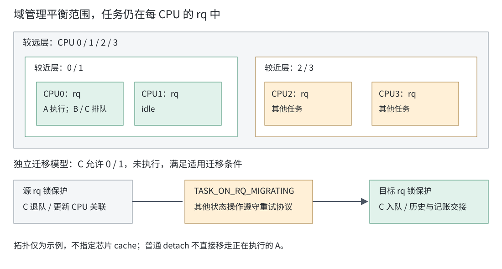
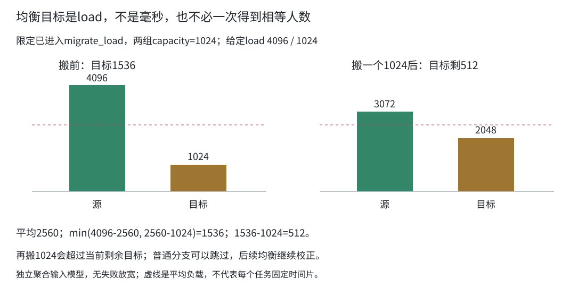

# CPU 放置、负载均衡与 EAS：在哪里运行，以及何时值得迁移？

一个 CPU 上的 CFS 可以公平，而整机仍不均衡。若 A、B、C 都挤在 CPU0，CPU1 空闲，CPU0 内部再公平也不能利用另一颗 CPU。

但迁移不是没有代价：它改变队列和历史归属，还可能损失缓存局部性、增加通信成本。本篇用 [任务/rq](../core/01-task-rq.md) 和 [负载信号](01-pelt.md) 解释选择与交接，重点是公平类；实时类的 push/pull 见 [FIFO/RR](../realtime/01-fifo-rr.md#smp)。

基线为Linux 6.1.158、arm64、RT补丁与`PREEMPT_RT=y`；多核场景另采用SMP，容量/EAS依赖按各节说明，不由RT配置自动推定。

本篇展开[多 CPU 调整循环](../../00-overview.md#placement)。输入是合法掩码、拓扑、类需求及负载/容量信号；输出可能是一次初始 CPU 选择，也可能是一批迁移，或保持现状。顺序为**范围和对象 → 唤醒放置 → 不均衡判断 → 实际移动 → 能效扩展**。

<a id="constraints"></a>

## 1. 决策范围：允许掩码与迁移约束

任务的 CPU 允许集合、cpuset、CPU 在线/active 状态和适用迁移限制，共同约束放置。`p->cpus_ptr` 是实际路径使用的掩码指针，不能假设它在所有窗口都等于某一份用户请求。

亲和性回答“哪些位置可以”，不回答“何时开始执行”。就算只允许 CPU2，上面仍可能有更高调度类、队列竞争、组限流或不可抢占区间。

也不是每个任务都可直接搬走：

- 正在执行的任务，普通 passive detach 不能当作排队任务移走。
- migration-disabled 与 per-CPU 线程有特殊约束。
- Deadline 还受 root domain 和准入条件影响。
- 热插拔改变合法范围，需要与调度迁移协议协调。

设置用法见 [用户亲和性](../../api-reference.md#affinity) 与 [内核辅助接口](../../api-reference.md#kernel-affinity)。

<a id="domains"></a>

## 2. 比较对象：调度域、组与根管理范围

假设四颗 arm64 CPU：0/1 共享一个近端资源组，2/3 属于另一个；更高层覆盖四颗。这个是教学拓扑，不指定芯片型号或实际 cache 层级。



`sched_domain` 定义适用平衡范围及策略标志，`sched_group` 用于在该范围内聚合和比较。可以先在较近层处理不均衡，再在较远层考虑跨组移动。具体层级来自实际拓扑与配置，不是固定“每台机器都有三层”。

三个名称要分开：

- **调度域/调度组**描述 CPU 的平衡关系，不直接拥有新的任务队列。
- **Task group / cgroup**组织任务和资源控制，可以建立公平实体层级。
- **Root domain**保存适用 CPU 范围和 RT/DL 等共享管理状态，与单层 sched_domain 不同。

源码：`kernel/sched/topology.c`、`include/linux/sched/topology.h`、`include/linux/sched/sd_flags.h`。

<a id="wake"></a>

## 3. 初始放置：唤醒选核的决策分支

贯穿本篇的场景是：A 在 CPU0 执行，B 刚被唤醒，CPU1 可用；B 允许 0/1。唤醒路径先为 B 找初始位置；若后续多个线程仍集中在 CPU0，均衡再考虑移动排队者。前者面对的是新出现的需求，后者面对的是已有分布。二者共享信号和合法范围，却不是同一个调用。

公平类 `select_task_rq_fair` 并不是逐次扫描全机、计算同一分数。实际分支包括：

| 决策路径 | 主要考虑 | 适用边界 |
| --- | --- | --- |
| EAS 候选 | 能力满足与能量增量 | 需要相关拓扑、模型和状态，可能回退 |
| wake affine | 前次 CPU 与唤醒者附近的局部性/负载 | 受域标志、wake-wide、允许掩码等影响 |
| idle sibling | 在适用附近寻找空闲候选 | 搜索范围和预算不是无条件全机 |
| idlest CPU 慢路径 | 域/组中的适用不均衡 | 由事件标志和域条件触发，fork/exec 与普通唤醒不总相同 |

本地 `kernel/sched/fair.c:7459` 先按条件尝试 EAS，再沿相应域判断 affine 或平衡标志，随后进入适用 fast/slow path。最终核心还要检查合法 CPU 和必要回退；类结果不是绕过所有掩码的许可。

一次初始放置没有永远绑定任务。后续压力、CPU 能力和局部性变化，仍可能触发均衡。

### 3.1 沿`select_task_rq_fair`看决策层次

这次输入不只是一个task，还包括prev_cpu以及表示唤醒、fork、exec等来源的flags。前一次位置用于局部性参考，当前唤醒者CPU又可能是候选；二者都须放回允许掩码和域范围。

```text
若是普通唤醒：
    记录唤醒关系
    若EAS可用：尝试能量候选，得到有效CPU可直接返回
    判断是否值得在唤醒者附近做affine选择

沿相关sched_domain：
    找到可用wake-affine域 -> 比较旧CPU/唤醒者附近，结束这次域搜索
    否则记录与本次事件标志对应的平衡域

有适用平衡域 -> find_idlest_cpu慢路径
普通唤醒且没有该域 -> select_idle_sibling局部快路径
返回候选CPU，核心再检查允许范围
```

`wake_affine`不是把所有被唤醒线程放到唤醒者CPU。大量扇出唤醒、两边负载、同步唤醒提示和cache关系都会改变这项偏好。`select_idle_sibling`又在限定范围与搜索条件下找空闲位置，不承诺扫描全机所有CPU。

Fork/exec与普通唤醒使用的域标志不同，不能把fork路径找到的全局较闲位置当作每次唤醒的执行过程。EAS、affine、idle sibling与慢路径是分支关系，不是所有结果必须逐项覆盖前一个结果。

<a id="balance"></a>

## 4. 分布调整：不均衡类型与目标量

这里开始第二段事务。先用信号回答“哪里需要减轻或增加什么”，再用候选检查回答“当前有什么能搬”。`lb_env` 保存本轮的源/目标、迁移类型、目标量、扫描进度和临时任务列表；它是一次平衡操作的工作状态，区别于持久的 rq 和调度域。

周期路径由 tick 等触发适用调度 softirq，沿域和间隔检查；新变 idle 的 CPU 有 newidle balance，nohz idle 还有代理/踢动等路径。这些是不同触发，不拼成每次调度都必走的单一链。

`load_balance` 的骨架：

```text
在当前域判断本 CPU 是否负责这次均衡
寻找适用最忙组，并计算不均衡类型/量
在组中寻找源 rq
在源 rq 保护下挑可移动任务并 detach
在目标 rq 保护下 attach
若受 pinning、热度等限制：尝试替代位置、重试或暂时放弃
```

“最忙”不总等于人数最多。源码区分负载、利用率、任务量、misfit 等迁移类型，容量和组分类影响不均衡判断。两任务的 rq 不一定比一任务的 rq 更适合释放一个任务，尤其两边能力不同。

Misfit 指任务的能力需求与当前 CPU 不匹配。例如任务需要较大的归一化能力，却放在供给较小的 CPU 上；这种不均衡与“两边队列人数不同”是不同问题。Pinning 则指允许范围等限制使候选不能迁到本轮目的 CPU，并非队列搜索已经失败就可忽略掩码。

一个限定算例：CPU0 上 A 正在执行，B/C 排队；CPU1 空闲；三者都允许 0/1，无组限流和局部性阻碍。移动一个排队任务能减少竞争。若 B 仅允许 CPU0，A 正在执行，C 又被适用规则判为不可移动，这轮可以没有迁移；空闲不是调度器忽略了 CPU1。

### 4.1 先给不均衡分类，才能决定移动多少

`group_has_spare`、`group_fully_busy`、`group_misfit_task`、`group_imbalanced`、`group_overloaded`等类别不是页面装饰。它们决定当前更需要填补余量、解决能力不匹配，还是减轻竞争。

`calculate_imbalance`形成的目标量还带单位：

| 迁移类型 | `env->imbalance`的含义 | 选一个任务后扣什么？ |
| --- | --- | --- |
| migrate_load | 需移动的带权/层级负载 | `task_h_load`，不是该任务最近跑了几毫秒 |
| migrate_util | 需移动的估计利用率 | `task_util_est` |
| migrate_task | 需移动的任务数 | 每个合适任务扣1 |
| migrate_misfit | 解决一个不适合源CPU的任务 | 找到适用任务后完成本轮目标 |

把这四种目标都解释成“搬几个线程”，会丢掉算法依据。也不能从migrate_util的624直接推断624 ms或624个任务。

### 4.2 一次migrate_load推演

独立模型：两个单CPU组capacity均为1024，已进入相应负载均衡分支；源组load=4096、目标组load=1024，没有其他组。总平均负载为2560。

```text
源侧最多应减：4096 - 2560 = 1536
目标侧最多应加：2560 - 1024 = 1536
本轮load目标：min(1536, 1536) = 1536
```

假设每个可搬任务的层级load为1024，失败放宽尚未参与。移动一个后，目标量剩512，第二个1024超过当前目标，普通分支可跳过它。结果不是强搬到两边绝对相等，而是避免单次搬运过量。



若源本来四任务、目标一任务，这个模型移动一个可得到3/2，而不是任务数量被“二分之一”公式一次算成2.5/2.5。模型假定的聚合输入与分支才决定结果，不表示任意4/1快照都走同一类型。

Migrate_util也有类似尺寸检查。例如目标余量624、任务估计200，搬后剩424；下一任务估计500可能先跳过。失败次数等条件可以放宽检查，避免长期找不到候选，但那是后续分支，不能先当成无限制搬运。

<a id="handoff"></a>

## 5. 迁移事务：候选筛选、detach 与 attach

`can_migrate_task` 检查允许掩码、正在执行、局部性及相应条件。`detach_tasks` 按迁移类型计算目标量并限制搜索；`detach_task` 在源 rq 保护下退队，再改变 CPU 关联。

迁移窗口用 `TASK_ON_RQ_MIGRATING` 等协议表达。源锁可以释放，然后在目标锁下 attach；`task_rq_lock` 等观察/修改者必须对迁移重试，不能抓到半份 CPU 与队列关系就继续。

同时公平类需要处理相对进度基准与 PELT 贡献交接。旧 `min_vruntime` 和新基准不相同，不能直接用跨 CPU 的绝对 `vruntime` 比大小；归一化按真实状态和 flags 进行，见 [CFS 迁移](../fair/01-cfs.md#migration)。

多个失败尝试之后，适用 active balance 可借 CPU stop 工作完成更强的移动；它不是允许普通路径强行移动一个仍执行的任务，也不是所有失败立即调用。

关键位置：`fair.c:8408`，`detach_task`；`:8459`，`detach_tasks`；`:10540`，`load_balance`。该实现的分阶段锁协议比官方历史性的“两把 rq 锁一起持有后搬任务”概括更具体。

### 5.1 一个候选从源rq到目标rq经历什么？

`detach_tasks`不是从公平红黑树随便弹出最左任务。它遍历源rq的公平任务组织，先检查能否迁移，再按迁移类型消耗目标量，最后将成功detach的任务放入本轮`env->tasks`临时列表。

| 阶段 | 候选关系 | 保护与观察者 |
| --- | --- | --- |
| 在源rq排队 | queued，关联源CPU | 源rq锁保护类组织 |
| 源端deactivate | 标记migrating，移出源类候选 | 改CPU前后仍遵循迁移协议 |
| 在临时列表等待attach | 非稳定queued成员，关联正交接 | `task_rq_lock`等须对migrating重试 |
| 目标activate | 从临时列表移出，建立目标类候选 | 目标rq锁保护，最终发布queued |

Task引用保证对象存活，不能代替上述队列保护。源rq计数、目标rq计数及PELT/vruntime归属也要随操作交接，不能只写`task_cpu=目标`。

### 5.2 为什么搜索需要预算、break和重试？

源任务可能不允许目的CPU、处于执行状态、属于不可移动per-CPU工作，或当前局部性收益不值得移动。`can_migrate_task`据此拒绝候选；`detach_tasks`又限制本次扫描数量并分段放锁，避免一次大范围搜索长占原始锁。

本RT基线具有可抢占支持，newly-idle均衡在相应分支取得第一个任务后即可结束本次detach，缩短这条调度临界路径。它不要求一次就填满全部空余量。

若所有候选被掩码限制，记录pinning状态，可能改试同组其他目标或后续域；若source已被另一CPU搬空，直接退出相应分支。Active balance要通过CPU-stop机制重新满足执行交接要求，不是将“正在执行”检查删掉。

<a id="eas"></a>

## 6. 能效扩展：能力匹配与能量增量

先确认是否有异构 capacity、相关调度拓扑、能量模型、配置和可用状态。Arm64 可以是同构多核；没有这些条件，不应为它画出默认启用的大小核 EAS 路径。

本地 `find_energy_efficient_cpu` 在 root domain 缺少 perf domain、已 overutilized 或缺少适用域时可退出。正常候选评估大致是：

1. 将候选限制到允许 CPU 与适用 domain。
2. 用 task util/est、当前 rq util、uclamp 和热压力等检查是否适合。
3. 在 perf domain 中比较适用候选和旧 CPU的放置。
4. 对比加入任务前后能量估计的增量，再结合适合程度决定是否改变。

Perf domain 可能共享频率/性能状态，把任务放到其中一颗 CPU 可能改变整个域能量。因此不是只看该 CPU 的空闲百分比，也不是“小核功耗低，所以所有任务先小核”。

`util_fits_cpu` 在本地实现中返回适合程度，不只是布尔值：0表示不能作为本轮适用候选，1表示通过检查，-1表示基础适合条件已通过，但CPU受热压力影响后的能力仍达不到相关 `uclamp_min` 提示。EAS可以保留这种-1候选并比较能力，因此“未完全满足性能提示”不等于“直接排除CPU”。`uclamp_max`也会改变基础适合判断，不能仅比较裸util与capacity。

### 6.1 为什么比较能量增量，而不是一个核的绝对数字？

独立教学能量模型，单位仅为给定模型分数，非瓦特或实测焦耳。两个性能域原分数为S=32、B=80，新任务在两个候选上都满足本轮适合条件：

| 放置位置 | 放置后S | 放置后B | 总分数 | 相对原总分112的增量 |
| --- | --- | --- | --- | --- |
| S域候选 | 56 | 80 | 136 | 24 |
| B域候选 | 32 | 94 | 126 | 14 |

只看“56比94小”会偏向S，却忽略另一域原先就在消耗80。比较整个受影响模型的增量，B只多14，比S多24更低。共享频率、域内其他CPU和任务共同影响这种变化，所以不是固定“更大能力就更贵”或“空闲小核总最省”。

实际`find_energy_efficient_cpu`在每个性能域找适用候选和prev，计算base及加入任务后的delta，再结合fit等级决定是否改变。`cpu_util_next`还要处理任务在原/新CPU上的贡献，避免将同一份利用率同时保留在原处又加到新处。模型比较和队列实际迁移仍是两个阶段。

容量不足、过载、估计时状态变化、未能得到候选都会改变分支。能量模型是决策依据而不是本次任务的实测能耗；cache、内存和硬件行为仍影响结果。

源码：`kernel/sched/fair.c:7260`，`find_energy_efficient_cpu`，以及 `compute_energy`、`util_fits_cpu`。当前篇讲清候选与状态流程，不穷举所有域标志和平台能量模型实现。

读完应能解释“不迁移”可能是合法性、收益或交接条件所致。继续看 [组带宽](../fair/02-bandwidth.md)，理解即使选到空 CPU，任务为何仍可能不能执行。
