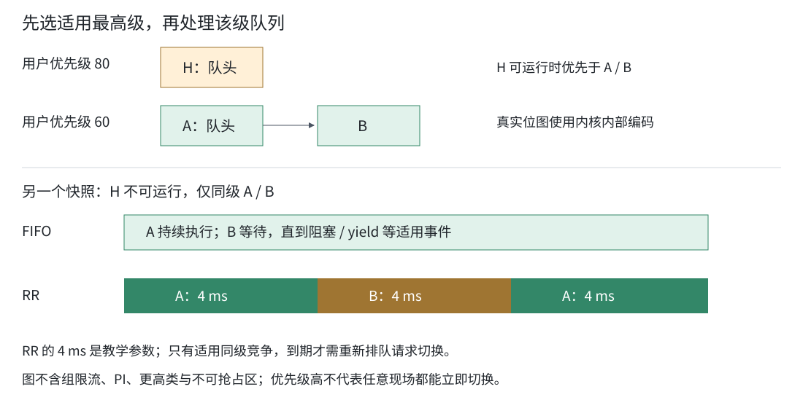

# FIFO/RR：固定优先级、同级队列与实时带宽

普通 CFS 根据相对进度分配份额，RT 类则优先响应固定实时优先级。理解 FIFO/RR，要分开“哪个级别先运行”和“同一个级别怎样轮换”。

本篇基于Linux 6.1.158的`kernel/sched/rt.c`，架构为arm64，源码已打RT补丁并固定假定`PREEMPT_RT=y`。任务是否采用FIFO/RR仍由策略决定，不因该配置自动变成实时类；设置用法见 [策略 API](../../api-reference.md#policy)。

它展开[架构中的 RT 类](../../00-overview.md#architecture)，输入是有效优先级、同级位置和当前执行，输出是 RT 候选及抢占请求。先看目标与状态对象，再走执行循环，最后加入带宽和多核协调；rq 与当前执行关系可先查[对象篇](../core/01-task-rq.md)。

<a id="priority"></a>

## 1. 策略目标：固定优先级及其编码

RT 类优先提供的是**固定优先级的响应顺序**。在可选范围内，较高优先级先得到服务；同级 FIFO 保持适用队列顺序，RR 增加轮转。两种策略都不根据已经使用的 CPU 时间自动降低优先级。为避免持续高优先级执行吞掉供给，预算限制另由带宽机制承担。

Linux 用户 FIFO/RR 优先级为 1～99，较大的数更高。API 应通过 `sched_get_priority_min/max` 查询；内核内部 RT `prio` 用较小数代表更高优先级。普通任务的 nice 不与这组用户优先级构成一个连续的 API 数轴。

在适用 class 候选中，RT 高于 fair，但低于 deadline 和 stop。锁依赖下的 PI 还可能使有效优先级/类与静态策略不同，详见 [PI](../synchronization/01-pi-preempt.md)。

所以先确定策略和有效属性，再解释优先级。只看 nice 或只看一个内部 `prio`，都不足以判断完整行为。

<a id="queue"></a>

## 2. 对象与循环：位图、同级队列和 current

`rt_rq->active` 是 `rt_prio_array`，包括各级队列和非空位图。`sched_rt_entity` 通过 `run_list` 进入对应级别；选任务先找到最高适用非空级别，再取其队头。



图使用用户优先级 80、60 显示规则，真实位图按内部编码索引。模型没有组限流、PI 或更高类。

如果启用 RT 组调度，实体可代表下级 RT 队列，选择需要沿层级下降。根部选出一个组实体后，不能立即把它当线程执行。

源码：`kernel/sched/rt.c:1773`，`pick_next_rt_entity`；`:1791`，`_pick_next_task_rt`；`kernel/sched/sched.h` 的 `rt_rq`、`rt_prio_array`。

### 2.1 位图、链表和当前任务怎样配合？

用户实时优先级80对应本地内部`99-80=19`，优先级60对应39。寻找第一个非空位，得到的是内部索引更小的较高优先级队列；再取链表队头，形成“先级别、后同级位置”。

`__enqueue_rt_entity`按flags决定是否真正移动链表节点。需要移动时，ENQUEUE_HEAD插头，否则通常插尾，并置相应位；发布实体on_rq并更新RT任务量。退队对称处理节点与空队列位。

稳定RT current可以仍留在active对应链表中。`set_next_task_rt`主要建立执行起点、结束等待统计并从pushable候选移除，**不是像CFS current那样必从排序树取出**。`on_list`、RT实体`on_rq`和task公共`on_rq`各有职责，保存/恢复的暂态又会区分节点是否真正移动。

因此一个current仍是队头，不表示它正在等待自己；队列保存策略顺序，`rq->curr/on_cpu`表达执行交接。不能把公平类的树成员规则复制到RT链表。

### 2.2 把对象放进一次完整运行循环

固定 A/B 同级 RT，H 高一级，无 PI、组限流或更高类：

| 阶段 | 队列/执行关系 | 主要实现 |
| --- | --- | --- |
| A/B 普通入队 | 放入相应优先级链表，维护非空位 | `enqueue_task_rt` |
| 选择 A | 位图先定位最高级，再取队头；A 成为 current | `pick_next_rt_entity`、`set_next_task_rt` |
| A 执行 | 核算执行量；若 RR 则推进自身时间片 | `update_curr_rt`、`task_tick_rt` |
| H 到来 | H 的优先级触发请求；A 仍可运行 | RT 唤醒抢占检查和核心调度 |
| H 阻塞 | H 退出候选，回到 A/B 的最高可用级 | RT 退队和类选择 |
| A 阻塞或同级让出 | 阻塞移除 A；让出则把适用实体移尾 | `dequeue_task_rt`、`yield_task_rt` |

FIFO 和 RR 的差异主要出现在“执行期间是否推动同级轮换”。下面先解释 FIFO 的位置变化，再解释 RR 的剩余计数。

<a id="fifo"></a>

## 3. FIFO：同级顺序与阻塞、抢占、让出

设同级 A 在队头，B 在后；较低级 C 等待：

1. A 持续可运行，则同级 B 不因为“时间到了”自动轮到。
2. A 阻塞，退出候选，B 才成为此级队头。
3. A 以后普通唤醒时按对应规则回队列，不能假设自动夺回队头。
4. 更高优先级 H 到来可抢占 A；A 一般保留同级顺序，H 结束后可以继续 A。
5. A 主动 yield 会按类规则移到同级队尾，而不是自动让低级 C 运行。

这些是属性没有变化的普通队列主线。调整优先级/策略、PI boost/deboost、head/save flags 等会改变入队位置，不能以“FIFO”推断所有退队再入队都保持同一顺序。

`enqueue_task_rt`、`enqueue_rt_entity`、`requeue_task_rt` 负责实际操作；`yield_task_rt` 明确把相应实体移到尾部。

### 3.1 三个同级状态变化

限定A/B同级FIFO，H更高，且不改变策略/优先级：

| 事件 | 同级队列 | 下一次正常选择 |
| --- | --- | --- |
| A为current，B排后 | A -> B | A可以继续 |
| H抢占A，A仍可运行 | A -> B的同级位置保留 | H退出后先恢复A |
| A主动yield | B -> A | B先取得本级机会 |
| A阻塞退队 | B | B执行；A以后普通唤醒按入队规则回来 |

高优先级抢占与同级让出改变的不是同一份状态。优先级变更或PI造成的队列变化又要读相应flags：`rt_mutex_setprio`会据旧/新有效优先级处理位置，不能对所有路径套“退队再回来必放尾部”。

<a id="rr"></a>

## 4. RR：同级轮转与剩余时间片

RR 仍先按固定优先级选择，但对自身 `time_slice` 做倒计数。用完时重置时间片，并在适用同级竞争存在时移动队尾、请求重调度。

假设 A/B 都为 RR、同级，模型时间片4 ms：A 执行4 ms，B 执行4 ms，再回到 A。若更高 H 在 A 执行2 ms 后抢占，A 尚未用完的 RR 时间不因此必然变成全新4 ms；它与后续补充规则要分开。

如果此级只有 A，时间片到期仍会重置，但不必为了轮转到自己制造实际切换。较低级 C 不会仅因 A 的 RR 时间片结束就自动获准抢先。

本地 `task_tick_rt` 在 `p->policy != SCHED_RR` 时跳过时间片逻辑；RR 到零后沿实体层级判断是否有竞争，再 `requeue_task_rt`、`resched_curr`。

入口：`kernel/sched/rt.c:2647`；查询实际间隔用 `sched_rr_get_interval`，不要硬编码某资料的默认毫秒数。计数受 HZ、运行配置和当前设置影响，模型4 ms不代表默认配置。

### 4.1 用tick计数推演，而不是凭墙上时间猜

另设RR时间片为4个运行tick，A/B同级；每个阶段只按实际送到current的tick计算，先不将tick换成设备毫秒：

| 阶段 | A剩余计数 | 级别/队列结果 |
| --- | --- | --- |
| A开始这轮 | 4 | A在队头 |
| A收到两个tick | 2 | 未到0，仍可继续 |
| H更高优先级执行期间 | 2 | A不是current，不因此扣H的运行tick |
| A恢复并再收到两个tick | 到0后重置4 | 有同级竞争时移到队尾并请求重调度 |

若只有A，没有同级候选，计数仍重置，但不必为“轮到自己”做一次低层切换。内核判断沿RT组实体链进行；组层级有竞争，也可能要求相应重新排队。

RR管理同级机会，`update_curr_rt`则累计执行并检查带宽。两个记账同时存在，不能拿剩余time_slice当作整个RT rq的runtime。

<a id="bandwidth"></a>

## 5. 带宽控制：执行记账、限流与周期恢复

固定优先级不提供预算隔离。一个永不阻塞的高优先级线程可能压制其他线程，因此还有适用 RT 带宽限制。

`update_curr_rt` 累计执行量，沿相应实体层级检查 runtime。`sched_rt_runtime_exceeded` 考虑 period、无限额度、可借 runtime 及 throttled 状态，必要时使 RT rq 暂时不能正常提供候选；周期处理再恢复。

不要把它和 CFS `cpu.max` 混用：

| 机制 | 管什么 | 主要配置/接口 |
| --- | --- | --- |
| RR 时间片 | 同级轮转 | `sched_rr_get_interval` 及适用系统设置 |
| RT runtime/period | 实时类可用带宽 | `sched_rt_runtime_us`、`sched_rt_period_us` 与适用组机制 |
| CFS quota/period | 公平组带宽 | cgroup v2 `cpu.max` |
| Deadline runtime | 单个 CBS 预算 | `sched_attr` 的 Q/D/P |

RT 组机制依赖 `CONFIG_RT_GROUP_SCHED`；v2 CPU 控制也有 RT 管理限制，不能照搬 v1 的 `cpu.rt_runtime_us` 当成任意 v2 组可用文件。

PI boost 又有避免依赖持锁者永久卡住的适用限制处理，`rt_rq_throttled` 的语义不能只看裸 `rt_throttled`。本篇不承诺任意 RT 线程都一定每周期获得相同份额。

### 5.1 Runtime用完与周期恢复怎么衔接？

执行增量计入`rt_time`，与当前允许`rt_runtime`比较。本地检查还先处理无限额度、runtime覆盖period、适用跨CPU借额等条件，之后才决定限流；没有一次无条件的`rt_time==runtime`就永远停。

固定period=10 ms、runtime=4 ms、未参与借额或boost的模型：记账后rt_time=4.1 ms，超过4，进入限流。一次周期处理可扣`min(rt_time, overrun*runtime)`；overrun=1时：

```text
rt_time = 4.1 - min(4.1, 1*4) = 0.1 ms
0.1 < runtime4 -> 可解除相应限流
```

它不是始终把rt_time直接清0，而是保留适用超额部分。若累计过多、补充不足，仍可能继续受限；实际队列恢复后，还要按优先级和执行条件选择。

`RT_RUNTIME_SHARE`允许的借额是相关RT队列runtime的交接，不凭空增加全机预算。它与公平组按slice领额是另一套状态、锁和算法；RT组配置、系统runtime设置和PI特殊情况都应单独核对。

<a id="smp"></a>

## 6. 多核协调：优先级信息与 push/pull

公平类的按负载迁移不是 RT 的全部办法。RT 维护适用 `pushable_tasks`：非 current、允许多个 CPU 的候选可以考虑推出；目标 CPU 则按适用优先级和 CPU 信息查找。

Push 尝试把源 CPU 上不能立即获得执行的 RT 任务放到更合适位置；pull 在需要时寻找可拉入的更高优先级任务。`cpupri` 等共享信息帮助缩小搜索，而实际迁移仍要确认掩码、当前运行和锁保护下的状态。

两个 CPU 的限定模型：CPU0 上 H80 执行，L60 排队；CPU1 运行 fair，L 允许两个 CPU。将 L 推到 CPU1 可以使它并行执行。若 L 只允许 CPU0，就不能为了“全局优先”违反掩码。已经执行的 H 也不作为普通 pushable 排队项随意移动。

入口：`select_task_rq_rt`、`push_rt_task`、`pull_rt_task`、`enqueue_pushable_task`。这是 RT 类的分工，不替代 [任务迁移协议](../placement/02-placement.md#handoff)。

### 6.1 Push为何不是找到一个低优先级CPU就结束？

`push_rt_task`先确认源RT队列overloaded，再选非current的pushable任务。如果候选优先级比当前还高，首先可能需要重调度源current，而不是急着把最重要的候选推出去。

搜索目标可能释放源rq锁，所以在适用路径先取得task引用，找到并锁定候选rq后再次检查任务仍属于原队列、仍符合推动条件。找不到目标时，还要区分“任务/队列已经变化，重选”与“同一任务仍在但没有可用目的地，结束等待后续pull”。

成功交接在相应双rq协议下完成：

```text
源deactivate -> 改CPU关联 -> 目标activate
请求目标current重调度
结束双rq保护 -> 释放临时task引用
```

Migration-disabled候选有专门分支，可能尝试通过CPU-stop移动当前任务来让出位置；不能直接搬走被保护的候选。Rq锁保证关系一致，task引用保证对象仍存在，二者分别收尾。

<a id="use"></a>

## 7. 使用 RT 策略前应确认什么？

至少确认优先级规划、最长持锁时间、是否主动阻塞、允许 CPU、可用 RT 带宽和目标抢占模型。高优先级循环不等于低延迟设计；设备、中断、锁依赖和不可抢占区间仍在响应路径中。

需要明确预算与期限时，继续看 [Deadline](02-deadline.md)。只想创建后台内核工作，先比较 [kthread 与工作队列](../../api.md#kernel)，不要把 FIFO 当默认优化。
