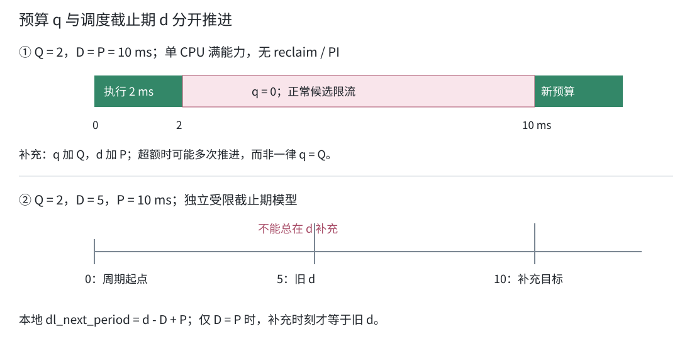
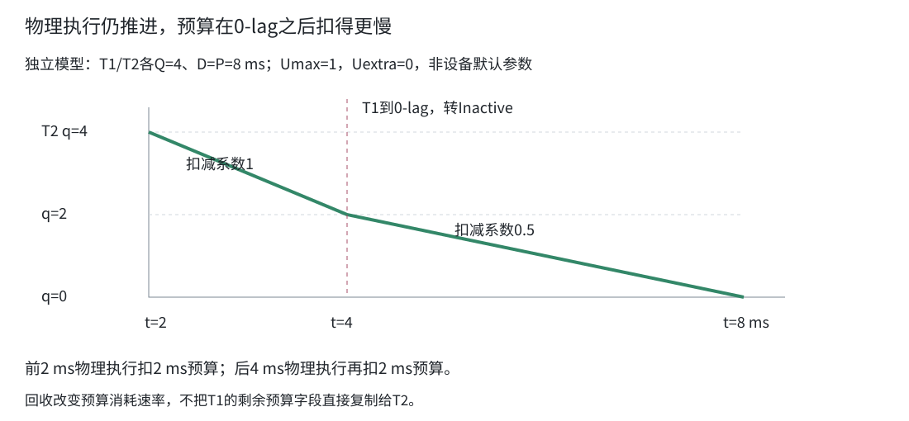

# Deadline：EDF 选择、CBS 预算和带宽回收

FIFO/RR 表达“谁优先”，不表达“每周期最多消耗多少，以及最晚何时完成”。Deadline 用参数描述一份运行需求，并限制它对其他预约的影响。

本篇基于Linux 6.1.158的`deadline.c`，采用arm64、RT补丁与`PREEMPT_RT=y`。先分清需求模型、运行状态和准入，再看GRUB。接口直达 [sched_attr](../../api-reference.md#attr)，PI情况见 [同步篇](../synchronization/01-pi-preempt.md)。

它展开[架构的 deadline 类](../../00-overview.md#architecture)：输入是预约、当前 q/d 和候选状态，输出是 EDF 选择及 CBS 限制/恢复。先定义模型和对象，用两任务走完整循环，再解释受限期限、唤醒、准入与回收。后面的独立算例会明确重新给定参数，不混成同一条运行记录。

<a id="parameters"></a>

## 1. 模型与对象：Q/D/P 预约和 q/d 状态

一个预约用 Q/D/P 表示：

- Q：每次预约的运行预算，源码 `dl_runtime`。
- D：相对截止期，源码 `dl_deadline`。
- P：周期或最小激活间隔，源码 `dl_period`。

动态状态还包括：

- q：当前剩余预算，源码 `runtime`。
- d：当前绝对调度截止期，源码 `deadline`。
- 是否限流、是否 yield、是否处于 non-contending 状态等。

用户参数通常要求 `0 < Q <= D <= P`，还有最小粒度及合法性约束。接口字段用纳秒，模型用毫秒只是便于推演。

例如 Q=2、D=5、P=10 ms，描述在适用时限内的运行需求。`Q/P=0.2` 是预约带宽，`Q/D=0.4` 是密度；二者在 D=P 时相等，在 D<P 时不可混用。

任务自己的 job 是否已经做完，仍由应用判断。内核调度截止期不自动替程序定义所有业务截止期。

### 1.1 哪些状态分别保存“约定、候选、记账”？

固定参数主要用于密度/带宽与合法性判断；动态q/d用于本轮选择和限制；DL树成员用于是否能作为候选。再加task公共运行资格和on_cpu，才能解释一次暂停。

预算耗尽的线程可以仍有运行需求、公共`on_rq`仍表达queued，却从正常DL候选树移除并标记throttled。业务阻塞则同时结束其对应公共资格。两者都暂时不执行，但下一次恢复分别由预算计时器与业务唤醒推动。

<a id="edf"></a>

## 2. 正常循环：EDF 选择与 CBS 预算

EDF 为 Earliest Deadline First：在适用 Deadline 候选中选更早的绝对调度截止期。DL rq 用对应红黑树组织实体，不以用户 RT 1～99 优先级排序。

单靠 EDF，一个声明需要2 ms却持续跑的任务仍可能占用更多执行。CBS（Constant Bandwidth Server）在执行时扣预算，耗尽则限制正常候选，随后按补充规则推进。

### 2.1 两个任务怎样走完选择、扣减和补充？

固定单 CPU、满归一化能力，两份预约已被接受：A 为 Q=2、D=P=10 ms；B 为 Q=1、D=P=6 ms。两者在 t=0 同时成为正常 DL 候选且业务持续有工作；没有 PI、reclaim、迁移或记账超额。

| 时刻/区间 | EDF 候选与动态状态 | 结果 |
| --- | --- | --- |
| t=0 | A(q=2,d=10)，B(q=1,d=6) | B 的 d 更早，先执行 |
| t=0～1 | B 消耗预算至 0 | B 限流，离开正常候选树 |
| t=1～3 | A 消耗预算至 0 | A 随后限流 |
| t=3～6 | 两者都无正常可用预算 | CPU 可服务其他类，而非提前重领预算 |
| t=6 | B 补充为 q=1,d=12 | 若业务仍 runnable，恢复 DL 候选 |
| t=10 | A 补充为 q=2,d=20 | 若业务仍 runnable，恢复 DL 候选 |

这条循环说明：**d 决定谁先选，q 决定还能执行多少，计时器决定何时恢复资格。** 周期不会自动替应用产生一个新 job；若业务已经睡眠，计时器可以只恢复参数，候选仍要等业务唤醒。

实现上，入队和选取维护 DL 树；`update_curr_dl` 扣 q 并检查耗尽；`start_dl_timer` 安排下一补充；`replenish_dl_entity` 推进 q/d。下面展开各步的边界。

### 2.2 区分执行时间与预算消耗



图上半固定单 CPU、满归一化能力、无 reclaim/PI、Q=2、D=P=10 ms。连续执行2 ms后 q=0，正常限流等下一周期；新 d 变为20 ms，q补充。不是所有 Deadline 调用都执行这样的时间线。

本地 `update_curr_dl` 从 `rq_clock_task` 记账执行，绝对 deadline 基于 rq 的墙上时间口径。无 reclaim 时还按适用频率和 CPU 容量缩放预算消耗；图假设缩放比为1。开启 reclaim 又用另一记账速率，因此不能始终写成 `q -= 墙上经过时间`。

目标树还有一处跨类记账：RT 带宽启用且相关记账条件成立时，DL 的实际 `delta_exec` 同时计入本 CPU 根 RT 队列的 `rt_time`，防止 RT 任务忽略已经被 DL 消耗的共享供给。DL 自身仍由 CBS 管预算，并非直接套 RT 候选限流。对应 `deadline.c:1385` 附近；三个量要分开读：实际执行、缩放后的 DL 扣减、RT 共享记账。

<a id="replenishment"></a>

## 3. 恢复事务：下一周期与超额预算

`update_curr_dl` 在预算耗尽或 yield 的适用条件下设置 `dl_throttled`、退出正常 DL 候选，并启动 `dl_timer`。定时器根据实际任务状态恢复/交接；任务已经睡眠、正在迁移或改变策略时有不同处理。

本地源码关键式：

```text
下一周期起点 = d - D + P
```

D=P 时，它等于 d。D<P 时却不是。例如本周期起点0、d=5、D=5、P=10 ms，补充目标是10 ms，不是5 ms。

官方同版本设计文档有“等到调度截止期补充”的简化说法；本文以 `deadline.c:1037` 的 `dl_next_period` 和 `start_dl_timer` 校正，不能只凭 URL 标为6.1就认为所有描述已经精确更新。

`replenish_dl_entity` 不一定简单做 `q=Q`：适用超额消耗时，循环把 q 加 Q，同时 d 加 P，直到恢复正预算。若已经落后过多，还有重建新周期的处理。定时器启动/回调也持有配对任务引用，不能任意删除任务或计时器状态。

### 3.1 超额怎样带进下一次预算？

固定Q=2、P=10 ms，当前d=10 ms，已进入普通补充循环且不触发其他重建条件：

| 原q | 推进次数 | 新q | 新d |
| --- | --- | --- | --- |
| 0 | 1 | 2 | 20 |
| -0.3 | 1 | 1.7 | 20 |
| -4.3 | 3 | 1.7 | 40 |

最后一行依次是`-4.3 -> -2.3 -> -0.3 -> 1.7`，d每次加10。若无论超额多少都重置q=2，就抹掉了欠记的预算消耗；只改q却不推进d，又可能保留不应有的早截止期优势。

### 3.2 两个计时器为什么不能合成一个？

| 计时器 | 回答什么？ | 触发后的主要工作 |
| --- | --- | --- |
| `dl_timer` | 被限流任务何时可以补充运行预算？ | 检查当前DL/boost/throttle状态，补q/d，按公共资格决定是否恢复候选 |
| `inactive_timer` | 已阻塞任务何时可退出active带宽集合？ | 在0-lag协议下减active带宽，供GRUB回收 |

预算恢复不等于业务条件满足。`dl_task_timer`若发现任务已经不是公共queued成员，补参数后不强制把它当业务已醒；等待原业务唤醒再建立相应候选。策略已经改变、已有PI补充或不再throttled时，也要退出相应回调分支。

回调取得`task_rq_lock`稳定归属，定时器生命周期与任务引用配对。CPU离线、候选重新过载等又可能产生迁移/推送，而不是在旧CPU上无条件排入队列。

<a id="wakeup"></a>

## 4. 唤醒扩展：旧预算的密度检查与调整

如果每次睡醒都立即领满 Q，一个线程可以反复短睡来超用预约。因此唤醒要检查旧 q/d 是否还能合法使用。

本地 `dl_entity_overflow` 判断的核心密度关系是：

```text
剩余预算 / (d - now) > Q / D
```

实现通过缩放和交叉相乘比较。若参数超出当前条件，需要更新；但不同期限模型处理不一样：

- D=P 的通常分支可按条件重建 d/q。
- D<P 且 d 仍在未来时，revised wakeup 可将剩余预算调整为密度允许量，而不是总重置成 Q。
- D<P、旧 d 已过而下一周期尚未到时，适用 constrained-deadline 检查可限流到下一周期。
- PI boosted 和特殊实体另有分支。

算例：Q=2、D=5、P=10，d=5，now=4，q=1 ms。旧密度 `1/(5-4)=1` 超过 `Q/D=0.4`；满足 revised-wakeup 前提时，预算约调整为0.4 ms。它不是新领2 ms。这是进入指定分支后的教学推演，真实值有固定点舍入。

入口：`update_dl_entity`、`update_dl_revised_wakeup`、`dl_check_constrained_dl`。

### 4.1 密度检查为什么要保留旧预算？

固定隐式期限模型，Q=2、D=P=10 ms，旧d=10，now=6，q=0.5。剩余密度`0.5/(10-6)=0.125`，不超过Q/D=0.2，可按相应条件继续旧q/d。每次唤醒都重置2 ms，会让一次正常睡眠额外领预算。

若同样now/d却q=1，剩余密度0.25超过0.2，保持旧参数会在太短的剩余窗口提供过大的预约密度，需要走更新分支。D<P情况下又可能按前述revised规则缩减q，而不是一律新周期。

检查在截止期仍有效的情形比较相对差值；过期和受限期限的下一周期之间还需专门分支，不能先把`d-now`的负值送入普通比例解释。

<a id="admission"></a>

## 5. 准入：预约带宽与保障条件

`sched_dl_overflow` 在相应 root domain 的带宽管理保护下，检查新增/变更预约是否可接受。失败可由用户接口看到 `EBUSY`，不是内存分配失败。

理解保障必须先声明假设：执行需求估计可靠、激活与期限模型成立、可用 CPU/容量满足要求、锁/设备等额外阻塞已分析、相关抢占与频率条件可接受。

单 CPU、D=P 的理想 EDF 可用总带宽解释一组任务，但多 CPU、D<P、迁移限制和阻塞不能仅凭 `sum(Q/P)<CPU数` 得出所有截止期必满足。Linux 的在线准入也不是对整个应用进行 WCET 和依赖关系证明。

目标树在启用相应带宽管理时还要求允许 CPU 掩码满足 root domain 范围条件。因此不要先随意绑一颗核，再忽略 `EPERM`，或为让设置成功擅自关闭全局准入。

### 5.1 修改预约时，为什么先扣旧值再加新值？

本地`__dl_overflow`比较“已有total_bw - 本任务旧bw + 请求新bw”与相应域上限；bw来自Q/P的固定点表示，capacity又参与上限缩放。修改已有任务不能把旧预约留着再多加一份，也不能先无条件删旧预约再让失败破坏原配置。

独立归一化模型：域上限0.8，总已有0.6，其中本任务旧值0.2，拟改0.4：

```text
变更后的总量 = 0.6 - 0.2 + 0.4 = 0.8
```

在这项比较中可以达到上限；若是另外新加0.4，则0.6+0.4=1.0，超过上限，应拒绝。这里0.8是给定模型，不是本机默认RT带宽，其他合法性和安全检查仍独立存在。

退出DL或降低预约又涉及何时释放相应带宽关系，不能当一个任意无锁减法。在线准入维护隔离状态，但仍没有替应用证明所有期限、锁阻塞与WCET假设。

<a id="grub"></a>

## 6. GRUB 扩展：active 状态与带宽回收

GRUB 即 Greedy Reclamation of Unused Bandwidth。适用 `SCHED_FLAG_RECLAIM` 使执行者按可回收带宽调整预算消耗速率，但阻塞者的带宽不能立即全部转给别人。

它区分：

| 状态 | 任务在做什么？ | 是否仍算 active bandwidth？ |
| --- | --- | --- |
| Active Contending | 可运行/执行 | 是 |
| Active Non-Contending | 刚阻塞，尚未到0-lag | 是 |
| Inactive | 阻塞已超过相应0-lag | 否，可纳入回收 |

0-lag 表示当前预算和截止期关系允许其带宽安全退出 active 集合的时刻：

```text
t0 = d - q * P / Q
```

独立模型 Q=4、D=P=8、d=8、q=2 ms，在 t=2 阻塞：`t0=8-2*8/4=4 ms`。若 t=3 醒来，仍从 active non-contending 回到竞争，不重复加一份 active 带宽；若继续睡到t=4，才按协议转 inactive。

`task_non_contending` 设置 inactive timer；`task_contending` 与回调通过 `dl_non_contending`、锁和引用配对避免重复增减。迁移还需要更新原/新 rq 的带宽归属。

本地 `grub_reclaim` 使用任务带宽、允许回收上限、inactive/extra 带宽形成扣减比例。回收不是免费增加一份独立预约，更不是把 sleeping task 的 Q 直接复制给另一个 task。

### 6.1 回收如何改变预算消耗速度？

用本地设计说明对应的教学公式：

```text
消耗系数 = max(Ui/Umax, 1 - Uinact - Uextra)
q的减少量 = 实际执行增量 * 消耗系数
```

Ui是当前任务预约带宽，Umax是相应回收上限，Uinact是本rq可回收的inactive带宽，Uextra是额外可回收项。源码使用固定点、边界比较与移位，避免负值和溢出问题。

独立模型两个任务Q=4、D=P=8 ms，Ui各0.5，Umax=1，Uextra=0；T1在t=2已用2 ms并阻塞，0-lag为4：

| 时间段 | T1状态 | T2的预算扣减系数 | 原因 |
| --- | --- | --- | --- |
| t=2～4 | Active Non-Contending | 1 | T1带宽还不能回收，Uinact=0 |
| t=4～8 | Inactive | 0.5 | Uinact=0.5，系数为max(0.5,0.5) |

T2从t=2起执行，前2 ms消耗2 ms预算；剩2 ms可以在后4 ms物理执行中按0.5速率消耗。这说明“回收”的表现是扣预算更慢，而不是直接把T1剩余q复制到T2。



### 6.2 唤醒与inactive回调竞争怎样避免重复记账？

任务进入Active Non-Contending时设置`dl_non_contending`并持有计时器所需引用。若先醒，清该标志并尝试取消回调；成功取消则配对释放引用。若回调已经在另一CPU执行、不能取消，它必须看到该状态并避免再次扣active带宽。

已经Inactive的任务醒来，则需要重新增加active贡献。两种唤醒不能都无条件“加一次”，否则会将仍active的任务重复计算。迁移还要处理所属rq的total/active归属，所以`this_bw`、`running_bw`、候选树成员和任务引用分别维护不同不变量。

<a id="source"></a>

## 7. 按状态变化进入实现

| 问题 | 本地入口 |
| --- | --- |
| 参数和动态状态在哪里？ | `include/linux/sched.h`，`sched_dl_entity` |
| EDF 候选及层级归属 | `kernel/sched/deadline.c`，DL 树的 enqueue/pick 路径 |
| 执行怎样扣预算？ | `:1309`，`update_curr_dl` |
| 下次补充时刻和超额处理 | `:1037`，`dl_next_period`；`:837`，`replenish_dl_entity` |
| 唤醒如何更新？ | `dl_entity_overflow`、`update_dl_entity`、`dl_check_constrained_dl` |
| 何时可以回收？ | `:392`，`task_non_contending`；`:448`，`task_contending`；`:1283`，`grub_reclaim` |
| 能否接受预约？ | `:2865`，`sched_dl_overflow`；`core.c` 的属性检查 |

当前篇提供预算、唤醒与回收的关键实现主线。全量多核 DL push/pull、调频保障和严格可调度性证明仍可独立下钻，不将本文算例当成目标机实时测试。
