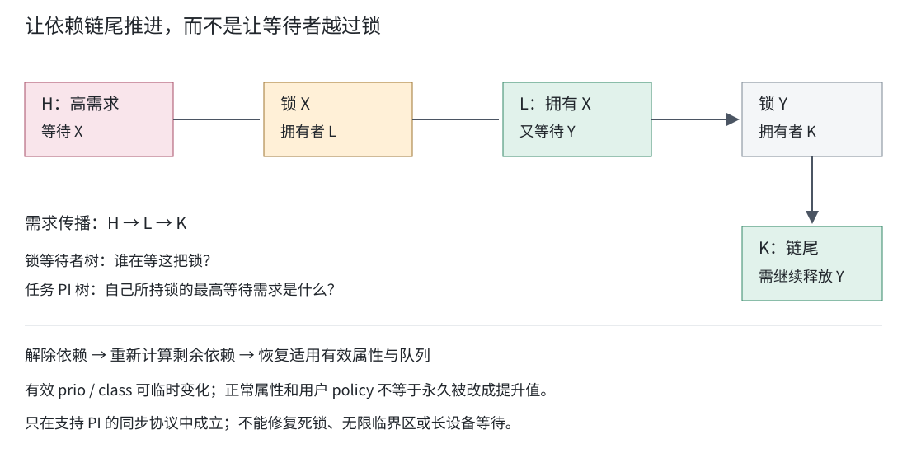
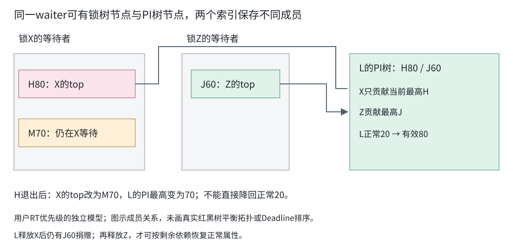

# PI 与抢占模型：谁能推进，以及何时能交接？

优先级只比较可运行候选。高优先级 H 等待低优先级 L 持有的资源时，H 本身不能继续；要让业务推进，必须使 L 完成临界区。

本篇区分三个问题：锁依赖怎样影响有效属性，依赖链怎样维护，抢占模型怎样影响请求兑现。基线为Linux 6.1.158、arm64、已打RT补丁，固定假定`PREEMPT_RT=y`。下文以RT语义为主线，不再把是否启用RT作为待判断条件。

<a id="preempt"></a>

## 1. 工作环境：PREEMPT_RT 的锁与抢占语义

本篇展开[架构中的同步依赖](../../00-overview.md#constraints)：输入是锁拥有者、等待者及有效优先需求，输出是正确的锁交接与必要的优先级传播/撤销。先看 RT 锁环境，再认识等待关系，沿 H 等待 L 的一次事务理解 PI，最后加入多锁、链传播和业务保存状态。前提是已理解[任务/rq](../core/01-task-rq.md)与[等待协议](../core/02-wait-wakeup.md)。

FIFO/RR是任务选择策略，PREEMPT_RT是本系列已启用的内核抢占与同步模型。在这个内核中，普通任务仍走fair；FIFO/RR按固定优先级竞争；DL按预算和截止期处理。RT配置改变这些任务所处的内核执行环境，不替它们选择策略。

| 本RT基线中的机制 | 主要作用 | 边界 |
| --- | --- | --- |
| `spinlock_t` / `rwlock_t` | 竞争时可进入RT锁等待；持有期间仍可被抢占 | 不靠关抢占保护，读写锁的PI能力仍受多读者等关系限制 |
| `local_lock` | 映射为per-CPU普通spinlock，串行化相应局部访问 | 不等于关闭硬中断或全机互斥 |
| `raw_spinlock_t` | 保留原始自旋和相应禁止抢占语义 | rq、任务pi_lock等关键保护仍不可按睡眠锁使用 |
| 线程化中断 | 许多中断处理可在任务上下文调度 | 真实hardirq部分和明确不线程化的中断仍有原子上下文约束 |
| `PREEMPT_LAZY` | 单独控制适用请求类别和兑现条件 | 不由RT启用一概确定当前特性状态，也不表示所有唤醒延迟相同 |

`spin_lock_irqsave`的本地RT实现不改变CPU硬中断开关；需要真实关中断的路径要使用与原始锁、IRQ状态相匹配的接口。`spinlock_t`持有期间不会任意迁移，但这是迁移限制，不等于禁止任务抢占；同CPU上的共享数据仍需自己的锁保护。

“锁竞争可以调度”也不表示可在持锁后执行任意业务睡眠、访问用户内存或等待回调。嵌套锁、RCU、对象依赖和具体API限制仍需核对，不能把RT变化当成取消所有上下文约束。

源码可从`include/linux/spinlock_rt.h`、`include/linux/local_lock_internal.h`、`kernel/locking/spinlock_rt.c`、`kernel/locking/rtmutex_api.c`与`core.c`交接核对。Lazy另结合`kernel/Kconfig.preempt`、`preempt_lazy_count`、need-resched标志及arm64返回入口；它不改变本篇已经固定的RT基线。

<a id="locks"></a>

## 2. 哪些同步对象有可传播的拥有者关系？

普通数据等待队列知道有哪些等待者，不知道一个可传递的锁拥有者链。Completion 也没有一般互斥锁所有权。因此“我唤醒一个高优先级线程”不等于有优先级继承。

本地RT实现中，普通`mutex`也以`rt_mutex_base`支撑；`spinlock_t`的RT实现同样借助rt-mutex机制，但额外保存任务状态、维护迁移限制。它们各自的等待协议仍要区分，不能把“都有PI”理解成完全相同的调用上下文。

Semaphore没有一个可确定的锁拥有者，不能像rt-mutex那样沿拥有者传播PI。普通等待队列和completion的业务事件也没有这类拥有者链；它们内部保护锁的性质，不等于事件本身提供PI。

即使 PI 生效，死锁、长 IO、无限循环和错误锁顺序也不会自动消失。它改善优先级依赖下的执行进展，不提供任意程序的正确性或整体时延保证。

<a id="inversion"></a>

## 3. 依赖模型：优先级反转与推进者

固定单 CPU 模型，H>M>L：

1. L 得到锁 X。
2. H 到来，等待 X，不再参与正常执行竞争。
3. M 持续可运行，优先于 L。
4. L 无法继续释放 X，H 因此被 M 间接拖住。

H 等 L 完成一个有界临界区本身是必要依赖；问题是 M 可以把等待继续延长，甚至让依赖链尾没有进展。

下面的图扩展为两把锁的依赖链：L持有X，但又等待K持有的Y。它不是前面H/M/L单锁例子的同一快照；PI的需求需要继续传到能释放Y的K。



PI（Priority Inheritance）让受支持锁的拥有者临时得到相应等待者的有效优先需求，使 L 能优先于 M 推进。它不让 H 越过锁读未完成数据，也不消除临界区自己的耗时。

<a id="trees"></a>

## 4. 对象与事务：两类树、继承和锁交接

RT-mutex 用两类索引回答不同问题：

- 每把锁的等待者树：谁在等这把锁，最高需求是谁？
- 每个拥有者的 PI 等待者树：它持有的多把锁中，各自最高等待需求组成什么集合？

拥有者可以持有多把锁，但一个任务在适用单次阻塞中只等待一把锁。若 L 又在等 K 持有的 Y，H 的需求还要向 K 传播。仅把 L 的一个字段设高，不能使整条链尾推进。

源码 `kernel/locking/rtmutex.c` 的 waiter/chain 处理协同维护这些关系。锁的 `wait_lock`、任务的 `pi_lock` 保护各自状态，chain walk 还要处理并发改变、重试和深度等边界；不是持有所有链上锁后一次性完成。

等待者超时、信号退出、锁释放和最高等待者变化，都会重新计算拥有者需求。不再需要最高提升时，要降回剩余最高依赖与正常属性共同决定的有效值，而不是无条件降到原来某个缓存数值。

### 4.1 先把对象和索引对上

| 对象/关系 | 保存什么 | 保护 |
| --- | --- | --- |
| `rt_mutex_base` 的 owner | 当前谁持锁，以及适用 waiters 编码 | 锁的原始 `wait_lock` 与快速路径协议 |
| 锁等待者树 | 等这把锁的任务，按有效需求排序 | `wait_lock` |
| `rt_mutex_waiter` | 一次等待中的 task/lock 关系及两种排序节点 | 按锁/任务协议分别维护 |
| task 的 `pi_waiters` | 各所持锁的最高捐赠者集合 | 任务原始 `pi_lock` |
| task 的 `pi_blocked_on` | 本任务当前等待的锁关系 | `pi_lock` 及链传播重检 |
| `normal_prio/ prio` | 正常需求 / 含 PI 的有效需求 | 调度属性与 rq 保护 |

同一等待者可以既是某把锁的排队项，又作为该锁的最高者加入 owner 的 PI 树。两种索引分别回答“谁能拿锁”和“owner 应按什么需求推进”，不是重复保存两份同样的队列。

### 4.2 一次 H 等待 L 的完整事务

先固定单 CPU、一个支持 PI 的锁 X，H>M>L，L 已持 X，H 新到来。此处先使用普通 rt-mutex 拥有者/等待者模型，RT spinlock 的业务保存状态在[后文](#saved)加入。

| 阶段 | 锁关系 | 调度侧结果 |
| --- | --- | --- |
| H 尝试 X | 发现 owner=L，建立 waiter，加入 X 的树 | H 即将进入锁等待 |
| H 成为 X 的最高等待者 | X 的 top=H，H 加入 L 的 PI 最高者集合 | L 有效需求提高到 H |
| H 阻塞 | H 不再正常竞争 CPU，但等待关系仍存在 | L 可先于 M 推进 |
| L 继续临界区 | L 真正完成受 X 保护的工作 | PI 给 L 执行机会，没有替 H 提前完成数据 |
| L 释放 X | 从 L 的 PI 集合撤销 X 的捐赠，准备通知最高者 | L 按剩余依赖/正常属性 deboost |
| H 被通知 | H 恢复竞争，锁仍有等待者过渡协议 | 唤醒不直接等于取得所有权 |
| H 成功取得 X | 移除自己的等待节点，设新 owner，更新剩余捐赠 | H 才能按持锁者继续执行 |

核心实现中的 `task_blocks_on_rt_mutex` 建立等待关系，`rt_mutex_setprio` 把有效需求落实到类/队列；`mark_wakeup_next_waiter` 与 `try_to_take_rt_mutex` 分别处理通知和取得锁。下节展开撤销与取得间的窗口。

只有一把锁、一个捐赠者时，L 释放后可回到正常需求。有多把锁或更多等待者时，要先重算剩余最高者，下面的例子就是在这条事务上加关系，而不是换一套 PI 原理。

### 4.3 两棵树各保存哪些等待者？

固定L的正常用户RT优先级20，L同时持有X和Z：H80、M70等待X，J60等待Z。只用于说明固定RT优先级关系，不加入Deadline继承。



X的等待者树保存H和M；Z的树保存J。L的PI树只需要来自每把所持锁的最高等待者，即H和J，M暂时不是L的另一份独立最高捐赠。

| 变化 | X的top waiter | Z的top waiter | L有效优先级 |
| --- | --- | --- | --- |
| 初始两锁均有等待者 | H80 | J60 | 80 |
| H取消/超时，M仍等X | M70 | J60 | 70 |
| L释放X并通知M | 不再由L持有 | J60 | 60 |
| L再释放Z | 无该持有关系 | 无该持有关系 | 回到正常20 |

H退出后不能直接把L降到20，也不能直接忽略X里仍等待的M。需要将L的PI树里X对应的top从H换成M，再重新计算有效需求。这是维护“每锁最高者集合”的意义。

### 4.4 新等待者入队改变哪些关系？

`task_blocks_on_rt_mutex`在锁的原始wait_lock保护下取得当前owner，为等待者关联task/lock和优先级节点，再放进锁等待树，并记录等待task的`pi_blocked_on`。

如果新等待者成为这把锁的top，则在owner的pi_lock保护下替换其PI树中该锁的top，调整owner有效属性。Owner本身还在等另一把锁时，这次变化需要继续向链尾传播；没有改变最高需求的等待者，通常不必做同样规模的重排，死锁检测等路径另有需要。

业务等待队列没有明确拥有者时做不了这件事：它可以通知任务，却没有“由谁释放此资源、此人还在等谁”的索引。

### 4.5 PI链为什么必须边走边重检？

`rt_mutex_adjust_prio_chain`不能把链上所有任务和锁一起锁住。它有步骤和深度边界，放开保护时持有task引用；重新进入下一步时，owner可能已经释放锁，等待者可能已取消，最高捐赠也可能已经变化。

```text
持有当前task的引用
获取task.pi_lock，检查它现在还阻塞在哪把锁
确认本轮捐赠是否仍需要传播
尝试取得该锁wait_lock
    失败 -> 释放pi_lock，再重试，不反向阻塞持锁
重新检查关系、循环与优先级
必要时重排该等待节点及下一owner的top捐赠
转到下一owner，交接引用并释放本步保护
```

链遍历从task找到它等待的lock，在这一步与常规锁操作的嵌套方向相反，因此源码使用trylock：失败先放开pi_lock，而不是持它无限等wait_lock。取得两份保护后仍重检关系，避免按已经失效的链继续传播。

走到没有`pi_blocked_on`的任务即到达链尾；优先级不再变化时可停止相应重排；要求完整死锁检测的路径则可能继续只检查关系。检测到环或达到相应深度限制时，要按当前协议退出并释放引用，不能将它当作继续无限boost的理由。

<a id="effective"></a>

## 5. 调度协作：有效属性更新、撤销与通知

`rt_mutex_setprio(p, pi_task)` 在适用任务/rq 保护下：

1. 根据正常优先级和 PI 来源计算有效值。
2. 如任务在队列/正在运行，处理退队及类当前状态。
3. 更新有效优先级，必要时改变调度类。
4. 重新入队或设置当前任务，并触发类变化处理。

`normal_prio` 与 `prio` 因此不能总当同一个属性。原本 fair 的锁拥有者可在相应 RT 需求下临时按有效类推进；它的用户 `policy` 不因此永久变 FIFO。

Deadline 的 PI 还可能连接 `pi_se` 和继承的 DL 属性，不能仅改一个 RT 整数优先级来表示。该路径与预算、队列和 boost 特例协作，见 `kernel/sched/core.c:7075` 及 [Deadline](../realtime/02-deadline.md)。

锁释放后，PI 机制解除相应依赖并恢复有效状态。不能自己写 `p->prio` 或直接调用内部 `rt_mutex_setprio` 来做一般性能优化；外部选择 [主要调度 API](../../api.md)。

### 5.1 锁释放为什么要先deboost，再完成通知？

`mark_wakeup_next_waiter`取得锁的top waiter，将它从原owner的PI树移出并重新计算owner需求。Top waiter仍留在锁等待树中，直到真正取得锁，而不是发起唤醒时就假定所有权已经交给它。

锁的owner编码可置为“无当前owner，但有waiters”的过渡状态。该标记迫使新到来的普通快速获取进入受wait_lock保护的慢路径，防止低优先级新任务轻易抢走已经有高优先级等待者的锁。

`try_to_take_rt_mutex`随后在wait_lock下检查：是否仍有owner，自己是否top或满足相应允许抢取条件。成功才摘除等待者、更新其阻塞关系、设置新owner并建立剩余top捐赠。**被锁通知唤醒与真正取得锁也是两个时刻。**

原owner已经降低有效优先级，但高优先级等待者尚未被通知的短窗口，仍可能被中间任务拖延。源码在相应交接段禁止抢占，并在wake_q处理后恢复，避免刚deboost就停住通知。这是一个有边界的内部协议，不表示RT锁持有者整个临界区都禁止抢占。

<a id="saved"></a>

## 6. 状态扩展：RT 锁等待与业务 saved_state

RT 路径中，一些原本不会睡眠的锁操作可能变成可调度等待。如果任务原先已经准备等待另一业务条件，锁等待状态不能吞掉该业务唤醒。

本地树使用适用 `TASK_RTLOCK_WAIT`、`saved_state` 与保存/恢复辅助协议：外部普通唤醒匹配保存状态时，可以记录“原等待已被唤醒”，而不无条件把仍等待锁的任务当作锁已获得。锁等待结束再恢复适用状态。

一个业务等待状态为`TASK_INTERRUPTIBLE`的任务，可以出现这些关键快照：

| 时刻 | `__state` | `saved_state` | 意义 |
| --- | --- | --- | --- |
| 已准备业务等待，尚未竞争RT锁 | `TASK_INTERRUPTIBLE` | `TASK_RUNNING` | 仍在检查/准备阶段 |
| 因RT锁竞争而等待 | `TASK_RTLOCK_WAIT` | `TASK_INTERRUPTIBLE` | 原业务状态保存，当前等锁 |
| 普通业务通知匹配保存状态 | `TASK_RTLOCK_WAIT` | `TASK_RUNNING` | 记录通知成功，但还没有得到锁 |
| 锁获得后完成状态恢复 | `TASK_RUNNING` | `TASK_RUNNING` | 不再按旧业务等待状态睡下去 |

表只列关键快照，省略锁通知后再次竞争等中间窗口。锁等待与业务通知的作用不同，正是保存状态协议需要维护的边界。

### 6.1 为什么普通业务唤醒不能替代锁唤醒？

当前若是TASK_RTLOCK_WAIT，普通唤醒只匹配saved_state并把它记为RUNNING，返回成功，但不能因此让锁获取代码当作已持有锁。锁通知使用对应状态和协议，让等待者继续竞争，真正拿到锁之后再恢复saved_state。

反向也一样：锁已可取得不等于原业务条件已经成立。如果没有普通业务通知，恢复的可能仍是TASK_INTERRUPTIBLE；等待循环随后再检查业务条件并按需要睡下去。两种事件各自满足一层条件，不互相凭空完成。

`pi_lock`串行化保存/恢复与TTWU匹配，wait_lock保护锁拥有者/等待者，rq原始锁保护有效属性与候选变化。普通RT spinlock的可调度实现依赖这些底层原始保护，不能把它们一并理解成“RT下所有锁都可以睡眠”。

入口：`kernel/sched/core.c` 的 `ttwu_state_match`、`kernel/locking/rtmutex.c` 的 RT 锁等待路径，以及 `include/linux/sched.h` 的状态辅助接口。它说明为什么 [普通等待快照](../core/01-task-rq.md#states) 不能覆盖所有 RT 窗口。

读完应能分开“依赖链必须由谁推进”和“当前现场何时能让出 CPU”。观察它们的事件与局限，继续看 [排障篇](../observation/01-observe.md)。
