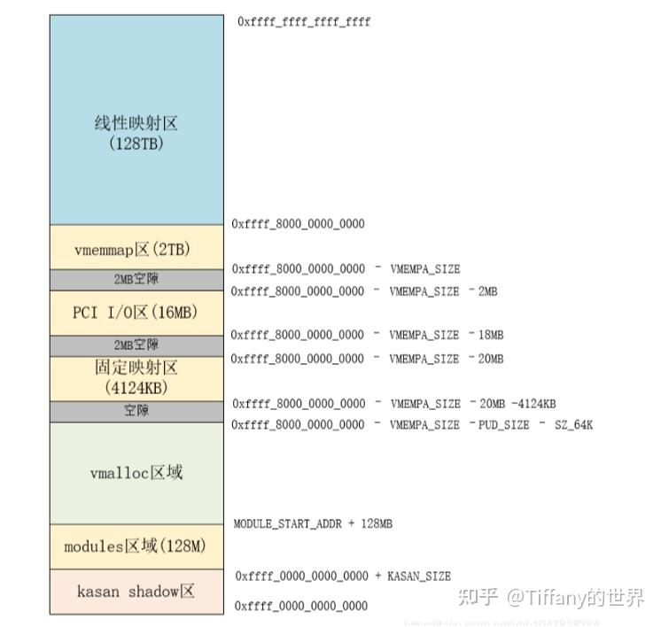

> 本文从硬件基础到内核实现，系统性地介绍 Linux 内存管理的完整体系。
> 目标读者：需要理解 Hypervisor Stage-2 页表隔离方案的工程师。
> 架构聚焦：ARM64 (AArch64)，兼顾 x86_64 对比。

---

## 目录

1. [物理内存的硬件视角](#1-物理内存的硬件视角)
2. [虚拟内存：为什么需要它](#2-虚拟内存为什么需要它)
3. [ARM64 地址翻译全景](#3-arm64-地址翻译全景)
4. [Linux 虚拟地址空间布局](#4-linux-虚拟地址空间布局)
5. [物理内存的组织：Node、Zone、Page](#5-物理内存的组织nodezonepage)
6. [页帧与 struct page](#6-页帧与-struct-page)
7. [Buddy System：物理页面分配器](#7-buddy-system物理页面分配器)
8. [Slab 分配器：小对象分配](#8-slab-分配器小对象分配)
9. [页表管理](#9-页表管理)
10. [内核内存分配 API 全景](#10-内核内存分配-api-全景)
11. [用户空间内存管理](#11-用户空间内存管理)
12. [Page Fault 处理](#12-page-fault-处理)
13. [内存回收与交换](#13-内存回收与交换)
14. [DMA 与 IOMMU/SMMU](#14-dma-与-iommusmmu)
15. [ARM64 两阶段地址翻译](#15-arm64-两阶段地址翻译)
16. [NUMA 与内存策略](#16-numa-与内存策略)
17. [内存管理关键数据结构总览](#17-内存管理关键数据结构总览)
18. [与我们的双分区方案的关联](#18-与我们的双分区方案的关联)

---

## 1. 物理内存的硬件视角

### 1.1 什么是物理内存

物理内存就是插在主板上的 DRAM 芯片。CPU 通过**物理地址总线**访问它。

```
┌─────────────────────────────────────────────────────────────┐
│                        SoC (片上系统)                        │
│                                                             │
│  ┌─────────┐   ┌─────────┐   ┌─────────┐   ┌─────────┐   │
│  │  CPU 0  │   │  CPU 1  │   │  CPU 2  │   │  CPU 3  │   │
│  └────┬────┘   └────┬────┘   └────┬────┘   └────┬────┘   │
│       │             │             │             │         │
│       └──────┬──────┴──────┬──────┴──────┬──────┘         │
│              │             │             │                 │
│         ┌────▼────┐   ┌────▼────┐   ┌────▼────┐          │
│         │  L2 $   │   │  L2 $   │   │  L2 $   │          │
│         └────┬────┘   └────┬────┘   └────┬────┘          │
│              │             │             │                 │
│              └──────┬──────┴──────┬──────┘                │
│                     │             │                        │
│                ┌────▼─────────────▼────┐                   │
│                │       L3 Cache        │                   │
│                └──────────┬────────────┘                   │
│                           │                                │
│                ┌──────────▼────────────┐                   │
│                │  Memory Controller    │                   │
│                │  (内存控制器)          │                   │
│                └──────────┬────────────┘                   │
│                           │                                │
└───────────────────────────┼─────────────────────────────────┘
                            │ 物理地址总线
                ┌───────────▼───────────┐
                │      DRAM 芯片        │
                │                       │
                │  PA 0x0000_0000_0000  │  ← 物理地址 0
                │  PA 0x0000_0000_1000  │  ← 物理地址 4KB
                │  ...                  │
                │  PA 0x0001_FFFF_FFFF  │  ← 8GB 处
                │                       │
                └───────────────────────┘
```

### 1.2 物理地址空间 ≠ 物理内存

物理地址空间是一个**地址编号的范围**，不是所有地址都对应 DRAM：

```
物理地址空间（以典型 ARM64 SoC 为例）：

PA 0x0000_0000_0000 ┌──────────────────────┐
                     │  Boot ROM            │  ← 只读，固化的启动代码
PA 0x0000_0001_0000 ├──────────────────────┤
                     │  外设寄存器 (MMIO)    │  ← UART, GPIO, SPI 等
                     │  不是内存！           │
                     │  读写这些地址 =       │
                     │  操作硬件寄存器       │
PA 0x0000_4000_0000 ├──────────────────────┤
                     │                      │
                     │  DRAM (物理内存)      │  ← 真正的内存在这里
                     │  2GB / 4GB / 8GB     │
                     │                      │
PA 0x0000_BFFF_FFFF ├──────────────────────┤
                     │  PCIe 地址窗口        │  ← GPU、NVMe 等设备
                     │                      │
PA 0x0000_FFFF_FFFF ├──────────────────────┤
                     │  更多 DRAM (高地址)   │  ← 如果内存 > 2GB
                     │                      │
                     └──────────────────────┘

关键理解：
  - 物理地址 0x0000_0000 不一定是 DRAM 的起始
  - MMIO 区域读写的是硬件寄存器，不是内存
  - DRAM 的起始地址由 SoC 设计决定
  - 这个布局在设备树 (Device Tree) 中描述
```

### 1.3 页（Page）：内存管理的基本单位

物理内存被划分为固定大小的**页帧（Page Frame）**：

```
ARM64 默认页大小：4KB (4096 字节)
也支持：16KB、64KB（编译时选择）

物理内存被划分为页帧：

  ┌──────────┐ PA 0x4000_0000  ← 页帧 0 (PFN = 0x40000)
  │  4KB     │
  ├──────────┤ PA 0x4000_1000  ← 页帧 1 (PFN = 0x40001)
  │  4KB     │
  ├──────────┤ PA 0x4000_2000  ← 页帧 2 (PFN = 0x40002)
  │  4KB     │
  ├──────────┤
  │  ...     │
  ├──────────┤ PA 0xBFFF_F000  ← 最后一个页帧
  │  4KB     │
  └──────────┘

PFN (Page Frame Number) = 物理地址 / 页大小
  PA 0x4000_3000 → PFN = 0x4000_3000 / 0x1000 = 0x4000_3

为什么用页？
  1. 页表映射的粒度就是页
  2. 内存分配的最小单位就是页
  3. 页面换入换出（swap）的单位也是页
  4. 统一管理，简化硬件和软件设计
```

---

## 2. 虚拟内存：为什么需要它

### 2.1 没有虚拟内存的世界

```
假设没有虚拟内存，所有程序直接使用物理地址：

  程序 A 编译时：
    代码段从 PA 0x1000 开始
    数据段从 PA 0x5000 开始

  程序 B 编译时：
    代码段从 PA 0x1000 开始  ← 冲突！
    数据段从 PA 0x5000 开始  ← 冲突！

问题：
  1. 地址冲突：两个程序不能同时运行
  2. 安全隐患：程序 A 可以读写程序 B 的内存
  3. 内存碎片：程序退出后留下不连续的空洞
  4. 内存不足：每个程序只能用物理内存大小的一部分
```

### 2.2 虚拟内存的核心思想

```
每个进程有自己独立的虚拟地址空间：

  进程 A 的视角：                进程 B 的视角：
  ┌──────────────┐              ┌──────────────┐
  │ VA 0x0000... │              │ VA 0x0000... │
  │ 代码段       │              │ 代码段       │
  │ VA 0x5000... │              │ VA 0x5000... │
  │ 数据段       │              │ 数据段       │
  │ ...          │              │ ...          │
  │ VA 0x7FFF... │              │ VA 0x7FFF... │
  │ 栈           │              │ 栈           │
  └──────┬───────┘              └──────┬───────┘
         │                             │
         │ 页表 A                      │ 页表 B
         │ (VA → PA 映射)              │ (VA → PA 映射)
         ▼                             ▼
  ┌──────────────────────────────────────────┐
  │              物理内存                     │
  │                                          │
  │  PA 0x2000: 进程 A 的代码               │
  │  PA 0x3000: 进程 B 的代码               │
  │  PA 0x4000: 进程 A 的数据               │
  │  PA 0x5000: 进程 B 的数据               │
  │  PA 0x6000: 共享库 (两个进程共享)       │
  │                                          │
  └──────────────────────────────────────────┘

关键：
  - 进程 A 和 B 都认为自己的代码从 VA 0x0000 开始
  - 但它们通过不同的页表映射到不同的物理地址
  - 进程 A 无法访问进程 B 的物理页面（页表中没有映射）
  - 共享库可以映射到两个进程的虚拟地址空间（同一个物理页面）
```

### 2.3 虚拟内存的五大好处

```
1. 隔离性：每个进程有独立的地址空间，互不干扰
2. 安全性：进程无法访问未映射的物理内存
3. 灵活性：虚拟地址连续，物理地址可以不连续
4. 超额分配：虚拟地址空间可以远大于物理内存（通过 swap）
5. 共享：多个进程可以共享同一个物理页面（共享库、COW fork）
```

---

## 3. ARM64 地址翻译全景

### 3.1 ARM64 的异常级别（Exception Levels）

```
┌─────────────────────────────────────────────────┐
│  EL3 - Secure Monitor (ARM TrustZone)           │
│  最高特权级，管理安全世界和非安全世界的切换      │
├─────────────────────────────────────────────────┤
│  EL2 - Hypervisor                               │
│  虚拟化层，管理虚拟机                            │
│  控制 Stage-2 页表（IPA → PA）                   │
│  我们的安全隔离方案工作在这一层                   │
├─────────────────────────────────────────────────┤
│  EL1 - OS Kernel                                │
│  操作系统内核                                    │
│  控制 Stage-1 页表（VA → IPA）                   │
├─────────────────────────────────────────────────┤
│  EL0 - User Application                        │
│  用户空间应用程序                                │
│  使用内核建立的页表映射                          │
└─────────────────────────────────────────────────┘

特权级从高到低：EL3 > EL2 > EL1 > EL0
高特权级可以控制低特权级的行为
```

### 3.2 单阶段地址翻译（无 Hypervisor）

```
没有 Hypervisor 时，地址翻译只有一个阶段：

  CPU 发出虚拟地址 (VA)
       │
       ▼
  ┌─────────────────────────────────────────┐
  │           MMU (内存管理单元)              │
  │                                         │
  │  VA ──→ 查询页表 ──→ PA                 │
  │                                         │
  │  页表基地址寄存器：                      │
  │    TTBR0_EL1: 用户空间页表基地址         │
  │    TTBR1_EL1: 内核空间页表基地址         │
  │                                         │
  │  如何选择用哪个 TTBR？                   │
  │    VA 最高位 = 0 → 用 TTBR0 (用户空间)  │
  │    VA 最高位 = 1 → 用 TTBR1 (内核空间)  │
  │                                         │
  └─────────────────────────────────────────┘
       │
       ▼
  物理地址 (PA) → 访问 DRAM 或 MMIO
```

### 3.3 两阶段地址翻译（有 Hypervisor）

```
有 Hypervisor 时，地址翻译分两个阶段：

  CPU 发出虚拟地址 (VA)
       │
       ▼
  ┌─────────────────────────────────────────────────────┐
  │                    MMU                               │
  │                                                     │
  │  Stage-1 (EL1 控制)                                 │
  │  ┌─────────────────────────────────────────────┐   │
  │  │  VA ──→ 查询 Stage-1 页表 ──→ IPA           │   │
  │  │                                             │   │
  │  │  页表基地址：TTBR0_EL1 / TTBR1_EL1         │   │
  │  │  权限控制：AP[2:1] (读/写/执行)             │   │
  │  │  由 OS 内核管理                              │   │
  │  └──────────────────────┬──────────────────────┘   │
  │                         │ IPA (中间物理地址)        │
  │                         ▼                           │
  │  Stage-2 (EL2 控制)                                 │
  │  ┌─────────────────────────────────────────────┐   │
  │  │  IPA ──→ 查询 Stage-2 页表 ──→ PA           │   │
  │  │                                             │   │
  │  │  页表基地址：VTTBR_EL2                      │   │
  │  │  权限控制：S2AP[1:0] (读/写)                │   │
  │  │  由 Hypervisor 管理                          │   │
  │  │  OS 内核无法修改！                           │   │
  │  └──────────────────────┬──────────────────────┘   │
  │                         │                           │
  └─────────────────────────┼───────────────────────────┘
                            │
                            ▼
                    物理地址 (PA) → 访问 DRAM

关键理解：
  - IPA (Intermediate Physical Address) 是一个中间地址
  - 在没有 Hypervisor 时，IPA = PA（恒等映射）
  - 在有 Hypervisor 时，IPA 和 PA 可以不同
  - 但在我们的方案中，IPA = PA（恒等映射），Stage-2 只用来控制权限
  - 最终权限 = Stage-1 权限 ∩ Stage-2 权限（取交集，更严格的生效）
```

### 3.4 四级页表的查找过程

ARM64 使用 4 级页表（以 4KB 页、48 位虚拟地址为例）：

```
48 位虚拟地址的分解：

  ┌───────┬───────┬───────┬───────┬──────────────┐
  │ 47:39 │ 38:30 │ 29:21 │ 20:12 │    11:0      │
  │ L0 idx│ L1 idx│ L2 idx│ L3 idx│ Page Offset  │
  │ 9 bit │ 9 bit │ 9 bit │ 9 bit │   12 bit     │
  │(0~511)│(0~511)│(0~511)│(0~511)│  (0~4095)    │
  └───┬───┴───┬───┴───┬───┴───┬───┴──────┬───────┘
      │       │       │       │          │
      ▼       │       │       │          │
  ┌────────┐  │       │       │          │
  │ PGD    │  │       │       │          │
  │ (L0)   │  │       │       │          │
  │        │  │       │       │          │
  │ 512个  │  │       │       │          │
  │ 条目   │  │       │       │          │
  │        │  │       │       │          │
  │ [idx]──┼──┘       │       │          │
  └────────┘          │       │          │
      │               │       │          │
      ▼               │       │          │
  ┌────────┐          │       │          │
  │ PUD    │          │       │          │
  │ (L1)   │          │       │          │
  │        │          │       │          │
  │ [idx]──┼──────────┘       │          │
  └────────┘                  │          │
      │                       │          │
      ▼                       │          │
  ┌────────┐                  │          │
  │ PMD    │                  │          │
  │ (L2)   │                  │          │
  │        │                  │          │
  │ [idx]──┼──────────────────┘          │
  └────────┘                             │
      │                                  │
      ▼                                  │
  ┌────────┐                             │
  │ PTE    │                             │
  │ (L3)   │                             │
  │        │                             │
  │ [idx]──┼─→ 物理页帧基地址            │
  └────────┘        │                    │
                    │                    │
                    ▼                    │
              物理页帧基地址 + Page Offset = 最终物理地址

每一级页表：
  - 占用 1 个物理页面 (4KB)
  - 包含 512 个条目 (每个条目 8 字节)
  - 512 × 8 = 4096 字节 = 4KB ✓

页表条目 (PTE) 的格式（简化）：
  ┌──────────────────────────────────────────────────────────┐
  │ 63:52  │ 51:12              │ 11:2      │ 1    │ 0      │
  │ 上层属性│ 物理页帧地址[51:12] │ 下层属性   │ 类型  │ 有效位 │
  │        │ (输出地址)          │ AP,SH,AF  │      │ Valid  │
  └──────────────────────────────────────────────────────────┘

  AP[2:1] (Access Permission):
    00 = EL1 读写, EL0 无权限
    01 = EL1 读写, EL0 读写
    10 = EL1 只读, EL0 无权限
    11 = EL1 只读, EL0 只读
```

### 3.5 TLB：页表的缓存

```
TLB (Translation Lookaside Buffer) 是页表查找结果的缓存：

  CPU 发出 VA
       │
       ▼
  ┌─────────────┐
  │  查询 TLB   │
  │             │
  │  命中？     │──── 是 ──→ 直接得到 PA（1~2 个时钟周期）
  │             │
  └──────┬──────┘
         │ 未命中
         ▼
  ┌─────────────┐
  │ 遍历页表    │  ← 需要 4 次内存访问（每级一次）
  │ (Page Walk) │     约 100~200 个时钟周期
  └──────┬──────┘
         │
         ▼
  ┌─────────────┐
  │ 结果存入TLB │  ← 下次访问同一页就能命中
  └─────────────┘

TLB 的重要性：
  - 没有 TLB，每次内存访问都需要 4 次额外的内存访问（查页表）
  - 有了 TLB，绝大多数访问只需 1~2 个时钟周期
  - TLB 命中率通常 > 99%

TLB 失效 (Flush)：
  - 修改页表后，必须刷新 TLB
  - tlbi vmalle1  → 刷新当前 VMID 的所有 EL1 TLB 条目
  - tlbi vale1is  → 刷新特定地址的 TLB 条目

VMID 与 ASID：
  - VMID (Virtual Machine ID)：区分不同虚拟机的 TLB 条目
  - ASID (Address Space ID)：区分不同进程的 TLB 条目
  - 有了 VMID/ASID，切换虚拟机/进程时不需要刷新整个 TLB
  - 在我们的方案中：ASIL-B 上下文和 QM 上下文使用不同的 VMID
    → 切换上下文时不需要刷新 TLB！
```

---

## 4. Linux 虚拟地址空间布局

### 4.1 用户空间与内核空间的划分

```
ARM64 的 48 位虚拟地址空间：

  0xFFFF_FFFF_FFFF_FFFF ┌──────────────────────────┐
                         │                          │
                         │    内核空间               │
                         │    (高地址，VA 最高位=1)   │
                         │                          │
                         │    使用 TTBR1_EL1 页表    │
                         │                          │
  0xFFFF_0000_0000_0000 ├──────────────────────────┤
                         │                          │
                         │    非规范地址空间          │
                         │    (Canonical Hole)       │
                         │    访问会触发异常          │
                         │                          │
                         │    这个"洞"有多大？        │
                         │    2^48 到 2^64 之间      │
                         │    约 16EB 的空间         │
                         │                          │
  0x0000_FFFF_FFFF_FFFF ├──────────────────────────┤
                         │                          │
                         │    用户空间               │
                         │    (低地址，VA 最高位=0)   │
                         │                          │
                         │    使用 TTBR0_EL1 页表    │
                         │                          │
  0x0000_0000_0000_0000 └──────────────────────────┘

关键理解：
  - ARM64 用两个页表基地址寄存器分别管理用户空间和内核空间
  - TTBR0_EL1：每个进程一个，切换进程时切换此寄存器
  - TTBR1_EL1：所有进程共享同一个内核页表，不需要切换
  - 中间的"洞"确保用户空间和内核空间完全隔离
```

### 4.2 内核虚拟地址空间详细布局

```
ARM64 内核空间布局（CONFIG_ARM64_VA_BITS=48）：下面的图不对！！

  0xFFFF_FFFF_FFFF_FFFF ┌──────────────────────────────────┐
                         │  Fixmap 区域                      │
                         │  用于早期启动阶段的固定映射        │
  0xFFFF_FFFF_FE80_0000 ├──────────────────────────────────┤
                         │  PCI I/O 空间                     │
  0xFFFF_FFFF_FE00_0000 ├──────────────────────────────────┤
                         │  Modules 区域 (128MB)             │
                         │  内核模块 (.ko) 加载到这里         │
  0xFFFF_FFFF_F600_0000 ├──────────────────────────────────┤
                         │  ...                              │
  0xFFFF_8000_0000_0000 ├──────────────────────────────────┤
                         │                                  │
                         │  vmalloc 区域                     │
                         │  vmalloc() 分配的内存映射到这里    │
                         │  ioremap() 映射的 MMIO 也在这里   │
                         │                                  │
                         │  大小：约 126TB                   │
                         │                                  │
  0xFFFF_0000_0000_0000 ├──────────────────────────────────┤
                         │                                  │
                         │  线性映射区 (Linear Map)          │
                         │  也叫"直接映射区"                 │
                         │                                  │
                         │  所有物理内存都在这里有一个        │
                         │  一一对应的虚拟地址映射            │
                         │                                  │
                         │  VA = PA + PAGE_OFFSET            │
                         │  PAGE_OFFSET = 0xFFFF_0000_0000.. │
                         │                                  │
                         │  kmalloc 分配的内存在这个区域      │
                         │  struct page 数组也在这个区域      │
                         │                                  │
                         │  大小：等于物理内存大小            │
                         │                                  │
                         └──────────────────────────────────┘

重要概念 — 线性映射区：
  - 所有物理内存都被映射到这个区域
  - 映射关系是简单的线性偏移：VA = PA + PAGE_OFFSET
  - 这意味着内核可以通过简单的加减法在 VA 和 PA 之间转换
  - kmalloc 返回的地址就在这个区域
  - 这个映射在启动时就建立好了，不需要动态修改页表
```

### 4.3 用户虚拟地址空间布局

```
用户进程的虚拟地址空间（从低到高）：

  0x0000_FFFF_FFFF_FFFF ┌──────────────────────────────────┐
                         │  栈 (Stack)                       │
                         │  从高地址向低地址增长              │
                         │  默认大小 8MB (ulimit -s)         │
                         │  每个线程有自己的栈                │
                         ├──────────────────────────────────┤
                         │                                  │
                         │  空闲区域                         │
                         │  (栈和 mmap 之间的空间)           │
                         │                                  │
                         ├──────────────────────────────────┤
                         │  mmap 区域                        │
                         │  - 共享库 (.so) 映射到这里         │
                         │  - mmap() 匿名映射               │
                         │  - mmap() 文件映射                │
                         │  从高地址向低地址增长              │
                         ├──────────────────────────────────┤
                         │                                  │
                         │  空闲区域                         │
                         │                                  │
                         ├──────────────────────────────────┤
                         │  堆 (Heap)                        │
                         │  brk/sbrk 管理                    │
                         │  malloc 的底层实现之一             │
                         │  从低地址向高地址增长              │
                         ├──────────────────────────────────┤
                         │  BSS 段                           │
                         │  未初始化的全局变量                │
                         │  (实际映射到零页，写时复制)        │
                         ├──────────────────────────────────┤
                         │  数据段 (Data)                    │
                         │  已初始化的全局变量                │
                         ├──────────────────────────────────┤
                         │  代码段 (Text)                    │
                         │  可执行代码，只读+可执行           │
  0x0000_0000_0040_0000 ├──────────────────────────────────┤
                         │  保留区域                         │
                         │  NULL 指针解引用保护              │
  0x0000_0000_0000_0000 └──────────────────────────────────┘

每个进程都有这样一个独立的布局。
进程切换时，内核切换 TTBR0_EL1 寄存器，
指向新进程的用户页表，用户空间的映射就完全不同了。
但 TTBR1_EL1 不变，所以内核空间的映射始终相同。
```

---

## 5. 物理内存的组织：Node、Zone、Page

### 5.1 三级组织结构

```
Linux 用三级结构组织物理内存：

  ┌─────────────────────────────────────────────────────────┐
  │                    Node (节点)                           │
  │  代表一个 NUMA 节点（一组 CPU + 本地内存）               │
  │  在 UMA 系统中只有一个 Node                              │
  │                                                         │
  │  ┌───────────────────────────────────────────────────┐  │
  │  │                Zone (区域)                         │  │
  │  │  按物理地址范围和用途划分                           │  │
  │  │                                                   │  │
  │  │  ┌─────────────────────────────────────────────┐  │  │
  │  │  │            Page Frame (页帧)                 │  │  │
  │  │  │  物理内存的最小管理单位 (4KB)                │  │  │
  │  │  │  每个页帧有一个 struct page 描述符           │  │  │
  │  │  └─────────────────────────────────────────────┘  │  │
  │  │                                                   │  │
  │  └───────────────────────────────────────────────────┘  │
  │                                                         │
  └─────────────────────────────────────────────────────────┘
```

### 5.2 NUMA Node

```
NUMA (Non-Uniform Memory Access) 架构：

  ┌─────────────────────┐     ┌─────────────────────┐
  │      Node 0         │     │      Node 1         │
  │                     │     │                     │
  │  ┌───┐ ┌───┐      │     │  ┌───┐ ┌───┐      │
  │  │C0 │ │C1 │      │     │  │C2 │ │C3 │      │
  │  └─┬─┘ └─┬─┘      │     │  └─┬─┘ └─┬─┘      │
  │    └──┬──┘         │     │    └──┬──┘         │
  │       │            │     │       │            │
  │  ┌────▼────┐       │     │  ┌────▼────┐       │
  │  │ 本地    │       │     │  │ 本地    │       │
  │  │ 内存    │       │     │  │ 内存    │       │
  │  │ 4GB     │       │     │  │ 4GB     │       │
  │  └─────────┘       │     │  └─────────┘       │
  │                     │     │                     │
  └──────────┬──────────┘     └──────────┬──────────┘
             │                           │
             └─────────┬─────────────────┘
                       │
                  互联总线 (QPI/UPI/CCI)

  CPU 0 访问 Node 0 的内存：快（本地访问，~100ns）
  CPU 0 访问 Node 1 的内存：慢（远程访问，~300ns）

  在我们的方案中：
  - 使用 NUMA emulation 将物理内存分为两个"假"NUMA 节点
  - Node 0 = QM Pool（普通内存）
  - Node 1 = ASIL-B Pool（安全内存）
  - 虽然物理上是同一个内存控制器，但内核会区分管理
```

### 5.3 Zone

```
每个 Node 内部按物理地址范围划分为多个 Zone：

  Node 0 的物理内存：
  ┌──────────────────────────────────────────────────────┐
  │                                                      │
  │  ZONE_DMA (0 ~ 16MB)                                │
  │  用于老式 ISA 设备的 DMA（只能访问低 16MB）           │
  │  在 ARM64 上通常不存在                                │
  │                                                      │
  ├──────────────────────────────────────────────────────┤
  │                                                      │
  │  ZONE_DMA32 (0 ~ 4GB)                               │
  │  用于只能访问低 4GB 的 32 位 DMA 设备                 │
  │  ARM64 上通常存在                                     │
  │                                                      │
  ├──────────────────────────────────────────────────────┤
  │                                                      │
  │  ZONE_NORMAL (4GB ~ 物理内存上限)                    │
  │  普通内存，大部分分配来自这里                         │
  │  ARM64 上这是最主要的 Zone                            │
  │                                                      │
  ├──────────────────────────────────────────────────────┤
  │                                                      │
  │  ZONE_MOVABLE (可选)                                 │
  │  可移动页面的区域，用于内存热插拔和大页分配            │
  │                                                      │
  └──────────────────────────────────────────────────────┘

为什么要分 Zone？
  - 某些硬件设备有地址限制（如 32 位 DMA 只能访问低 4GB）
  - 分配内存时可以指定从哪个 Zone 分配
  - GFP_DMA32 → 从 ZONE_DMA32 分配
  - GFP_KERNEL → 从 ZONE_NORMAL 分配（也可以回退到 DMA32）

每个 Zone 维护自己的：
  - free_area[MAX_ORDER]：空闲页面链表（Buddy System）
  - 水位线（watermark）：控制何时触发内存回收
  - 统计信息：空闲页数、已分配页数等
```

---

## 6. 页帧与 struct page

### 6.1 struct page：物理页面的描述符

```
内核为每个物理页帧维护一个 struct page 结构体：

  struct page {
      unsigned long flags;        // 页面状态标志
                                  // PG_locked, PG_dirty, PG_slab 等

      union {
          struct {                // 用于页缓存 (Page Cache)
              struct list_head lru;      // LRU 链表节点
              struct address_space *mapping; // 所属的 address_space
              pgoff_t index;             // 在文件中的偏移（页为单位）
          };

          struct {                // 用于 Slab 分配器
              struct kmem_cache *slab_cache;  // 所属的 slab cache
              void *freelist;                 // 空闲对象链表
              unsigned int active;            // 活跃对象数
          };

          struct {                // 用于复合页 (Compound Page)
              unsigned long compound_head;    // 指向首页
              unsigned int compound_order;    // 阶数
          };
      };

      atomic_t _refcount;         // 引用计数
      atomic_t _mapcount;         // 映射计数（多少个页表映射了此页）
  };

关键理解：
  - struct page 使用 union 来节省内存（同一个页面不会同时用于多种用途）
  - 每个 struct page 大约 64 字节
  - 对于 4GB 内存：4GB / 4KB = 1M 个页面 × 64B = 64MB 的 struct page 数组
  - 这个数组本身也需要物理内存来存储！
```

### 6.2 struct page 数组的存储

```
struct page 数组存储在哪里？

  方式 1：FLATMEM（平坦内存模型）
  ──────────────────────────────
  一个连续的大数组：
    struct page *mem_map;
    mem_map[pfn] 就是 PFN 对应的 struct page

  方式 2：SPARSEMEM（稀疏内存模型，ARM64 默认）
  ──────────────────────────────
  内存被分成多个 section，每个 section 有自己的 struct page 数组
  支持内存热插拔

  方式 3：SPARSEMEM_VMEMMAP（ARM64 实际使用）
  ──────────────────────────────
  struct page 数组被映射到 vmemmap 虚拟地址区域
  通过页表映射，可以处理物理地址不连续的情况

  PFN → struct page 的转换：
    struct page *page = pfn_to_page(pfn);
    // 实际上就是：vmemmap + pfn

  struct page → PFN 的转换：
    unsigned long pfn = page_to_pfn(page);
    // 实际上就是：page - vmemmap

  PFN → 物理地址：
    phys_addr_t pa = PFN_PHYS(pfn);  // pfn << PAGE_SHIFT

  物理地址 → PFN：
    unsigned long pfn = PHYS_PFN(pa);  // pa >> PAGE_SHIFT

  物理地址 → 虚拟地址（线性映射区）：
    void *va = phys_to_virt(pa);  // pa + PAGE_OFFSET
    // 或：__va(pa)

  虚拟地址 → 物理地址（线性映射区）：
    phys_addr_t pa = virt_to_phys(va);  // va - PAGE_OFFSET
    // 或：__pa(va)
```

---

## 7. Buddy System：物理页面分配器

### 7.1 Buddy System 的原理

```
Buddy System 是 Linux 的底层物理页面分配器。
它管理所有空闲的物理页面，以 2 的幂次方为单位分配。

  每个 Zone 维护一个 free_area 数组：

  zone->free_area[0]  → 空闲的 2^0 = 1 页的块
  zone->free_area[1]  → 空闲的 2^1 = 2 页的块
  zone->free_area[2]  → 空闲的 2^2 = 4 页的块
  zone->free_area[3]  → 空闲的 2^3 = 8 页的块
  ...
  zone->free_area[10] → 空闲的 2^10 = 1024 页 = 4MB 的块

  MAX_ORDER = 11（默认），最大一次分配 2^10 = 4MB

  图示：
  ┌─────────────────────────────────────────────────────┐
  │  free_area[0]: [page] → [page] → [page] → ...      │
  │                 1页      1页      1页               │
  │                                                     │
  │  free_area[1]: [page,page] → [page,page] → ...     │
  │                 2页连续      2页连续                 │
  │                                                     │
  │  free_area[2]: [4页连续] → [4页连续] → ...          │
  │                                                     │
  │  ...                                                │
  │                                                     │
  │  free_area[10]: [1024页连续] → ...                  │
  └─────────────────────────────────────────────────────┘
```

### 7.2 分配过程

```
请求分配 1 页（order=0）：

  Step 1: 查看 free_area[0]
          有空闲块？ → 取出一个，返回 ✅

          没有空闲块？ → 向上查找 ↓

  Step 2: 查看 free_area[1]（2 页的块）
          有空闲块？ → 取出一个 2 页的块
                       拆分为两个 1 页的块
                       返回一个，另一个放入 free_area[0]

          没有空闲块？ → 继续向上查找 ↓

  Step 3: 查看 free_area[2]（4 页的块）
          有空闲块？ → 取出一个 4 页的块
                       拆分：4 → 2 + 2
                       再拆分：2 → 1 + 1
                       返回 1 页
                       剩余：1 页放入 free_area[0]
                              2 页放入 free_area[1]

  图示（分配 1 页，从 4 页块拆分）：

  拆分前：
    free_area[2]: [A B C D]    (4 页连续块)

  拆分后：
    返回给调用者：[A]          (1 页)
    free_area[0]: [B]          (1 页，A 的 buddy)
    free_area[1]: [C D]        (2 页块)
```

### 7.3 释放过程（合并）

```
释放 1 页（order=0）：

  Step 1: 检查这个页的 buddy（伙伴）是否也是空闲的
          buddy 的地址 = 当前地址 XOR (1          buddy 的地址 = 当前地址 XOR (1 << order)

          例如：释放 PFN=0x1000 的页面（order=0）
          buddy PFN = 0x1000 XOR 0x1 = 0x1001

  Step 2: 如果 buddy 也是空闲的 -> 合并
          从 free_area[0] 中移除 buddy
          合并成一个 2 页的块
          放入 free_area[1]

  Step 3: 继续检查新块的 buddy 是否空闲
          如果是 -> 继续合并，放入 free_area[2]
          如果不是 -> 停止

  图示（释放页面 B，与 buddy A 合并）：

  释放前：
    free_area[0]: [A]          (A 是空闲的)
    正在释放：B               (B 是 A 的 buddy)

  合并后：
    free_area[0]: (A 被移除)
    free_area[1]: [A B]        (合并为 2 页块)

  继续检查：[A B] 的 buddy [C D] 是否空闲？
    如果是 -> 合并为 [A B C D]，放入 free_area[2]
    如果不是 -> 停止

为什么叫 Buddy？
  - 每个块都有一个伙伴块
  - 两个伙伴合并后形成更大的块
  - 这种递归合并避免了外部碎片
```

### 7.4 分配 API

```c
// 分配 2^order 个连续物理页面
struct page *alloc_pages(gfp_t gfp_mask, unsigned int order);

// 分配 1 个物理页面
struct page *alloc_page(gfp_t gfp_mask);
// 等价于 alloc_pages(gfp_mask, 0)

// 分配并返回虚拟地址（线性映射区的 VA）
unsigned long __get_free_pages(gfp_t gfp_mask, unsigned int order);
unsigned long __get_free_page(gfp_t gfp_mask);

// 释放
void __free_pages(struct page *page, unsigned int order);
void free_pages(unsigned long addr, unsigned int order);
```

### 7.5 GFP 标志（Get Free Pages flags）

```
GFP 标志控制分配行为：

  GFP_KERNEL
    最常用的标志
    可以睡眠（等待内存回收）
    从 ZONE_NORMAL 分配
    用于：大部分内核代码

  GFP_ATOMIC
    不能睡眠（用于中断上下文、持有自旋锁时）
    如果没有空闲页面，立即失败
    用于：中断处理程序、软中断

  GFP_DMA / GFP_DMA32
    从 ZONE_DMA / ZONE_DMA32 分配
    用于：需要低地址内存的 DMA 设备

  GFP_HIGHUSER
    分配用户空间页面
    可以从 ZONE_HIGHMEM 分配（32 位系统）

  __GFP_ZERO
    分配后将页面清零
    用于：安全敏感的分配

  __GFP_NOWARN
    分配失败时不打印警告

  组合示例：
    GFP_KERNEL | __GFP_ZERO  -> 可睡眠，分配后清零
    GFP_ATOMIC | GFP_DMA32   -> 不可睡眠，从低 4GB 分配
```

---

## 8. Slab 分配器：小对象分配

### 8.1 为什么需要 Slab

```
Buddy System 的最小分配单位是 1 页 (4KB)。
但内核中大量的数据结构远小于 4KB：

  struct task_struct    约 6KB (跨页，但大部分字段 < 4KB)
  struct inode          约 600 字节
  struct dentry         约 200 字节
  struct file           约 256 字节
  struct sk_buff        约 240 字节

如果每个 200 字节的 dentry 都分配一个 4KB 页面：
  浪费率 = (4096 - 200) / 4096 = 95%！

Slab 分配器解决这个问题：
  从 Buddy System 获取整页
  在页内切分为固定大小的小对象
  管理这些小对象的分配和释放
```

### 8.2 Slab 的三层结构

```
+-------------------------------------------------------------+
|  kmem_cache ("dentry_cache")                                |
|  描述一种特定大小/类型的对象缓存                             |
|                                                             |
|  +-------------------------------------------------------+  |
|  |  Slab (一个或多个连续物理页面)                         |  |
|  |                                                       |  |
|  |  +-----+-----+-----+-----+-----+-----+-----+        |  |
|  |  |obj 0|obj 1|obj 2|obj 3|obj 4|obj 5|obj 6|        |  |
|  |  |used |free |used |free |used |free |free |        |  |
|  |  +-----+-----+-----+-----+-----+-----+-----+        |  |
|  |                                                       |  |
|  |  freelist -> obj1 -> obj3 -> obj5 -> obj6 -> NULL     |  |
|  |                                                       |  |
|  +-------------------------------------------------------+  |
|                                                             |
|  Slab 状态：                                                |
|    full:    所有对象都已分配                                  |
|    partial: 部分对象已分配，部分空闲                          |
|    empty:   所有对象都是空闲的                                |
|                                                             |
+-------------------------------------------------------------+

Linux 内核有三种 Slab 实现（编译时选择一种）：
  SLAB:   最早的实现，功能完整但复杂
  SLUB:   当前默认，更简单高效（推荐）
  SLOB:   极简实现，用于嵌入式系统
```

### 8.3 通用 Slab 缓存（kmalloc）

```
除了为特定类型创建的 kmem_cache，内核还预创建了一系列通用大小的缓存：

  kmalloc-8       -> 8 字节对象
  kmalloc-16      -> 16 字节对象
  kmalloc-32      -> 32 字节对象
  kmalloc-64      -> 64 字节对象
  kmalloc-128     -> 128 字节对象
  kmalloc-256     -> 256 字节对象
  kmalloc-512     -> 512 字节对象
  kmalloc-1k      -> 1024 字节对象
  kmalloc-2k      -> 2048 字节对象
  kmalloc-4k      -> 4096 字节对象
  kmalloc-8k      -> 8192 字节对象

kmalloc(200, GFP_KERNEL) 的过程：
  1. 找到 >= 200 字节的最小缓存 -> kmalloc-256
  2. 从 kmalloc-256 的 partial slab 中分配一个 256 字节的对象
  3. 如果没有 partial slab，从 Buddy System 获取新页面创建新 slab
  4. 返回对象的虚拟地址（在线性映射区）

内部浪费：200 字节请求分配了 256 字节 -> 浪费 56 字节 (22%)
比直接用 Buddy System 浪费 3896 字节 (95%) 好得多！
```

---

## 9. 页表管理

### 9.1 Linux 的五级页表模型

```
Linux 内核定义了一个通用的五级页表模型：

  PGD (Page Global Directory)     -> L0
  P4D (Page 4th Directory)        -> L1 (5 级页表时使用)
  PUD (Page Upper Directory)      -> L1/L2
  PMD (Page Middle Directory)     -> L2/L3
  PTE (Page Table Entry)          -> L3/L4

ARM64 使用 4 级页表（48 位 VA），P4D 被折叠：
  PGD -> PUD -> PMD -> PTE -> Page

x86_64 使用 4 级页表（48 位 VA），P4D 也被折叠：
  PGD -> PUD -> PMD -> PTE -> Page

x86_64 使用 5 级页表（57 位 VA，LA57）：
  PGD -> P4D -> PUD -> PMD -> PTE -> Page
```

### 9.2 页表的存储

```
页表本身也是存储在物理内存中的：

  每级页表占用 1 个物理页面 (4KB)
  包含 512 个条目 (每个 8 字节)

  页表页面的分配：
    通过 Buddy System 分配（alloc_pages）
    页表页面的 struct page 标记为 PG_table

  页表页面在哪个区域？
    在线性映射区有虚拟地址映射
    内核通过虚拟地址读写页表内容
    页表页面的物理地址写入上级页表条目

  一个进程需要多少页表页面？
    最坏情况（映射满 256TB 用户空间）：
      PGD: 1 页
      PUD: 512 页
      PMD: 512 x 512 = 262,144 页
      PTE: 512^3 = 134,217,728 页
      总计约 512GB 的页表！

    实际情况：
      大部分虚拟地址空间未映射
      只有实际使用的地址范围才有页表
      典型进程：几十到几百个页表页面
```

### 9.3 页表操作 API

```c
// 获取 PGD 条目
pgd_t *pgd = pgd_offset(mm, addr);

// 获取 PUD 条目
pud_t *pud = pud_offset(pgd, addr);

// 获取 PMD 条目
pmd_t *pmd = pmd_offset(pud, addr);

// 获取 PTE 条目
pte_t *pte = pte_offset_kernel(pmd, addr);  // 内核页表
pte_t *pte = pte_offset_map(pmd, addr);     // 用户页表

// 设置 PTE
set_pte(pte, mk_pte(page, prot));

// 清除 PTE
pte_clear(mm, addr, pte);

// 检查 PTE 状态
pte_present(*pte)   // 页面是否在内存中
pte_write(*pte)     // 是否可写
pte_dirty(*pte)     // 是否被修改过
pte_young(*pte)     // 是否最近被访问过
```

### 9.4 大页（Huge Pages）

```
普通页面：4KB，需要 4 级页表查找
大页：跳过最后一级或两级页表，减少 TLB 压力

ARM64 支持的大页大小：
  2MB 大页 (PMD 级别)：PMD 条目直接指向 2MB 物理块
  1GB 大页 (PUD 级别)：PUD 条目直接指向 1GB 物理块

  普通 4KB 页：
    PGD -> PUD -> PMD -> PTE -> 4KB Page
                                需要 PTE 级别

  2MB 大页：
    PGD -> PUD -> PMD -> 2MB Block
                         PMD 直接指向 2MB 块，跳过 PTE

  1GB 大页：
    PGD -> PUD -> 1GB Block
                   PUD 直接指向 1GB 块，跳过 PMD 和 PTE

好处：
  1. 减少 TLB 条目数量（1 个 2MB TLB 条目 = 512 个 4KB TLB 条目）
  2. 减少页表级数，加速地址翻译
  3. 减少页表占用的内存

Linux 大页支持：
  HugeTLB：预分配的大页池，通过 hugetlbfs 使用
  THP (Transparent Huge Pages)：内核自动将连续的 4KB 页合并为 2MB 大页
```

---

## 10. 内核内存分配 API 全景

### 10.1 分配 API 层次

```
+-------------------------------------------------------------+
|                    应用层 API                                |
|                                                             |
|  kmalloc()     vmalloc()     kmem_cache_alloc()             |
|  kzalloc()     vzalloc()     mempool_alloc()                |
|  kcalloc()     vmap()                                       |
|                                                             |
+-------------------------------------------------------------+
|                    中间层                                    |
|                                                             |
|  Slab 分配器 (SLUB)          vmalloc 子系统                  |
|  管理小对象                   管理虚拟连续内存                |
|                                                             |
+-------------------------------------------------------------+
|                    底层                                      |
|                                                             |
|  Buddy System (alloc_pages)                                 |
|  管理物理页面                                                |
|                                                             |
+-------------------------------------------------------------+
|                    硬件                                      |
|                                                             |
|  物理内存 (DRAM)                                             |
|                                                             |
+-------------------------------------------------------------+
```

### 10.2 kmalloc vs vmalloc vs kmem_cache_alloc

```
+------------------+------------------+----------------------+
|     kmalloc      |     vmalloc      |  kmem_cache_alloc    |
+------------------+------------------+----------------------+
| 物理连续 YES     | 物理不连续 NO    | 物理连续 YES         |
| 虚拟连续 YES     | 虚拟连续 YES     | 虚拟连续 YES         |
| 线性映射区       | vmalloc 区域     | 线性映射区           |
| 小分配 (< 4MB)   | 大分配 (> 4MB)   | 特定类型对象         |
| 速度快           | 速度慢           | 速度快               |
| 可用于 DMA YES   | 不可用于 DMA NO  | 可用于 DMA YES       |
| 可能失败(碎片)   | 更容易成功       | 有对象缓存           |
+------------------+------------------+----------------------+
| 底层：Slab       | 底层：alloc_pages| 底层：Slab           |
|       + Buddy    |       + 页表映射 |       + Buddy        |
+------------------+------------------+----------------------+

使用场景：
  kmalloc：大部分内核分配（结构体、缓冲区等）
  vmalloc：大块内存（内核模块代码、大数组）
  kmem_cache_alloc：频繁分配/释放的特定类型（inode、dentry）
```

### 10.3 kmalloc 的完整过程

```
void *ptr = kmalloc(200, GFP_KERNEL);

  Step 1: 确定大小类
          200 字节 -> 向上取整到 256 -> 使用 kmalloc-256 缓存

  Step 2: SLUB 分配器查找空闲对象
          a) 检查当前 CPU 的本地缓存 (cpu_slab)
             有空闲对象？ -> 直接返回（最快路径，无锁）

          b) 检查 partial slab 列表
             有部分使用的 slab？ -> 从中分配一个对象

          c) 从 Buddy System 分配新页面
             alloc_pages(GFP_KERNEL, slab_order)
             初始化为新的 slab
             从中分配第一个对象

  Step 3: 返回对象的虚拟地址
          ptr 指向线性映射区的一个地址
          VA = PA + PAGE_OFFSET

  Step 4: 使用
          memset(ptr, 0, 200);
          // VA -> Stage-1 -> IPA -> Stage-2 -> PA -> 写入 DRAM

  Step 5: 释放
          kfree(ptr);
          // 对象归还给 slab 的 freelist
          // 如果整个 slab 都空闲了，可能归还给 Buddy System
```

### 10.4 vmalloc 的完整过程

```
void *ptr = vmalloc(1024 * 1024);  // 分配 1MB

  Step 1: 在 vmalloc 地址空间找到空闲的虚拟地址范围
          搜索 vmap_area 红黑树，找到 1MB 的空洞
          VA 范围：0xFFFF_8000_1000_0000 ~ 0xFFFF_8000_100F_FFFF

  Step 2: 分配 256 个物理页面（1MB / 4KB = 256 页）
          for (i = 0; i < 256; i++) {
              pages[i] = alloc_page(GFP_KERNEL);
              // 每个页面可能来自不同的物理位置
          }

  Step 3: 建立页表映射
          for (i = 0; i < 256; i++) {
              va = base_va + i * PAGE_SIZE;
              pa = page_to_phys(pages[i]);
              // 在内核页表 (TTBR1_EL1) 中创建 PTE：
              // va -> pa, 权限 RW
              // 可能需要分配新的 PMD/PTE 页表页面
          }

  Step 4: 刷新 TLB
          flush_tlb_kernel_range(base_va, base_va + size);

  Step 5: 返回虚拟地址
          ptr = base_va;  // 0xFFFF_8000_1000_0000

  使用时的地址翻译：
    ptr[0] = 'A';
    VA 0xFFFF_8000_1000_0000
      -> Stage-1: IPA = pages[0] 的物理地址
      -> Stage-2: PA (权限检查)
      -> 写入 DRAM

  释放 (vfree)：
    1. 清除所有页表映射
    2. 刷新 TLB
    3. 释放所有物理页面（归还给 Buddy System）
    4. 释放 vmap_area 结构

为什么 vmalloc 比 kmalloc 慢？
  1. 需要搜索虚拟地址空间
  2. 需要逐页分配物理页面
  3. 需要建立页表映射（可能分配新的页表页面）
  4. 需要刷新 TLB
  5. 访问时可能 TLB miss（vmalloc 区域的映射不如线性映射区稳定）
```

---

## 11. 用户空间内存管理

### 11.1 VMA（Virtual Memory Area）

```
每个进程的虚拟地址空间由多个 VMA 组成：

  struct vm_area_struct {
      unsigned long vm_start;     // VMA 起始虚拟地址
      unsigned long vm_end;       // VMA 结束虚拟地址（不包含）
      struct vm_area_struct *vm_next; // 链表中的下一个 VMA
      pgprot_t vm_page_prot;      // 页面保护属性（RWX）
      unsigned long vm_flags;     // VMA 标志
      struct file *vm_file;       // 映射的文件（匿名映射为 NULL）
      unsigned long vm_pgoff;     // 文件偏移（页为单位）
      const struct vm_operations_struct *vm_ops; // VMA 操作函数
  };

  进程的所有 VMA 组织在 mm_struct 中：
  struct mm_struct {
      struct vm_area_struct *mmap;     // VMA 链表头
      struct rb_root mm_rb;            // VMA 红黑树（快速查找）
      pgd_t *pgd;                      // 页表根（PGD）
      atomic_t mm_users;               // 使用此 mm 的线程数
      atomic_t mm_count;               // mm_struct 的引用计数
      unsigned long total_vm;          // 总虚拟页面数
      unsigned long locked_vm;         // 锁定的页面数
      unsigned long start_code, end_code;   // 代码段范围
      unsigned long start_data, end_data;   // 数据段范围
      unsigned long start_brk, brk;         // 堆的范围
      unsigned long start_stack;            // 栈的起始地址
  };

  一个典型进程的 VMA 列表（可通过 /proc/PID/maps 查看）：

  地址范围                    权限  类型
  --------------------------------------------------
  0x0040_0000-0x0041_0000    r-xp  代码段 (/usr/bin/app)
  0x0061_0000-0x0061_1000    r--p  只读数据 (/usr/bin/app)
  0x0061_1000-0x0061_2000    rw-p  数据段 (/usr/bin/app)
  0x0200_0000-0x0221_0000    rw-p  堆 [heap]
  0x7F00_0000-0x7F20_0000    r-xp  共享库 (/lib/libc.so)
  0x7F20_0000-0x7F20_2000    rw-p  共享库数据
  0x7FFF_0000-0x7FFF_2000    rw-p  匿名 mmap
  0x7FFF_E000-0x8000_0000    rw-p  栈 [stack]
```

### 11.2 mmap 系统调用

```
void *mmap(void *addr, size_t length, int prot, int flags, int fd, off_t offset);

两种主要用法：

1. 匿名映射（MAP_ANONYMOUS）：
   void *p = mmap(NULL, 4096, PROT_READ|PROT_WRITE,
                  MAP_PRIVATE|MAP_ANONYMOUS, -1, 0);
   // 分配 4KB 的匿名内存
   // 类似 malloc，但直接使用系统调用

2. 文件映射：
   int fd = open("/path/to/file", O_RDONLY);
   void *p = mmap(NULL, file_size, PROT_READ,
                  MAP_PRIVATE, fd, 0);
   // 将文件内容映射到内存
   // 读取 p[i] 就是读取文件的第 i 个字节
   // 不需要 read() 系统调用

mmap 的内核处理过程：

  Step 1: 参数检查
          地址对齐、权限检查、大小检查

  Step 2: 在进程的虚拟地址空间找到空闲区域
          搜索 VMA 红黑树

  Step 3: 创建新的 VMA
          分配 vm_area_struct
          设置 vm_start, vm_end, vm_flags, vm_file 等
          插入 VMA 链表和红黑树

  Step 4: 返回虚拟地址
          注意：此时还没有分配物理页面！
          也没有建立页表映射！
          这就是"延迟分配"（Demand Paging）

  Step 5: 首次访问时触发 Page Fault
          -> 见下一章
```

### 11.3 brk 与 malloc

```
malloc 的底层实现：

  小分配 (< 128KB，glibc 默认阈值)：
    使用 brk() 系统调用扩展堆
    brk 移动堆的上边界

    +----------------+ <-- brk (堆顶)
    |  新分配的空间   | <-- brk() 向上移动
    +----------------+ <-- 旧的 brk
    |  已有的堆数据   |
    +----------------+ <-- start_brk (堆底)
    |  BSS 段        |
    +----------------+

  大分配 (>= 128KB)：
    使用 mmap() 匿名映射
    在 mmap 区域分配独立的 VMA

  free() 的行为：
    小分配：不一定立即归还给内核（glibc 缓存）
    大分配：munmap() 立即归还

  为什么 malloc 不直接用 mmap？
    brk 扩展堆是连续的，管理简单
    mmap 每次都要创建新的 VMA，开销更大
    glibc 的 malloc 在用户空间维护自己的空闲链表
    减少系统调用次数
```

---

## 12. Page Fault 处理

### 12.1 什么是 Page Fault

```
Page Fault（缺页异常）发生在 CPU 访问一个虚拟地址，
但 MMU 无法完成地址翻译时。

触发 Page Fault 的原因：

  1. 页面未映射（PTE 不存在或 PTE.Valid = 0）
     -> 可能是合法的延迟分配
     -> 也可能是非法访问（段错误）

  2. 权限不足（如写只读页面）
     -> 可能是 COW（Copy-On-Write）触发
     -> 也可能是非法写入（段错误）

  3. 页面被换出到 swap
     -> 需要从 swap 读回

Page Fault 的处理流程：

  CPU 访问 VA
       |
       v
  MMU 翻译失败 -> 触发异常
       |
       v
  CPU 跳转到异常向量表
       |
       v
  内核的 Page Fault 处理函数
  do_page_fault() / do_mem_abort()
       |
       v
  +---------------------------------------------+
  |  检查 VA 是否在某个 VMA 范围内              |
  |                                             |
  |  find_vma(mm, addr)                         |
  |                                             |
  |  找到 VMA？                                 |
  |    否 -> 非法访问 -> SIGSEGV (段错误)       |
  |    是 -> 继续检查                           |
  +--------------------+------------------------+
                       |
                       v
  +---------------------------------------------+
  |  检查访问权限                               |
  |                                             |
  |  写访问 + VMA 不可写？                      |
  |    -> 如果是 COW 页面 -> 处理 COW           |
  |    -> 否则 -> SIGSEGV                       |
  |                                             |
  |  权限 OK -> 继续                            |
  +--------------------+------------------------+
                       |
                       v
  +---------------------------------------------+
  |  处理缺页                                   |
  |                                             |
  |  PTE 不存在（首次访问）？                   |
  |    -> 匿名页：分配新页面，映射到零页        |
  |    -> 文件页：从磁盘读取文件内容            |
  |                                             |
  |  PTE 存在但页面在 swap？                    |
  |    -> 从 swap 读回页面                      |
  |                                             |
  |  PTE 存在但是 COW？                         |
  |    -> 复制页面，建立新映射                  |
  +--------------------+------------------------+
                       |
                       v
  +---------------------------------------------+
  |  建立页表映射                               |
  |                                             |
  |  set_pte(pte, mk_pte(page, prot));          |
  |                                             |
  |  返回用户空间，重新执行触发异常的指令        |
  +---------------------------------------------+
```

### 12.2 匿名页面的 Page Fault

```
场景：用户进程首次写入 mmap 匿名映射的页面

  *p = 42;  // p 指向 mmap 返回的地址，首次访问

  Page Fault 处理：

  Step 1: find_vma() 找到对应的 VMA
          确认是匿名映射 (vm_file == NULL)

  Step 2: 分配一个物理页面
          page = alloc_page(GFP_HIGHUSER | __GFP_ZERO);
          // 从 Buddy System 分配
          // 清零（安全：不泄露其他进程的数据）

  Step 3: 建立页表映射
          遍历页表层级，必要时分配中间页表页面：
          pgd = pgd_offset(mm, addr);
          pud = pud_alloc(mm, pgd, addr);    // 可能分配新的 PUD 页
          pmd = pmd_alloc(mm, pud, addr);    // 可能分配新的 PMD 页
          pte = pte_alloc_map(mm, pmd, addr); // 可能分配新的 PTE 页

          set_pte(pte, mk_pte(page, vma->vm_page_prot));

  Step 4: 更新统计信息
          mm->total_vm++
          page->_mapcount++

  Step 5: 返回用户空间
          CPU 重新执行 *p = 42
          这次 MMU 能成功翻译 -> 写入成功
```

### 12.3 Copy-On-Write (COW)

```
COW 是 fork() 的核心优化：

  fork() 时不复制父进程的所有页面，
  而是让父子进程共享同一个物理页面，
  但将页表标记为只读。

  父进程页表：VA 0x1000 -> PA 0x5000 (只读)
  子进程页表：VA 0x1000 -> PA 0x5000 (只读)
                                同一个物理页面

  当任一进程写入时：
  1. 触发 Page Fault（写只读页面）
  2. 内核检测到这是 COW 页面
  3. 分配新的物理页面
  4. 复制原页面内容到新页面
  5. 更新写入者的页表指向新页面，权限改为读写
  6. 原页面的引用计数减 1

  写入后：
  父进程页表：VA 0x1000 -> PA 0x5000 (读写，引用计数=1)
  子进程页表：VA 0x1000 -> PA 0x8000 (读写，新页面)

好处：
  - fork() 非常快（不需要复制内存）
  - 如果子进程立即 exec()，大部分页面永远不会被复制
  - 只有实际被修改的页面才会复制
```

---

## 13. 内存回收与交换

### 13.1 内存回收的触发

```
当空闲内存低于水位线时，内核启动内存回收：

  Zone 的三个水位线：
  +---------------------------------------------+
  |                                             |
  |  ████████████████████  已使用               |
  |  --------------------  WMARK_MIN            | <-- 低于此线：直接回收
  |  ░░░░░░░░░░░░░░░░░░░  空闲                 |     （分配路径中同步回收）
  |  --------------------  WMARK_LOW            | <-- 低于此线：唤醒 kswapd
  |  ░░░░░░░░░░░░░░░░░░░  空闲                 |     （后台异步回收）
  |  --------------------  WMARK_HIGH           | <-- kswapd 回收到此线停止
  |  ░░░░░░░░░░░░░░░░░░░  空闲                 |
  |                                             |
  +---------------------------------------------+

  kswapd：内核线程，后台回收内存
  直接回收：在 alloc_pages 路径中同步回收（更慢）
  OOM Killer：当回收也无法满足时，杀死进程释放内存
```

### 13.2 可回收的页面类型

```
1. 文件页面（File-backed Pages）
   - 页缓存（Page Cache）中的页面
   - 可以直接丢弃（干净页面）或写回磁盘（脏页面）
   - 下次访问时从磁盘重新读取

2. 匿名页面（Anonymous Pages）
   - 进程的堆、栈、mmap 匿名映射
   - 不能直接丢弃（没有磁盘备份）
   - 需要先写入 swap 分区/文件，然后才能回收
   - PTE 标记为"在 swap 中"，记录 swap 位置

3. Slab 缓存
   - 可收缩的 slab 缓存（如 dentry cache、inode cache）
   - 通过 shrinker 接口回收

不可回收的页面：
   - 内核代码和数据
   - 页表页面
   - 被 mlock() 锁定的页面
   - 内核 kmalloc 分配的内存
```

### 13.3 LRU 链表

```
内核使用 LRU (Least Recently Used) 链表管理可回收页面：

  每个 Zone 维护多个 LRU 链表：

  lruvec->lists[LRU_INACTIVE_ANON]   // 不活跃匿名页面
  lruvec->lists[LRU_ACTIVE_ANON]     // 活跃匿名页面
  lruvec->lists[LRU_INACTIVE_FILE]   // 不活跃文件页面
  lruvec->lists[LRU_ACTIVE_FILE]     // 活跃文件页面
  lruvec->lists[LRU_UNEVICTABLE]     // 不可回收页面

  页面在链表间的流动：

  新分配 -> INACTIVE
              |
              | 被访问（PTE.AF 位被设置）
              v
           ACTIVE
              |
              | 长时间未被访问
              v
           INACTIVE
              |
              | 内存回收
              v
           回收（丢弃或写入 swap）

  回收优先级：
    1. 先回收不活跃文件页面（代价最小）
    2. 再回收不活跃匿名页面（需要写 swap）
    3. 最后回收活跃页面（可能影响性能）
```

### 13.4 Swap

```
Swap 允许将匿名页面暂时存储到磁盘：

  写出（Swap Out）：
  1. 选择一个不活跃的匿名页面
  2. 在 swap 空间分配一个 slot
  3. 将页面内容写入 swap slot
  4. 修改 PTE：清除 Present 位，记录 swap entry
     PTE 格式变为：[swap type | swap offset | 0]
     （最低位 = 0 表示不在内存中）
  5. 释放物理页面

  读回（Swap In）：
  6. 进程访问被换出的页面 -> Page Fault
  7. 内核检查 PTE，发现是 swap entry
  8. 分配新的物理页面
  9. 从 swap 读取内容到新页面
  10. 更新 PTE：指向新页面，设置 Present 位
  11. 返回用户空间，重新执行指令

  Swap 的性能影响：
    DRAM 访问：约 100ns
    SSD swap：约 100us (慢 1000 倍)
    HDD swap：约 10ms (慢 100,000 倍)
    所以 swap 应该尽量避免（尤其在实时系统中）
```

---

## 14. DMA 与 IOMMU/SMMU

### 14.1 DMA 基础

```
DMA (Direct Memory Access)：设备直接读写内存，不经过 CPU。

  没有 DMA 的数据传输（PIO 模式）：
  +-------+  1.读设备寄存器  +--------+
  |  CPU  | <--------------- |  设备  |
  |       |  2.写入内存      |        |
  |       | --------------> +--------+
  +-------+                 |  内存  |
                            +--------+
  CPU 全程参与，效率低

  有 DMA 的数据传输：
  +-------+  1.配置DMA       +--------+
  |  CPU  | ---------------> |  设备  |
  |       |                  |        |
  |       |  3.DMA完成中断   |  DMA   |
  |       | <--------------- | 引擎   |
  +-------+                  +---+----+
                                 |
                       2.直接传输 |
                                 v
                            +--------+
                            |  内存  |
                            +--------+
  CPU 只需要配置和处理中断
  数据传输由 DMA 引擎完成
```

### 14.2 DMA 地址问题

```
DMA 设备使用什么地址访问内存？

  情况 1：没有 IOMMU/SMMU
  -------------------------
  设备直接使用物理地址
  dma_addr_t = 物理地址

  问题：
  a) 设备可能只支持 32 位地址（只能访问低 4GB）
  b) 需要物理连续的缓冲区（scatter-gather 除外）
  c) 设备可以访问任意物理地址 -> 安全隐患！

  情况 2：有 IOMMU/SMMU
  -------------------------
  设备使用 IOVA (I/O Virtual Address)
  IOMMU 将 IOVA 翻译为物理地址

  +--------+  IOVA  +---------+  PA   +--------+
  |  设备  | -----> |  IOMMU  | ----> |  内存  |
  +--------+        |  /SMMU  |       +--------+
                    +---------+

  好处：
  a) 设备看到的是连续的 IOVA，物理上可以不连续
  b) 可以限制设备只能访问特定的物理地址范围
  c) 32 位设备可以通过 IOMMU 访问高地址内存
```

### 14.3 SMMU（ARM 的 IOMMU）

```
SMMU (System Memory Management Unit) 是 ARM 平台的 IOMMU。

  SMMU 的地址翻译（类似 CPU 的 MMU）：

  设备发出 DMA 请求
       |
       | 携带 StreamID（标识是哪个设备）
       v
  +---------------------------------------------------+
  |                    SMMU                            |
  |                                                   |
  |  Step 1: 根据 StreamID 查找 Stream Table Entry    |
  |          STE 包含该设备的页表配置                  |
  |                                                   |
  |  Step 2: Stage-1 翻译（可选）                     |
  |          IOVA -> IPA                              |
  |          设备驱动可以管理                          |
  |                                                   |
  |  Step 3: Stage-2 翻译（可选）                     |
  |          IPA -> PA                                |
  |          Hypervisor 管理                           |
  |          用于隔离！                                |
  |                                                   |
  |  Step 4: 权限检查                                 |
  |          读/写权限、地址范围检查                   |
  |          违规 -> 产生 SMMU fault，阻止访问        |
  |                                                   |
  +---------------------------------------------------+
       |
       v
  物理内存

  SMMU 的 Stream Table：
  +----------------------------------------------+
  |  StreamID 0: STE -> 设备 0 的页表配置         |
  |  StreamID 1: STE -> 设备 1 的页表配置         |
  |  StreamID 2: STE -> 设备 2 的页表配置         |
  |  ...                                         |
  |  每个设备可以有不同的地址翻译配置             |
  |  -> 实现设备间的隔离                          |
  +----------------------------------------------+
```

### 14.4 DMA 分配 API

```c
// 分配 DMA 一致性缓冲区（CPU 和设备都能访问）
void *dma_alloc_coherent(struct device *dev, size_t size,
                         dma_addr_t *dma_handle, gfp_t gfp);
// 返回值：CPU 端虚拟地址
// dma_handle：设备端 DMA 地址（IOVA 或 PA）

// 释放
void dma_free_coherent(struct device *dev, size_t size,
                       void *cpu_addr, dma_addr_t dma_handle);

// 流式 DMA 映射（已有缓冲区，建立 DMA 映射）
dma_addr_t dma_map_single(struct device *dev, void *cpu_addr,
                          size_t size, enum dma_data_direction dir);
void dma_unmap_single(struct device *dev, dma_addr_t dma_addr,
                      size_t size, enum dma_data_direction dir);

// Scatter-Gather DMA（多个不连续缓冲区）
int dma_map_sg(struct device *dev, struct scatterlist *sg,
               int nents, enum dma_data_direction dir);

// DMA 方向：
//   DMA_TO_DEVICE     -> CPU 写，设备读（如发送网络包）
//   DMA_FROM_DEVICE   -> 设备写，CPU 读（如接收网络包）
//   DMA_BIDIRECTIONAL -> 双向
```

---

## 15. ARM64 两阶段地址翻译

### 15.1 为什么需要两阶段翻译

```
虚拟化场景：多个虚拟机（Guest OS）运行在同一个物理机上

  Guest OS 认为自己管理的是物理内存，
  但实际上它管理的是 Hypervisor 分配给它的"假"物理内存。

  没有 Stage-2 时：
    Guest OS 直接操作页表 -> 可以映射到任意物理地址
    -> 一个 Guest 可以访问另一个 Guest 的内存
    -> 不安全！

  有 Stage-2 时：
    Guest OS 操作 Stage-1 页表：VA -> IPA
    Hypervisor 控制 Stage-2 页表：IPA -> PA
    Guest OS 无法绕过 Stage-2 的限制
    -> 每个 Guest 只能访问自己的物理内存
    -> 安全隔离！
```

### 15.2 Stage-2 页表的控制

```
Stage-2 页表由 Hypervisor (EL2) 管理：

  关键寄存器：
  +-------------------------------------------------------+
  |  VTTBR_EL2 (Virtualization Translation Table Base)    |
  |  -----------------------------------------------------+
  |  [63:48] VMID  - 虚拟机 ID（区分不同 VM 的 TLB）     |
  |  [47:1]  BADDR - Stage-2 页表基地址                   |
  |                                                       |
  |  HCR_EL2 (Hypervisor Configuration Register)          |
  |  -----------------------------------------------------+
  |  VM 位：启用 Stage-2 翻译                             |
  |  其他位：控制 trap 行为                                |
  |                                                       |
  |  VTCR_EL2 (Virtualization Translation Control)        |
  |  -----------------------------------------------------+
  |  配置 Stage-2 页表的格式（级数、粒度等）              |
  +-------------------------------------------------------+

  Stage-2 页表条目的权限控制：
  +-------------------------------------------------------+
  |  S2AP[1:0] (Stage-2 Access Permission)                |
  |                                                       |
  |  00 = 无权限（访问触发异常）                          |
  |  01 = 只读                                            |
  |  10 = 只写（罕见）                                    |
  |  11 = 读写                                            |
  |                                                       |
  |  XN[1:0] (Execute Never)                              |
  |  控制是否可以从该页面执行代码                         |
  |                                                       |
  |  MemAttr (内存属性)                                   |
  |  控制缓存策略（Normal/Device/Non-cacheable）          |
  +-------------------------------------------------------+

  最终权限 = Stage-1 权限 AND Stage-2 权限（取更严格的）

  例如：
    Stage-1: RW (读写)
    Stage-2: RO (只读)
    最终：RO（Stage-2 限制了写权限）

    Stage-1: RO (只读)
    Stage-2: RW (读写)
    最终：RO（Stage-1 已经限制了）
```

### 15.3 VTTBR_EL2 切换

```
切换 Stage-2 页表 = 切换 VTTBR_EL2 寄存器

  在我们的双分区方案中：

  QM 上下文：
    VTTBR_EL2 = { VMID=0, BADDR=S2_QM_PGD }
    S2AP 配置：
      ASIL-B 区域 -> 只读 (S2AP=01)
      QM 区域 -> 读写 (S2AP=11)

  ASIL-B 上下文：
    VTTBR_EL2 = { VMID=1, BADDR=S2_ASILB_PGD }
    S2AP 配置：
      ASIL-B 区域 -> 读写 (S2AP=11)
      QM 区域 -> 读写 (S2AP=11)

  切换过程（通过 HVC 调用）：

  内核代码：
    asm volatile("hvc #0" : : "x0"(HVC_SWITCH_TO_ASILB));

  Hypervisor 处理：
    // 保存当前状态
    // 切换 VTTBR_EL2
    msr vttbr_el2, x_new_vttbr
    isb  // 指令同步屏障
    // 不需要 TLB flush（因为 VMID 不同）
    eret  // 返回 EL1

  切换开销：约 50~100ns（主要是 HVC trap + 寄存器操作）
```

---

## 16. NUMA 与内存策略

### 16.1 NUMA 架构回顾

```
NUMA (Non-Uniform Memory Access)：
  不同 CPU 访问不同内存区域的延迟不同

  真实 NUMA（多路服务器）：
    物理上有多个内存控制器
    每个 CPU 有"本地"内存（快）和"远程"内存（慢）

  NUMA Emulation（我们的方案使用）：
    物理上只有一个内存控制器
    通过内核启动参数将内存划分为多个"假"NUMA 节点
    内核命令行：numa=fake=2
    或通过设备树指定

  效果：
    Node 0: PA 0x1000_0000 ~ 0x7FFF_FFFF (QM Pool)
    Node 1: PA 0x0000_0000 ~ 0x0FFF_FFFF (ASIL-B Pool)

    内核的 NUMA 感知分配器会优先从"本地"节点分配
    我们利用这个机制实现内存池隔离
```

### 16.2 NUMA 内存策略

```
Linux 支持多种 NUMA 内存分配策略：

  MPOL_DEFAULT：
    从当前 CPU 的本地节点分配
    这是默认策略

  MPOL_BIND：
    只从指定的节点集合分配
    如果指定节点内存不足，分配失败

  MPOL_PREFERRED：
    优先从指定节点分配
    如果不足，回退到其他节点

  MPOL_INTERLEAVE：
    在多个节点间交替分配（轮询）
    用于提高带宽

内核 API：
  set_mempolicy(int mode, unsigned long *nodemask, unsigned long maxnode);
  mbind(void *addr, unsigned long len, int mode, ...);

在我们的方案中：
  安全驱动使用 MPOL_BIND 绑定到 ASIL-B 节点
  确保安全数据只分配在 ASIL-B 物理内存区域
```

### 16.3 per-node 和 per-zone 的数据结构

```
每个 NUMA 节点有自己的：
  - pg_data_t (pglist_data)：节点描述符
  - zone[]：该节点的 Zone 数组
  - node_zonelists[]：分配回退顺序
  - 每个 Zone 有自己的 free_area[]（Buddy System）

  +---------------------------------------------+
  |  Node 0 (QM Pool)                           |
  |  +-------------------------------------+    |
  |  |  ZONE_DMA32                         |    |
  |  |  free_area[0..10]                   |    |
  |  |  watermark[min/low/high]            |    |
  |  +-------------------------------------+    |
  |  +-------------------------------------+    |
  |  |  ZONE_NORMAL                        |    |
  |  |  free_area[0..10]                   |    |
  |  |  watermark[min/low/high]            |    |
  |  +-------------------------------------+    |
  +---------------------------------------------+

  +---------------------------------------------+
  |  Node 1 (ASIL-B Pool)                      |
  |  +-------------------------------------+    |
  |  |  ZONE_DMA32                         |    |
  |  |  free_area[0..10]                   |    |
  |  |  watermark[min/low/high]            |    |
  |  +-------------------------------------+    |
  |  +-------------------------------------+    |
  |  |  ZONE_NORMAL                        |    |
  |  |  free_area[0..10]                   |    |
  |  |  watermark[min/low/high]            |    |
  |  +-------------------------------------+    |
  +---------------------------------------------+

  分配时：
    普通分配 -> 从 Node 0 的 free_area 分配
    安全分配 -> 从 Node 1 的 free_area 分配
    两个节点的 Buddy System 完全独立
```

---

## 17. 内存管理关键数据结构总览

### 17.1 全局数据结构

```
+-------------------------------------------------------------+
|                    全局数据结构                               |
|                                                             |
|  node_data[MAX_NUMNODES]                                    |
|  +-- pg_data_t node_data[0]  (Node 0)                      |
|  |   +-- node_zones[MAX_NR_ZONES]                          |
|  |   |   +-- zone[ZONE_DMA32]                              |
|  |   |   |   +-- free_area[MAX_ORDER]  <-- Buddy System    |
|  |   |   |   +-- watermark[NR_WMARK]                       |
|  |   |   |   +-- lruvec                <-- LRU 链表         |
|  |   |   |   +-- zone_pgdat            --> 指回 Node        |
|  |   |   +-- zone[ZONE_NORMAL]                             |
|  |   |       +-- ...                                       |
|  |   +-- node_start_pfn                                    |
|  |   +-- node_present_pages                                |
|  |   +-- node_spanned_pages                                |
|  +-- pg_data_t node_data[1]  (Node 1)                      |
|      +-- ...                                               |
|                                                             |
|  vmemmap                                                    |
|  +-- struct page 数组（所有物理页帧的描述符）               |
|                                                             |
|  vmap_area_root (红黑树)                                    |
|  +-- 管理 vmalloc 地址空间的分配                            |
|                                                             |
|  slab_caches (链表)                                         |
|  +-- 所有 kmem_cache 的链表                                |
|      +-- kmalloc-8, kmalloc-16, ..., kmalloc-8k            |
|      +-- task_struct_cachep                                |
|      +-- inode_cachep                                      |
|      +-- dentry_cache                                      |
|      +-- ...                                               |
+-------------------------------------------------------------+
```

### 17.2 进程相关数据结构

```
+-------------------------------------------------------------+
|  task_struct (进程描述符)                                     |
|  +-- mm_struct *mm  (内存描述符)                             |
|      +-- pgd_t *pgd              <-- 页表根 (PGD)           |
|      |   (写入 TTBR0_EL1，进程切换时更新)                    |
|      |                                                      |
|      +-- struct vm_area_struct *mmap  <-- VMA 链表           |
|      |   +-- VMA 1: [vm_start, vm_end) 代码段               |
|      |   +-- VMA 2: [vm_start, vm_end) 数据段               |
|      |   +-- VMA 3: [vm_start, vm_end) 堆                   |
|      |   +-- VMA 4: [vm_start, vm_end) mmap 区域            |
|      |   +-- VMA 5: [vm_start, vm_end) 栈                   |
|      |                                                      |
|      +-- struct rb_root mm_rb     <-- VMA 红黑树            |
|      |   (用于快速查找地址所属的 VMA)                        |
|      |                                                      |
|      +-- unsigned long total_vm   <-- 总虚拟页面数           |
|      +-- unsigned long start_brk  <-- 堆起始                |
|      +-- unsigned long brk        <-- 堆当前顶部            |
|      +-- unsigned long start_stack <-- 栈起始               |
|                                                             |
|  内核线程没有 mm（mm == NULL）                               |
|  所有进程共享内核页表（TTBR1_EL1 不变）                      |
+-------------------------------------------------------------+
```

### 17.3 数据结构之间的关系图

```
  进程切换时发生了什么？

  context_switch(prev, next):

  1. 切换用户页表
     TTBR0_EL1 = next->mm->pgd
     // 用户空间的映射完全改变
     // 内核空间不变（TTBR1_EL1 不动）

  2. 切换 ASID
     TTBR0_EL1 的高位包含 ASID
     // 不同进程的 TLB 条目通过 ASID 区分
     // 不需要刷新 TLB

  3. 切换内核栈
     sp = next->thread.sp
     // 每个进程有自己的内核栈

  4. 在我们的方案中，额外步骤：
     如果 next 是安全进程：
       HVC 切换到 ASIL-B 上下文
       // VTTBR_EL2 切换，VMID 改变
     如果 prev 是安全进程且 next 不是：
       HVC 切换回 QM 上下文

  整个过程中：
  - 内核页表 (TTBR1_EL1) 始终不变
  - 内核的线性映射区始终可用
  - 所有 struct page、zone、free_area 始终可访问
  - 只有用户空间映射和 Stage-2 权限在变化
```

### 17.4 一次完整的内存访问：从用户空间到物理内存

```
用户进程执行 *ptr = 42; (ptr 是 mmap 返回的地址)

  Step 1: CPU 在 EL0 发出虚拟地址
          VA = 0x0000_7FFF_0000_1234

  Step 2: MMU 检查 VA 最高位
          最高位 = 0 -> 使用 TTBR0_EL1（用户页表）

  Step 3: TLB 查找
          用 {VMID, ASID, VA} 查找 TLB
          命中 -> 直接得到 PA，跳到 Step 7
          未命中 -> 继续 Page Walk

  Step 4: Stage-1 Page Walk（硬件自动完成）
          a) 从 TTBR0_EL1 读取 PGD 基地址
          b) VA[47:39] 索引 PGD -> 得到 PUD 地址
          c) VA[38:30] 索引 PUD -> 得到 PMD 地址
          d) VA[29:21] 索引 PMD -> 得到 PTE 地址
          e) VA[20:12] 索引 PTE -> 得到 IPA + Stage-1 权限

          如果任何一级 PTE.Valid = 0:
            -> Stage-1 Page Fault
            -> 陷入 EL1 内核处理（见第 12 章）

  Step 5: Stage-2 Page Walk（硬件自动完成）
          a) 从 VTTBR_EL2 读取 Stage-2 PGD 基地址
          b) IPA 的各级位索引 Stage-2 页表
          c) 最终得到 PA + Stage-2 权限 (S2AP)

          如果 Stage-2 权限不足：
            -> Stage-2 Page Fault
            -> 陷入 EL2 Hypervisor 处理

  Step 6: 权限合并
          最终权限 = Stage-1 AP AND Stage-2 S2AP
          如果最终权限不允许写入：
            -> Permission Fault

  Step 7: 访问物理内存
          PA = Stage-2 输出的物理地址 + VA[11:0] (页内偏移)
          将 42 写入 PA 对应的 DRAM 位置

  Step 8: TLB 缓存
          将 {VMID, ASID, VA} -> PA 的映射存入 TLB
          下次访问同一页面时直接命中

  整个过程对用户程序完全透明！
  用户程序只看到 *ptr = 42 这一条指令。
```

---

## 18. 与我们的双分区方案的关联

### 18.1 方案回顾

```
我们的 Hypervisor Stage-2 双分区隔离方案：

  目标：在单个 Linux 内核中实现 ASIL-B 级别的内存隔离
  方法：利用 ARM64 Stage-2 页表控制内存写权限

  两个上下文：
  +-------------------+-------------------+
  |    QM 上下文      |   ASIL-B 上下文   |
  +-------------------+-------------------+
  | VMID = 0          | VMID = 1          |
  | ASIL-B 区域：只读 | ASIL-B 区域：读写 |
  | QM 区域：读写     | QM 区域：读写     |
  +-------------------+-------------------+

  物理内存划分（通过 NUMA emulation）：
  +-------------------+-------------------+
  |   ASIL-B Pool     |     QM Pool       |
  |   (Node 1)        |     (Node 0)      |
  |   256MB           |     剩余内存      |
  +-------------------+-------------------+
```

### 18.2 内存管理各层与方案的关系

```
现在你理解了 Linux 内存管理的全貌，
让我们看看每一层与我们方案的关系：

+-------------------------------------------------------------+
| 层次              | 在哪个区域 | 需要修改？ | 原因           |
+-------------------------------------------------------------+
| struct page 数组  | QM 区域   | 不需要     | 两个上下文都   |
| (vmemmap)         |           |            | 能读写 QM 区域 |
+-------------------------------------------------------------+
| Buddy System      | QM 区域   | 不需要     | free_area 在   |
| (free_area)       |           |            | zone 中，zone  |
|                   |           |            | 在 QM 区域     |
+-------------------------------------------------------------+
| Slab 分配器       | QM 区域   | 不需要     | kmem_cache 和  |
| (SLUB)            |           |            | slab 页面都在  |
|                   |           |            | QM 区域        |
+-------------------------------------------------------------+
| 页表页面          | QM 区域   | 不需要     | Stage-1 页表   |
| (PGD/PUD/PMD/PTE) |           |            | 页面在 QM 区域 |
|                   |           |            | 两个上下文共享 |
+-------------------------------------------------------------+
| VMA 管理          | QM 区域   | 不需要     | vm_area_struct |
| (vm_area_struct)  |           |            | 通过 kmalloc   |
|                   |           |            | 分配在 QM 区域 |
+-------------------------------------------------------------+
| vmalloc           | QM 区域   | 不需要     | vmap_area 和   |
|                   |           |            | 页表都在 QM    |
+-------------------------------------------------------------+
| Page Fault        | QM 区域   | 约 20 行   | 安全进程的     |
| 处理              |           |            | 页面需要从     |
|                   |           |            | ASIL-B Pool    |
|                   |           |            | 分配           |
+-------------------------------------------------------------+
| 调度器            | QM 区域   | 约 10 行   | 切换安全进程   |
| (context_switch)  |           |            | 时同步切换     |
|                   |           |            | Stage-2 上下文 |
+-------------------------------------------------------------+
| DMA 分配          | 取决于    | 约 30 行   | 新增安全 DMA   |
|                   | 设备类型  | 内核       | 分配 API       |
+-------------------------------------------------------------+
| SMMU 配置         | Hypervisor| 约 200 行  | 阻止 QM 设备   |
|                   |           | Hypervisor | DMA 写入       |
|                   |           |            | ASIL-B 区域    |
+-------------------------------------------------------------+
```

### 18.3 为什么改动量这么小

```
核心原因：我们的方案不修改内存管理子系统本身，
          只是在它的"外面"加了一层权限控制。

  传统虚拟化方案：
    每个 VM 有独立的内核、独立的内存管理
    Stage-2 用于隔离不同 VM 的物理内存
    改动量巨大

  我们的方案：
    只有一个内核，一套内存管理
    Stage-2 只用于控制写权限
    IPA = PA（恒等映射）
    内核"不知道"Stage-2 的存在

  类比：
    内核的内存管理 = 一个公司的财务系统
    Stage-2 = 公司大门的门禁系统

    门禁系统不改变财务系统的工作方式
    它只是控制谁能进入哪个房间
    财务系统的所有账本（元数据）都在公共区域
    所有人都能看到账本（读）
    但只有授权的人才能修改特定房间的东西（写）

  具体来说：

  1. 所有内存管理元数据都在 QM 区域
     - struct page, zone, free_area, vmap_area, 页表页面
     - 两个上下文都能读写这些元数据
     - 所以内存管理代码完全不需要修改

  2. Stage-2 只控制数据页面的写权限
     - ASIL-B Pool 中的数据页面
     - QM 上下文只能读，不能写
     - ASIL-B 上下文可以读写

  3. 内核只有一套 Stage-1 页表
     - 两个上下文看到完全相同的虚拟地址空间
     - 同一个 VA 在两个上下文中映射到同一个 IPA/PA
     - 区别只在于 Stage-2 的写权限

  4. 需要修改的只有"边界"代码
     - Page Fault：决定从哪个 Pool 分配页面
     - 调度器：决定何时切换 Stage-2 上下文
     - DMA：提供安全分配 API + SMMU 配置
```

### 18.4 完整的内存分配路径总结

```
场景 1：普通内核代码 kmalloc（QM 上下文）
  kmalloc(200, GFP_KERNEL)
    -> SLUB: 从 kmalloc-256 缓存分配对象
    -> 如果需要新 slab: alloc_pages 从 Node 0 (QM) 的 Buddy System 分配
    -> 返回线性映射区 VA
    -> 访问时: VA -> Stage-1 -> IPA(QM区域) -> Stage-2(QM): RW -> PA
    -> 写入成功

场景 2：安全驱动分配安全内存（ASIL-B 上下文）
  SAFETY_ASILB_SECTION {
      safety_kmalloc(200, GFP_KERNEL)
        -> SLUB: 从 safety-kmalloc-256 缓存分配对象
        -> 如果需要新 slab: alloc_pages 从 Node 1 (ASIL-B) 的 Buddy System 分配
        -> 返回线性映射区 VA
        -> 访问时: VA -> Stage-1 -> IPA(ASIL-B区域) -> Stage-2(ASIL-B): RW -> PA
        -> 写入成功
  }
  // 退出 ASIL-B 上下文后：
  // 同一个 VA -> Stage-1 -> IPA(ASIL-B区域) -> Stage-2(QM): RO
  // 只能读，不能写

场景 3：用户进程 mmap（QM 上下文）
  mmap(NULL, 4096, PROT_READ|PROT_WRITE, MAP_ANONYMOUS, -1, 0)
    -> 创建 VMA（不分配物理页面）
    -> 首次访问触发 Page Fault
    -> alloc_page 从 Node 0 (QM) 分配
    -> 建立用户页表映射
    -> 访问时: 用户VA -> Stage-1(TTBR0) -> IPA(QM) -> Stage-2(QM): RW -> PA

场景 4：安全进程 mmap（调度器切换到 ASIL-B 上下文）
  mmap(NULL, 4096, PROT_READ|PROT_WRITE, MAP_ANONYMOUS, -1, 0)
    -> 创建 VMA
    -> 首次访问触发 Page Fault
    -> 检测到安全进程 -> alloc_page 从 Node 1 (ASIL-B) 分配
    -> 建立用户页表映射
    -> 安全进程运行时（调度器已切换到 ASIL-B 上下文）：
       用户VA -> Stage-1(TTBR0) -> IPA(ASIL-B) -> Stage-2(ASIL-B): RW -> PA

场景 5：普通设备 DMA（QM 上下文）
  dma_alloc_coherent(dev, 4096, &dma_handle, GFP_KERNEL)
    -> alloc_pages 从 Node 0 (QM) 分配
    -> 建立 CPU 端映射 + SMMU/IOMMU 映射
    -> 设备 DMA: IOVA -> SMMU -> PA(QM区域) -> 访问成功
    -> 设备尝试 DMA 到 ASIL-B 区域: SMMU 阻止 -> fault

场景 6：安全设备 DMA（ASIL-B 上下文）
  safe_dma_alloc_coherent(dev, 4096, &dma_handle, GFP_KERNEL)
    -> alloc_pages 从 Node 1 (ASIL-B) 分配
    -> 建立 CPU 端映射 + SMMU 映射
    -> 设备 DMA: IOVA -> SMMU -> PA(ASIL-B区域) -> 访问成功
```

### 18.5 关键认知清单

```
读完本文，你应该理解以下关键概念：

  1. 物理内存被划分为固定大小的页帧（4KB）
     每个页帧有一个 struct page 描述符

  2. 虚拟地址通过页表翻译为物理地址
     ARM64 使用 4 级页表
     用户空间用 TTBR0_EL1，内核空间用 TTBR1_EL1

  3. 有 Hypervisor 时，翻译分两个阶段
     Stage-1: VA -> IPA（内核控制）
     Stage-2: IPA -> PA（Hypervisor 控制）
     最终权限取两者的交集

  4. 物理内存按 Node -> Zone -> Page 三级组织
     Node 对应 NUMA 节点
     Zone 按地址范围划分（DMA32, Normal）
     每个 Zone 有自己的 Buddy System

  5. Buddy System 管理物理页面的分配和释放
     以 2 的幂次方为单位
     通过伙伴合并避免碎片

  6. Slab 分配器在页面内管理小对象
     kmalloc 使用通用 Slab 缓存
     特定类型使用专用 kmem_cache

  7. 用户空间通过 VMA 管理虚拟地址区域
     mmap 创建 VMA 但不分配物理页面
     首次访问触发 Page Fault 才分配

  8. Page Fault 是延迟分配的核心机制
     也用于 COW、swap in、文件映射

  9. DMA 设备直接访问物理内存，绕过 CPU 页表
     SMMU/IOMMU 为 DMA 提供地址翻译和权限控制

  10. 在我们的方案中：
      - 所有内存管理元数据在 QM 区域，两个上下文都能读写
      - Stage-2 只控制数据页面的写权限
      - 内核内存管理子系统几乎不需要修改
      - 只需要修改 Page Fault 处理、调度器、DMA 分配
      - SMMU 保护 DMA 路径
```

---
