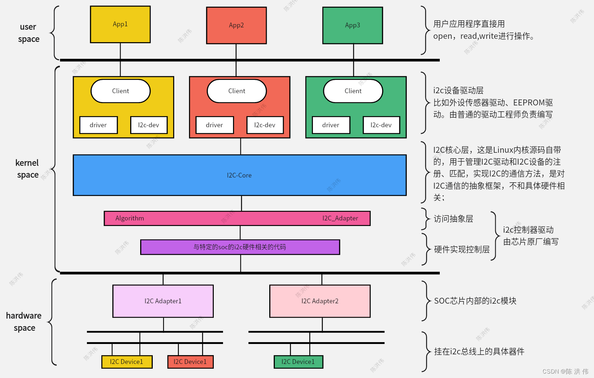

## 参考
[i2c](../../Linux_APIs/i2c.md)
## I2C
Linux 内核的 **I2C 子系统** 是内核中设计最为清晰、分层最为合理的子系统之一。它负责管理计算机系统中的 I2C 总线控制器（Adapter）以及挂接在总线上的 I2C 从设备（Client）。

为了让你透彻理解，我们将从**架构分层**、**核心数据结构**、**关键 API** 以及 **工作流程** 四个方面进行详细介绍。

---

### 1. 架构分层 (Architecture)

Linux I2C 子系统在设计上采用了标准的“设备驱动模型”分层思想，主要分为三层：

#### A. I2C 核心层 (I2C Core)
*   **位置**：`drivers/i2c/i2c-core.c`
*   **作用**：这是与硬件无关的中间层。
    *   维护 I2C 总线（Adapter）和 I2C 设备（Driver）的列表。
    *   提供注册和注销接口（`i2c_add_adapter`, `i2c_register_driver`）。
    *   提供通信方法的统一封装（如 `i2c_transfer`），让上层驱动不需要关心底层的具体硬件实现。
    *   处理设备树（Device Tree）解析和设备匹配（Match）。

#### B. I2C 总线驱动层 (I2C Adapter / Bus Driver)
*   **位置**：`drivers/i2c/busses/`
*   **作用**：**驱动 I2C 控制器（Master）**。
    *   它对应 SOC 内部的 I2C 硬件控制器（如 Samsung I2C, Rockchip I2C, STM32 I2C）。
    *   它实现了具体的比特传输算法，即“如何把数据发到物理线路上”。
    *   如果硬件没有 I2C 控制器，也可以用 GPIO 模拟 I2C 时序（Bit-banging），这由 `i2c-algo-bit` 模块支持。

#### C. I2C 设备驱动层 (I2C Client Device Driver)
*   **位置**：分散在内核各处（如 `drivers/hwmon/`, `drivers/input/`, `drivers/rtc/`）。
*   **作用**：**驱动具体的从设备（Slave）**。
    *   比如 EEPROM (AT24C02)、触摸屏 (GT911)、传感器 (MPU6050)。
    *   这一层不知道底层是用什么控制器发的波形，它只调用 Core 层提供的接口说：“我要读寄存器 0x10 的值”。
    * 
---

### 2. 核心数据结构 (Key Structures)

理解这四个结构体是理解 I2C 模块的钥匙：

| 结构体 | 英文名 | 角色 | 描述 |
| :--- | :--- | :--- | :--- |
| **`struct i2c_adapter`** | Adapter | **物理控制器** | 代表一个物理 I2C 通道（如 `/dev/i2c-0`）。它包含了发送数据的算法指针。 |
| **`struct i2c_algorithm`** | Algorithm | **传输方法** | 包含函数指针 `master_xfer`。这是真正操作硬件寄存器发送 I2C 波形的函数。 |
| **`struct i2c_client`** | Client | **从设备实例** | 代表挂在总线上的一个硬件设备。包含设备地址 (`addr`)、所属总线指针、中断号等。 |
| **`struct i2c_driver`** | Driver | **设备驱动** | 软件驱动程序。包含 `probe`（探测）、`remove`（移除）函数和 `id_table`（匹配表）。 |

**关系图解：**
*   一个 `i2c_adapter` 对应一个 `i2c_algorithm`。
*   一个 `i2c_adapter` 上可以挂载多个 `i2c_client`（总线上有多个设备）。
*   一个 `i2c_driver` 可以支持多个 `i2c_client`（同一个驱动代码可以驱动多个相同的芯片）。

---

### 3. 数据传输流程 (Data Transfer)

Linux 内核中 I2C 数据传输的核心单位是 **`struct i2c_msg`**。

```c
struct i2c_msg {
    __u16 addr;   // 从设备地址
    __u16 flags;  // 读写标志 (I2C_M_RD 表示读, 0 表示写)
    __u16 len;    // 数据长度
    __u8 *buf;    // 数据缓冲区
};
```

**传输函数层级：**

1.  **最底层核心接口：`i2c_transfer()`**
    *   这是所有 I2C 通信的入口。它接受一个 `i2c_msg` 数组。
    *   它会获取总线锁（Mutex），然后调用 `adapter->algo->master_xfer`。

2.  **简易封装接口：**
    *   `i2c_master_send(client, buf, count)`: 封装了一个只有写标志的 msg。
    *   `i2c_master_recv(client, buf, count)`: 封装了一个只有读标志的 msg。

3.  **寄存器级封装 (Regmap 或 SMBus)：**
    *   `i2c_smbus_read_byte_data(...)`: 符合 SMBus 协议的读写。

---

### 4. 驱动编写实战逻辑

#### 场景一：编写一个 I2C 从设备驱动（如温湿度传感器）

这是 95% 的开发者会做的工作。

1.  **定义 `struct i2c_driver`**：
    ```c
    static struct i2c_driver my_sensor_driver = {
        .driver = {
            .name = "my_sensor",
            .of_match_table = my_sensor_of_match, // 用于设备树匹配
        },
        .probe = my_sensor_probe,   // 设备匹配成功后调用
        .remove = my_sensor_remove,
    };
    ```
2.  **注册驱动**：调用 `i2c_add_driver(&my_sensor_driver)`。
3.  **实现 `probe` 函数**：
    *   在 `my_sensor_probe(struct i2c_client *client, ...)` 中：
    *   调用 `i2c_check_functionality` 检查总线能力。
    *   使用 `i2c_master_send/recv` 初始化芯片。
    *   注册字符设备或 misc 设备，向用户空间提供接口。

#### 场景二：用户空间直接访问 (i2c-dev)

有时候不需要写内核驱动，直接在应用层操作。内核提供了 `i2c-dev` 驱动。

1.  确保内核开启了 `CONFIG_I2C_CHARDEV`。
2.  设备节点：`/dev/i2c-0`, `/dev/i2c-1`。
3.  **用户态代码**：
    ```c
    int fd = open("/dev/i2c-1", O_RDWR);
    ioctl(fd, I2C_SLAVE, 0x50); // 设置从机地址
    write(fd, buf, len);        // 写
    read(fd, buf, len);         // 读
    ```

---

### 5. I2C 子系统的高级特性

1.  **I2C Mux (多路复用器)** ：
    *   有些板子上 I2C 设备地址冲突，或者电气负载太重，会加 I2C Mux 芯片（如 PCA9548）。
    *   Linux 抽象了 `i2c-mux` 模块，它会在 `/dev/` 下虚拟出多个 I2C 总线（如 i2c-2, i2c-3），实际上物理上走的是同一条 i2c-1，内核会自动切换 Mux 通道。

2.  **Regmap API**：
    *   现代 I2C 驱动推荐使用 `Regmap` 子系统来代替裸的 `i2c_transfer`。
    *   它提供了缓存机制（Cache），可以减少 I2C 慢速总线的读写次数，极大提高性能。

3.  **设备树 (Device Tree) 描述**：
    ```dts
    &i2c1 {
        status = "okay";
        // 描述从设备
        my_sensor@68 {
            compatible = "vendor,my-sensor";
            reg = <0x68>; // I2C 地址
            interrupt-parent = <&gpio1>;
            interrupts = <10 IRQ_TYPE_LEVEL_LOW>;
        };
    };
    ```

### 6. 常用调试工具 (i2c-tools)

在开发阶段，由 `i2c-tools` 包提供的命令行工具非常强大：

*   **`i2cdetect -y &lt;bus&gt;`**: 扫描总线上的设备。
    *   例如 `i2cdetect -y 1`，如果看到 `UU` 表示内核驱动已加载，看到数值（如 `50`）表示设备存在但无驱动，空缺表示无设备。
*   **`i2cdump -y &lt;bus&gt; &lt;addr&gt;`**: 导出设备所有寄存器的值。
*   **`i2cget` / `i2cset`**: 读写单个寄存器。
*   **`i2ctransfer`**: 发送自定义的 I2C 消息序列（支持更复杂的读写逻辑）。

### 总结

Linux 内核 I2C 模块的核心在于**将“怎么发波形（Adapter）”和“发什么数据（Client）”彻底解耦**。
*   如果你是做 SoC Bring-up（点亮板子），你需要关注 **Adapter 驱动**。
*   如果你是做外设集成，你需要关注 **Client 驱动** 和 **设备树**。
*   如果你在调试，**i2c-dev** 和 **i2c-tools** 是你的好帮手。

## SMBUS vs I2C
这是一个非常经典且在实际开发中容易混淆的话题。

简单来说，**SMBus (System Management Bus)** 是 **I2C (Inter-Integrated Circuit)** 协议的一个**子集（Subset）**，但它对 I2C 做了更严格的限制和规范，使其更适合用于主板的系统管理（如电池、温度传感器、风扇控制）。

你可以把它们的关系理解为：**I2C 是“普通话”，而 SMBus 是“标准播音腔”。** 讲播音腔的人一定能听懂普通话，但讲普通话的人（如果不守规矩）可能会让讲播音腔的人听不懂或报错。

以下是详细介绍及两者的核心区别：

---

### 1. 什么是 SMBus？

*   **起源**：由 Intel 在 1995 年定义。
*   **目的**：为了在计算机主板上低成本地监控和管理系统状态（Smart Battery、温度、电压、风扇）。
*   **物理层**：基于 I2C，也是两条线（SMBCLOCK 和 SMBDATA），外加一条可选的 `SMBALERT#`（中断线）。

### 2. 核心区别：I2C vs SMBus

虽然物理连接几乎一样，但在协议细节和电气特性上有几个关键不同：

#### A. 超时机制 (Timeout) —— 最重要的区别
*   **I2C**：理论上允许**直流（DC）**，即时钟可以无限期拉低（Clock Stretching），总线可以暂停任意长时间，没有强制超时。
*   **SMBus**：**强制要求超时**。
    *   如果时钟频率低于 10kHz，或时钟拉低超过 35ms，SMBus 控制器会认为总线挂死（Bus Hang），并强制复位总线。
    *   **意义**：这对于系统管理至关重要。你不能因为一个温度传感器坏了，就导致整个 CPU 的控制总线卡死。

#### B. 传输速度 (Speed)
*   **I2C**：范围很广。Standard (100kHz), Fast (400kHz), High-speed (3.4MHz) 等。
*   **SMBus**：范围严格限制在 **10kHz ~ 100kHz** 之间。

#### C. 数据传输格式 (Protocols)
*   **I2C**：自由度极高。通常是 `Start -> Address -> Read/Write -> Data(任意长度) -> Stop`。它是基于**字节流**的。
*   **SMBus**：定义了**严格的事务类型（Transactions）**。例如：
    *   `Quick Command`
    *   `Byte Data` (读写单字节)
    *   `Word Data` (读写双字节)
    *   `Block Data` (读写块)
    *   **PEC (Packet Error Checking)**：SMBus 强制支持 CRC-8 校验（虽然是可选启用的），提高数据可靠性。

#### D. 电气特性 (Electrical)
*   **I2C**：逻辑电平通常是 VDD 的百分比（例如高电平是 0.7 * VDD）。这意味着它可以适应 1.8V, 3.3V, 5V 系统。
*   **SMBus**：定义了固定的逻辑电平电压值，而不是比例值。这使得不同电压域的设备更容易在 SMBus 上互联。

#### E. 警报机制 (Alert)
*   **SMBus**：引入了 `SMBALERT#` 线。从设备可以通过拉低这条线请求主设备注意（类似于中断），主设备会广播读取“警报响应地址（ARA）”来确定是谁发出的警报。
*   **I2C**：标准 I2C 没有这个引脚，通常通过普通的 GPIO 中断来实现类似功能。

---

### 3. Linux 内核中的关系

在 Linux 内核（`drivers/i2c/`）中，这两个协议是**融合在一起**的，但处理方式有所不同。

#### 1. 驱动兼容性 (The "Emulation")
Linux 的 I2C 子系统设计得非常巧妙，它处理了这种“父子”关系：

*   **I2C 控制器跑 SMBus 协议**：绝大多数 I2C 控制器（Master）都支持 I2C 的所有功能，因此它们可以轻松模拟 SMBus 协议。内核函数 `i2c_smbus_read_byte_data` 在底层其实就是封装了一个标准的 I2C 传输。
*   **SMBus 控制器跑 I2C 协议**：这是**痛点**所在。PC 主板上的南桥（如 Intel PCH）通常集成的只是 **SMBus 控制器**，而不是通用的 I2C 控制器。
    *   这意味着：如果你写了一个驱动，里面用了 `i2c_transfer()` 发送了一串不符合 SMBus 规范的自定义数据流，这个驱动在嵌入式 ARM 板（通常是全功能 I2C）上能跑，但在 PC 主板上可能会**失败**。

#### 2. 编程建议
在编写 Linux I2C 设备驱动时，**推荐优先使用 SMBus API**（如 `i2c_smbus_read_byte`, `i2c_smbus_write_word_data`）。

*   **原因**：SMBus API 是 I2C API 的“最大公约数”。
*   如果你的驱动使用 SMBus API，它既可以在全功能 I2C 控制器上运行（通过模拟），也可以在受限的 SMBus 控制器（如 PC 主板）上运行。
*   只有当你需要发送非常特殊的长序列，或者设备不支持 SMBus 标准命令时，才使用原生的 `i2c_transfer`。

#### 3. 核心结构体区分
在 `struct i2c_algorithm` 中，有一个 `.functionality` 字段：
*   如果支持 `I2C_FUNC_I2C`，说明它是全功能 I2C。
*   如果只支持 `I2C_FUNC_SMBUS_...`，说明它可能只是个 SMBus 控制器。

### 总结

| 特性 | I2C | SMBus |
| :--- | :--- | :--- |
| **全称** | Inter-Integrated Circuit | System Management Bus |
| **父子关系** | 父集 (Parent) | 子集 (Subset) |
| **超时机制** | 无 (允许 Bus Hang) | **强制 (35ms 超时复位)** |
| **速度** | 0Hz ~ 3.4MHz+ | 10kHz ~ 100kHz |
| **数据格式** | 任意字节流 | **固定包格式 (Byte/Word/Block)** |
| **应用场景** | 通用外设 (Touch, Camera, Audio) | 系统监控 (Power, Fan, RAM SPD) |
| **Linux 建议** | 特殊需求时使用 | **优先使用 (兼容性更好)** |

**一句话总结：SMBus 是为了让主板管理更健壮、更不容易死机而“加了规矩”的 I2C。**


## APIs

Linux内核中的I2C子系统API非常丰富，主要分为 **设备驱动（Device Driver/Client）** 使用的API和 **总线适配器（Adapter/Bus Driver）** 使用的API。

以下是按功能分类的Linux内核I2C核心API详细汇总表：

### 1. 数据传输 API (最核心部分)
这些API用于在主机（Master）和从机（Slave）之间发送或接收数据。

| API 函数名 | 功能描述 | 关键参数/备注 |
| :--- | :--- | :--- |
| **`i2c_transfer`** | **最底层的传输接口**。支持在一个原子操作中发送多个消息（如“写寄存器地址”后紧接“读数据”的Repeated Start信号）。 | `adap`: 适配器<br>`msgs`: `i2c_msg`结构体数组<br>`num`: 消息数量<br>**注意：可能会休眠，不能在中断上下文调用。** |
| **`i2c_master_send`** | 发送单一数据包的简便封装函数。 | `client`: I2C从设备指针<br>`buf`: 发送缓冲区<br>`count`: 字节数<br>内部调用了`i2c_transfer`。 |
| **`i2c_master_recv`** | 接收单一数据包的简便封装函数。 | `client`: I2C从设备指针<br>`buf`: 接收缓冲区<br>`count`: 字节数<br>内部调用了`i2c_transfer`。 |

---

### 2. SMBus 协议 API (System Management Bus)
很多I2C设备（特别是传感器、电源管理芯片）实际上使用的是SMBus协议子集。如果I2C控制器不支持纯I2C但支持SMBus，或者为了简化寄存器读写，通常使用这些API。

| API 函数名 | 功能描述 | 典型应用场景 |
| :--- | :--- | :--- |
| **`i2c_smbus_read_byte`** | 从设备读取一个字节（不指定寄存器地址）。 | 简单的状态读取。 |
| **`i2c_smbus_write_byte`** | 向设备写入一个字节（通常作为命令）。 | 发送简单指令。 |
| **`i2c_smbus_write_byte_data`** | **写寄存器（8位）**。向指定命令/寄存器地址写入一个8位数据。 | 配置控制寄存器。 |
| **`i2c_smbus_read_byte_data`** | **读寄存器（8位）**。向指定命令/寄存器地址读取一个8位数据。 | 读取传感器数值（8位）。 |
| **`i2c_smbus_write_word_data`** | **写寄存器（16位）**。向指定地址写入16位数据（小端序）。 | 配置高精度参数。 |
| **`i2c_smbus_read_word_data`** | **读寄存器（16位）**。从指定地址读取16位数据。 | 读取ADC结果等。 |
| **`i2c_smbus_read_i2c_block_data`** | 读取块数据（Block Read）。允许读取最多32字节的连续数据。 | 批量读取数据。 |

---

### 3. 驱动注册与注销 API (设备驱动开发常用)
用于编写具体的I2C外设驱动（如EEPROM驱动、加速度计驱动）。

| API 函数名 | 功能描述 | 备注 |
| :--- | :--- | :--- |
| **`i2c_add_driver`** | 注册一个 `struct i2c_driver` 到I2C核心层。 | 驱动加载时调用（通常在 `module_init`）。 |
| **`i2c_del_driver`** | 注销 I2C 驱动。 | 驱动卸载时调用（通常在 `module_exit`）。 |
| **`module_i2c_driver`** | 宏。用于自动生成 `init` 和 `exit` 函数，简化样板代码。 | 如果驱动只有注册/注销逻辑，直接用此宏代替手写 `module_init/exit`。 |
| **`i2c_set_clientdata`** | 将私有数据指针保存到 `struct i2c_client` 中。 | 类似于 `platform_set_drvdata`。 |
| **`i2c_get_clientdata`** | 从 `struct i2c_client` 中取回私有数据指针。 | 在传输函数中常用于获取设备上下文。 |

---

### 4. 客户端(Client)管理 API
用于在运行时创建或销毁代表I2C设备的 `struct i2c_client`。

| API 函数名 | 功能描述 | 使用场景 |
| :--- | :--- | :--- |
| **`i2c_new_client_device`** | 在指定适配器上实例化一个新的I2C设备。 | 当设备树（Device Tree）未描述该设备，需要在代码中动态识别并添加设备时使用。 |
| **`i2c_unregister_device`** | 注销并释放 `struct i2c_client`。 | 动态创建的设备移除时使用。 |
| **`i2c_verify_client`** | 验证一个 `device` 结构体是否是 `i2c_client`。 | 用于类型安全检查。 |

---

### 5. 适配器(Adapter)管理 API (总线驱动开发常用)
这些API通常由SoC厂商或I2C控制器驱动开发者使用，普通设备驱动开发者较少接触。

| API 函数名 | 功能描述 | 备注 |
| :--- | :--- | :--- |
| **`i2c_add_adapter`** | 注册一个新的I2C总线适配器，系统自动分配总线号。 | 适用于热插拔的USB-I2C适配器等。 |
| **`i2c_add_numbered_adapter`** | 注册一个新的I2C适配器，并请求指定的总线号。 | **SoC驱动最常用**，通常基于设备树别名（如 `i2c0`, `i2c1`）。 |
| **`i2c_del_adapter`** | 注销I2C适配器。 | 控制器驱动卸载时使用。 |
| **`i2c_check_functionality`** | 检查适配器支持哪些功能（如是否支持SMBus，是否支持10-bit地址等）。 | 驱动初始化时用来判断控制器能力：`I2C_FUNC_I2C`, `I2C_FUNC_SMBUS_...` |

---

### 核心数据结构简述

为了理解上述API，必须了解以下三个核心结构体：

1.  **`struct i2c_adapter`**: 代表物理上的I2C控制器（主机）。
2.  **`struct i2c_client`**: 代表挂载在总线上的具体的从设备（如温度传感器）。包含设备的地址、中断号等信息。
3.  **`struct i2c_msg`**: 定义数据传输的基本单元。
    *   `addr`: 从机地址。
    *   `flags`: 读/写标志 (`I2C_M_RD`)。
    *   `len`: 数据长度。
    *   `buf`: 数据指针。

### 总结：典型开发流程

1.  **定义 `struct i2c_driver`**: 包含 `probe`（探测）、`remove`（移除）和 `id_table`。
2.  **调用 `module_i2c_driver`**: 注册驱动。
3.  **在 `probe` 函数中**:
    *   使用 `i2c_check_functionality` 检查总线能力。
    *   使用 `i2c_smbus_...` 或 `i2c_transfer` 进行硬件初始化。
    *   注册字符设备、Input设备或IIO设备以向用户空间暴露接口。

## 学习方法
这是一个非常好的切入点。I2C 子系统是 Linux 内核驱动中最经典、最规范的子系统之一。弄懂了 I2C，你对 Linux 设备驱动模型（Device Driver Model）、总线（Bus）、设备（Device）、驱动（Driver）的分层与分离思想就会有深刻的理解，学习 SPI、Platform 等其他总线也会势如破竹。

以下我将从**整体架构**到**学习路线**为你做详细梳理。

---

### 第一部分：Linux I2C 子系统整体架构（上帝视角）

Linux 的 I2C 子系统设计核心在于**“解耦”**。它把“怎么发数据（控制器驱动）”和“发什么数据（外设驱动）”完全分开了。

整体可以分为三个层次（由下至上）：

#### 1. I2C 总线适配器驱动（I2C Adapter / Bus Driver）
*   **角色**：它是“搬运工”。
*   **对应硬件**：SoC 内部的 I2C 控制器（如 STM32 的 I2C 模块，或 Raspberry Pi 的 I2C 接口）。
*   **职责**：只负责产生 I2C 波形（Start, Stop, ACK, SCL 时钟）。它根本不知道总线上挂的是温度传感器还是 EEPROM，它只管把字节发出去。
*   **核心结构体**：`struct i2c_adapter`，`struct i2c_algorithm`。

#### 2. I2C 核心层（I2C Core）
*   **角色**：它是“大管家”或“红娘”。
*   **代码位置**：`drivers/i2c/i2c-core.c` 等。
*   **职责**：
    *   维护 I2C 总线的管理。
    *   提供统一的接口（API），让上层驱动不需要关心底层是用硬件 I2C 还是 GPIO 模拟的 I2C。
    *   **匹配设备与驱动**：当一个新的设备（Device）或新的驱动（Driver）被注册时，核心层负责检查它们是否匹配（Probe）。

#### 3. I2C 设备驱动（I2C Client Driver）
*   **角色**：它是“业务员”。
*   **对应硬件**：挂在 I2C 总线上的具体芯片（如 MPU6050, AT24C02, 触摸屏芯片）。
*   **职责**：知道该芯片的寄存器定义。它通过调用核心层的 API 来读写数据，然后向用户空间提供功能（比如生成一个 `/dev/input/eventX` 节点，或者通过 Sysfs 显示温度）。
*   **核心结构体**：`struct i2c_driver`，`struct i2c_client`。

---

### 第二部分：进阶学习路线（由浅入深）

建议分为 5 个阶段进行学习，不要试图一口吃成胖子。

#### 阶段一：黑盒操作与协议基础（不写代码）
**目标**：熟悉 I2C 协议本身，会用工具验证硬件。

1.  **I2C 协议物理层**：
    *   搞懂 Start/Stop 信号、ACK/NACK。
    *   **关键点**：7位/10位地址、R/W 位、时钟延展（Clock Stretching）。
2.  **Linux 用户态工具（i2c-tools）**：
    *   找一块树莓派或开发板，挂一个 I2C 模块。
    *   `i2cdetect`：扫描总线设备地址。
    *   `i2cdump`：导出寄存器。
    *   `i2cset` / `i2cget`：读写寄存器。
    *   *思考：为什么不需要写驱动就能读写？（引出 `/dev/i2c-x` 接口）*

#### 阶段二：编写设备驱动（Client Driver）—— 重点
**目标**：这是工作中 90% 的场景。给你一个新传感器，你能写出驱动。

1.  **最简驱动框架**：
    *   学习 `struct i2c_driver` 的注册。
    *   理解 **Device Tree (设备树)** 中如何描述 I2C 设备，以及内核是如何通过 `of_match_table` 匹配到你的 `probe` 函数的。
2.  **数据传输**：
    *   学习 `i2c_transfer()`：这是最底层的发送函数，所有读写最后都归结为它。
    *   学习 `i2c_master_send()` / `i2c_master_recv()`。
3.  **Regmap 子系统（进阶必学）**：
    *   现在的 Linux 驱动很少直接裸写 I2C 读写函数，而是套用 **Regmap**。
    *   它自动处理了寄存器缓存、字节序转换、页读写等复杂逻辑。
    *   *任务：将一个裸写的 I2C 驱动重构为 Regmap 模式。*

#### 阶段三：深入核心层源码（Core Layer）
**目标**：理解 Linux 驱动模型的设计美学。

1.  **四大结构体的爱恨情仇**：
    *   画出 `i2c_adapter`, `i2c_algorithm`, `i2c_client`, `i2c_driver` 之间的指向关系图。
2.  **匹配机制**：
    *   阅读源码，追踪 `i2c_register_driver` 到底干了什么？它是如何遍历总线上的设备列表并调用 `probe` 的？
3.  **i2c-dev 机制**：
    *   分析 `drivers/i2c/i2c-dev.c`，理解它是如何把内核的 I2C 接口暴露给用户空间（即阶段一用的工具原理）。

#### 阶段四：编写适配器驱动（Adapter Driver）—— 高阶
**目标**：理解 SoC 厂商（如 NXP, Samsung）是如何写底层驱动的。

1.  **GPIO 模拟 I2C (Bit-banging)**：
    *   阅读 `drivers/i2c/busses/i2c-gpio.c`。
    *   这是学习 I2C 时序最好的代码，因为它用软件模拟了每一个电平跳变。
2.  **硬件控制器驱动**：
    *   阅读你手头开发板对应的 I2C 总线驱动（如 `i2c-imx.c` 或 `i2c-mv64xxx.c`）。
    *   理解**中断处理**（传输完成产生中断）和 **DMA 传输**。
3.  **算法接口**：
    *   理解 `struct i2c_algorithm` 中的 `master_xfer` 函数指针，这是核心层调用底层驱动的入口。

#### 阶段五：调试与疑难杂症
**目标**：解决“玄学”问题。

1.  **逻辑分析仪**：必须会看波形，分析 Signal Integrity（信号完整性）、上拉电阻是否合适。
2.  **Ftrace / Dynamic Debug**：在不重新编译内核的情况下，开启 I2C 核心层的调试日志。
3.  **Bus Recovery（总线恢复）**：当 I2C 从设备死机拉低 SDA 线导致总线挂死时，主控如何发送 9 个时钟脉冲来“救活”总线。

---

### 推荐的学习资源与动作

1.  **源码目录**：
    *   `drivers/i2c/`：核心层代码。
    *   `drivers/i2c/busses/`：各种 SoC 的适配器驱动。
    *   `include/linux/i2c.h`：头文件，所有结构体定义的源头。

2.  **实操建议**：
    *   不要只看书！买一个简单的 I2C 模块（如 **AP3216C** 光感，或 **AT24C02** EEPROM）。
    *   第一步：用 `i2c-tools` 读到数据。
    *   第二步：写一个内核模块（.ko），在 `probe` 里打印 "Hello I2C"。
    *   第三步：在驱动里读取 Chip ID。
    *   第四步：注册一个字符设备或 Sysfs 节点，把数据丢给应用层。

按照这个流程走，从应用到内核，再到硬件底层，你会发现 I2C 是一个非常完美的“麻雀虽小，五脏俱全”的学习样本。准备好开始了吗？


## 问题1: 
`为什么linux内核i2c模块里面的i2c_register_adapter时候，adapter的bus类型为i2c bus？`

这是一个非常深刻且触及Linux设备模型（Linux Device Model, LDM）核心设计理念的问题。

在Linux内核中，`i2c_register_adapter` 确实会将 `adapter->dev.bus` 设置为 `&i2c_bus_type`。

初看起来这有点反直觉：通常我们认为总线（Bus）是连接设备（Device）和驱动（Driver）的通道，**适配器（Adapter）应该是“创造”总线的东西，而不是总线上的“设备”。**

但Linux内核之所以这样设计，主要基于以下几个核心原因：

### 1. 统一的视图与管理 (Unified Management)

在Linux设备模型中，所有的 I2C 相关对象（无论是控制总线的**主控制器/适配器**，还是挂在总线上的**从设备/Client**）都被归纳在 `i2c_bus_type` 下进行统一管理。

*   **集中化列表**：将 Adapter 挂在 `i2c_bus_type` 上，内核就可以通过遍历 `i2c_bus_type` 的设备链表找到系统中所有的 I2C 适配器，而不需要去遍历 Platform 总线、PCI 总线等各种不同的物理总线来寻找 I2C 控制器。
*   **sysfs 目录结构**：这直接决定了你在用户空间看到的目录结构。因为 Adapter 属于 `i2c_bus_type`，所以你才能在 `/sys/bus/i2c/devices/` 下看到 `i2c-0`, `i2c-1` 这样的设备节点。这使得用户空间工具（如 `i2cdetect`）能够轻松枚举所有 I2C 总线。

### 2. 逻辑设备 vs. 物理设备 (Logical vs. Physical)

这里有一个关键的**分层概念**，需要区分“物理控制器硬件”和“逻辑适配器接口”：

1.  **物理控制器 (Parent)**：
    *   实际的 I2C 硬件控制器（IP核）通常是挂在 `platform_bus`（嵌入式常见）或者 `pci_bus`（PC常见）上的。
    *   它有一个对应的驱动（如 `i2c-imx` 或 `i2c-designware`）。
    *   这个设备负责硬件寄存器的读写、中断处理等。

2.  **逻辑适配器 (Adapter)**：
    *   这是物理控制器驱动在加载时，向 I2C 核心层注册的一个**软件抽象对象** (`struct i2c_adapter`)。
    *   这个对象代表了“I2C 协议的处理能力”。
    *   内核将这个**逻辑对象**视为 `i2c_bus_type` 的一部分。

**简而言之：** 物理硬件归“平台总线”管，但它提供的 I2C 功能（Adapter）归“I2C 总线”管。

### 3. 利用 `device_type` 进行区分

既然 Adapter 和 Client（从设备）都挂在同一个 `i2c_bus_type` 上，内核怎么区分它们呢？

在 `i2c-core-base.c` 中，注册 Adapter 时有如下代码：

```c
adap->dev.bus = &i2c_bus_type;
adap->dev.type = &i2c_adapter_type; // <--- 关键点
```

而在创建 I2C Client（从设备）时：

```c
client->dev.bus = &i2c_bus_type;
client->dev.type = &i2c_client_type; // <--- 关键点
```

`i2c_bus_type` 的匹配函数（`i2c_device_match`）会利用这个 `type` 字段来决定行为：
*   如果是 **Client**，它会尝试匹配 `i2c_driver`（如温度传感器驱动）。
*   如果是 **Adapter**，它通常不会匹配任何驱动（因为它已经是由物理总线驱动创建的了），或者匹配一些特殊的类驱动。

### 4. 依赖关系树 (Dependency Tree)

Linux 设备模型是一个树状结构。将 Adapter 注册在 I2C 总线上，有助于建立清晰的父子关系树：

*   **Root**: `/sys/devices`
    *   **Platform Device**: `.../soc/40000000.i2c` (挂在 Platform Bus)
        *   **I2C Adapter**: `i2c-0` (挂在 I2C Bus，作为 Platform Device 的子节点)
            *   **I2C Client**: `0-0050` (挂在 I2C Bus，作为 Adapter 的子节点)

这种结构让电源管理（PM）非常顺畅：当需要休眠时，内核知道必须先挂起 Client，再挂起 Adapter，最后挂起物理控制器。

### 总结

`i2c_register_adapter` 将 adapter 的 bus 类型设为 `i2c bus`，是为了**利用 Linux 设备模型的通用机制来统一管理 I2C 子系统**。

它将“提供 I2C 功能的接口”（Adapter）与“具体的硬件控制器”解耦，使得无论底层硬件是 PCI 还是 Platform，在 I2C 核心层和用户空间看来，它们都是标准的 I2C 总线接口 (`/sys/bus/i2c/devices/i2c-n`)。