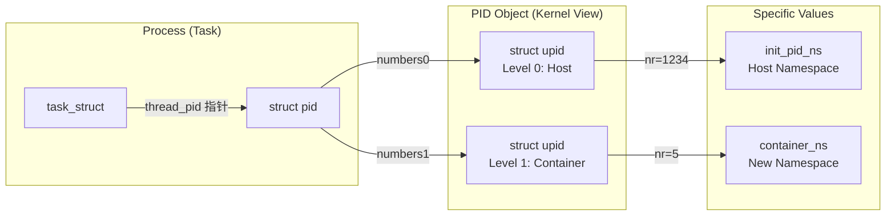

## PID
参考
linux内核PID管理 
Linux-进程-PID-管理

进程有以下标识符。
1. 进程标识符，进程所属的进程号命名空间到根的每层命名空间，都会给进程分配一个标识符。
2. 线程组标识符：多个共享用户虚拟地址空间的进程组成一个线程组，线程组中的主进程称为组长，线程组标识符就是组长的进程标识符。当调用系统调用clone传入标志CLONE_THREAD以创建新进程时，新进程和当前进程属于一个线程组.进程描述符的成员tgid存放线程组标识符，成员group_leader指向组长的进程描述符。
3. 进程组标识符：多个进程可以组成一个进程组，进程组标识符是组长的进程标识符。进程可以使用系统调用setpgid创建或者加入一个进程组。会话和进程组被设计用来支持shell作业控制，shell为执行单一命令或者管道的进程创建一个进程组。进程组简化了向进程组的所有成员发送信号的操作。
4. 会话标识符：多个进程组可以组成一个会话。当进程调用系统调用setsid的时候，创建一个新的会话，会话标识符是该进程的进程标识符。创建会话的进程是会话的首进程。

Linux是多用户操作系统，用户登录时会创建一个会话，用户启动的所有进程都属于这个会话。登录shell是会话首进程，它所使用的终端就是会话的控制终端，会话首进程通常也被称为控制进程。当用户退出登录时，所有属于这个会话的进程都将被终止。
假设某个进程属于进程号命名空间b，b的父命名空间是a，a的父命名空间是初始进程号和名空间，从b到初始的每一级命名空间分配的进程号依次是10、20和30。
进程标识符数据结构如图2.3所示，进程描述符的相关成员如下：
1. 成员pid存储全局进程号，即初始进程号命名空间分配的进程号30。
2. 成员pids[PIDTYPE_PID].pid指向结构体pid，存放3个命名空间分配的进程号。
3. 成员pids[PIDTYPE_PGID].pid指向进程组组长的结构体pid(限于篇幅，图2.3中没画出)。
4. 成员pids[PIDTYPE_SID].pid指向会话首进程的结构体pid(限于篇幅，图2.3中没画出)。
   
==注意：最新Linux中，PIDTYPE_PID已经通过struct task_struct -> thread_pid来直接定位，其他类型通过struc task_struct->signal->pids[xx] 来定位，所以下面的图已经不太对了 ==

进程标识符结构体pid的成员如下。
(1)成员count是引用计数。
(2)成员level是进程所属的进程号命名空间的层次。
(3〉数组numbers的元素个数是成员level的值加上1，3个元素依次存放初始命名空间、a和b三个命名空间分配的进程号。numbers[i].nr是进程号命名空间分配的进程号,numbers[i].ns指向进程号命名空间的结构体pidnamespace，numbers[i].pidchain用来把进程加入进程号散列表pidhash，根据进程号和命名空间计算散列值。


## 主要数据结构关系

```
struct pid
{
	refcount_t count;
	unsigned int level;
	spinlock_t lock;
	/* lists of tasks that use this pid */
	struct hlist_head tasks[PIDTYPE_MAX];
	struct hlist_head inodes;
	/* wait queue for pidfd notifications */
	wait_queue_head_t wait_pidfd;
	struct rcu_head rcu;
	struct upid numbers[1];
};
```

## APIs
API主要在 /include/linux/sched.h /include/linux/pid.h里面定义

| API                                    | 类似API                                                                                                         | 描述                                                      |
| -------------------------------------- | ------------------------------------------------------------------------------------------------------------- | ------------------------------------------------------- |
| get_task_pid<br>                       | get_pid<br>put_pid                                                                                            | 通过task struct获取pid来增加/减少pid结构引用<br>get_task_pid带rcu锁    |
| attach_pid<br>detach_pid<br>change_pid |                                                                                                               | 修改task不同类型的pid                                          |
| get_pid_task<br>pid_task               |                                                                                                               | 通过pid获取task struct, get_pid_task带rcu锁                   |
| pidfd_pid<br>pidfd_get_pid             |                                                                                                               | 通过文件/句柄来获取pid结构，或者相反                                    |
| find_get_pid<br>find_ge_pid            | find_vpid<br>find_pid_ns                                                                                      | 在指定namespace或者当前namespace找到其pid结构<br>前面两个是后面两个加了rcu锁的封装 |
| alloc_pid<br>free_pid                  |                                                                                                               | 分配/释放pid结构                                              |
| ns_of_pid                              |                                                                                                               | 指定pid所在的命名空间                                            |
| pid_nr<br>pid_vnr<br>pid_nr_ns         |                                                                                                               | 全局/当前命名空间/指定命名空间的pid值                                   |
| task_pid                               |                                                                                                               | 直接定位task 里面的pid结构，类型PIDTYPE_PID                         |
| __task_pid_nr_ns                       | task_pid_nr<br>task_pid_nr_ns<br>task_pid_vnr                                                                 | 通过task来找到不同namespace不同pid类型的pid值                        |
| task_pgrp_nr_ns                        | task_session_nr_ns<br>task_session_vnr<br>task_tgid_nr_ns<br>task_tgid_vnr<br>task_ppid_nr_ns<br>task_ppid_nr | 通过task来找到不同namespacesession/tgid/ppid值                  |
|                                        |                                                                                                               |                                                         |
以下是Linux内核中PID子系统主要API的详细汇总。为了方便查阅，我将其分为**查找与获取**、**数值转换**、**任务关联**以及**生命周期管理**四个类别。

主要头文件：
*   `&lt;linux/pid.h&gt;`
*   `&lt;linux/sched.h&gt;`

### 1. 查找与获取 (Lookup & Retrieval)
这一类API主要用于通过数字PID查找内核内部的 `struct pid` 结构体。

| API 名称 | 参数 | 返回值 | 功能描述 | 关键注意事项 (Locking/Refcount) |
| :--- | :--- | :--- | :--- | :--- |
| **`find_get_pid`** | `pid_t nr` | `struct pid *` | 在当前命名空间中查找指定数字PID对应的 `struct pid`。 | **最常用**。会自动增加 `struct pid` 的引用计数。使用完毕后**必须**调用 `put_pid` 释放，否则内存泄漏。 |
| **`find_vpid`** | `pid_t nr` | `struct pid *` | 在当前命名空间中查找 `struct pid`，但不增加引用计数。 | **不推荐直接使用**。因为它不保证返回的结构体在后续使用中依然有效（可能被释放）。通常需要配合 RCU 锁。 |
| **`find_pid_ns`** | `pid_t nr`<br>`struct pid_namespace *ns` | `struct pid *` | 在**指定**的命名空间中查找数字PID。 | 类似于 `find_vpid`，不增加引用计数。用于跨命名空间查找。 |

### 2. 数值转换 (Numeric Conversion)
这一类API用于在 `struct pid` 结构体和整型数值（`pid_t`）之间进行转换，核心在于处理**PID命名空间**。

| API 名称 | 参数 | 返回值 | 功能描述 | 场景 |
| :--- | :--- | :--- | :--- | :--- |
| **`pid_nr`** | `struct pid *pid` | `pid_t` | 获取该 `pid` 在**全局**（init namespace）中的数值。 | 用于内核日志打印、驱动内部记录唯一标识。 |
| **`pid_vnr`** | `struct pid *pid` | `pid_t` | 获取该 `pid` 在**当前调用者所在命名空间**中的数值。 | **最常用**。用于向用户空间返回PID（例如 `getpid` 系统调用）。 |
| **`pid_nr_ns`** | `struct pid *pid`<br>`struct pid_namespace *ns` | `pid_t` | 获取该 `pid` 在**指定命名空间**中的数值。 | 如果该PID在指定命名空间不可见，返回0。用于容器管理等场景。 |

### 3. 任务与PID结构体互转 (Task &lt;-&gt; PID struct)
这一类API用于在进程描述符 `struct task_struct` 和 `struct pid` 之间建立联系。

| API 名称 | 参数 | 返回值 | 功能描述 | 关键注意事项 |
| :--- | :--- | :--- | :--- | :--- |
| **`pid_task`** | `struct pid *pid`<br>`enum pid_type type` | `struct task_struct *` | 根据 `struct pid` 获取对应的 `task_struct`。`type` 通常为 `PIDTYPE_PID`。 | **需要 RCU 保护** (`rcu_read_lock`)。返回的任务指针不增加任务的引用计数，任务可能随时退出。 |
| **`get_task_pid`** | `struct task_struct *task`<br>`enum pid_type type` | `struct pid *` | 获取指定任务的 `struct pid` 指针。 | 会**增加**返回的 `struct pid` 的引用计数。用完需调用 `put_pid`。 |
| **`task_pid`** | `struct task_struct *task` | `struct pid *` | 快速获取任务的主PID结构体指针（不增加引用计数）。 | 必须在 RCU 锁或持有 `tasklist_lock` 的环境下使用，否则不安全。 |
| **`task_pid_nr`** | `struct task_struct *tsk` | `pid_t` | 快捷宏：直接获取任务在**全局**命名空间的数字PID。 | 等同于 `pid_nr(task_pid(tsk))`。常用于调试打印。 |
| **`task_pid_vnr`** | `struct task_struct *tsk` | `pid_t` | 快捷宏：直接获取任务在**当前**命名空间的数字PID。 | 等同于 `pid_vnr(task_pid(tsk))`。 |
| **`task_tgid_nr`** | `struct task_struct *tsk` | `pid_t` | 获取任务所属**线程组**（Thread Group）的全局ID。 | 对应用户空间通常理解的“进程ID”（多线程下主线程的PID）。 |

### 4. 生命周期管理 (Reference Counting)
`struct pid` 是通过引用计数管理的，确保在还有人引用它时内存不被释放。

| API 名称 | 参数 | 返回值 | 功能描述 | 注意事项 |
| :--- | :--- | :--- | :--- | :--- |
| **`get_pid`** | `struct pid *pid` | `struct pid *` | 增加 `struct pid` 的引用计数。 | 返回传入的指针本身。 |
| **`put_pid`** | `struct pid *pid` | `void` | 减少 `struct pid` 的引用计数。如果降为0，释放内存。 | 必须与 `find_get_pid`、`get_task_pid` 或 `get_pid` 成对使用。 |

### 总结：最常用的开发模式

如果你在编写内核模块，最典型的操作流程如下：

1.  **用户传入一个数字 PID** (`int arg_pid`)。
2.  **查找并锁定结构体**：
    ```c
    struct pid *kpid = find_get_pid(arg_pid); // 引用计数 +1
    if (!kpid) return -ESRCH;
    ```
3.  **获取任务并操作** (安全方式)：
    ```c
    rcu_read_lock();
    struct task_struct *task = pid_task(kpid, PIDTYPE_PID);
    if (task) {
        // 访问 task->comm, task->state 等
        // 不要在这里做耗时操作或睡眠，因为持有 RCU 锁
    }
    rcu_read_unlock();
    ```
4.  **释放结构体引用**：
    ```c
    put_pid(kpid); // 引用计数 -1
    ```
## PID介绍
基于 Linux 5.15 内核，PID（Process ID）的管理机制远比用户空间看到的一个简单的“整数”要复杂。Linux 内核为了支持**容器化（Namespaces）**和**线程组（Thread Groups）**，设计了一套层次化的 PID 结构。

以下是关于 Linux 5.15 内核中 PID 子系统的详细介绍，包括核心概念、数据结构、命名空间映射以及常用 API。

---

### 1. 核心概念：用户视角 vs 内核视角

在深入代码之前，必须理清 Linux 中“进程”和“线程”在 PID 上的混淆点。

| 概念 | 用户空间视角 (`ps`命令/POSIX标准) | 内核视角 (`task_struct`) | 描述 |
| :--- | :--- | :--- | :--- |
| **线程ID** | TID (Thread ID) | **PID** (Process ID) | 调度单元的唯一标识。Linux中线程是轻量级进程。 |
| **进程ID** | **PID** (Process ID) | **TGID** (Thread Group ID) | 线程组的主ID。多线程进程中，所有线程的 TGID 相同（等于主线程的 PID）。 |
| **进程组ID** | PGID | PGID | 用于信号发送（如管道命令）。 |
| **会话ID** | SID | SID | 用于终端控制。 |

**总结：** 当我们在内核代码中看到 `pid` 时，它通常指的是**线程**的 ID；当我们看到 `tgid` 时，它指的是**进程**（即线程组）的 ID。

---

### 2. 核心数据结构

在 Linux 5.15 中，PID 不仅仅是一个数字，而是一个被封装的对象。

#### 2.1 `struct task_struct` 中的 PID
在 `include/linux/sched.h` 中：

```c
struct task_struct {
    /* ... */
    pid_t pid;  // 线程 ID (内核视角)
    pid_t tgid; // 线程组 ID (用户视角的 PID)

    /* PID 结构体指针 */
    struct pid *thread_pid; 
    struct hlist_node pid_links[PIDTYPE_MAX];
    /* ... */
};
```
*   `pid` 和 `tgid` 这两个整型变量主要用于快速查找和向后兼容。
*   真正核心的是指向 `struct pid` 的指针。

#### 2.2 `struct pid` (内核中的 PID 对象)
这是内核管理 PID 的核心结构，定义在 `include/linux/pid.h`。为什么需要这个结构？主要是为了支持 **PID Namespace**。同一个进程在宿主机和容器中看到的 PID 是不一样的。

```c
struct pid {
    refcount_t count;         // 引用计数
    unsigned int level;       // 该 PID 所在的命名空间深度
    struct hlist_head tasks[PIDTYPE_MAX]; // 链表头，指向使用该 PID 的 task
    struct rcu_head rcu;
    struct upid numbers[1];   // 柔性数组，存储各层命名空间中的数值
};
```

#### 2.3 `struct upid` (特定命名空间的 ID)
`struct pid` 中的 `numbers` 数组存储了该 ID 在每一层命名空间中的具体数值。

```c
struct upid {
    int nr;                         // 具体的 PID 数值 (例如 1234)
    struct pid_namespace *ns;       // 该数值所属的命名空间
    struct hlist_node pid_chain;    // 用于哈希表查找的链表节点
};
```

**举例说明：**
假设你在宿主机（Level 0）启动了一个 Docker 容器（Level 1）。
*   在容器内，某进程 PID 可能是 **5**。
*   在宿主机，该进程 PID 可能是 **1005**。
*   内核会创建一个 `struct pid`，它的 `level` 为 1，`numbers` 数组有两个元素：
    *   `numbers[0]`: nr = 1005, ns = 宿主机NS
    *   `numbers[1]`: nr = 5,    ns = 容器NS

---

### 3. PID 的分配与管理 (IDR)

在 Linux 5.15 中，PID 的分配依赖于 **IDR (Integer ID Management)** 机制（底层通常基于 Radix Tree 或 XArray 优化）。

*   **位图 (Bitmap) vs IDR**：早期的 Linux 使用位图管理空闲 PID。现代 Linux 使用 IDR 机制，能够更高效地处理稀疏的 PID 空间。
*   **pid_max**：PID 的最大值由 `/proc/sys/kernel/pid_max` 控制。默认通常是 32768，但在 64 位系统上可以设置得很大（最多 400万左右），以支持海量并发。

内核维护了一个全局的哈希表（`pid_hash`），用于通过 `nr` 和 `ns` 快速找到对应的 `struct pid`。

---

### 4. 常用 API (开发者必看)

内核开发中，经常需要在 `int` (PID数值)、`struct pid` 和 `struct task_struct` 之间转换。

#### 4.1 从 PID 数值 -> `struct task_struct`
这是最常见的需求（例如编写内核模块监控特定进程）。

**错误做法：** 直接遍历 `init_task` 链表（效率低且不安全）。

**正确做法：**
```c
/* 1. 根据数值获取 struct pid */
/* find_get_pid 会增加引用计数，用完需要 put_pid */
struct pid *pid_struct = find_get_pid(nr); 

if (pid_struct) {
    /* 2. 根据 struct pid 获取 task_struct */
    /* type 通常是 PIDTYPE_PID */
    struct task_struct *task = pid_task(pid_struct, PIDTYPE_PID);
    
    if (task) {
        // 使用 task ...
    }
    
    /* 3. 减少引用计数 */
    put_pid(pid_struct);
}
```
*   `find_vpid(nr)`: 在**当前**命名空间查找（不加引用计数）。
*   `find_get_pid(nr)`: 在**当前**命名空间查找（加引用计数）。

#### 4.2 从 `struct task_struct` -> PID 数值

由于命名空间的存在，获取数值时必须指定“在哪个命名空间下的数值”。

```c
/* 获取当前 task 在其自身命名空间下的 PID */
pid_t p = task_pid_vnr(current);

/* 获取当前 task 在全局（init）命名空间下的 PID */
pid_t p_global = task_pid_nr(current);
```

*   `_nr`: 这里的 nr 代表 Number。
*   `_vnr`: 代表 Virtual Number（即从进程自己的视角看到的 ID）。

#### 4.3 常用宏
*   `get_pid(pid)`: 增加 pid 引用计数。
*   `put_pid(pid)`: 减少引用计数，如果为 0 则释放。

---

### 5. Linux 5.15 的特定上下文

在 5.15 版本中，PID 子系统相对稳定，但有几个值得注意的点：

1.  **PIDFD (File Descriptor for PIDs)**:
    Linux 5.x 引入并完善了 `pidfd` 机制。这允许用户空间打开一个文件描述符来代表一个进程。
    *   **解决了 PID 复用竞争问题**：传统的 PID 是整数，当进程很快结束，新进程可能复用同一个 PID。用户态发信号时可能误杀新进程。`pidfd` 绑定的是底层的 `struct pid` 对象，即使进程死了，只要 fd 没关，结构体还在，就不会发生误操作。
    *   相关系统调用：`pidfd_open`, `pidfd_send_signal`。

2.  **Redsigned futex2**:
    虽然不是直接修改 PID 结构，但 5.15 引入的 futex2 等并发机制严重依赖 PID 的查找性能。

3.  **Real-Time 改进**:
    5.15 作为 PREEMPT_RT补丁合入主线的重要版本，PID 锁（`pidmap_lock` 等）的粒度和中断上下文处理经过了大量优化以降低延迟。

### 总结

在 Linux 5.15 中：
1.  **区分概念**：内核 PID = 用户线程 ID；内核 TGID = 用户进程 ID。
2.  **核心结构**：`struct pid` 是核心，支持多层命名空间（容器的基础）。
3.  **查找方式**：通过 `pid_hash` 和 IDR 机制快速查找。
4.  **操作原则**：在内核模块中操作 PID 时，务必注意**引用计数**（`get_pid`/`put_pid`）和**RCU 锁**，以防止 Use-after-free 错误。

为了直观展示 Linux 内核（5.15）中 PID 相关数据结构的关系，我为你设计了一个**“容器化场景”**下的内存结构图。

### 场景假设
假设我们在宿主机（Host）上运行了一个 Docker 容器。
*   有一个进程，在**宿主机（Level 0）**看来，PID 是 **1234**。
*   在**容器内（Level 1）**看来，同一个进程 PID 是 **5**。

---

## PID图示
### 1. 宏观关系图 (Mermaid 风格)

这展示了从进程控制块 (`task_struct`) 到具体 PID 数值 (`upid`) 的层级引用。



---

### 2. 微观内存布局图 (ASCII 详细版)

这个图展示了数据结构在内存中的实际嵌套方式，特别是 `struct pid` 尾部的**柔性数组**（Flexible Array）是如何实现多层命名空间的。

```text
       内核中的实体对象                PID 管理对象 (引用计数与层级)
+-------------------------+       +-----------------------------------+
| struct task_struct      |       | struct pid                        |
| (进程/线程描述符)       |       |                                   |
|-------------------------|       |-----------------------------------|
| pid = 5 (缓存, vnr)     |       | count (refcount_t)                |
| tgid = 5 (线程组ID)     |       | level = 1 (深度, 0是宿主, 1是容器)|
| ...                     |       | tasks[PIDTYPE_MAX] (链表头)       |
| struct pid *thread_pid -+-----> | ...                               |
+-------------------------+       |                                   |
                                  | // 柔性数组 numbers[] 开始         |
                                  | numbers[0] (对应 Level 0/Host)    |
                                  | numbers[1] (对应 Level 1/Container)|
                                  +-----------------+-----------------+
                                                    |
             +--------------------------------------+
             |
             V
    +-------------------------------------------+
    | struct upid numbers[] (实际存储数值的数组) |
    |-------------------------------------------|
    | [Index 0] - 宿主机视角                     |
    |   nr = 1234                               | <--- 宿主机看到的 PID
    |   ns = &init_pid_ns (指向全局命名空间)     |
    |   pid_chain (挂入全局哈希表 pid_hash)      |
    |-------------------------------------------|
    | [Index 1] - 容器视角                       |
    |   nr = 5                                  | <--- 容器内看到的 PID
    |   ns = &my_container_ns (指向容器命名空间) |
    |   pid_chain (挂入容器层级的哈希表)         |
    +-------------------------------------------+
```

---

### 3. 关键结构体字段解析

结合上面的图，我们来看看代码层面的定义（基于 Linux 5.15）：

#### A. `struct task_struct` (进程)
```c
struct task_struct {
    // 这里的 pid 是 task_pid_vnr(current)，即进程在自己命名空间看到的ID
    // 主要是为了快速访问，不用每次都去翻 struct pid
    pid_t pid;  
    
    // 真正的内核 PID 对象指针
    struct pid *thread_pid; 
};
```

#### B. `struct pid` (身份证)
这是内核用来标识一个“ID实体”的结构。注意它不直接存数字，而是存了一组数字。
```c
struct pid {
    refcount_t count;      // 引用计数。进程死了，只要有人还拿着这个 fd，结构就不释放
    unsigned int level;    // 当前 ID 属于第几层嵌套（本例中是 1）
    
    // 这是一个柔性数组 (Flexible Array Member)
    // 数组大小在分配内存时根据 level 动态决定
    struct upid numbers[1]; 
};
```

#### C. `struct upid` (特定空间的投影)
这是 PID 在某一层命名空间中的“投影”。
```c
struct upid {
    int nr;                       // 具体的数值 (例如 1234 或 5)
    struct pid_namespace *ns;     // 所属的命名空间对象
    struct hlist_node pid_chain;  // 哈希冲突链表节点
};
```

---

### 4. 查找过程图解

当内核需要通过一个 PID 数值找到对应的 `task_struct` 时（例如 `kill(5)` 在容器内执行）：

1.  **确定命名空间**：获取当前进程的命名空间（Container NS）。
2.  **哈希查找**：利用 `nr=5` 和 `ns=ContainerNS` 计算哈希值。
3.  **遍历哈希桶**：在全局 `pid_hash` 中找到对应的 `struct upid`。
4.  **回溯对象**：利用 `container_of` 机制，从 `struct upid` 找到包含它的 `struct pid`。
5.  **获取任务**：访问 `struct pid` 中的 `tasks` 链表，找到对应的 `task_struct`。

```text
用户态: kill(5)
      |
      V
内核态: find_vpid(5)
      |
      +---> 1. 获取当前 Namespace (Level 1)
      |
      +---> 2. 查 Hash 表 (Key: nr=5, ns=Level1_Ptr)
      |        |
      |        V
      |     找到 struct upid (即上面图中的 numbers[1])
      |        |
      |        V
      +---> 3. 通过指针偏移找到 struct pid (父结构体)
               |
               V
            4. 访问 pid->tasks[PIDTYPE_PID] 链表
               |
               V
            找到 struct task_struct
```

### 总结
*   **`task_struct`** 是人（进程）。
*   **`struct pid`** 是身份证包（ID对象）。
*   **`struct upid`** 是身份证包里的一张张卡（特定地区的ID）。
    *   `numbers[0]` 是“全球通用身份证”（宿主机 PID）。
    *   `numbers[1]` 是“某小区门禁卡”（容器 PID）。
*   内核通过这种分层结构，完美支持了容器技术的 ID 隔离。