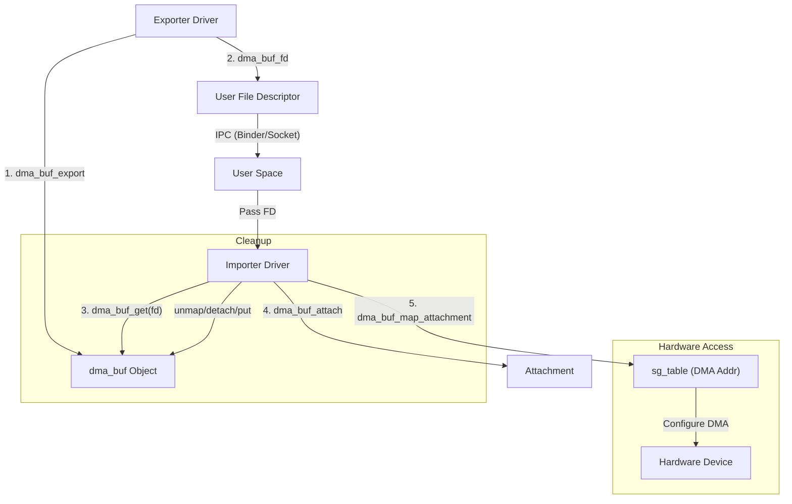

## dma-buf
Linux内核中的 **DMA-BUF** (DMA Buffer Sharing) 是一个极其重要的子系统，特别是在嵌入式、图形、多媒体（Camera、Display、GPU、VPU）等领域。它的核心目标是解决**不同硬件设备驱动之间高效共享内存**的问题，实现**零拷贝（Zero-Copy）**数据传输。

以下是对 DMA-BUF 模块的详细介绍，涵盖背景、架构、核心概念、API 以及同步机制。

---

### 1. 背景与诞生原因

在 DMA-BUF 出现之前，如果一个 Camera 驱动采集了数据，想要交给 GPU 进行处理，然后再交给 Display 显示，通常需要经过多次内存拷贝：
1. Camera 驱动分配内存 -> 数据写入。
2. 数据拷贝到用户空间（User Space）。
3. 数据从用户空间拷贝到 GPU 驱动的内存空间。

对于 4K/8K 视频或高帧率游戏，这种拷贝带来的 CPU 负载和总线带宽消耗是不可接受的。

**DMA-BUF 解决了这个问题：** 它允许一个驱动程序（Exporter）分配内存，并将其作为一个对象共享给其他驱动程序（Importers）。所有设备直接通过 DMA 访问同一块物理内存，无需 CPU 参与数据搬运。

---

### 2. 核心架构与角色

DMA-BUF 采用了 **Exporter（导出者）** 和 **Importer（导入者）** 的设计模式。

#### 2.1 Exporter (生产者/分配者)
*   **职责**：负责实际物理内存的分配和管理。它了解内存的物理特性（如是否连续、Cache 属性等）。
*   **动作**：将分配好的内存封装成一个 `struct dma_buf` 对象，并实现相应的操作回调 (`dma_buf_ops`)。
*   **常见 Exporter**：GPU 驱动 (DRM/KGSL)、DMA-BUF Heaps (原 Android ION)、V4L2 驱动。

#### 2.2 Importer (消费者/使用者)
*   **职责**：需要访问这块内存的设备驱动。
*   **动作**：通过文件描述符（FD）获取 `dma_buf` 对象，将其“挂载（Attach）”到自己的设备上，并获取 DMA 地址（Scatter-Gather list）进行硬件访问。
*   **常见 Importer**：DRM Display 驱动、视频编码器驱动、V4L2 设备。

#### 2.3 Userspace (协调者)
*   **职责**：用户空间程序（如 SurfaceFlinger, GStreamer）通常不直接接触内存数据，而是作为“中间人”传递文件描述符（FD）。
*   **流程**：从 Exporter 获取 FD -> 将 FD 传递给 Importer。

---

### 3. 工作流程与机制

整个 DMA-BUF 的生命周期大致如下：

1.  **Export（导出）**：
    *   驱动 A 分配内存。
    *   调用 `dma_buf_export()` 创建 `dma_buf` 对象。
    *   调用 `dma_buf_fd()` 将对象关联到一个文件描述符（fd）。
    *   将 fd 返回给用户空间。

2.  **Pass（传递）**：
    *   用户空间进程通过 Binder、Socket 或其他 IPC 机制将 fd 传递给另一个进程或直接传递给驱动 B。

3.  **Import（导入）**：
    *   驱动 B 收到 fd，调用 `dma_buf_get(fd)` 获得 `dma_buf` 对象指针。

4.  **Attach（挂载）**：
    *   驱动 B 调用 `dma_buf_attach()`。这建立了一个连接，告诉 Exporter：“我有设备要访问这块内存了”。
    *   此时会检查设备约束（如内存是否必须连续，是否在 4G 地址空间内等）。

5.  **Map（映射）**：
    *   驱动 B 在真正需要 DMA 传输前，调用 `dma_buf_map_attachment()`。
    *   **关键点**：Exporter 此时会调用 DMA-Mapping API，将物理内存映射到驱动 B 设备的 I/O 地址空间（IOVA）。返回一个 `sg_table` (Scatter-Gather Table)。
    *   之所以需要这一步，是因为不同设备看到的“地址”可能不同（IOMMU 存在与否）。

6.  **Access（硬件访问）**：
    *   驱动 B 配置硬件 DMA 引擎使用 `sg_table` 中的地址进行读写。

7.  **Unmap/Detach/Release**：
    *   访问结束，逆向操作：`unmap` -> `detach` -> `dma_buf_put`。当引用计数为 0 时，Exporter 释放物理内存。

---

### 4. 关键数据结构与 API

#### 4.1 `struct dma_buf`
内核中表示共享 buffer 的核心对象。
```c
struct dma_buf {
    size_t size;
    struct file *file;      // 关联的文件对象
    const struct dma_buf_ops *ops; // 操作回调
    struct list_head attachments;  // 所有挂载该 buf 的设备列表
    struct dma_resv *resv;  // 同步锁/Reservation Object (用于Fence)
    void *priv;             // Exporter 私有数据
    // ...
};
```

#### 4.2 `struct dma_buf_ops` (Exporter 必须实现)
这是 Exporter 提供给框架的接口：
*   `attach` / `detach`: 当 Importer 加入或退出时调用。
*   `map_dma_buf` / `unmap_dma_buf`: **核心**，返回 `sg_table`，完成 DMA 映射。
*   `release`: 内存释放。
*   `begin_cpu_access` / `end_cpu_access`: 处理 CPU 访问时的 Cache 一致性。
*   `mmap`: 允许用户空间直接 mmap 这块内存。

#### 4.3 常用 API
*   **Exporter 端**: `dma_buf_export()`, `dma_buf_fd()`
*   **Importer 端**: `dma_buf_get()`, `dma_buf_attach()`, `dma_buf_map_attachment()`

---

### 5. 同步机制 (Synchronization) - 难点

由于多个设备（如 GPU 和 Display）可能并发访问同一块内存，必须有同步机制防止“撕裂”或竞争。

#### 5.1 Explicit Synchronization (显式同步 - Android 常用)
*   **Sync File / Fence**: 用户空间传递 buffer fd 的同时，还会传递一个 **fence fd**。
*   Importer 必须等待 fence 触发（signal）后才能开始硬件操作。
*   硬件操作完成后，Importer 生成一个新的 fence 传给下一个消费者。

#### 5.2 Implicit Synchronization (隐式同步 - Linux Desktop/DRM 常用)
*   同步对象存储在 `dma_buf->resv` (`dma_resv` 结构体) 中。
*   不需要用户空间传递 fence fd。
*   内核驱动在提交作业（Job）时，会自动检查 `dma_buf` 上的 fence，并在作业完成后自动更新 fence。
*   **读写锁语义**：可以有多个 readers (shared fence)，但只能有一个 writer (exclusive fence)。

---

### 6. CPU 访问与 Cache 一致性

虽然 DMA-BUF 主要用于 Device-to-Device，但有时 CPU 也需要访问（如软件后处理）。
*   **mmap**: 用户空间可以通过 fd 进行 mmap。
*   **Bracketing**: 在 CPU 读写前后，**必须**调用以下 ioctl 或内核 API：
    *   `DMA_BUF_IOCTL_SYNC` (Userspace)
    *   `dma_buf_begin_cpu_access()` / `dma_buf_end_cpu_access()` (Kernel)
*   **作用**：这些调用会触发 Cache Invalidate（读前）或 Cache Flush（写后），确保 CPU 看到的数据与设备 DMA 写入的数据一致。

---

### 7. 生态演进：ION 与 DMA-BUF Heaps

*   **ION (The Past)**: Android 早期为了解决内存碎片和不同设备对内存分配的特殊需求（如连续物理内存、特定对齐）引入了 ION 内存管理器。ION 是 DMA-BUF 的主要 Exporter。
*   **DMA-BUF Heaps (The Future)**: 从 Linux 5.6 开始，ION 的标准化版本 **DMA-BUF Heaps** 进入主线。它提供了一组字符设备（如 `/dev/dma_heap/system`, `/dev/dma_heap/cma`），用户空间可以直接从这些 heap 中申请 dma-buf fd。

### 总结

Linux 内核的 **DMA-BUF** 模块是现代嵌入式和图形系统的基石。
1.  **接口标准化**：统一了不同子系统（V4L2, DRM, Network）交换内存的方式。
2.  **性能极致**：通过传递 fd 和 Scatter-Gather 列表，实现了真正的零拷贝。
3.  **完整性**：不仅包含内存共享，还集成了同步机制（dma_fence）和 Cache 管理，是一个完整的异构系统内存管理方案。

## APIs
这是Linux内核 `dma-buf` 模块主要API的详细汇总。为了清晰起见，我将API分为 **生命周期管理**、**设备/DMA访问**、**CPU访问** 以及 **Exporter回调接口** 四个部分进行展示。

### 1. 核心生命周期与对象管理 API
这些API主要用于创建 `dma_buf` 对象、引用计数管理以及文件描述符转换。

| API 名称 | 调用者角色 | 关键参数 | 功能描述 |
| :--- | :--- | :--- | :--- |
| **`dma_buf_export`** | Exporter | `struct dma_buf_export_info *` | **创建核心对象**。<br>驱动根据填充好的 `info`（包含大小、ops回调、私有数据等）分配并初始化一个新的 `dma_buf` 结构体。 |
| **`dma_buf_fd`** | Exporter | `struct dma_buf *`, `flags` | **对象转文件描述符**。<br>为已创建的 dma-buf 对象分配一个未使用的文件描述符（fd）。这个 fd 将被传递给用户空间。 |
| **`dma_buf_get`** | Importer | `int fd` | **文件描述符转对象**。<br>根据用户空间传来的 fd，查找并返回对应的 `struct dma_buf *` 指针，同时增加引用计数。如果 fd 无效则返回错误。 |
| **`dma_buf_put`** | Both | `struct dma_buf *` | **释放引用**。<br>减少 dma-buf 的引用计数。当计数降为 0 时，内核会调用 Exporter 的 `release` 回调来释放物理内存。 |
| **`get_dma_buf`** | Both | `struct dma_buf *` | **增加引用**。<br>显式增加 dma-buf 的引用计数（通常在驱动内部需要长期持有指针时使用）。 |

---

### 2. 设备互联与 DMA 访问 API (核心功能)
这是 Importer 将自己的设备与 Buffer 关联，并获取物理地址（DMA地址）的关键步骤。

| API 名称 | 调用者角色 | 关键参数 | 功能描述 |
| :--- | :--- | :--- | :--- |
| **`dma_buf_attach`** | Importer | `struct dma_buf *`, `struct device *` | **建立连接**。<br>将 Importer 的设备结构体（`device`）挂载到 dma-buf 的 attachment 链表中。此时 Exporter 会检查该设备是否兼容（如是否能访问该内存区域）。返回 `struct dma_buf_attachment *`。 |
| **`dma_buf_detach`** | Importer | `struct dma_buf *`, `struct dma_buf_attachment *` | **断开连接**。<br>将设备从 dma-buf 的挂载列表中移除，清理相关资源。 |
| **`dma_buf_map_attachment`** | Importer | `struct dma_buf_attachment *`, `direction` | **获取 DMA 地址 (关键)**。<br>请求 Exporter 将内存映射到 Importer 设备的地址空间。**返回 `struct sg_table *`**，其中包含了可以直接用于 DMA 传输的物理地址列表（Scatter-Gather List）。 |
| **`dma_buf_unmap_attachment`** | Importer | `struct dma_buf_attachment *`, `sg_table *` | **释放 DMA 地址**。<br>通知 Exporter 此时不再进行 DMA 传输，Exporter 可借此机会解除 IOMMU 映射或同步缓存。 |
| **`dma_buf_dynamic_attach`** | Importer | `...`, `struct dma_resv *`, `flags` | **动态连接**。<br>允许 Importer 声明它支持动态映射（即 Buffer 可以在物理内存中移动）。如果不调用此接口，默认 buffer 必须被固定（Pinned）。 |

---

### 3. CPU 访问与 Cache 同步 API
当 CPU（内核态或用户态）需要读取或修改 dma-buf 内容时，必须使用这些 API 来保证 Cache 一致性。

| API 名称 | 调用者角色 | 关键参数 | 功能描述 |
| :--- | :--- | :--- | :--- |
| **`dma_buf_begin_cpu_access`** | Importer / User | `struct dma_buf *`, `direction` | **CPU 访问开始**。<br>在 CPU 读写 Buffer **前**调用。通常会触发 Cache Invalidate（读前）操作，确保 CPU 读到内存中最新的数据，而不是 Cache 中的脏数据。 |
| **`dma_buf_end_cpu_access`** | Importer / User | `struct dma_buf *`, `direction` | **CPU 访问结束**。<br>在 CPU 读写 Buffer **后**调用。通常会触发 Cache Flush（写后）操作，将 CPU Cache 中的数据刷入物理内存，供设备 DMA 读取。 |
| **`dma_buf_kmap`** / **`dma_buf_vmap`** | Kernel Driver | `struct dma_buf *` | **内核虚拟映射**。<br>将 dma-buf 映射到内核虚拟地址空间（vaddr），以便内核代码直接 `memcpy` 或读取。 |
| **`dma_buf_kunmap`** / **`dma_buf_vunmap`** | Kernel Driver | `struct dma_buf *`, `vaddr` | **解除内核映射**。<br>释放内核虚拟地址映射。 |
| **`dma_buf_mmap`** | User Space | `struct dma_buf *`, `vma` | **用户空间映射**。<br>将 dma-buf 映射到用户进程的虚拟地址空间。通常通过 fd 的 `mmap` 系统调用触发。 |

---

### 4. Exporter 必须实现的回调 (struct dma_buf_ops)
这部分**不是**驱动直接调用的 API，而是 Exporter 驱动在创建 dma-buf 时需要**填充（Implement）**的函数指针表。内核框架会在上述 API 被调用时，内部跳转到这些回调。

| 回调函数 (Ops) | 触发时机 (对应 API) | 实现职责 |
| :--- | :--- | :--- |
| **`attach`** | `dma_buf_attach` | 检查 Importer 设备是否符合约束；分配私有 attachment 数据；如果不支持该设备则返回错误。 |
| **`detach`** | `dma_buf_detach` | 清理 attachment 相关的私有数据。 |
| **`map_dma_buf`** | `dma_buf_map_attachment` | **核心实现**。调用 `dma_map_sg` 或 IOMMU 相关接口，生成 `sg_table`。必须正确处理设备看到的总线地址。 |
| **`unmap_dma_buf`** | `dma_buf_unmap_attachment` | 解除映射，调用 `dma_unmap_sg`。 |
| **`release`** | `dma_buf_put` (归零时) | 释放物理内存页，销毁相关内核对象。 |
| **`begin_cpu_access`** | `dma_buf_begin_cpu_access` | 处理 CPU 访问前的 Cache 一致性。 |
| **`end_cpu_access`** | `dma_buf_end_cpu_access` | 处理 CPU 访问后的 Cache 一致性。 |
| **`mmap`** | `mmap` (syscall) | 设置用户空间 VMA（Virtual Memory Area）的属性（如 pgprot），映射物理页到用户空间。 |

### 5. API 调用流程图解



### 总结与注意事项

1.  **配对使用**：`attach` 必须配对 `detach`，`map` 必须配对 `unmap`，`get` 必须配对 `put`。内存泄漏往往发生在 `put` 缺失。
2.  **Map 的开销**：`dma_buf_map_attachment` 可能涉及 IOMMU 页表操作，开销较大。不要在每一帧数据处理中频繁调用 map/unmap，通常建议在初始化阶段 map，或者利用 Cache。
3.  **Synchronization**：上述 API 主要解决内存共享地址问题。关于“何时可以读写”，需要结合 `dma_resv` (Reservation Objects) 和 `dma_fence` 机制使用，这通常隐藏在 `dma_buf` 结构体内部。