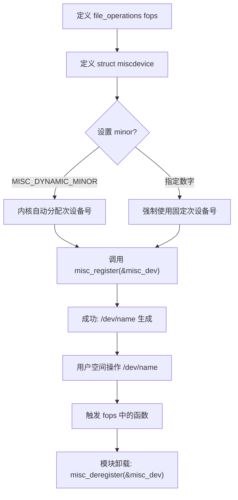

## misc
Linux内核中的 **Misc 模块**（Miscellaneous Devices，杂项设备）是字符设备（Character Device）的一种特例。它是Linux内核为了简化那些功能简单、无法明确分类或不需要独占一个主设备号的驱动程序开发而设计的一个子系统。

以下是对Linux Misc模块的详细介绍，包括其设计目的、核心数据结构、工作原理、API以及编写示例。

---

### 1. 什么是 Misc 设备？

在Linux中，标准的字符设备通常需要申请一个独立的 **主设备号（Major Number）**。然而，主设备号是有限的资源（尽管在64位系统中很多，但管理起来依然繁琐）。

很多设备（如看门狗 Watchdog、RTC、一些简单的IO控制接口）并不复杂，如果每一个都申请一个主设备号太浪费了。因此，Linux内核预留了 **主设备号 10** 给 Misc 子系统。

*   **主设备号：** 固定为 **10**。
*   **次设备号：** 用来区分不同的 Misc 设备（0 ~ 255）。
*   **本质：** Misc 设备本质上仍然是字符设备，但它对标准的字符设备注册流程进行了封装和简化。

### 2. 为什么要使用 Misc 驱动？

相比于传统的字符设备驱动（使用 `alloc_chrdev_region`, `cdev_init`, `cdev_add` 等），Misc 驱动有以下巨大优势：

1.  **节省主设备号资源：** 所有 Misc 设备共享主设备号 10。
2.  **API 极其简单：** 只需要一个 `struct` 和一个注册函数即可完成驱动加载。
3.  **自动创建设备节点：** `misc_register` 函数内部会自动调用设备模型代码，配合 `udev` 或 `mdev` 在 `/dev` 目录下自动生成设备节点（例如 `/dev/my_device`），无需手动运行 `mknod` 或编写 `class_create`/`device_create` 代码。

### 3. 核心数据结构

Misc 驱动的核心定义在 `&lt;linux/miscdevice.h&gt;` 头文件中。最主要的是 `struct miscdevice`。

```c
struct miscdevice {
    int minor;                          // 次设备号
    const char *name;                   // 设备名称（出现在 /dev/ 下）
    const struct file_operations *fops; // 文件操作集合
    struct list_head list;              // 内部链表头（内核内部使用）
    struct device *parent;              // 父设备（通常为 NULL）
    struct device *this_device;         // 指向自动创建的 device 结构体
    const char *nodename;               // 节点名称
    umode_t mode;                       // 访问权限模式
};
```

**关键字段说明：**
*   **`minor`**:
    *   如果填具体的数字（如 135），则强制使用该次设备号。
    *   通常填 **`MISC_DYNAMIC_MINOR`** (255)，让内核动态分配一个可用的次设备号。
*   **`name`**: 设备节点的名字。例如设为 "test_misc"，注册后会生成 `/dev/test_misc`。
*   **`fops`**: 指向 `file_operations` 结构体，定义 `open`, `read`, `write`, `ioctl` 等具体操作。

### 4. 核心 API

Misc 驱动主要只需要掌握两个函数：

#### (1) 注册
```c
int misc_register(struct miscdevice *misc);
```
*   **功能：** 注册一个杂项设备。会自动分配次设备号（如果指定为动态），并创建 `/dev` 节点。
*   **返回值：** 0 表示成功，负值表示失败。

#### (2) 注销
```c
void misc_deregister(struct miscdevice *misc);
```
*   **功能：** 注销设备，删除 `/dev` 节点，释放次设备号。

### 5. 内部工作原理（进阶理解）

理解 Misc 驱动的工作原理有助于深入掌握 Linux 驱动模型。

1.  **Misc 子系统初始化：**
    Linux 内核启动时，Misc 核心层（`drivers/char/misc.c`）会调用 `misc_init`。它使用主设备号 10 注册了一个通用的字符设备。
    ```c
    register_chrdev(MISC_MAJOR, "misc", &misc_fops);
    ```

2.  **通用 open 函数：**
    Misc 核心层维护了一个全局链表，记录了所有注册的 `miscdevice`。
    当用户空间 `open("/dev/xxx", ...)` 时，VFS（虚拟文件系统）根据主设备号 10，首先调用 Misc 核心层的 `misc_open` 函数。

3.  **重定向（偷梁换柱）：**
    `misc_open` 函数会做以下事情：
    *   获取用户打开文件的次设备号。
    *   遍历 Misc 设备链表，找到对应的 `struct miscdevice`。
    *   **关键步骤：** 将文件对象（`struct file`）的 `f_op` 指针，替换为该具体驱动提供的 `fops`。
    *   调用具体驱动的 `open` 函数。

    因此，后续的 `read`, `write`, `ioctl` 调用将直接跳转到你编写的驱动函数中，不再经过 Misc 核心层。

### 6. 代码示例

下面是一个最简的 Misc 驱动示例，实现了一个简单的回环（Echo）功能。

```c
#include <linux/module.h>
#include <linux/kernel.h>
#include <linux/init.h>
#include <linux/fs.h>
#include <linux/miscdevice.h>
#include <linux/uaccess.h>

#define DEVICE_NAME "my_misc_dev"

// 1. 实现具体的文件操作
static int my_open(struct inode *inode, struct file *file)
{
    printk(KERN_INFO "MyMisc: Device opened\n");
    return 0;
}

static int my_release(struct inode *inode, struct file *file)
{
    printk(KERN_INFO "MyMisc: Device closed\n");
    return 0;
}

static ssize_t my_read(struct file *file, char __user *buf, size_t count, loff_t *ppos)
{
    char kbuf[] = "Hello from Kernel!\n";
    int len = sizeof(kbuf);
    
    if (*ppos >= len) return 0;
    if (count > len - *ppos) count = len - *ppos;

    if (copy_to_user(buf, kbuf + *ppos, count))
        return -EFAULT;
    
    *ppos += count;
    return count;
}

// 定义 file_operations
static const struct file_operations my_fops = {
    .owner   = THIS_MODULE,
    .open    = my_open,
    .release = my_release,
    .read    = my_read,
};

// 2. 定义 miscdevice 结构体
static struct miscdevice my_misc_device = {
    .minor = MISC_DYNAMIC_MINOR, // 动态分配次设备号
    .name  = DEVICE_NAME,        // /dev/my_misc_dev
    .fops  = &my_fops,
};

// 3. 模块加载函数
static int __init my_misc_init(void)
{
    int ret;
    
    // 注册 misc 设备
    ret = misc_register(&my_misc_device);
    if (ret) {
        printk(KERN_ERR "MyMisc: Failed to register misc device\n");
        return ret;
    }
    
    printk(KERN_INFO "MyMisc: Registered successfully, minor: %d\n", my_misc_device.minor);
    return 0;
}

// 4. 模块卸载函数
static void __exit my_misc_exit(void)
{
    misc_deregister(&my_misc_device);
    printk(KERN_INFO "MyMisc: Deregistered\n");
}

module_init(my_misc_init);
module_exit(my_misc_exit);

MODULE_LICENSE("GPL");
MODULE_AUTHOR("Demo User");
MODULE_DESCRIPTION("A simple Linux Misc Driver Example");
```

### 7. 常见应用场景

Misc 驱动非常适合那些“小而美”的设备：

*   **看门狗 (Watchdog)：** 内核中大量的 Watchdog 驱动都是基于 Misc 框架实现的。
*   **PWM 控制：** 简单的脉宽调制控制接口。
*   **ADC 读取：** 获取传感器数据的简单接口。
*   **硬件特定的控制接口：** 比如某个特定开发板上的 LED 控制、蜂鸣器控制。
*   **用户空间与内核通信的桥梁：** 当你需要一个简单的 `ioctl` 接口来在 App 和 Kernel 间传递控制命令时，Misc 是最快实现方式。

### 8. 总结：Misc vs 标准字符设备

| 特性 | 标准字符设备 (cdev) | 杂项设备 (Misc) |
| :--- | :--- | :--- |
| **主设备号** | 需要申请或固定 | 固定为 10 |
| **设备节点创建** | 需手动 mknod 或 编写 class/device 代码 | **自动创建** |
| **代码复杂度** | 较高（alloc_chrdev, cdev_init...） | **极低** (misc_register) |
| **灵活性** | 高 (可管理大量同类设备) | 中 (适合单一、少量设备) |
| **适用场景** | 复杂的设备驱动（如 GPIO、磁盘等） | 简单的控制接口、看门狗、RTC |

**结论：**
除非你需要编写一个极其复杂的驱动，或者需要定义自己的主设备号来管理成百上千个子设备，否则在Linux驱动开发中，**优先推荐使用 Misc 驱动框架**。它是实现字符设备驱动最快、最标准的方式。

## APIs
Linux 内核 Misc 模块（杂项设备）的 API 非常简洁，主要围绕 `struct miscdevice` 结构体以及注册、注销这两个核心函数展开。

以下是 Misc 模块主要 API、核心结构体成员及相关宏定义的详细汇总。

### 1. 核心操作函数 (Functions)

这是驱动开发中最直接调用的接口。

| API 名称 | 函数原型 | 功能描述 | 返回值 / 备注 |
| :--- | :--- | :--- | :--- |
| **`misc_register`** | `int misc_register(struct miscdevice *misc);` | **注册设备**。<br>1. 自动分配次设备号（若指定动态）。<br>2. 关联 `file_operations`。<br>3. 在 `/dev` 下自动生成设备节点。 | **成功**：0<br>**失败**：负数错误码 (如 `-EBUSY`) |
| **`misc_deregister`** | `void misc_deregister(struct miscdevice *misc);` | **注销设备**。<br>1. 删除 `/dev` 下的设备节点。<br>2. 释放占用的次设备号。 | 无返回值 (`void`)<br>通常在模块卸载 (`module_exit`) 时调用。 |

---

### 2. 核心数据结构 (Data Structure)

`struct miscdevice` 是 Misc 驱动的核心，定义在 `&lt;linux/miscdevice.h&gt;` 中。你需要填充这个结构体并传递给注册函数。

| 结构体成员 | 类型 | 详细描述 | 设置建议 |
| :--- | :--- | :--- | :--- |
| **`minor`** | `int` | **次设备号**。<br>用于区分不同的 misc 设备。 | 通常设置为宏 **`MISC_DYNAMIC_MINOR`**，让内核自动分配可用的次设备号（范围 0-255）。 |
| **`name`** | `const char *` | **设备名称**。<br>注册成功后，会在 `/dev/` 目录下生成同名的设备节点，也会出现在 `/proc/misc` 中。 | 例如：`"my_watchdog"` 会生成 `/dev/my_watchdog`。 |
| **`fops`** | `const struct file_operations *` | **文件操作集合指针**。<br>指向标准的字符设备操作函数集（open, release, read, write, ioctl 等）。 | **必填**。这是驱动真正处理用户请求的地方。 |
| **`parent`** | `struct device *` | **父设备指针**。<br>指向该 misc 设备所依附的物理设备（如 PCI 设备、Platform 设备）。 | 如果没有特定的物理父设备，可设为 `NULL`。Linux设备模型会用它来构建 `/sys/class/misc/xxx` 的拓扑。 |
| **`this_device`** | `struct device *` | **设备结构体指针**。<br>由 `misc_register` 成功后自动填充。 | **无需手动设置**。注册后可用于打印日志 (`dev_info`) 或创建 sysfs 属性。 |
| **`nodename`** | `const char *` | **节点名称**。<br>用于 devtmpfs 创建节点。 | 通常不需要设置，内核默认使用 `name` 字段。 |
| **`mode`** | `umode_t` | **权限模式**。<br>设置 `/dev` 节点的默认文件权限。 | 例如 `S_IRUGO | S_IWUGO`。若不设置，默认通常由 udev 规则决定。 |

---

### 3. 重要宏定义 (Constants & Macros)

在使用 Misc 模块时，这几个宏是经常会遇到的。

| 宏名称 | 值 / 定义 | 功能描述 |
| :--- | :--- | :--- |
| **`MISC_MAJOR`** | `10` | **主设备号**。<br>所有 Misc 设备共享这一个主设备号。你不需要手动申请，内核已预留。 |
| **`MISC_DYNAMIC_MINOR`** | `255` | **动态次设备号标记**。<br>将 `minor` 字段设为此值，告诉 `misc_register` 自动寻找一个空闲的次设备号分配给该设备。 |
| **`MODULE_ALIAS_MISCDEV(minor)`** | 宏 | **模块别名**。<br>用于配合 `modprobe` 自动加载驱动。当用户空间尝试打开对应次设备号的设备时，触发模块自动加载。 |

---

### 4. 辅助结构体 (关联知识)

虽然不是 misc 特有的，但使用 misc 必须实现 `struct file_operations`。

| 结构体 | 关键成员 | 描述 | 在 Misc 中的作用 |
| :--- | :--- | :--- | :--- |
| **`struct file_operations`** | `owner` | 模块拥有者 | 通常设为 `THIS_MODULE`。 |
| | `open` | 打开设备回调 | 当用户 `open("/dev/xxx")` 时调用。 |
| | `release` | 关闭设备回调 | 当用户 `close()` 时调用。 |
| | `read` / `write` | 读写数据 | 处理数据传输。 |
| | `unlocked_ioctl` | IO 控制 | 处理 `ioctl` 命令 (最常用的 misc 功能)。 |

### 5. API 使用流程总结



### 总结

Misc 模块的 API 核心就在于 **“填表”**（填充 `struct miscdevice`）和 **“注册”**（`misc_register`）。它极大地简化了传统字符设备需要手动 `alloc_chrdev_region`、`cdev_init`、`cdev_add`、`class_create`、`device_create` 这一系列繁琐的步骤。